# Aggre/Gator

**An event aggregator for operations teams: it takes the scattered events a process emits, groups them by a shared key, and follows each group from its first event to its last, or flags it when the last one never comes.** It runs as one container, and anything that can send an HTTP request or an SNMP trap can feed it.

Most processes leave a trail of separate events behind them. A card payment is requested, authorised and captured. A phone call is invited, rings, is answered and hangs up. A network interface goes down and, hopefully, comes back up. Each step arrives on its own, from different systems, sometimes out of order, and the question people actually ask is about the whole thing: did this payment finish, how long did that call last, which interfaces are still down? Aggre/Gator answers it. You describe a lifecycle once as a policy (which field holds the key, which event opens a group, which event closes it, how long to wait), and every event that arrives is filed into its group as it comes in.

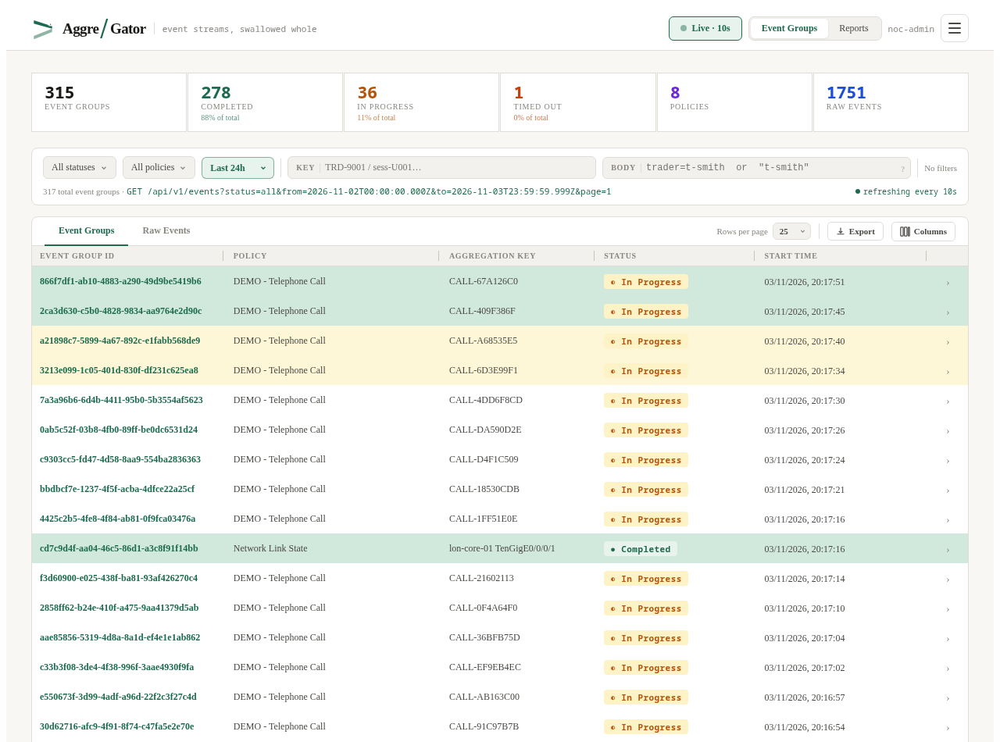

*Demo Telecom's event groups during a live run, refreshing every 10 seconds. Green rows are groups that opened or closed since the last refresh; yellow rows have just received another event. Phone calls arrive over HTTP; the Network Link State and UPS Power Event groups come from SNMP traps.*

---

## At a glance

| | |
|---|---|
| **Policies** | One per lifecycle: aggregation key (a field path in the event body, nested paths included), the opening and closing conditions, an optional timeout; a dry run that shows what an event would do |
| **Ingest** | One HTTP endpoint for everything; an SNMP v2c trap receiver with its own MIB, routing rules for standard traps, and a trap log |
| **Event groups** | Live list with filters, key and body search, every group's raw events as a list or a timeline, CSV and JSON export |
| **Timeouts and notifications** | Groups that never close are timed out by policy; HMAC-signed webhooks on completion and timeout, retried and logged; email alerts on timeout |
| **Reports** | Throughput over time, per-policy health and completion rates, slowest groups, the oldest open groups, duration distribution |
| **Tenancy and access** | Organisations with their own ingest keys, SNMP communities, users and policies, enforced by PostgreSQL row-level security; viewer, editor, admin and superadmin roles |
| **Administration** | System health and logs, a full audit log, policy import and export, database backups, data retention, database maintenance |
| **API** | Everything the UI does is a REST call; an OpenAPI spec with Swagger UI |

---

## Policies: describing a lifecycle

A policy says how to recognise one process in a stream of events. It names the **key field** that ties events together (`paymentId`, `callId`, or a nested path such as `fix.clOrdId`), the **cradle** condition that opens a group (`eventType` = `payment.requested`), the **grave** condition that closes it (`eventType` = `payment.captured`, or `fix.ordStatus` = `FILLED`), and optionally a **timeout** after which an open group is given up on. Any event with the same key that arrives in between is added to the group in order.

The demo here has eight policies per organisation. Five global examples are shared by every organisation (trade, order, user session, API request/response, telephone call). Each organisation adds its own: Demo Markets has *Payment Authorisation* (2-minute timeout), *FIX Order* and *Nightly Batch Run*; Demo Telecom has *Network Link State*, *UPS Power Event* and *Fibre Fault Ticket*.

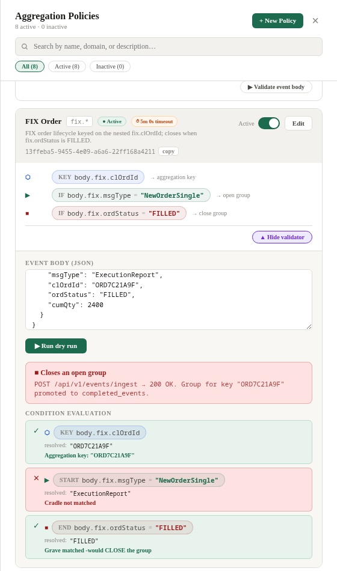

*A dry run in the policy editor. Paste an event and it shows, condition by condition, which key it resolves to and whether it would open a group, close one, or be added to one, without sending anything.*

Policies can be switched off without deleting them, exported as a JSON bundle and imported into another instance. Changing a policy's timeout applies it at once to groups already open.

---

## Getting events in

### Over HTTP

Every producer uses the same endpoint, `POST /api/v1/events/ingest`, with the policy ID and the event body. The organisation's ingest key goes in an `X-API-Key` header, so each organisation's events stay its own. Aggre/Gator works out the key from the body, decides whether the event opens, extends or closes a group, and answers with what it did (`group_opened`, `raw_event_appended` or `group_promoted`). It drops a repeated event rather than counting it twice, and rejects a closing event that has no open group to close.

During the demo run, HTTP producers for payments, FIX orders, API calls and a batch job (Demo Markets) and phone calls (Demo Telecom) sent 8,235 events in 30 minutes without an error.

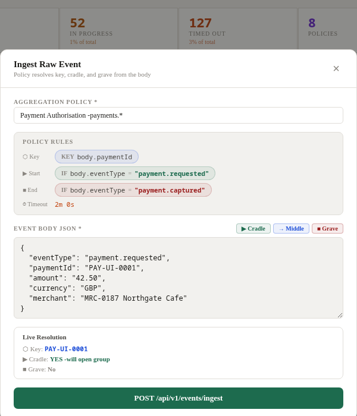

*Events can also be sent by hand from the UI. The form shows the chosen policy's rules and resolves the key and conditions as you type.*

### As SNMP traps

Network equipment speaks SNMP, so Aggre/Gator has a trap receiver (SNMP v2c, UDP port 1162) with a hand-written BER/ASN.1 parser. A trap reaches a policy in one of two ways:

- **The AggreGator MIB.** Aggre/Gator ships its own MIB (enterprise OID 1.3.6.1.4.1.99999) with fields for the policy ID, aggregation key, event type, a JSON body and a severity. Any system that can send a trap can feed any policy this way. In the demo, a fibre line monitor raises and clears fault tickets like this.
- **Routing rules for standard traps.** Ordinary traps (MIB-II `linkDown`/`linkUp`, UPS-MIB `upsTrapOnBattery`/`upsTrapBatteryNormal`, and so on) are routed by rules that match on community string, sending device and trap OID, and name the policy and the varbind to key on. A linkDown opens a *Network Link State* group for that interface, and the linkUp closes it.

The community string tells Aggre/Gator which organisation a trap belongs to, even from a device it has never seen. Every trap is logged with how it was routed, or that it wasn't. Of the 97 traps in this run, 87 were routed by community rule, 2 by source rule, 5 came in through the AggreGator MIB, and 3 went unrouted: two router cold starts on the `public` community and one test trap.

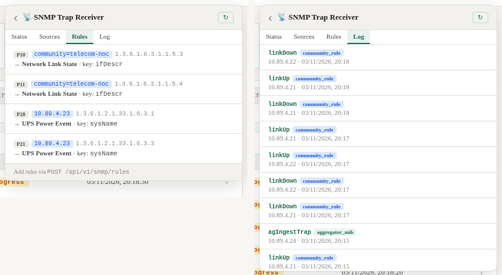

*Demo Telecom's routing rules (two by community and trap OID, two by the UPS's own address) and its trap log. Four simulated devices, each a container with its own address, sent the traps: two routers flapping interfaces, a UPS at the Edinburgh exchange losing mains, and the fibre monitor.*

---

## Following a group

Open any group to see its whole life: the key and where it came from, when it started and ended, how long it took, the policy conditions that applied, and every raw event in order, each with its full body. A timeline view lays the events out to scale between the first and the last. A group can be exported as JSON or CSV.

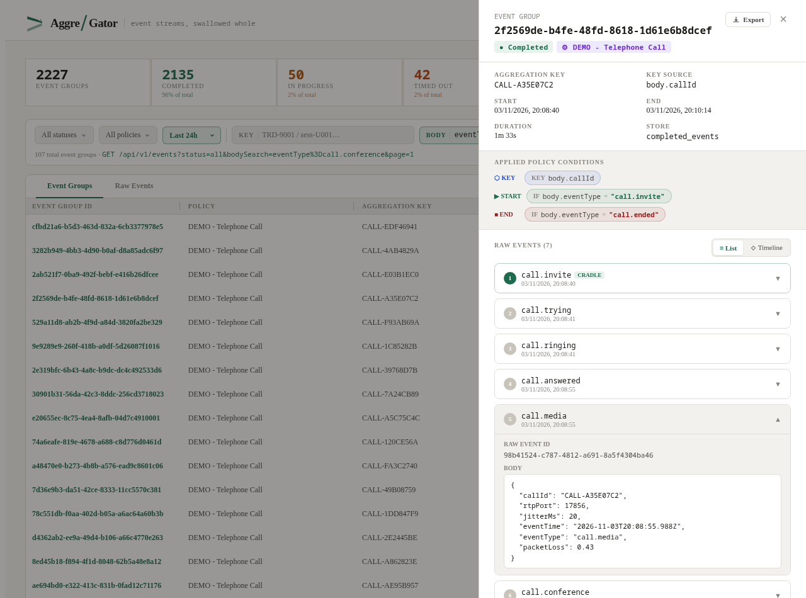

The list itself filters by status, policy, time range and key, and **body search** looks inside the events: `eventType=call.conference` finds the 107 calls in the last 30 days that became a conference, and a plain word (`Northgate`) searches whole bodies. Turn on auto-refresh and the list updates every 10 seconds, highlighting what changed.

---

## When the last event never comes

A group with a timeout that hasn't closed in time is closed by a background sweep every minute, marked **timed out**, and kept with the events it did get. That is often the most useful thing Aggre/Gator tells you: the payments that were authorised but never captured, the interface that went down and stayed down, the batch job that started and never finished. In the 30 days of demo history, 164 groups timed out this way, among them one night's `risk-var` job, which hung.

**Webhooks** tell other systems when a group completes or times out. Each organisation registers its own endpoints and chooses which of the two events each one gets. Every delivery is a JSON POST signed with HMAC-SHA256 (`X-AggreGator-Signature`), so the receiver can check where it came from. A failed delivery is retried twice, after 5 and 30 seconds, and every attempt is logged with the response.

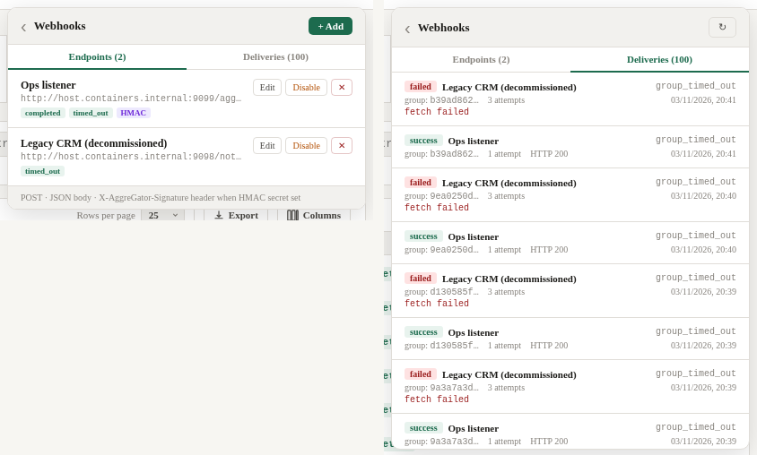

*Demo Markets' two endpoints and its delivery log. Each timed-out payment went to both: the Ops listener took it first time, while the decommissioned CRM endpoint refuses connections, so its deliveries failed after three attempts. Over the run the listener received 2,371 deliveries and found a valid signature on every one.*

Timeouts can also be **emailed** to administrators through any SMTP server, configured and tested from the Settings page.

---

## Reports

The Reports view summarises a time range: groups opened and closed over time, raw events over time, groups and events per policy, an activity heatmap, and per-policy figures.

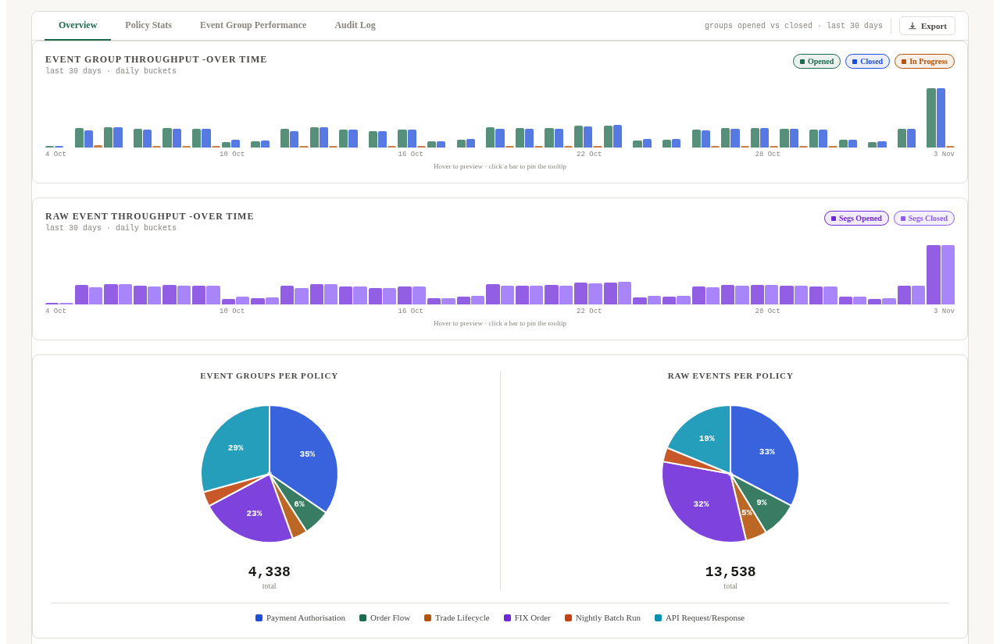

*Thirty days of Demo Markets. The tall bars on the right are the live run, which was busier than a normal day.*

**Policy Stats** gives each policy a health rating, its completion and timeout rates, average duration and event counts, so a lifecycle that has started to go wrong stands out.

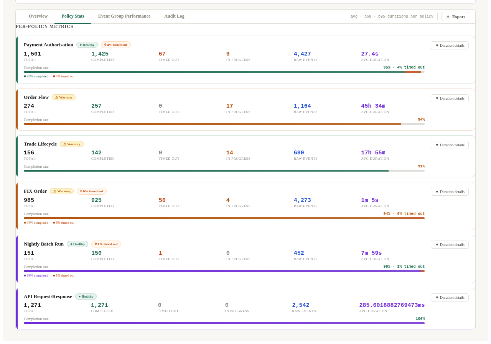

**Event Group Performance** lists the slowest completed groups, the oldest groups still open, and how durations are distributed. Here the slowest are parcel orders that took three days to deliver, and the oldest open groups are orders and trades that never reached their last step.

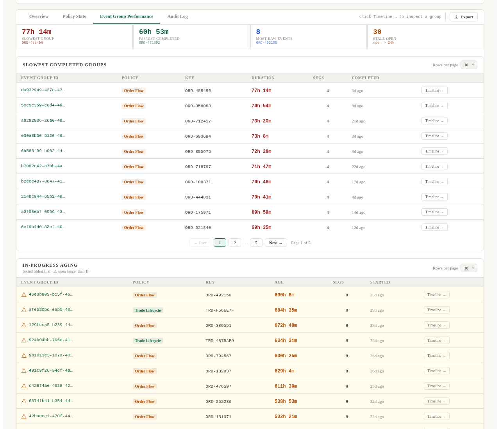

Every report can be exported as CSV or JSON.

---

## Organisations, users and roles

One instance can serve several organisations. Each has its own ingest key, SNMP community string, users, policies, webhooks and data, and no organisation can see another's. The separation is enforced in the application and, for policies, users and the audit log, by PostgreSQL row-level security as well, so a missed filter in the code can't leak another organisation's rows. A superadmin creates organisations, rotates their keys and manages their users; global policies are shared by all of them.

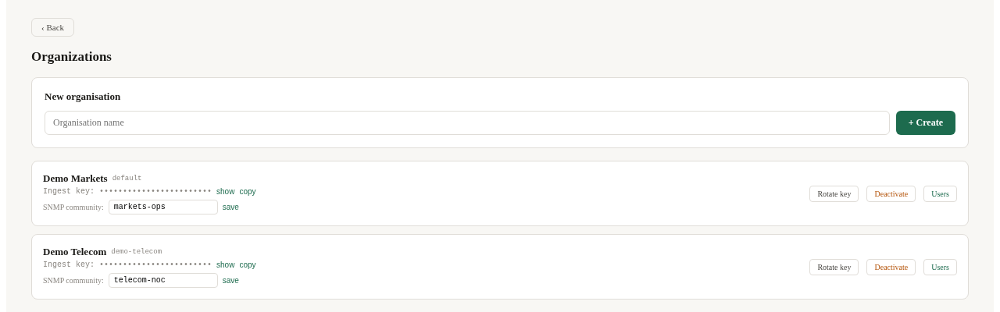

Inside an organisation, **viewers** can read events and reports, **editors** can also send events and manage policies, webhooks and SNMP settings, and **admins** can manage accounts and the administration pages. Sign-in uses a session cookie, a first sign-in forces a password change, and failed logins are rate-limited.

---

## Administration

**System Health** shows CPU, memory, disk and uptime, database size, open and recently closed groups, table sizes, and the backend, nginx and PostgreSQL logs, with log rotation.

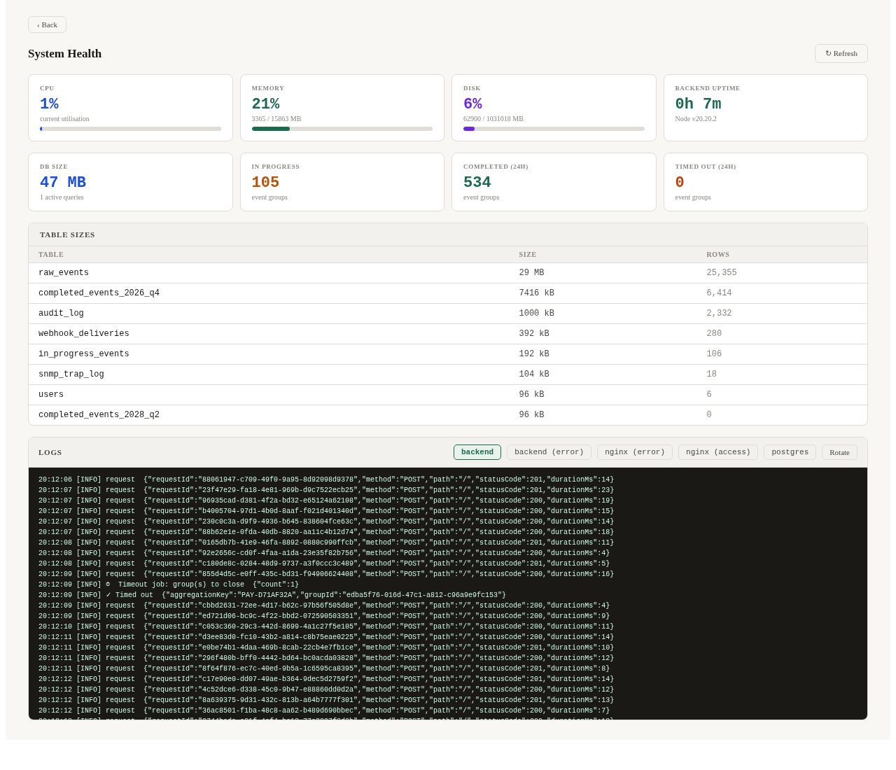

The **Audit Log** records every sign-in, every policy change and every ingested event, with who did it and from where, and can be filtered by action and actor.

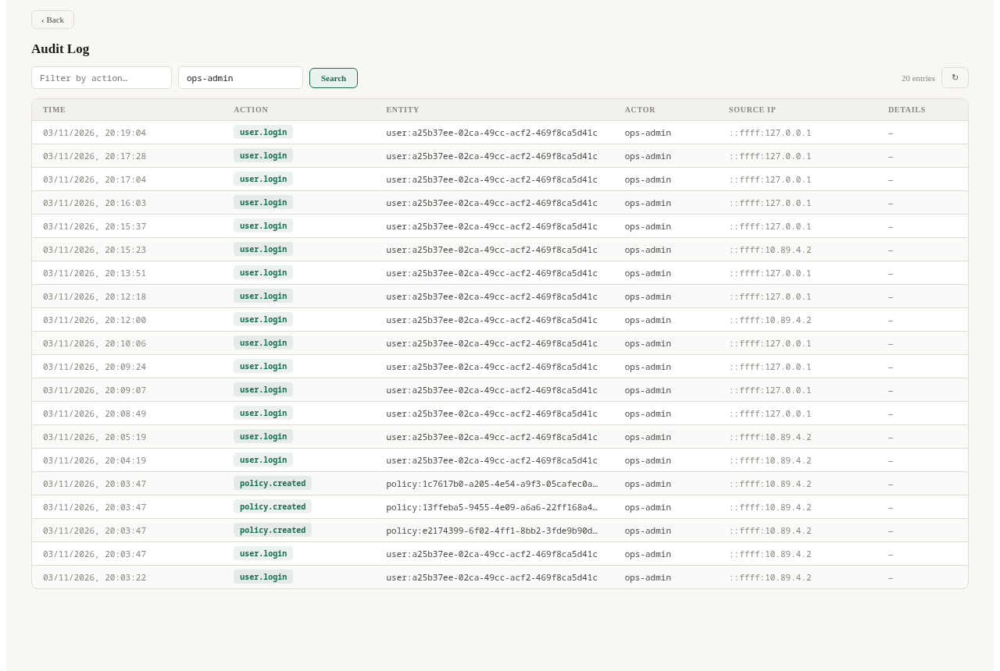

The rest:

- **Import/Export** downloads all of an organisation's policies as a JSON bundle and uploads one, updating policies by name.
- **Data Retention** purges an organisation's completed groups and audit entries older than a given number of days.
- **Backup** (superadmin) downloads a full `pg_dump` of the database. The demo database's backup was 13 MB, covering 22 tables.
- **Database maintenance** (superadmin) shows table statistics and runs `VACUUM ANALYZE`.

---

## The API

The UI is a client of the REST API, so anything it does can be scripted: ingest, event queries and stats, policies, webhooks, SNMP sources and rules, users, organisations and the administration functions. An OpenAPI 3 spec is served with Swagger UI at `/api/v1/docs`. Stats and performance queries are cached briefly and say so in an `X-Cache` header.

---

## How it runs

One container holds PostgreSQL 16, the Node.js/Express backend and nginx serving the React frontend, managed by supervisord, and starts with Podman or Docker Compose. Completed groups are stored in quarterly partitions that a background job creates ahead of time. The base image can be Ubuntu, Debian, Fedora, Rocky, Alma or Amazon Linux.

---

## Status

A working prototype. The backend has 59 automated tests (Vitest, against a real PostgreSQL) covering the ingest engine, tenancy isolation, row-level security, SNMP routing, partitioning, authentication and backup, and CI runs lint, type checks, builds, the tests, dependency audits and a container build with a health-check smoke test.

The screenshots come from a run on 3 November 2026: about 6,000 backdated groups over 30 days for two organisations, then 30 minutes of live HTTP traffic and SNMP traps from four simulated devices.
