# Alfoir

> *A personal home-lab project, built to learn and experiment. Not for release or distribution.*

**A platform for running checks and scripts on a schedule, against anything you can reach, and keeping the results.** You write a check once, or take one from a catalog of about 150, and Alfoir runs it against your servers, websites, APIs and phone systems, from the server itself or from agents on other machines. It keeps every result, trends what the checks measure, and tells you when something breaks or starts to drift.

It's for the people who look after a mixed estate and have ended up with health checks spread across cron jobs, shell scripts and three different monitoring tools. Alfoir puts the scripts, the schedules, the results and the alerts in one place, and keeps the evidence for each run: the output, the measurements, a screenshot, a recording.

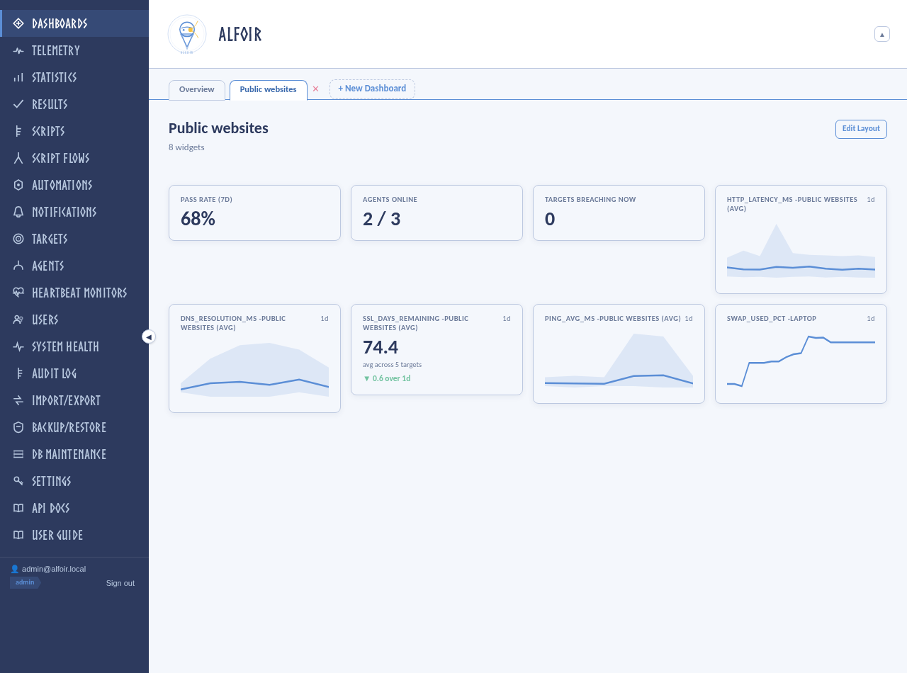

*A dashboard built for this overview, watching Google, GitHub, Wikipedia, the BBC and Cloudflare from a PC and a laptop: pass rate, agents online, response time, DNS lookup time, certificate days left and ping, plus the laptop's own swap usage creeping up through the evening.*

---

## At a glance

| | |
|---|---|
| **Scripts in seven languages** | Python, Bash, JavaScript, TypeScript, Playwright, PowerShell and Go, with typed variables, version history and a code editor |
| **A catalog of ready-made checks** | About 150 scripts and 25 flows: websites and certificates, Linux and Windows hosts, databases, containers, cloud, CI, mail, DNS, telephony |
| **Schedules, flows and agents** | Cron schedules in any time zone, webhooks and SNMP traps; flows that branch on failure; agents that run checks on other machines |
| **Results with evidence** | Every run's output, structured results, screenshots and attachments, streamed live while it runs |
| **Telemetry and alerts** | What checks measure, trended per target with anomaly detection; alert rules, heartbeats and a public status page |
| **AI where it helps** | Explains failures, drafts scripts, suggests checks, summarises telemetry, with Claude or a model you run yourself |

It runs as one container, and the agents are a single Python script.

---

## Write a check once

A check is an ordinary script: Python, Bash, JavaScript, TypeScript, Go, PowerShell, or a Playwright browser test. Alfoir stores it, versions every save, and runs it with the variables you declare, typed (text, number, true/false, a list to choose from, a password that never appears in logs) and passed both as command-line arguments and as environment variables. Pass or fail is the exit code. A script that prints `ALFOIR_RESULT: {...}` hands back structured data, and one that prints `ALFOIR_ATTR: {...}` reports measurements for Telemetry.

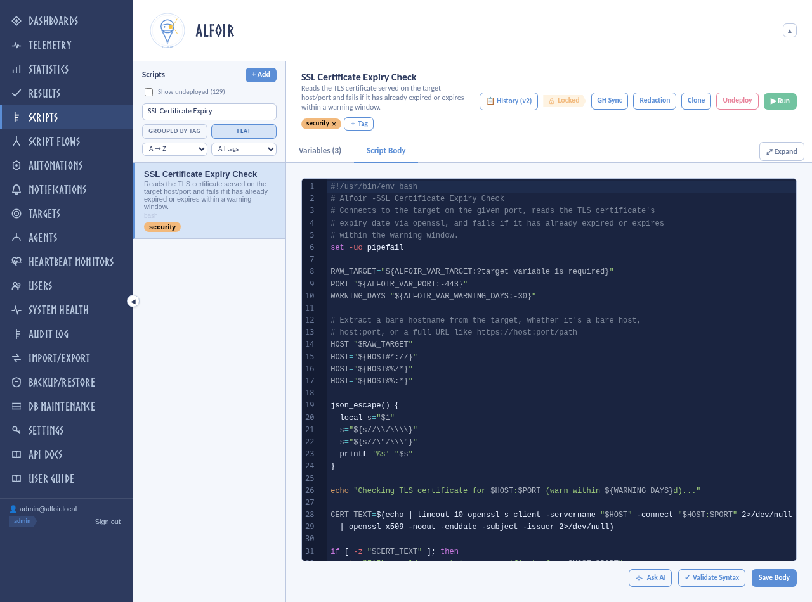

*One of the catalog checks in the editor: syntax highlighting, syntax validation before saving, and Ask AI to draft or change the body from a sentence.*

Scripts can be tagged, cloned, pinned to a version per automation, synced to a GitHub repository, and set to mask card numbers and other sensitive values in their output before it's stored.

---

## A catalog of ready-made checks

Most checks people need have been written before. The built-in catalog holds about 150 scripts and 25 flows, deployed with one click: HTTP, DNS, TLS and port checks; disk, memory, load, services and security baselines on Linux and Windows hosts; PostgreSQL, MySQL, SQL Server and MongoDB; Docker, Podman, Kubernetes and Proxmox; Kafka, Prometheus, Elasticsearch; Vault, Consul and Nomad; Azure, AWS, GCP, DigitalOcean and Hetzner monitoring; Jenkins, Terraform Cloud and Ansible AWX; mail and DNS servers; and phone-system tests through CallRaven. Almost all of it only looks; the few scripts that change things on purpose (clean-ups, backups, certificate renewal) are tagged as such and come with dry-run defaults and safety limits.

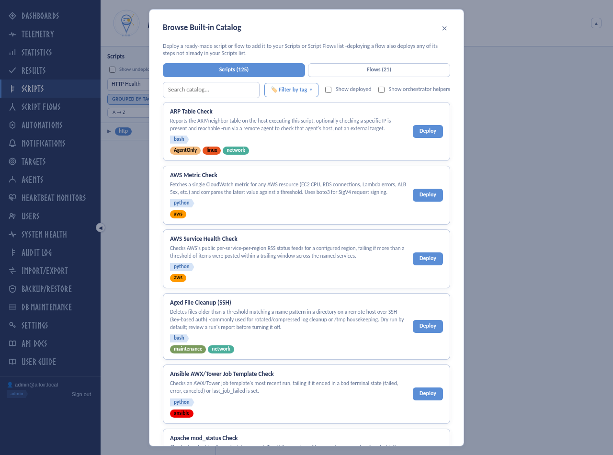

Catalog checks are tested against real systems when they're added, and running this overview's demo against public sites still found three that needed fixing: the TLS chain check failed every site under OpenSSL 3 and didn't check the host name, and the Python HTTP checks were refused by sites that block Python's default User-Agent. All three are fixed, and the website checks now report their measurements to Telemetry.

---

## Chain checks into flows

A flow runs scripts one after another against the same target, and each step says what happens when it fails: stop, carry on, end the flow as a pass, or jump to another step. A step can use an earlier step's result in its own variables (`{{steps.Login.token}}`), so a flow can log in, call an API with the token, and check what came back.

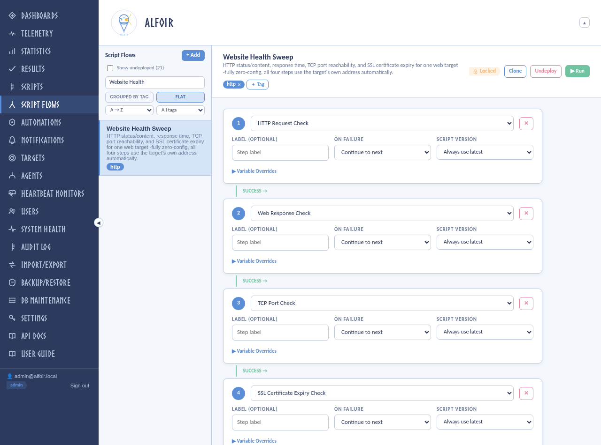

*The Website Health Sweep from the catalog: status and content, response time, TCP reachability, the certificate, and a keyword on the page, five checks per site, each carrying on if one fails.*

---

## Know what you're checking

Targets are what the checks run against: a server, a website, an API, a device, a phone extension. They sit in groups, and an automation can run against a whole group at once; switching a group off skips all of its targets, and a target being worked on can be put in a maintenance window so it's skipped without alerting. Targets can be added by hand, imported from JSON, or kept in step with an external API by a **target source** on a schedule.

**Discovery** goes further: a source can run a script on an agent that looks at the host itself and reports what it finds. Nothing becomes a target automatically. Findings wait in a review queue to be added or dismissed, and a dismissed one stays dismissed. With AI turned on, **Suggested Checks** picks the catalog checks worth deploying for each finding, each with a Deploy button, or one that adds the target and opens a new automation with both filled in.

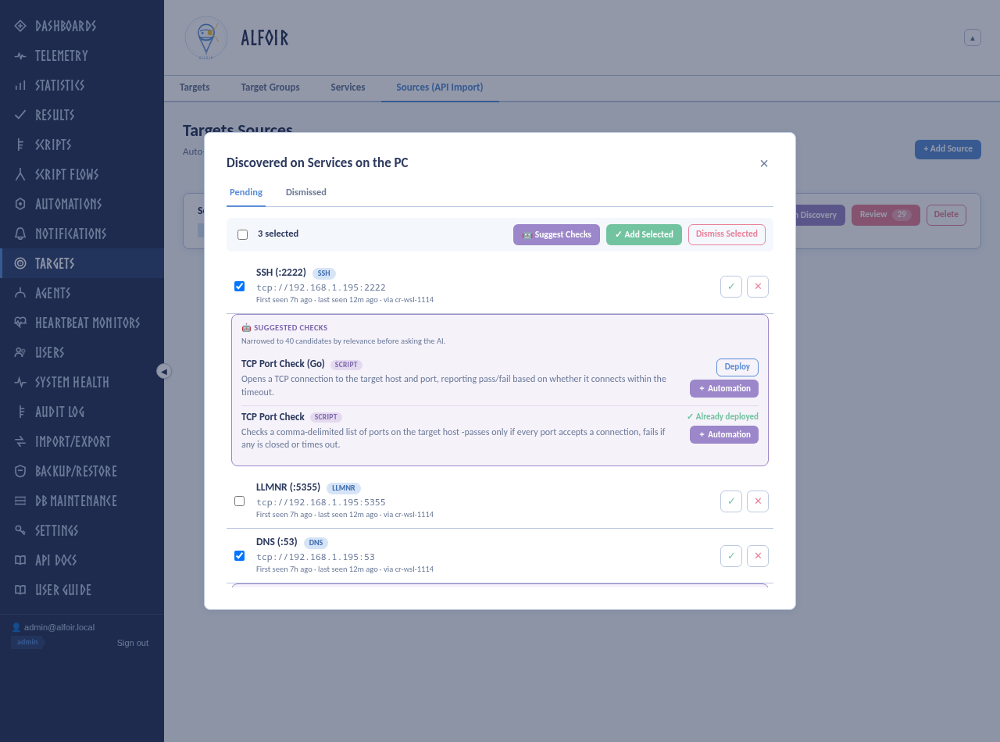

*The catalog's Listening Services Discovery, run by the agent on the PC, found 29 services listening there: SSH, DNS, Alfoir itself, CallRaven, Whisper, Ollama and more, each probed for HTTPS or HTTP so its address is ready to check. For SSH the local model suggested the TCP port checks; for Alfoir's web port, the HTTP and full page checks, already deployed.*

**Services** group targets into something people recognise ("the booking system") and roll them up into one status, as the worst of their members or "up while at least N are up". They drive the status page below.

---

## Run it when it should run

An automation joins a script or flow to a target or a whole group of targets and says when to run it: by hand, on a cron schedule, from an inbound webhook (a CI pipeline, another system), or when an SNMP trap arrives. Targets in a group run in parallel up to a limit you set, and a run can have a time limit of its own.

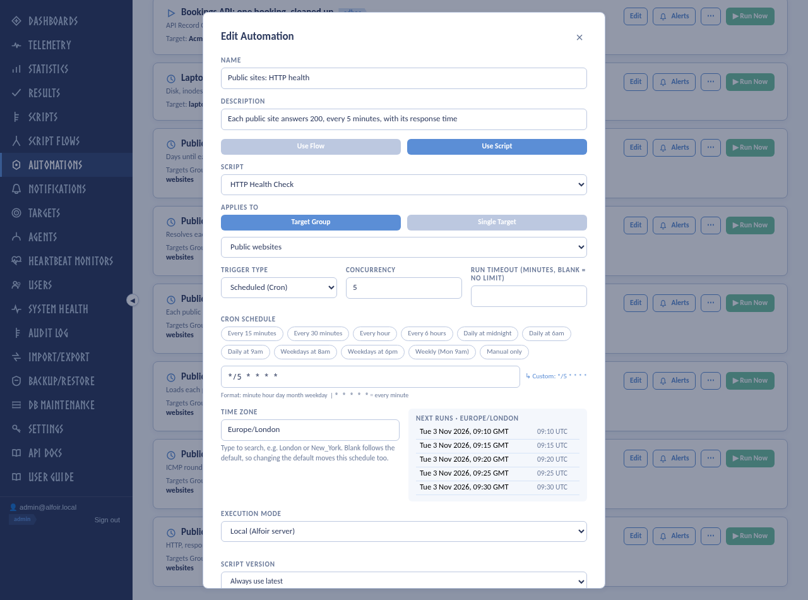

*Every five minutes, in Europe/London. Schedules run in their own time zone, so "weekdays at 8am" stays 8am local across the clock changes, and the next runs are shown before you save.*

---

## Run checks from where they matter

Some checks have to run somewhere else: inside another network, on the host being checked, from a second vantage point. An agent is one Python script that connects out to Alfoir over a TLS WebSocket (pinned to the server's certificate), takes jobs, runs them and streams the output back. Automations can send work to one agent, to any agent with the right tags, to a group, or to every agent in a group at once; agents can run checks with sudo, hold on to their jobs through a short drop in the connection, and be updated from the UI.

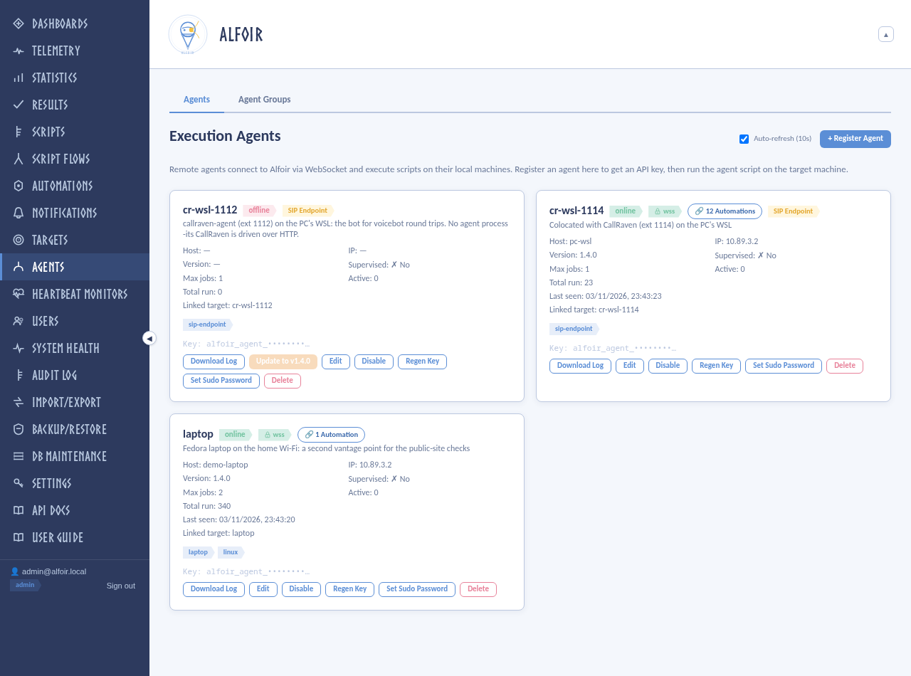

*The PC that hosts Alfoir and a laptop on the same Wi-Fi. The laptop runs the DNS and ping checks, so they are measured from a second machine, and a host health sweep on itself: 340 jobs since the morning.*

The same check run from several places tells you whether a problem is the service or the route to it. Each agent's measurements are kept apart, so a chart can show one line per agent:

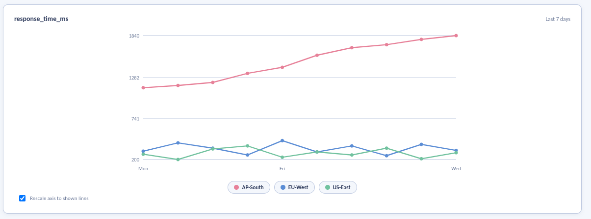

*On a demo instance, one response-time check run by agents in three regions for a week: from AP-South it climbed steadily to 1,840 ms, while EU-West and US-East stayed around 300 ms (312 and 288 ms at the end).*

Some checks need two agents at once. The catalog's **Network Path** orchestrator starts an iperf3 server on one agent and a client on another, then measures the path between them: round-trip time and loss, jitter, UDP loss and bandwidth. The same pattern sets up a three-node Docker Swarm across agents.

---

## Results you can check

Every run keeps what happened, target by target and step by step: the output, the exit code, the structured result, timings, and any screenshot or file the script attached. Runs stream live in the browser while they happen. Results can be filtered, searched and exported, and a failed step can be explained by AI or handed to Ask AI to fix.

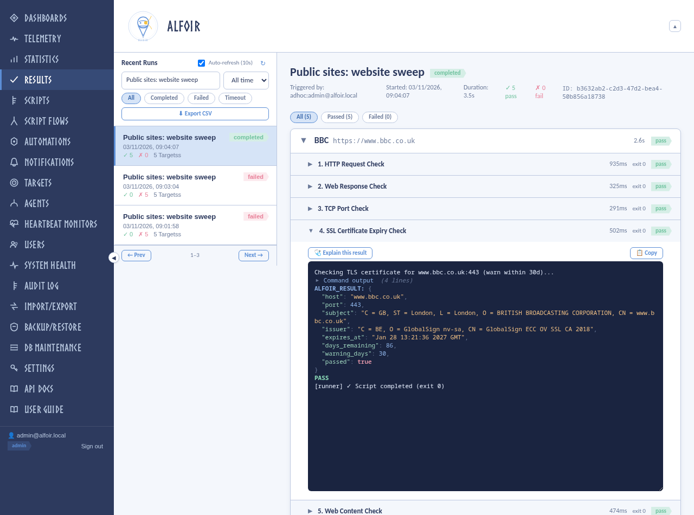

*The sweep against the BBC: all five steps passed, and the certificate step shows what it found: issued by GlobalSign to the BBC, 86 days left.*

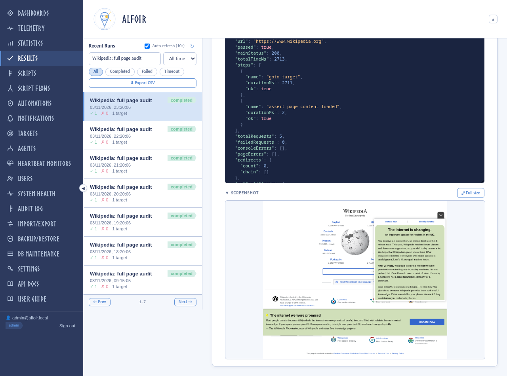

*The full page audit loads a page in headless Chromium and records its timings, requests, console errors, redirects and certificate, with a screenshot. It's how the demo found that Cloudflare's own home page logs a console error on every load ("Refused to get unsafe header X-OneTrust-IsBot"), which fails the Playwright page check for that site every time while the other four pass.*

Whatever a script saves goes with its run and is shown in the way that suits it: images inline, recordings with a player, transcripts as text, HTML reports, PDFs, JUnit and packet captures to open or download.

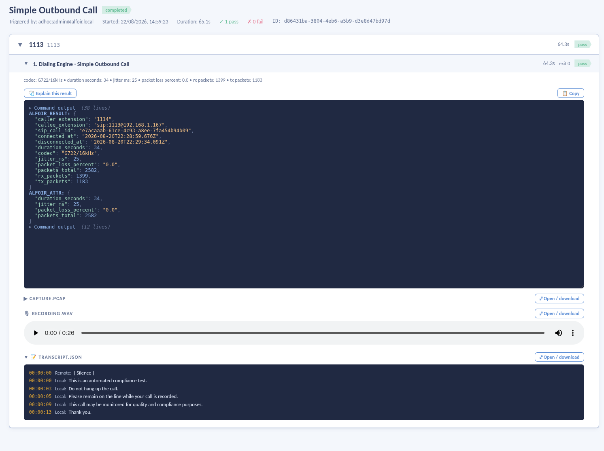

*A test call from a demo instance: the call's measurements as a structured result (G.722, 34 seconds, 25 ms jitter, no loss), and the three files the script saved, each shown in place: the packet capture to download, the recording to play, and the transcript, timed and split by speaker.*

---

## See trends, not just ticks

Whatever a check measures, it can report to Telemetry: response times, days left on a certificate, disk free, queue lag, call quality. Alfoir keeps the history per target, shows the latest values, charts each one over time, flags values that cross a threshold, and lists every target with a failing check across the fleet. The AI can summarise a target's telemetry in a few lines.

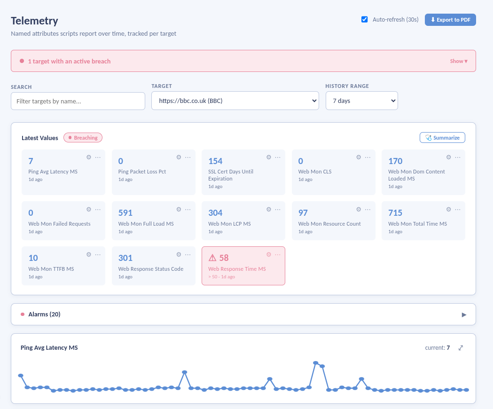

*The BBC website on a demo instance with a week of history: ping, certificate days left, Core Web Vitals from the full page audit (largest contentful paint 304 ms), and Web Response Time over its threshold (58 ms against 50), shown in red.*

**Dashboards** are built from widgets: fleet figures (pass rate, agents online, targets breaching now) and any measurement, for one target, a group or the whole fleet, as a chart or a single value. The one at the top of this page took eight widgets. Telemetry exports to PDF, and Results and Statistics to CSV.

**Statistics** looks across all of it: pass rates by automation and target, trends by week, how often thresholds were breached, and anomaly detection that flags a day that departs from the rolling average.

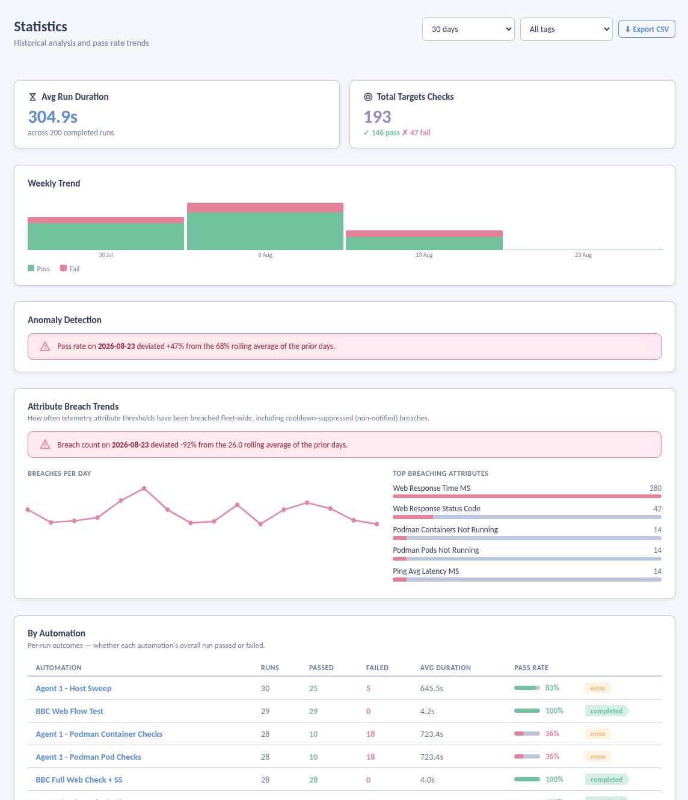

*Four weeks on a demo instance: pass and fail by week, an anomalous day flagged, threshold breaches per day (Web Response Time the most often, 280 times), and each automation's pass rate.*

---

## Find out when it matters

Alert rules decide when to tell someone: a run fails, times out or errors; it fails N times in a row; a measurement crosses a threshold; a heartbeat is missed; an agent goes offline. Each rule has a cooldown, can be scoped to one automation or target or apply everywhere, and notifies by email, webhook, Slack, Teams, Pushover, PagerDuty or Zendesk. A target in a maintenance window is skipped rather than reported as failing, and an automation set to silent still runs but doesn't alert.

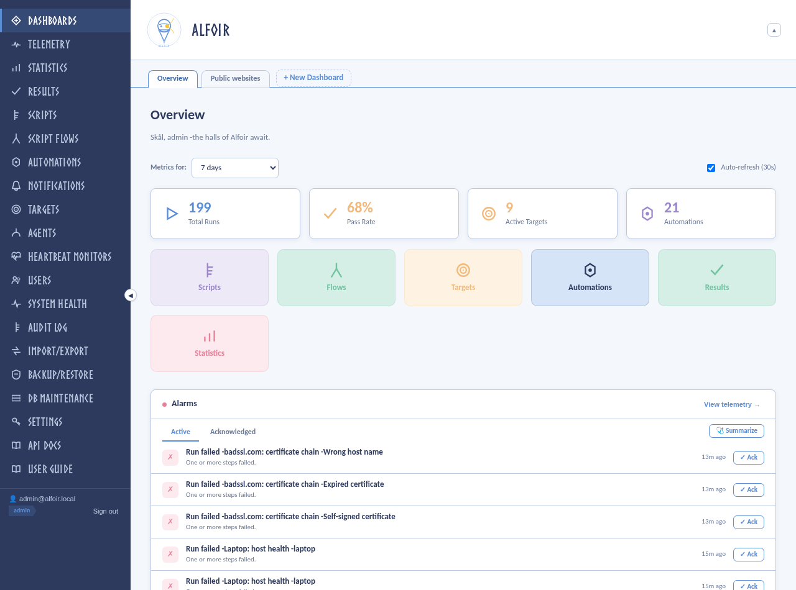

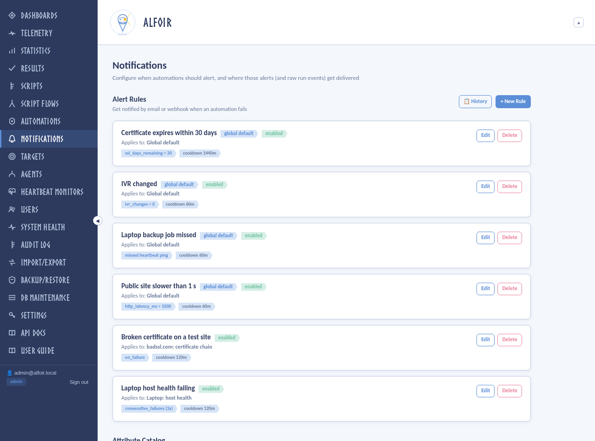

*The demo's rules: certificates under 30 days, any public site slower than 1 s (it fired once, when Cloudflare took 1,122 ms), the laptop's host checks failing three times in a row, the badssl.com checks failing, and the backup job's heartbeat being missed.*

An alert can also **fix the problem**. A threshold rule on one target can start a remediation automation when it trips: clear a full spool, restart a stuck service, rotate a log. The fix runs every time the condition is met, independent of the notification cooldown, so a recently sent alert never holds a fix back. Only automations marked as remediation-eligible, on the rule's own target, can be used.

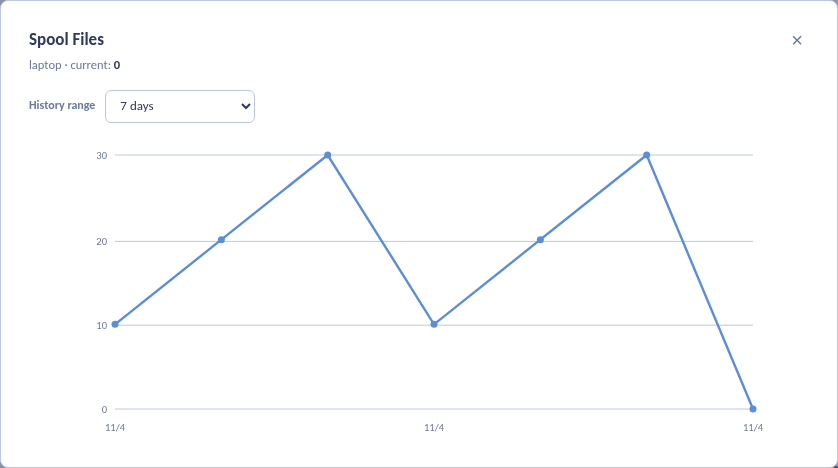

*A stand-in job on the laptop drops two files a minute into a spool, and a check counts them every five minutes. Each time the count went over 20 (30 files, at 07:05 and again at 07:33, after the laptop briefly slept), the rule started the clean-up by itself and the spool emptied. No one touched it.*

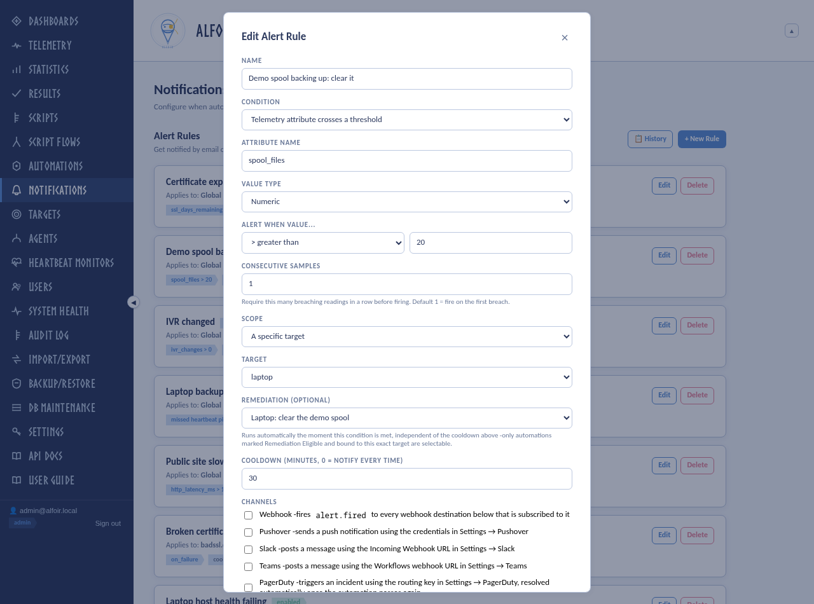

**Heartbeat monitors** work the other way round, for jobs Alfoir doesn't run itself: a backup script or a cron job pings a URL when it finishes, and Alfoir raises an alarm when the ping doesn't come.

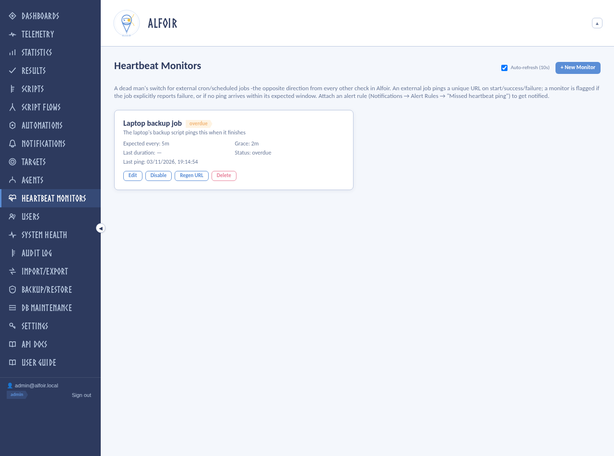

*A stand-in backup job on the laptop pinged every 4 minutes for an hour and then stopped; five minutes plus the grace period later the monitor went overdue and its alert fired.*

---

## Tell everyone else

The optional public **status page** shows the state of services, each a group of targets rolled up as the worst of its members or "up while at least N are up", and of chosen automations, with uptime. It's off until an admin turns it on, and shows nothing but names, states and percentages.

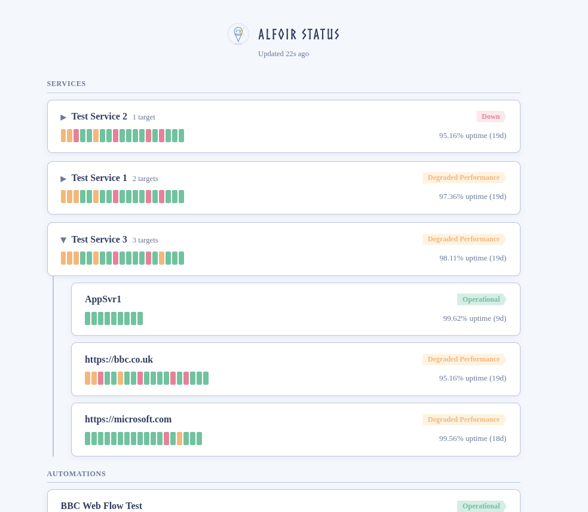

*From a demo instance with three weeks of history: three services over 19 days, one down and two degraded. Expanding a service shows each member's own record; the BBC site's dips are what hold its service at 98.11%.*

---

## AI, on your terms

AI is optional, and works with Claude or a model you run yourself (Ollama and the like), so results never have to leave your network. It explains a failed step from its output and telemetry, explains a passing one, looks across an automation's recent failures for a pattern, drafts or edits scripts, suggests checks for a host from what it runs, summarises telemetry and logs, writes incident summaries for alerts, and answers questions about Alfoir from its own guide. Answers are short: a verdict and a few bullets.

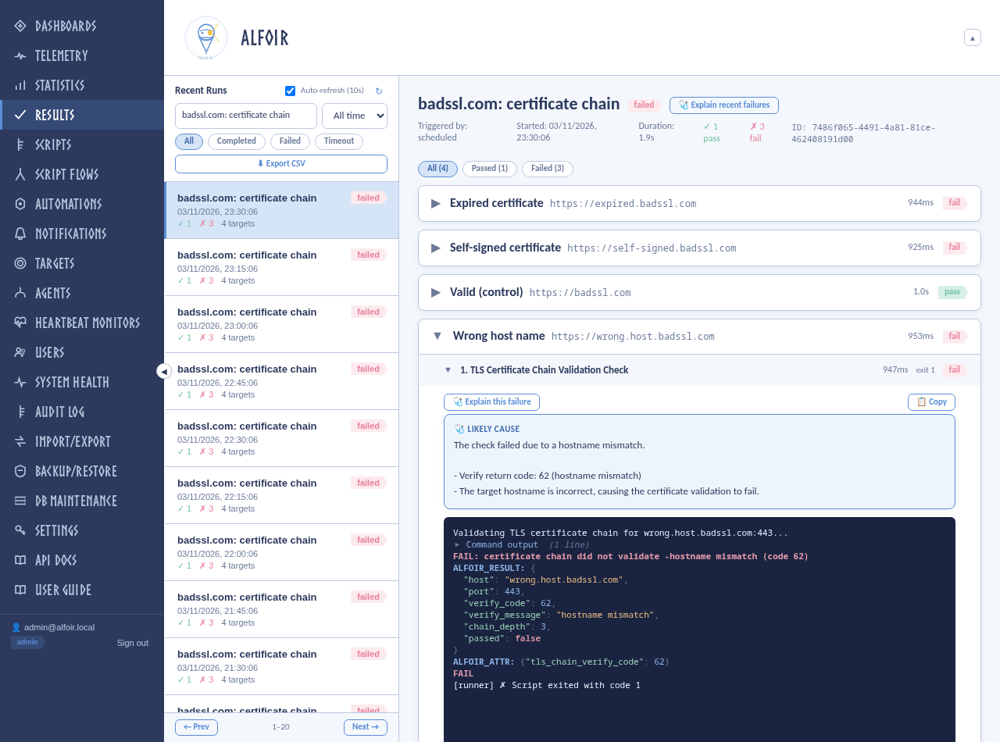

*qwen2.5:7b on the same PC's GPU, explaining why the check failed for wrong.host.badssl.com: the certificate is valid but for a different name (verify code 62). Earlier, on a run that timed out, it blamed the network, so the output it explains always sits right below.*

---

## Phone systems too

With [CallRaven](../callraven/README.md), a containerised SIP test phone, Alfoir tests phone systems on a schedule like anything else: test plans that call a number, press keys and check what's said; IVR maps that catch a changed menu; voicebot conversations scored over repeated calls; and checks of what the bot actually did in the backend afterwards. The call quality, the transcript, the recording and the reports come back as the run's evidence.

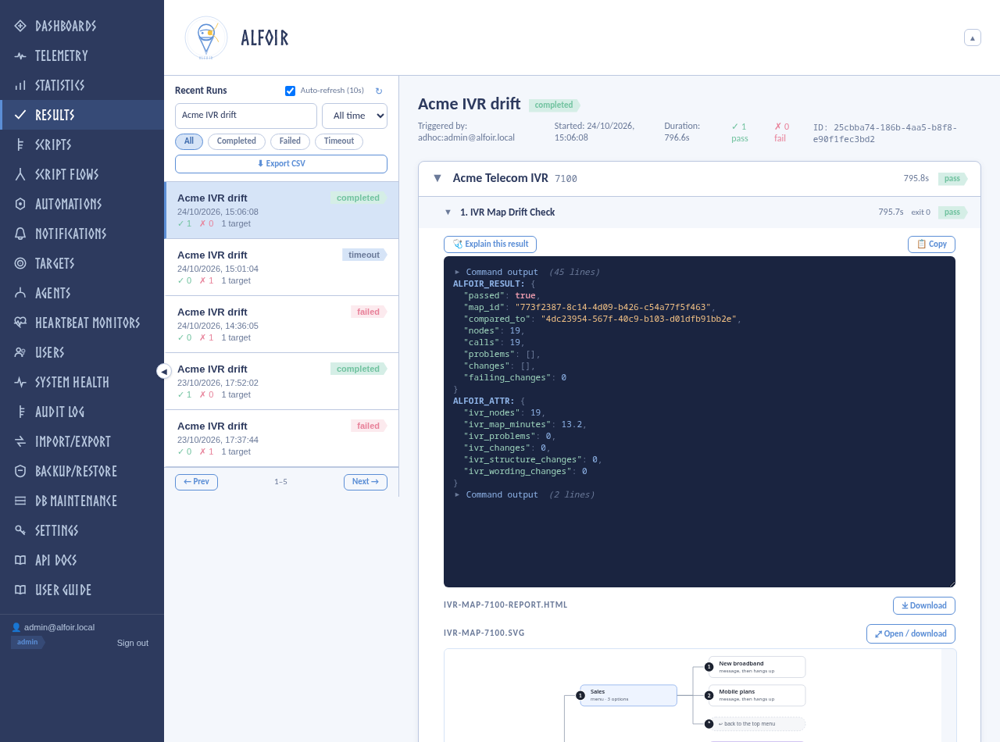

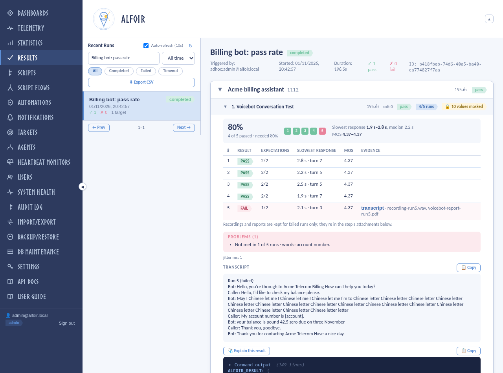

*Five identical calls to a voicebot: four passed. In the fifth, speech recognition turned the bot's reply into a loop of nonsense and the expected words never appeared. The card and account numbers in the transcript are masked by Alfoir's output redaction.*

---

## Run it like a product

- **Users and roles:** viewer, editor and admin; user groups that limit which targets their members see; email two-factor codes; single sign-on with Microsoft Entra ID; LDAP and Active Directory.
- **Secure by default:** HTTPS from the first start (self-signed until you add a certificate), credentials encrypted at rest, rate limits on login and other public endpoints, revocable sessions, and an audit log of every change.
- **Housekeeping:** retention for runs, screenshots, attachments and logs; backups and restores, scheduled or by hand; database maintenance (VACUUM and ANALYZE, table sizes, purging old runs); import and export of scripts, flows and automations between instances.
- **Organising:** tags across scripts, flows and automations; maintenance windows for targets being worked on; silent mode for an automation that should run without alerting.
- **Help built in:** the User Guide and Admin Guide are part of the app, with **Ask the Guide** to answer a question from them.
- **Integrations:** GitHub sync for scripts, an OpenAPI-documented REST API with API keys, outbound webhooks signed with HMAC, Prometheus metrics, Zoom and Open CDR.

Everything is set from **Settings**: notification channels, security and sign-in, AI, retention, the default time zone, redaction, the status page and the integrations. Secrets are write-only once saved.

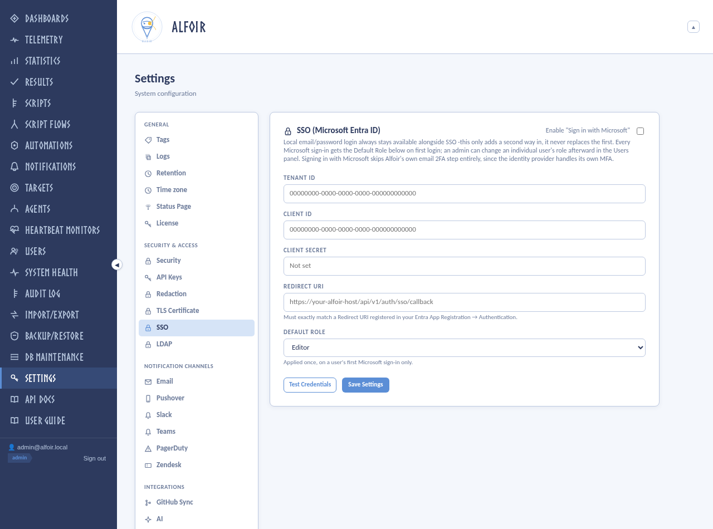

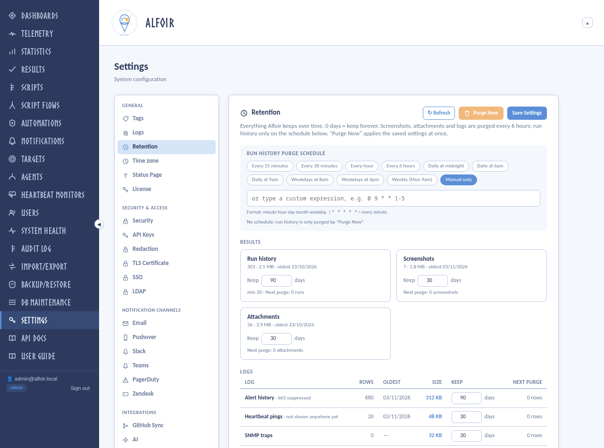

*Retention for everything Alfoir keeps, each with its size, oldest entry and what the next purge would remove.*

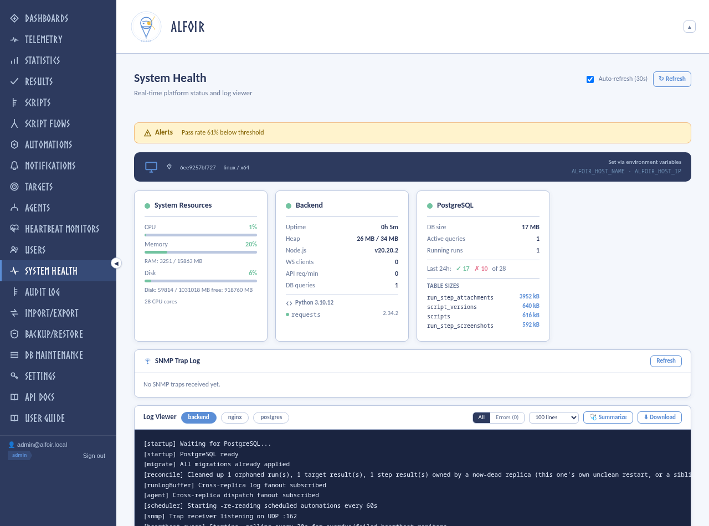

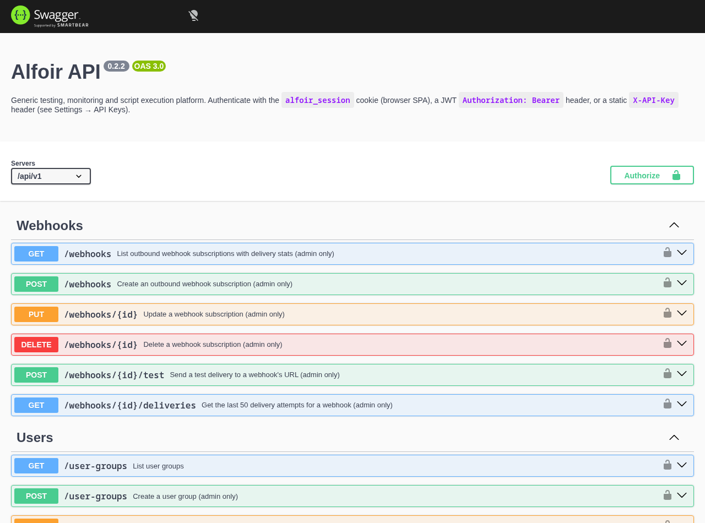

---

## How it runs

One container with PostgreSQL, the Node.js backend and the web UI behind nginx, on port 8081 over HTTPS, started with Docker or Podman Compose. Remote agents are a single Python script with one dependency, on Linux, macOS or Windows.

---

## Status

Alfoir is under active development. A unit-test suite runs with every change, regression tests run catalog checks against real containers, and the catalog's scripts are checked against real systems before they ship. Everything in this overview was captured from one running instance on a home PC, checking public websites, badssl.com's deliberately broken sites and its own host from the PC and a laptop over a day, except where a caption says a demo instance: Telemetry, Statistics, the status page, the per-region chart and the test call's attachments, from one with weeks of history.
