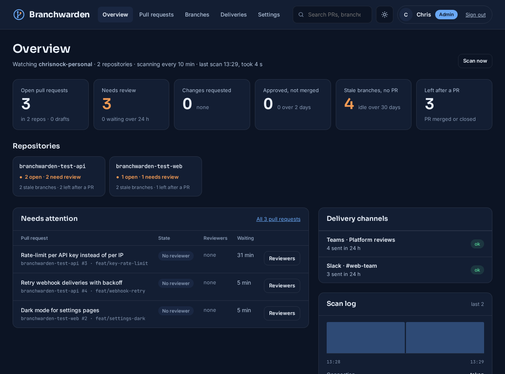
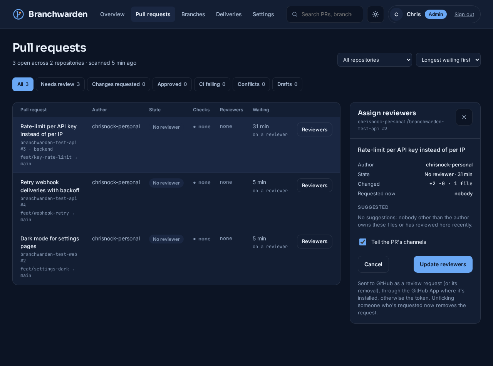
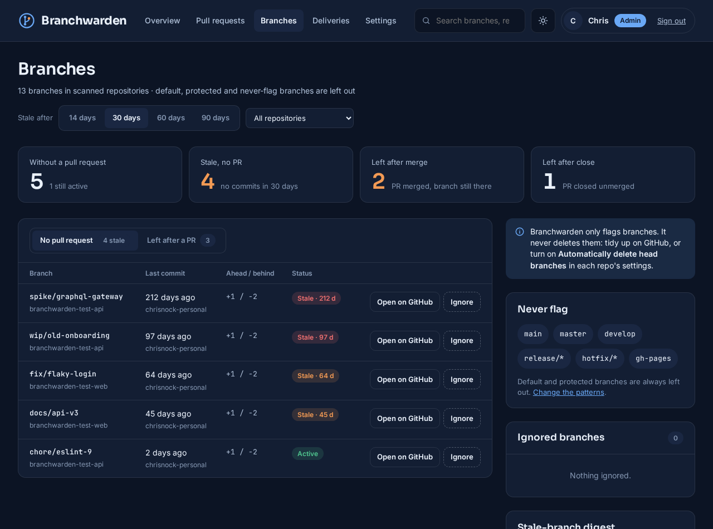
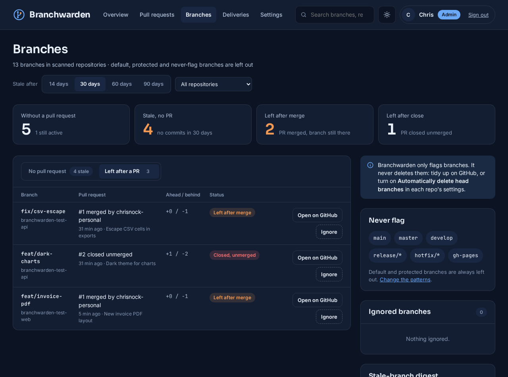
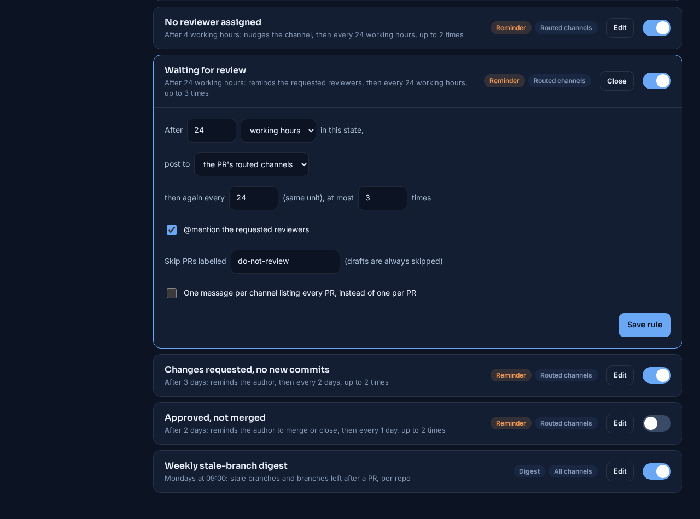
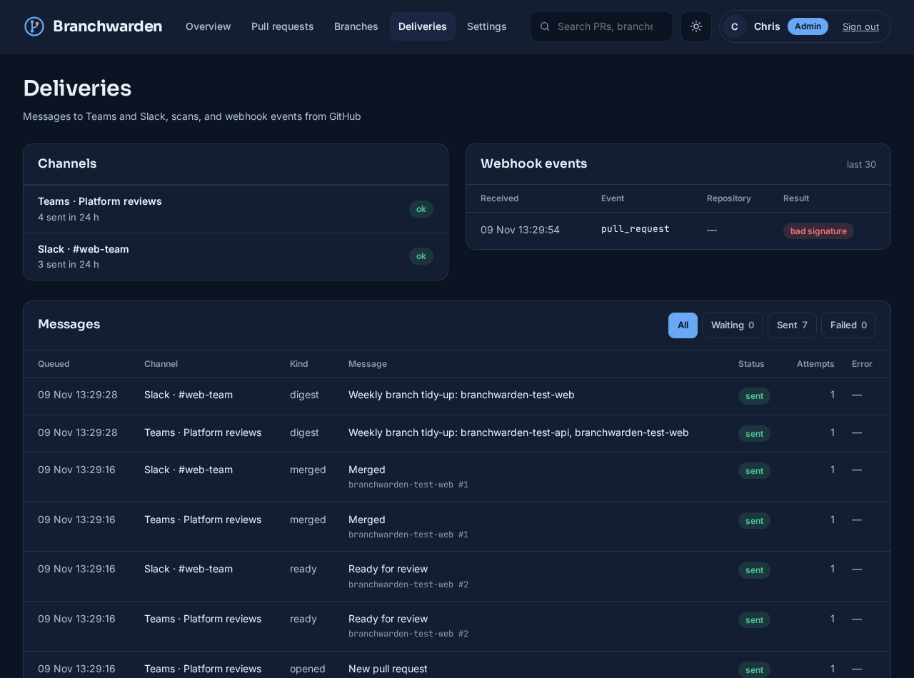
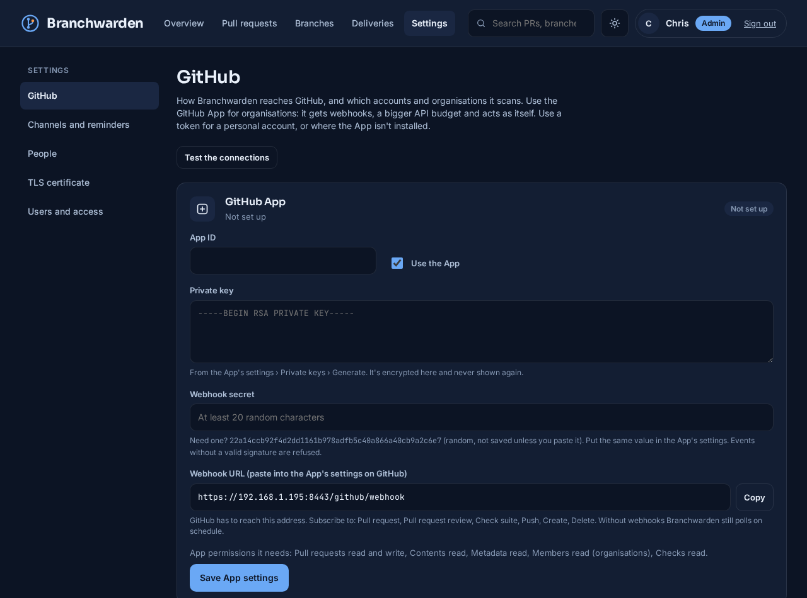
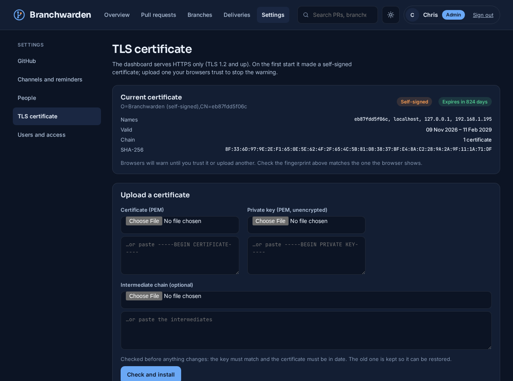

# Branchwarden

**A self-hosted dashboard for engineering teams that watches every pull request and branch across a GitHub organisation or account. It shows what each PR is waiting on, flags stale branches and branches left behind by merged PRs, lets you request reviewers from the browser, and reminds people in Microsoft Teams or Slack when a review, merge or close is overdue.**

GitHub shows pull requests one repository at a time, and only to the people already looking. Across a few dozen repos, nobody can see which PRs have waited three days for a reviewer, which ones were approved and then forgotten, or how many branches are still around months after their PR merged. Branchwarden scans the lot on a schedule (or as soon as a webhook says something changed), works out each PR's state and who has to act next, and tells the right channel. It only reads branches: it never pushes and never deletes, and its one write to GitHub is requesting reviewers.

Source code: not published yet.

*The overview during a test run on 9 November 2026, against two throwaway private repositories set up for it: 13 branches with backdated commits, three open pull requests, one merged and one closed.*

---

## At a glance

| | |
|---|---|
| **Pull requests** | Every open PR across the accounts you add, with one headline state (draft, conflicts, changes requested, approved, no reviewer, in review, awaiting review), CI status, who it's waiting on and for how long |
| **Reviewers** | Request or withdraw reviewers from the dashboard. Suggestions come from CODEOWNERS and from who has reviewed in that repo recently, along with each person's current review load |
| **Branches** | Branches with no PR, flagged stale after a set number of days; branches left behind by a merged PR, by a closed PR, or pushed to after their merge. All are flagged only, never deleted |
| **Teams and Slack** | Messages when a PR opens or is marked ready, gets a review, merges or closes. Reminders when it sits too long, counted in working hours. A weekly digest of branches to tidy up. Teams Adaptive Cards and Slack Block Kit, with @mentions |
| **GitHub connections** | A GitHub App, a personal access token, or both: the App where it's installed, otherwise the token. Webhooks trigger a rescan within seconds. Can point at GitHub Enterprise Server |
| **Secure by default** | HTTPS with a generated certificate and an upload page, secrets sealed with AES-256-GCM, no default accounts, and three roles |

---

## Pull requests, and who they're waiting on

Each open PR gets one headline state, picked by what matters most: a draft is a draft, conflicts come before anything else, then the review decision, then whether anyone has been asked. Filters overlap, so a PR that is approved but failing CI appears under both. The waiting time counts from when the PR entered its current state, not from when it was opened: for "approved", that's the newest approval; for "awaiting review", it's the last review request or the moment it left draft.

*Three open PRs, none with a reviewer yet. The panel on the right is where members and admins request reviewers.*

**Requesting reviewers.** The panel suggests people and teams in this order:
- The **CODEOWNERS** of the files the PR changes. The last matching rule wins, as on GitHub.
- People who have **reviewed in that repo** recently.
- Everyone else in the organisation, with a filter box.

Each candidate shows how many open reviews they already have. Ticking someone requests their review on GitHub, and unticking someone who is already requested withdraws the request. A notice can go to the PR's channels at the same time. If GitHub refuses (it won't let authors review their own PRs, for example), its reason is shown as it came back.

---

## Branches that should have gone

Two lists, side by side:

- **No pull request.** Branches nobody has opened a PR for, flagged stale once they've had no commits for 30 days. That's a setting, and the page can switch to 14, 60 or 90 days to look around. Each one shows when it was last touched, by whom, and how far it is ahead of and behind the default branch.
- **Left after a PR.** Branches whose newest PR merged (their commits are already in the base) or closed without merging. A branch that someone pushed to after its PR merged is called out separately, because deleting it would lose work.

*The test repos' backdated branches: `spike/graphql-gateway` last touched 212 days ago, a 2-day-old branch still marked active.*

Default and protected branches are never listed. Neither are names matching the never-flag patterns (`main`, `develop`, `release/*`, `hotfix/*`, `gh-pages` by default). A member can ignore any single branch, and reverse that later.

*`fix/csv-escape` and `feat/invoice-pdf` were merged without deleting their branches; `feat/dark-charts` was closed unmerged.*

Branchwarden never deletes anything. The way out is GitHub's own "Automatically delete head branches" setting, or a tidy-up from the weekly digest.

---

## Messages to Teams and Slack

Each channel is a webhook: a Teams **Workflows** webhook (the replacement for the retired Office 365 connectors), which receives an Adaptive Card, or a Slack incoming webhook, which receives a Block Kit message. A channel is routed by repo patterns (`api-*`, `my-org/web-console`), by teams (a PR matches when that team is asked to review it), or gets everything.

**Events** are posted when a scan sees them happen:
- a PR opens, or is marked ready for review,
- a review approves or requests changes,
- a PR merges or closes. If its branch is still there, the message says so.

A repo's first scan only records what's there, so adding an organisation doesn't flood the channels with history.

**Reminders** go out when a PR stays in one state too long:
- no reviewer assigned,
- waiting for review,
- changes requested and no new commits since,
- approved but not merged.

Each reminder has its own wait, repeat interval and maximum count. Waits can be counted in working hours, so a PR opened on Friday afternoon isn't "two days late" on Monday morning. Reminders are only sent in working hours, they skip drafts and a chosen label, and they can be grouped into one message per channel. If a PR leaves the state and comes back, its reminder count starts again.

**The weekly digest** lists, per channel, the stale branches and the branches left behind in that channel's repos, with each branch's last committer @mentioned.

*The rules as shipped. "Waiting for review" is open: 24 working hours, then every 24 working hours, at most three times, @mentioning the reviewers.*

@mentions work through a People page that matches each GitHub login to a Teams user and a Slack member ID. Anyone without a match appears as a bold name, so a message never breaks.

In the test run, three events reached a local test receiver as Teams cards within a second of the scan that saw them:
- the new PR `branchwarden-test-api #4`,
- the draft `branchwarden-test-web #2` marked ready, with "Reviewers: none yet",
- the merge of `branchwarden-test-web #1`, noting "The branch `feat/invoice-pdf` is still there".

The Slack channel, routed to the web repo only, got just that repo's messages.

---

## Deliveries and scans

Every message is queued per channel and retried with back-off when Teams or Slack answers 429 or 5xx. Other errors are permanent and shown as failed, with the reason, such as Slack's `HTTP 404: no_team` for a webhook that has been removed. One broken channel never holds up another. Webhook URLs are secrets, so they never appear in an error.

*Each message, its channel and its result. The one webhook event shown was a deliberately unsigned request, refused as "bad signature".*

The same page lists each scan with:
- what triggered it (the schedule, a webhook, or someone pressing *Scan now*),
- how many repos, PRs and branches it read,
- how many events it found,
- how much of GitHub's hourly API budget was left.

A full scan of the two test repos took about 4 seconds, and after several scans the token still had 4,986 of its 5,000 hourly points left.

---

## Connecting GitHub

Two kinds of connection, usable together:
- **A GitHub App** suits organisations. It has its own API budget and sends webhooks, so PR changes show up in seconds instead of at the next scan. Once its ID and private key are in, the page lists every installation and its permissions.
- **A fine-grained personal access token** is the quickest start. Branchwarden reads its expiry date from GitHub and warns 14 days ahead.

Each account can be set to use the App, the token, or the App with the token as fallback. Repos are included or skipped by pattern, and archived repos and forks are left out unless you ask for them.

---

## Security

The project was built against a security review of all my repos, with its "secure by default" checklist applied from the first line:

- **HTTPS only.** The dashboard serves TLS 1.2 and up. A self-signed certificate is generated on the first start for the host's names and addresses. An admin can upload a real one, which is checked before anything changes (the key must match, and the certificate must be in date), and the previous one is kept so it can be restored. HSTS is on and cookies are always `Secure`.
- **Secrets sealed at rest.** The GitHub token, the App's private key, the webhook secret and every channel's webhook URL are encrypted with AES-256-GCM. The key is generated into its own volume, apart from the database, and can be rotated. No secret is ever shown again once saved.
- **Nothing open by default.** There's no default admin: the first account needs a one-time code from the server's log. The database has no default password and isn't reachable from outside. Webhooks without a valid signature are refused, and so is everything when no secret is set. Forms carry CSRF tokens, sign-ins are throttled, and channel URLs must be HTTPS on Slack's or Microsoft's hosts.
- **Three roles.** *Admins* change settings, *members* request reviewers and ignore branches, *viewers* only read.

---

## How it runs

Three containers with podman-compose or Docker Compose: Postgres, a worker (scans, rules and delivery) and the dashboard (gunicorn over HTTPS). Settings, channels and rules are all changed in the browser; the `.env` file holds only the database password, the published port and certificate names.

## Status

New (November 2026).
- **Tests:** 36 unit tests run on every push, covering PR states, branch rules, CODEOWNERS matching, working-hours maths, message rendering and escaping, webhook signatures, encryption and key rotation, and certificate checks. CI also runs `pip-audit` (no known vulnerabilities in the pinned versions) and `gitleaks`.
- **End-to-end test:** run against two throwaway private repositories. It covered a first scan, three live events, Teams and Slack delivery to a local test receiver, a digest, a refused review request, and a simulated week of reminders (sent on the first due time, held for the repeat interval, stopped at the maximum, silent on Sunday).
- **Not yet tested:** a GitHub App installation on a real organisation, GitHub Enterprise Server, and messages posted into real Teams and Slack workspaces.
