# Branchwarden

**A self-hosted dashboard for engineering teams that watches every pull request and branch across a GitHub organisation or account. It shows what each PR is waiting on, flags stale branches and branches left behind by merged PRs, requests reviewers (by hand or automatically), and reminds people in Microsoft Teams or Slack when a review, merge or close is overdue.**

GitHub shows pull requests one repository at a time, and only to the people already looking. Across a few dozen repos, nobody can see which PRs have waited three days for a reviewer, which ones were approved and then forgotten, or how many branches are still around months after their PR merged. Branchwarden scans everything on a schedule, or as soon as a webhook says something changed. It works out each PR's state and who has to act next, tells the right channel, and keeps the numbers that show whether reviews are getting faster or slower. It only reads branches: it never pushes and never deletes. Its one write to GitHub is requesting reviewers.

Source code: [github.com/chrisnock-personal/branchwarden](https://github.com/chrisnock-personal/branchwarden)

*The overview during a test run on 9 November 2026, against two throwaway private repositories set up for it: 13 branches with backdated commits, three open pull requests, one merged and one closed. The red bar in the scan log is a scan that ran while the host was restarting and couldn't reach GitHub; the next one recovered on its own.*

---

## At a glance

| | |
|---|---|
| **Pull requests** | Every open PR across the accounts you add, with one headline state (draft, conflicts, changes requested, approved, no reviewer, in review, awaiting review), CI status, who it's waiting on and for how long |
| **Reviewers** | Request or withdraw reviewers from the dashboard, with suggestions from CODEOWNERS and recent reviewers. Or let a rule pick one automatically: code owners first, then whoever is least busy |
| **Branches** | Branches with no PR, flagged stale after a set number of days; branches left behind by a merged PR, by a closed PR, or pushed to after their merge. All are flagged only, never deleted |
| **Teams and Slack** | Messages when a PR opens or is marked ready, gets a review, merges or closes. Reminders when it sits too long, counted in working hours, each with a snooze button. A weekly digest of branches to tidy up. In Slack, each PR's messages can stay in one thread |
| **Metrics** | Time to first review, time to merge, merges per week, and daily trends of PRs needing review and stale branches, overall or per repo |
| **MVP** | For the last 7 days: who reviewed, merged, pruned branches and opened PRs the most, with an optional weekly post of the winners |
| **GitHub** | A GitHub App, a personal access token, or both. Webhooks trigger a rescan within seconds. Can point at GitHub Enterprise Server |
| **Access and security** | Sign in with GitHub, with roles taken from GitHub teams, or local accounts. HTTPS with a generated certificate and an upload page, secrets sealed with AES-256-GCM, no default accounts, three roles |

---

## Pull requests, and who they're waiting on

Each open PR gets one headline state, picked by what matters most: a draft is a draft, conflicts come before anything else, then the review decision, then whether anyone has been asked. Filters overlap, so a PR that is approved but failing CI appears under both. The waiting time counts from when the PR entered its current state, not from when it was opened: for "approved", that's the newest approval; for "awaiting review", it's the last review request or the moment it left draft.

*Three open PRs, none with a reviewer yet. The panel on the right is where members and admins request reviewers.*

**Requesting reviewers.** The panel suggests people and teams in this order:
- the **CODEOWNERS** of the files the PR changes (the last matching rule wins, as on GitHub),
- people who have **reviewed in that repo** recently,
- everyone else in the organisation, with a filter box.

Each candidate shows how many open reviews they already have. Ticking someone requests their review on GitHub, and unticking someone already requested withdraws the request. A notice can go to the PR's channels at the same time. If GitHub refuses (it won't let authors review their own PRs, for example), its reason is shown as it came back.

**Auto-assign.** A rule can do this unasked. It applies when a PR has had nobody asked to review it for a set time, one working hour by default.
- **Who it picks:** code owners of the changed files first. Then the least busy person in a pool of logins and teams, where each team's members count separately; with no pool, the repo's recent reviewers. "Least busy" means fewest open review requests now, then fewest assignments in the last 14 days.
- **Never picked:** the PR's author.
- **Limits:** only in working hours, and only once each time a PR is left without a reviewer.
- **Telling the channel:** it posts who was picked and why.

It's off until an admin switches it on, because it writes to GitHub.

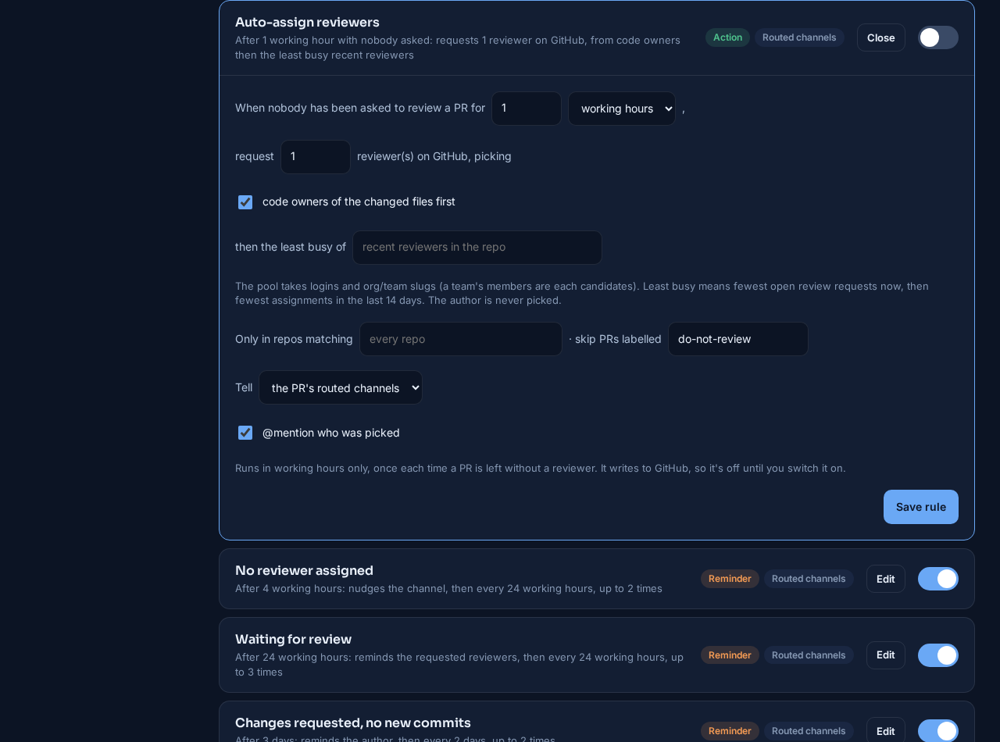

---

## Branches that should have gone

Two lists, side by side:

- **No pull request.** Branches nobody has opened a PR for, flagged stale once they've had no commits for 30 days. That's a setting, and the page can switch to 14, 60 or 90 days to look around. Each one shows when it was last touched, by whom, and how far it is ahead of and behind the default branch.
- **Left after a PR.** Branches whose newest PR merged (their commits are already in the base) or closed without merging. A branch that someone pushed to after its PR merged is called out separately, because deleting it would lose work.

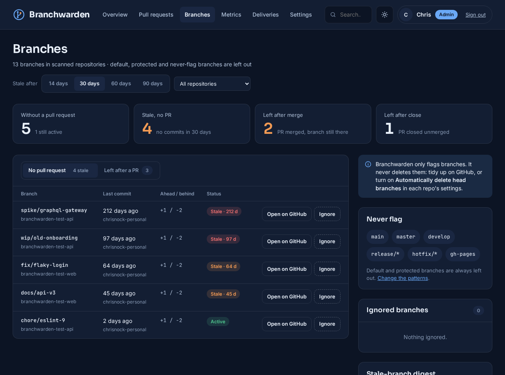

*The test repos' backdated branches: `spike/graphql-gateway` last touched 212 days ago, a 2-day-old branch still marked active.*

Default and protected branches are never listed. Neither are names matching the never-flag patterns (`main`, `develop`, `release/*`, `hotfix/*`, `gh-pages` by default). A member can ignore any single branch, and reverse that later.

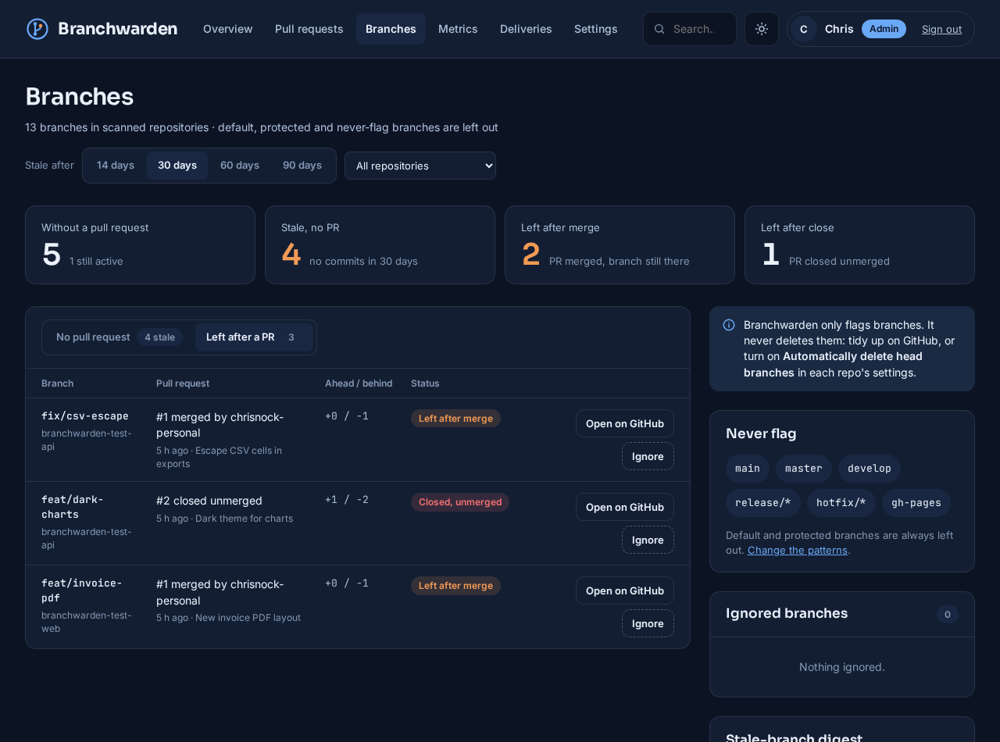

*`fix/csv-escape` and `feat/invoice-pdf` were merged without deleting their branches; `feat/dark-charts` was closed unmerged.*

Branchwarden never deletes anything. The way out is GitHub's own "Automatically delete head branches" setting, or a tidy-up from the weekly digest.

---

## Messages to Teams and Slack

Each channel is routed by repo patterns (`api-*`, `my-org/web-console`), by teams (a PR matches when that team is asked to review it), or gets everything. Teams channels use a **Workflows** webhook (the replacement for the retired Office 365 connectors) and receive Adaptive Cards. Slack channels receive Block Kit messages through an incoming webhook or a bot token.

**Events** are posted when a scan sees them happen:
- a PR opens, or is marked ready for review,
- a review approves or requests changes,
- a PR merges or closes. If its branch is still there, the message says so.

A repo's first scan only records what's there, so adding an organisation doesn't flood the channels with history.

**Reminders** go out when a PR stays in one state too long:
- no reviewer assigned,
- waiting for review,
- changes requested and no new commits since,
- approved but not merged.

Each reminder has its own wait, repeat interval and maximum count. Waits can be counted in working hours, so a PR opened on Friday afternoon isn't "two days late" on Monday morning. Reminders are only sent in working hours, they skip drafts and a chosen label, and they can be grouped into one message per channel. If a PR leaves the state and comes back, its reminder count starts again.

**The weekly digest** lists, per channel, the stale branches and the branches left behind in that channel's repos, with each branch's last committer @mentioned.

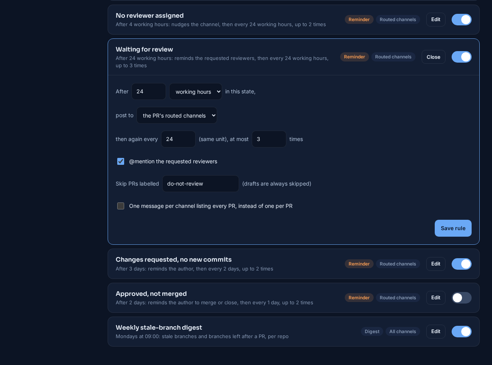

*"Waiting for review" open for editing: 24 working hours, then every 24 working hours, at most three times, @mentioning the reviewers.*

**Snooze.** Every reminder carries a Snooze button. It opens the PR in Branchwarden, where a member can silence its reminders for 1, 3 or 7 days while it's parked on purpose. The other PRs keep their reminders.

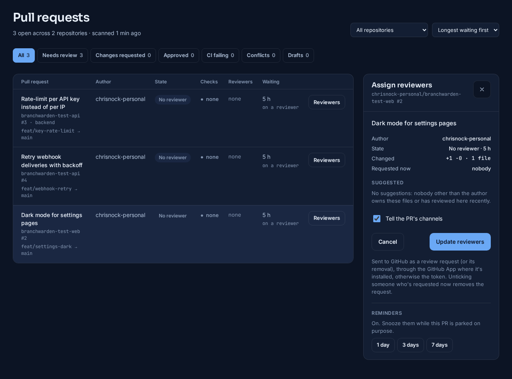

**Threads in Slack.** With a bot token instead of a webhook, the first message about a PR starts a thread. Everything after it (the reminder, the review, the auto-assigned reviewer) is a reply in that thread, so a busy channel shows one line per PR. Merges and closes are also shown in the channel, and the digest is posted on its own. Teams webhooks can't reply in a thread, so Teams channels get one card per message.

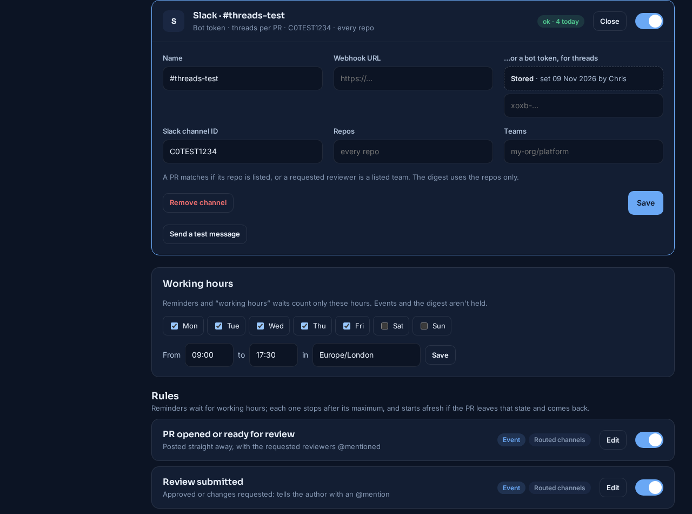

@mentions work through a People page that matches each GitHub login to a Teams user and a Slack member ID. Anyone without a match appears as a bold name, so a message never breaks.

In the test run, three events reached a local test receiver as Teams cards within a second of the scan that saw them:
- the new PR `branchwarden-test-api #4`,
- the draft `branchwarden-test-web #2` marked ready, with "Reviewers: none yet",
- the merge of `branchwarden-test-web #1`, noting "The branch `feat/invoice-pdf` is still there".

The Slack channel, routed to the web repo only, got just that repo's messages. Against a stand-in for Slack's API, a PR's first message started a thread. Its reminder went into that thread, and its merge went into the thread and was also shown in the channel.

---

## Metrics

The Metrics page answers "are reviews getting faster?" for the last 30, 90 or 180 days, across everything or one repo:
- the **median time to first review**, and the share of PRs reviewed within a day,
- the **median time to merge**, and merges per week,
- **daily trends** of PRs needing review and of stale branches, from a snapshot written every hour,
- a table **by repository**, and the **reviewers** with the most requests waiting on them now, with how long the oldest has waited.

Times count from when a PR was ready for review, and an author's own replies don't count as a first review. Every chart can be shown as a table. History starts when Branchwarden starts watching an account, so the page fills in over the first weeks.

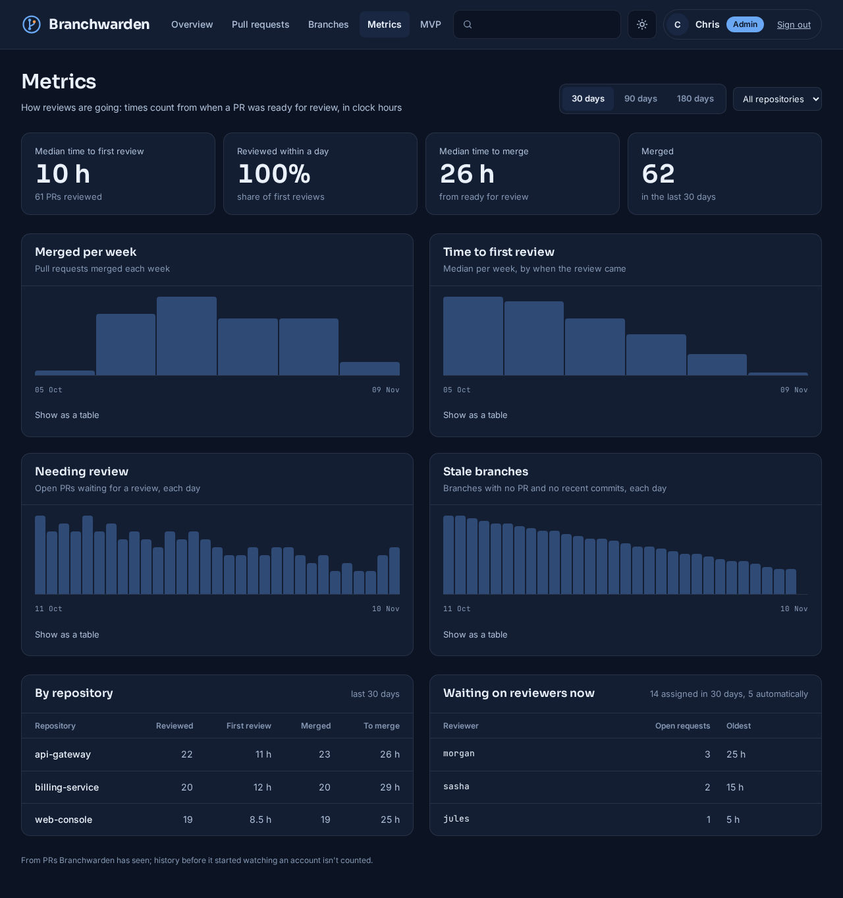

*Made-up test activity: five weeks across three repos and eight people, in which first reviews speed up from about 20 hours to about 3, and stale branches get tidied. The test repositories used elsewhere on this page have a single author and no reviews, so they can't show this page.*

---

## MVP

The MVP page shows, for the last 7 days or the 7 before, who did the most of four things. Each board has an MVP and places 2 to 5, with team totals across the top:
- **Most reviews:** PRs they reviewed for someone else. Reviewing your own PR doesn't count, and neither do repeat comments on one PR.
- **Most merges:** PRs they pressed merge on.
- **Most branch prunes:** branches they deleted. Who deleted a branch only comes from the GitHub App's `delete` webhook. A deletion that only a scan noticed counts in the team total, but for nobody by name, and the board says so.
- **Most PRs raised:** PRs they opened.

Bots are left out of every board. An optional weekly post, off by default, sends each board's winner and the next two to Teams and Slack, at a set day and time (Fridays 16:00 unless changed). Winners are @mentioned.

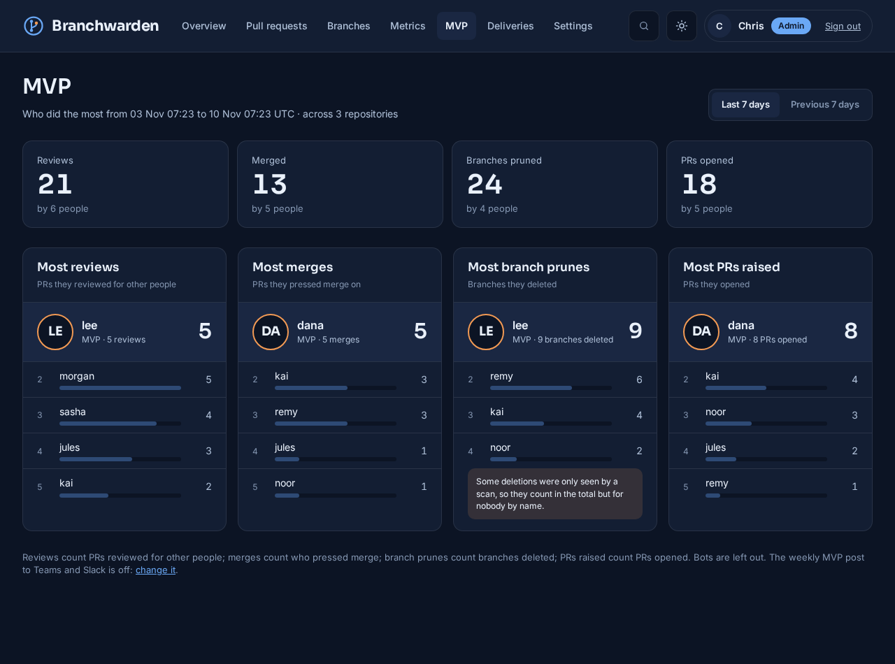

*The same made-up test activity. The note on the prunes board is because three deletions were only seen by a scan.*

---

## Deliveries and scans

Every message is queued per channel and retried with back-off when Teams or Slack answers 429 or 5xx. Other errors are permanent and shown as failed, with the reason, such as Slack's `HTTP 404: no_team` for a webhook that has been removed. One broken channel never holds up another. Webhook URLs and bot tokens are secrets, so they never appear in an error.

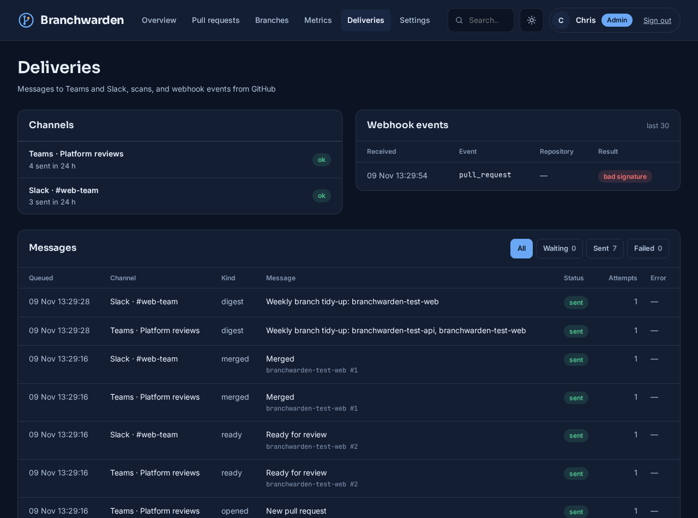

*Each message, its channel and its result. The one webhook event shown was a deliberately unsigned request, refused as "bad signature".*

The same page lists each scan with:
- what triggered it (the schedule, a webhook, or someone pressing *Scan now*),
- how many repos, PRs and branches it read,
- how many events it found,
- how much of GitHub's hourly API budget was left.

A full scan of the two test repos took about 4 seconds, and after several scans the token still had 4,986 of its 5,000 hourly points left.

---

## Connecting GitHub

Two kinds of connection, usable together:
- **A GitHub App** suits organisations. It has its own API budget and sends webhooks, so PR changes show up in seconds instead of at the next scan. Once its ID and private key are in, the page lists every installation and its permissions.
- **A fine-grained personal access token** is the quickest start. Branchwarden reads its expiry date from GitHub and warns 14 days ahead.

Each account can be set to use the App, the token, or the App with the token as fallback. Repos are included or skipped by pattern, and archived repos and forks are left out unless you ask for them.

---

## Who gets in

**Sign in with GitHub** works with an OAuth App or the GitHub App's own credentials.
- **Who gets which role:** admins list logins, `org/team` slugs or whole organisations against each role (admin, member, viewer).
- **Every sign-in:** the person's role is worked out again from their GitHub teams. Anyone matching no list is turned away, so having a GitHub account isn't enough.
- **The token:** the sign-in uses PKCE and a state check. The GitHub token is only used to read the person's teams, and is never stored.
- **Fallback:** local accounts keep working, so an admin can always get in.

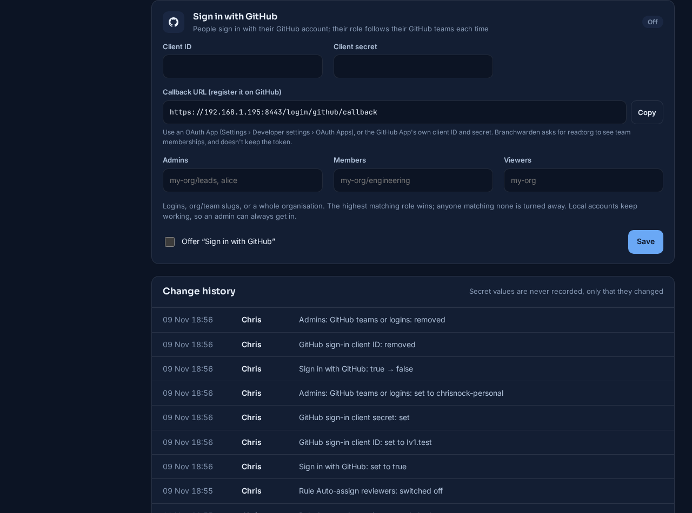

The three roles: *admins* change settings; *members* request reviewers, snooze reminders and ignore branches; *viewers* only read.

---

## Security

The project was built against a security review of all my repos, with its "secure by default" checklist applied from the first line:

- **HTTPS only.**
  - The dashboard serves TLS 1.2 and up. On the first start it generates a self-signed certificate for the host's names and addresses.
  - An admin can upload a real one. It's checked before anything changes (the key must match, and the certificate must be in date), and the previous one is kept so it can be restored.
  - HSTS is on, and cookies are always `Secure`.
- **Secrets sealed at rest.**
  - The GitHub token, the App's private key, the webhook secret, the sign-in client secret and every channel's webhook URL or bot token are encrypted with AES-256-GCM.
  - The key is generated into its own volume, apart from the database, and can be rotated.
  - No secret is ever shown again once saved.
- **Nothing open by default.**
  - There's no default admin: the first account needs a one-time code from the server's log.
  - The database has no default password and isn't reachable from outside.
  - Webhooks without a valid signature are refused, and so is everything when no secret is set.
  - Forms carry CSRF tokens, sign-ins are throttled, and channel URLs must be HTTPS on Slack's or Microsoft's hosts.
- **Data kept no longer than needed.** Closed PRs are kept for 365 days (the metrics use them). Messages and scans are kept for 90 days. Older records are removed every hour.

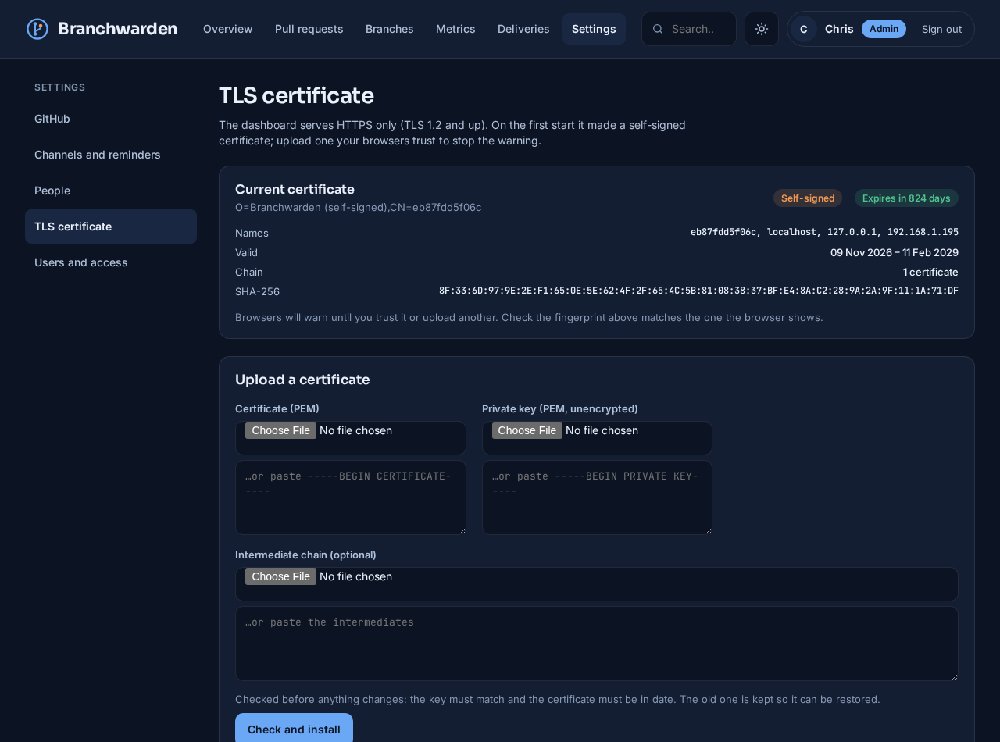

---

## How it runs

Three containers with podman-compose or Docker Compose: Postgres, a worker (scans, rules, auto-assign, delivery and housekeeping) and the dashboard (gunicorn over HTTPS). Settings, channels and rules are all changed in the browser. The `.env` file holds only the database password, the published port and the certificate's names.

## Status

New (November 2026).

- **Unit tests:** 52 run on every push. They cover:
  - PR states, branch rules and CODEOWNERS matching,
  - reviewer selection and working-hours maths,
  - message rendering and escaping,
  - Slack API answers,
  - webhook signatures, encryption and key rotation,
  - the GitHub sign-in role rules and certificate checks,
  - the MVP rankings and the weekly post.

  CI also runs `pip-audit` (no known vulnerabilities in the pinned versions) and `gitleaks`.
- **End-to-end test:** run against two throwaway private repositories. It covered:
  - a first scan and three live events,
  - Teams and Slack delivery, and Slack threads, against local stand-ins,
  - a digest, and a refused review request,
  - a simulated week of reminders: sent on the first due time, held for the repeat interval, stopped at the maximum, silent on Sunday, and skipped for a snoozed PR,
  - auto-assign making one attempt per PR,
  - the start of a GitHub sign-in, and the refusal of a forged one,
  - the metrics and MVP pages, and the weekly MVP post, on made-up activity. That covered self-reviews, bots and deletions with nobody named.
- **Not yet tested:**
  - a GitHub App installation on a real organisation,
  - GitHub Enterprise Server,
  - a full GitHub sign-in,
  - an auto-assigned review on a repo with more than one person,
  - messages in real Teams and Slack workspaces.
