# Branchwarden

**A self-hosted dashboard for engineering teams that watches every pull request and branch across a GitHub organisation or account. It shows each person what's waiting on them, shows what each PR is waiting on, flags stale branches and branches left behind by merged PRs, tracks whether each GitHub Actions workflow ran when it should and passed, points out the repository settings behind those problems, requests reviewers (by hand or automatically), and reminds people in Microsoft Teams or Slack when a review, merge or close is overdue. Everything it shows or does is also available to scripts, AI agents and Grafana, through an API, a command line, an MCP server for AI agents, and a Prometheus endpoint.**

GitHub shows pull requests one repository at a time, and only to the people already looking. Across a few dozen repos, nobody can see which PRs have waited three days for a reviewer, which ones were approved and then forgotten, or how many branches are still around months after their PR merged. Branchwarden scans everything on a schedule, or as soon as a webhook says something changed. It works out each PR's state and who has to act next, tells the right channel, and keeps the numbers that show whether reviews are getting faster or slower. It only reads branches: it never pushes and never deletes. Its one write to GitHub is requesting reviewers.

Source code: [github.com/chrisnock-personal/branchwarden](https://github.com/chrisnock-personal/branchwarden) · latest release: [v0.8.1](https://github.com/chrisnock-personal/branchwarden/releases/tag/v0.8.1) · [](https://github.com/chrisnock-personal/branchwarden/actions/workflows/ci.yml)

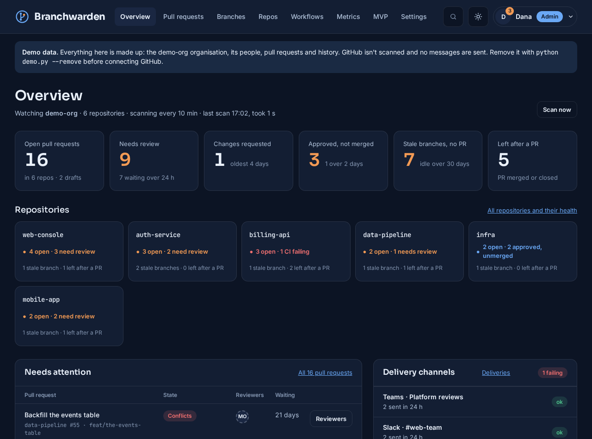

*Every screenshot on this page comes from the real product, filled with a made-up demo organisation (`demo-org`): six repositories, eight people, PRs in every state, and five weeks of history. You're signed in as Dana, and the 3 on her avatar is the reviews waiting on her.*

---

## At a glance

| | |
|---|---|
| **My work** | Each person's own list: reviews waiting on them, their PRs and what each needs next, their branches to tidy, and their snoozed reminders |
| **Pull requests** | Every open PR across the accounts you add, with one headline state (draft, conflicts, changes requested, approved, no reviewer, in review, awaiting review), CI status, who it's waiting on and for how long. Big and stalled PRs are flagged, and ticket keys link to your tracker |
| **Reviewers** | Request or withdraw reviewers from the dashboard, with suggestions from CODEOWNERS and recent reviewers. Or let a rule pick one automatically: code owners first, then whoever is least busy |
| **Branches** | Branches with no PR, flagged stale after a set number of days; branches left behind by a merged PR, by a closed PR, or pushed to after their merge. All are flagged only, never deleted |
| **Repositories** | Every repo with what's open and what to tidy, and the settings behind most branch and review problems, each linked to where it's fixed on GitHub. A page per repo pulls it all together |
| **Workflows** | Every GitHub Actions workflow, day by day: when each scheduled one was due, whether it ran, and whether its runs passed. Flags workflows failing on the default branch, scheduled runs that never started, and schedules GitHub switched off |
| **Teams and Slack** | Messages when a PR opens or is marked ready, gets a review, merges or closes, or a workflow starts failing or misses its schedule. Reminders when it sits too long, counted in working hours, each with a snooze button. A weekly digest of branches to tidy up. In Slack, each PR's messages can stay in one thread. Each person can get a morning message, in Slack or Teams, with what's waiting on them |
| **Metrics** | Time to first review, time to merge, merges per week, all three by PR size too, and daily trends of PRs needing review and stale branches, overall or per repo |
| **MVP** | For the last 7 days: who reviewed, merged, pruned branches and opened PRs the most, with an optional weekly post of the winners |
| **API, CLI, MCP and Prometheus** | A JSON API with the same roles as the dashboard, personal and service tokens, a `branchwarden` command line for people and scripts, an MCP server so AI agents like Claude can use it directly, locally or over HTTP, and a Prometheus endpoint for Grafana and alerts |
| **GitHub** | A GitHub App, a personal access token, or both. Webhooks trigger a rescan within seconds. Can point at GitHub Enterprise Server |
| **Access and security** | Sign in with GitHub, with roles taken from GitHub teams, or local accounts. HTTPS with a generated certificate and an upload page, secrets sealed with AES-256-GCM, no default accounts, three roles |

---

## My work

My work is the page people open first thing. It sits in the menu under your name, and the badge on your avatar shows how many reviews are waiting on you from every page. People who sign in with GitHub land on it straight away. Someone with a local account types in their GitHub login once.

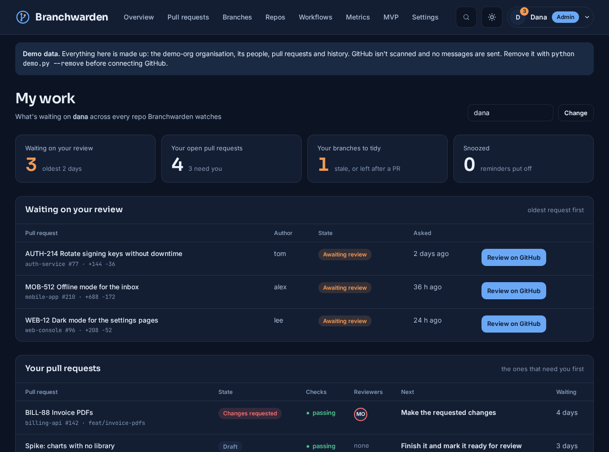

*Dana's My work: three reviews waiting on her, the oldest asked two days ago; four of her own PRs, three of which need something from her.*

It has four parts:
- **Waiting on your review:** PRs that ask you by name, oldest request first, each with a button straight to the review on GitHub. It notes when you've already reviewed an earlier version.
- **Your pull requests:** the ones that need you come first, each with the next step: resolve the conflicts, fix the failing checks, make the requested changes, merge it, or ask someone to review it. The rest show who they're waiting on.
- **Your branches to tidy:** your stale branches, and branches left behind after your PRs.
- **Snoozed reminders:** what you've put off, and until when.

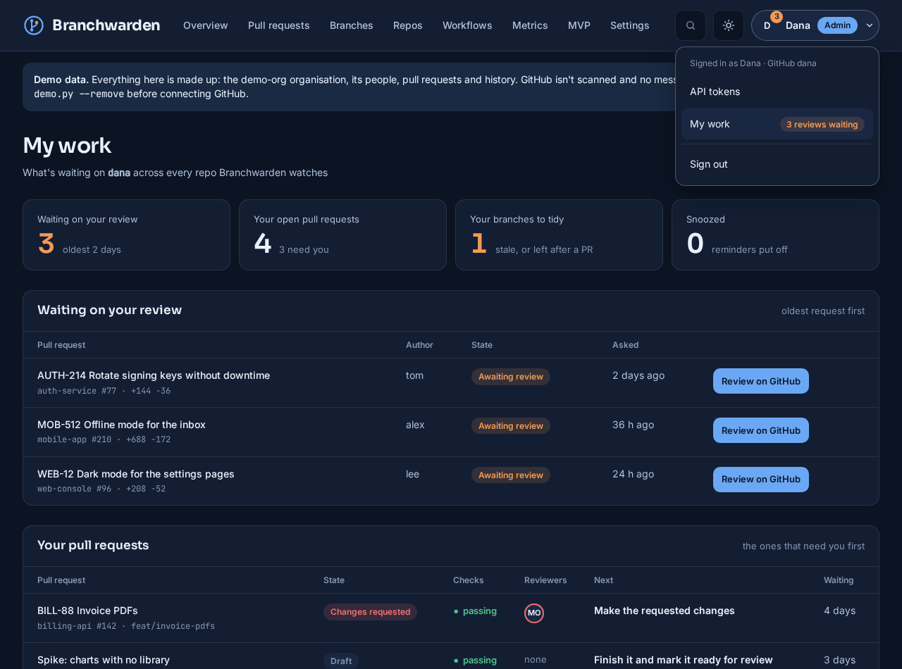

---

## Pull requests, and who they're waiting on

Each open PR gets one headline state, picked by what matters most: a draft is a draft, conflicts come before anything else, then the review decision, then whether anyone has been asked. Filters overlap, so a PR that is approved but failing CI appears under both. The waiting time counts from when the PR entered its current state, not from when it was opened: for "approved", that's the newest approval; for "awaiting review", it's the last review request or the moment it left draft.

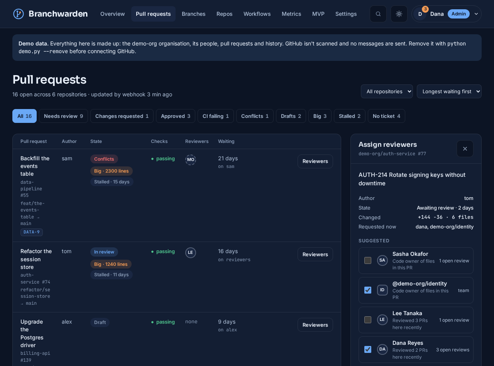

*Sixteen open PRs. The panel is open for `auth-service #77`, which changes files under `src/token/`, so it suggests that folder's code owners (the `identity` team and Sasha) before recent reviewers.*

**Requesting reviewers.** The panel suggests people and teams in this order:
- the **CODEOWNERS** of the files the PR changes (the last matching rule wins, as on GitHub),
- people who have **reviewed in that repo** recently,
- everyone else in the organisation, with a filter box.

Each candidate shows how many open reviews they already have. Ticking someone requests their review on GitHub, and unticking someone already requested withdraws the request. A notice can go to the PR's channels at the same time. If GitHub refuses (it won't let authors review their own PRs, for example), its reason is shown as it came back.

**Auto-assign.** A rule can do this unasked. It applies when a PR has had nobody asked to review it for a set time, one working hour by default.
- **Who it picks:** code owners of the changed files first. Then the least busy person in a pool of logins and teams, where each team's members count separately; with no pool, the repo's recent reviewers. "Least busy" means fewest open review requests now, then fewest assignments in the last 14 days.
- **Never picked:** the PR's author.
- **Limits:** only in working hours, and only once each time a PR is left without a reviewer.
- **Telling the channel:** it posts who was picked and why.

It's off until an admin switches it on, because it writes to GitHub.

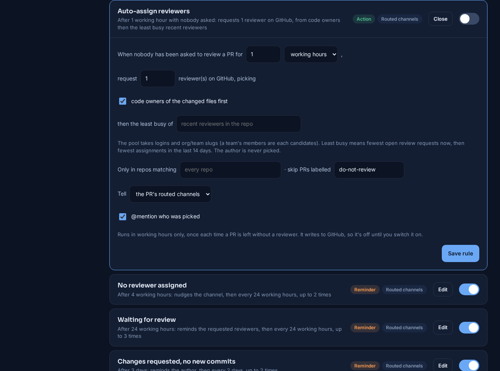

**Big, stalled and ticketed.** Three more things show on each PR:
- **Big:** over 500 lines changed or 30 files, by default. Both limits are settings.
- **Stalled:** no commits, reviews or comments for 7 days. Drafts never stall.
- **Tickets:** keys like `AUTH-214` in the title, the branch name or the description link to Jira, Linear or any tracker, once its link (with `{key}` in it) is set. Only the keys are kept from a description, never the text.

Each has a filter, including "No ticket". A "Stalled" reminder rule nudges the author, and message buttons open the ticket.

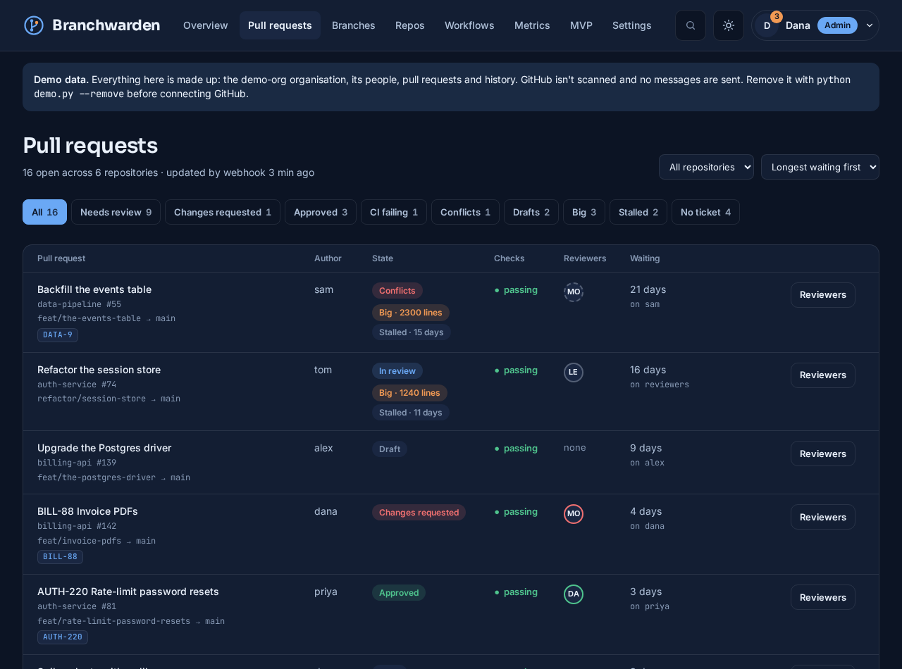

*The two oldest PRs are both big and stalled. `DATA-9` came from the first one's description, `DATA-17` from a branch name.*

---

## Branches that should have gone

Two lists, side by side:

- **No pull request.** Branches nobody has opened a PR for, flagged stale once they've had no commits for 30 days. That's a setting, and the page can switch to 14, 60 or 90 days to look around. Each one shows when it was last touched, by whom, and how far it is ahead of and behind the default branch.
- **Left after a PR.** Branches whose newest PR merged (their commits are already in the base) or closed without merging. A branch that someone pushed to after its PR merged is called out separately, because deleting it would lose work.

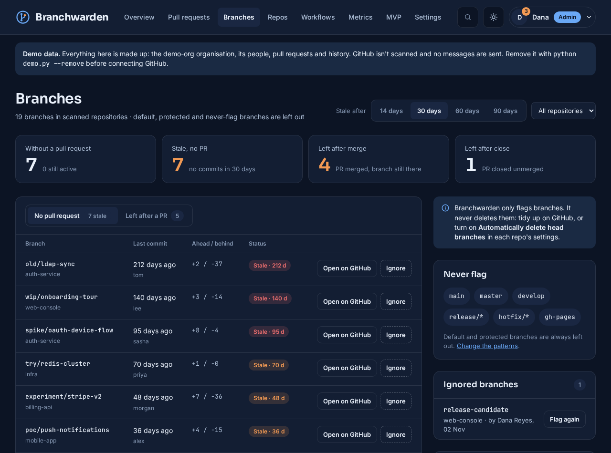

*Seven stale branches, the oldest untouched for 212 days. Someone chose to stop flagging `release-candidate`, so it's listed under Ignored branches, where it can be flagged again.*

Default and protected branches are never listed. Neither are names matching the never-flag patterns (`main`, `develop`, `release/*`, `hotfix/*`, `gh-pages` by default). A member can ignore any single branch, and reverse that later.

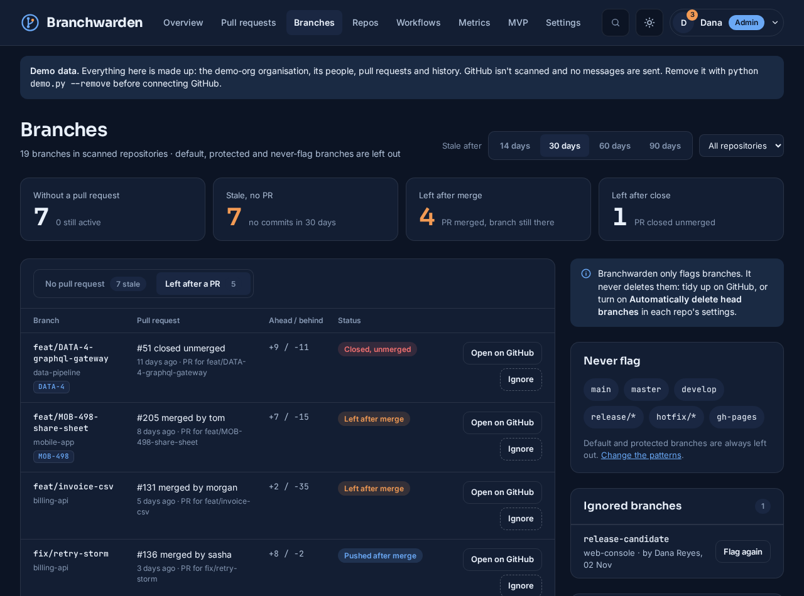

*`fix/retry-storm` had new commits after its PR merged, so it's marked "Pushed after merge" rather than safe to delete.*

Branchwarden never deletes anything. The way out is GitHub's own "Automatically delete head branches" setting, or a tidy-up from the weekly digest.

---

## Repositories, and the settings behind the problems

Branches pile up for a reason, and the usual one is a repository setting. The Repositories page lists every repo with its open PRs, branches to tidy and failing workflows, and flags four settings:
- **Head branches aren't deleted after merge:** GitHub's "Automatically delete head branches" is off. This is the main reason branches are left behind.
- **The default branch isn't protected.**
- **Merging doesn't need an approving review.**
- **No CODEOWNERS file,** so nobody is suggested or asked to review by the files a PR changes.

Each flag links to the place on GitHub where it's changed. Branchwarden only reads these settings, and never changes them.
- **When they're read:** protection and rulesets once a day, the rest with each scan.
- **Hidden settings:** GitHub may hide branch protection details from a token without admin rights. So "no approving review" is only flagged when GitHub actually shows it, never guessed.

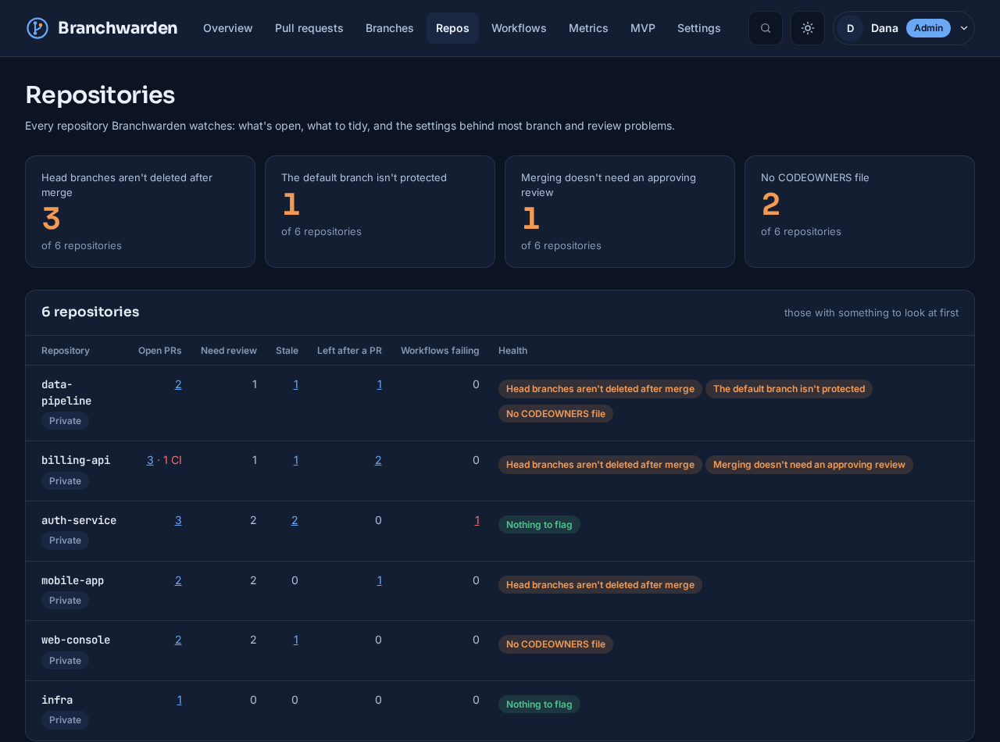

*Three of the six demo repos don't delete head branches after merge; data-pipeline also has an unprotected default branch and no CODEOWNERS.*

**A page per repository** brings everything about one repo together:
- its health flags, each with a "Fix on GitHub" button,
- its open PRs, and its stale and left-behind branches,
- its weekly merge and first-review charts,
- who reviews there and who's waiting on them,
- its CODEOWNERS rules, its workflows, and which Teams and Slack channels get its messages.

Repo names across the dashboard open it. On the overview, each repo card's status line opens that repo's pull requests and its branch line opens its branches, so a repo with stale branches and no PRs no longer lands on an empty list.

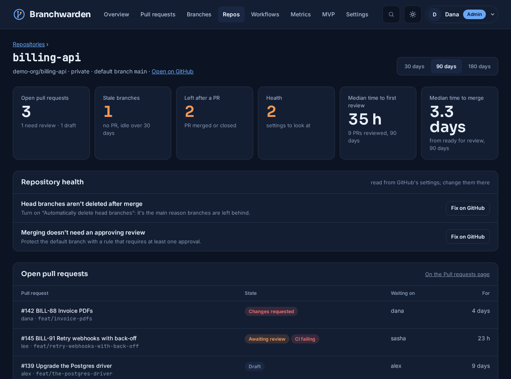

---

## Workflows: did it run, and did it pass?

GitHub Actions shows runs, but not runs that never happened. A nightly build, a weekly dependency check or a backup job on a cron schedule can stop running, and nothing on GitHub tells you. Sometimes GitHub drops a scheduled run when it's busy. It also switches a scheduled workflow off for good after 60 days with no activity in the repo. The Workflows page reads each workflow's file, works out from its cron schedule when it was due, and matches those times against the runs that actually happened.

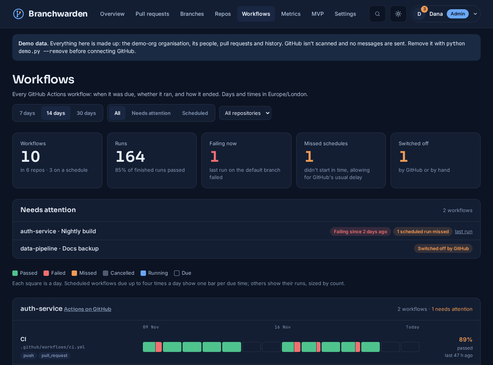

*auth-service's nightly build has failed the last three nights, and one night it never ran. data-pipeline's docs backup was switched off by GitHub after 60 quiet days.*

Each workflow is one row, grouped by repository, with a square per day over the last 7, 14 or 30 days:
- **Scheduled workflows** due up to four times a day get one bar per due time: passed, failed, cancelled, still running, still due, or **missed**.
- **Other workflows** (on push, pull request or by hand) show that day's runs, sized by how many passed, failed or were cancelled.
- **Tiles and a "Needs attention" list** pick out workflows whose last run on the default branch failed (with how long they've been failing), missed scheduled runs, and workflows that are switched off.

Clicking a row shows its schedule in words ("daily at 03:17 UTC"), when it's next due, and its last 15 runs: trigger, branch, result, how long it took, who started it, and a link to the run on GitHub.

**Late isn't missed.** GitHub runs schedules in UTC, and often late. On one quiet repository, a nightly due at 03:17 started between 10:00 and 11:25 every day for two weeks. So Branchwarden learns each workflow's usual delay from its own runs. A due time counts as missed only after one and a half times that delay plus an hour: 90 minutes for a workflow GitHub runs on time, about 12 hours for that nightly. The page shows the usual delay too.

Two rules post to Teams and Slack (see below): one when a workflow starts failing and again when it passes, and one when a scheduled run is missed or a schedule is switched off. It needs the **Actions: read** permission. Without it, pull requests and branches are scanned as before, and the page lists the repos it can't read.

---

## Messages to Teams and Slack

Each channel is routed by repo patterns (`api-*`, `my-org/web-console`), by teams (a PR matches when that team is asked to review it), or gets everything. Teams channels use a **Workflows** webhook (the replacement for the retired Office 365 connectors) and receive Adaptive Cards. Slack channels receive Block Kit messages through an incoming webhook or a bot token.

**Events** are posted when a scan sees them happen:
- a PR opens, or is marked ready for review,
- a review approves or requests changes,
- a PR merges or closes. If its branch is still there, the message says so,
- a workflow starts failing, and passes again. That's one message per change, not one per failed run, for scheduled runs, the default branch, or every branch,
- a scheduled run is missed, or a scheduled workflow is switched off.

A repo's first scan only records what's there, so adding an organisation doesn't flood the channels with history.

**Reminders** go out when a PR stays in one state too long:
- no reviewer assigned,
- waiting for review,
- changes requested and no new commits since,
- approved but not merged,
- stalled: no commits, reviews or comments for a week (off until switched on).

Each reminder has its own wait, repeat interval and maximum count. Waits can be counted in working hours, so a PR opened on Friday afternoon isn't "two days late" on Monday morning. Reminders are only sent in working hours, they skip drafts and a chosen label, and they can be grouped into one message per channel. If a PR leaves the state and comes back, its reminder count starts again.

**The weekly digest** lists, per channel, the stale branches and the branches left behind in that channel's repos, with each branch's last committer @mentioned.

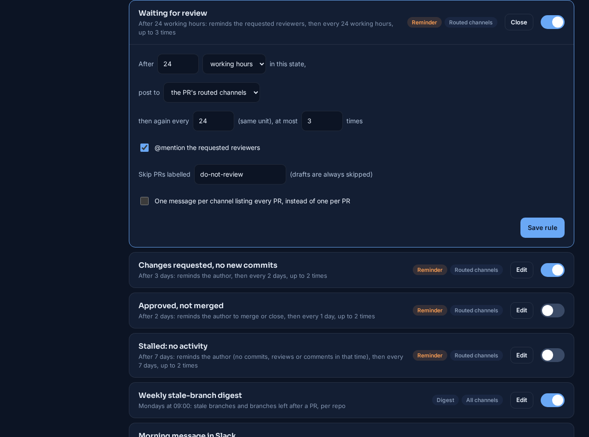

*"Waiting for review" open for editing: 24 working hours, then every 24 working hours, at most three times, @mentioning the reviewers.*

**Snooze.** Every reminder carries a Snooze button. It opens the PR in Branchwarden, where a member can silence its reminders for 1, 3 or 7 days while it's parked on purpose. The other PRs keep their reminders.

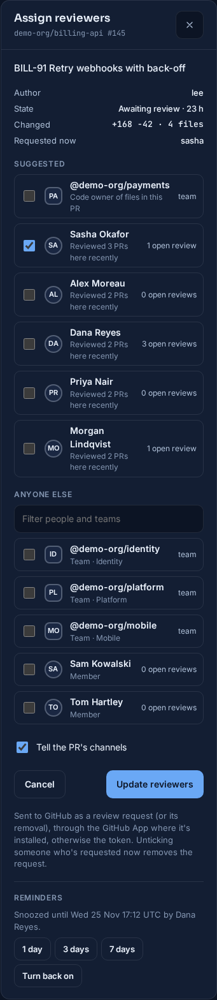

**Threads in Slack.** With a bot token instead of a webhook, the first message about a PR starts a thread. Everything after it (the reminder, the review, the auto-assigned reviewer) is a reply in that thread, so a busy channel shows one line per PR. Merges and closes are also shown in the channel, and the digest is posted on its own. Teams webhooks can't reply in a thread, so Teams channels get one card per message.

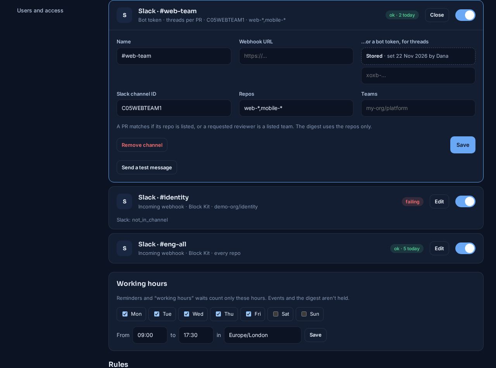

**A morning message, in Slack or Teams.** People who opt in on My work get a message on working days, at a set time, with the reviews waiting on them, oldest first, and their own PRs that need something. Nothing is sent on a day when nothing's waiting. Each person picks where it goes:
- **Slack:** a direct message from a bot. It needs a Slack bot token, set in the rule, and the person's Slack member ID on the People page.
- **Teams:** their own chat. A Teams bot would need an Azure app registration, so instead each person makes a Teams Workflows flow that posts to their chat and pastes its URL here. It's stored encrypted, and the message arrives as a card. There's nothing for an admin to set up.

"Send me one now" checks it works. With demo data loaded, it sends nothing.

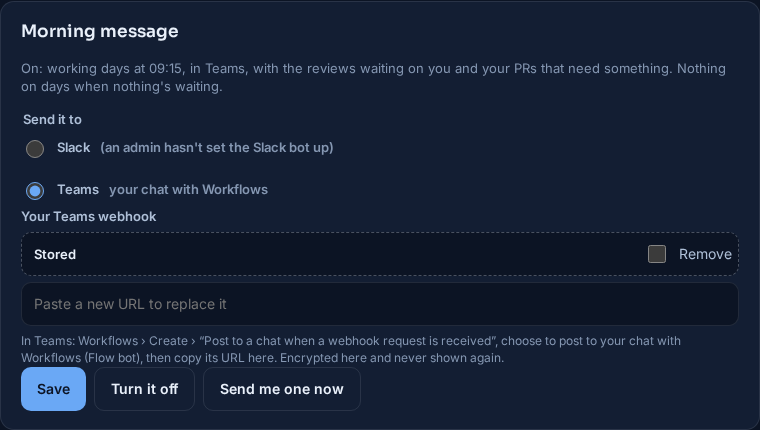

@mentions work through a People page that matches each GitHub login to a Teams user and a Slack member ID. Anyone without a match appears as a bold name, so a message never breaks.

In the end-to-end test on 9 November, with two throwaway private repositories, three events reached a local test receiver as Teams cards within a second of the scan that saw them:
- a new PR,
- a draft marked ready, with "Reviewers: none yet",
- a merge, noting "The branch `feat/invoice-pdf` is still there".

The Slack channel, routed to one repo only, got just that repo's messages. Against a stand-in for Slack's API, a PR's first message started a thread. Its reminder went into that thread, and its merge went into the thread and was also shown in the channel.

---

## Metrics

The Metrics page answers "are reviews getting faster?" for the last 30, 90 or 180 days, across everything or one repo:
- the **median time to first review**, and the share of PRs reviewed within a day,
- the **median time to merge**, and merges per week,
- **daily trends** of PRs needing review and of stale branches, from a snapshot written every hour,
- a table **by repository**, and the **reviewers** with the most requests waiting on them now, with how long the oldest has waited.

A table by PR size answers "do big PRs wait longer?": in the demo history, small PRs got a first review in a median of 4.7 hours and merged in 22, while those over 500 lines took 2.5 days and 4.4 days. Times count from when a PR was ready for review, and an author's own replies don't count as a first review. Every chart can be shown as a table. The first scan of each repo imports the PRs merged or closed in the last 180 days, so the numbers are there from day one. Only the daily trends, and who pruned which branches, start when Branchwarden does.

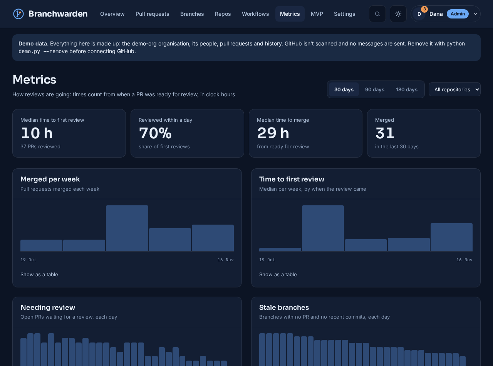

*In the demo's last 30 days, the median first review came within 10 hours and 70% within a day, and stale branches were tidied from 16 to 7 over the month.*

---

## MVP

The MVP page shows, for the last 7 days or the 7 before, who did the most of four things. Each board has an MVP and places 2 to 5, with team totals across the top:
- **Most reviews:** PRs they reviewed for someone else. Reviewing your own PR doesn't count, and neither do repeat comments on one PR.
- **Most merges:** PRs they pressed merge on.
- **Most branch prunes:** branches they deleted. Who deleted a branch only comes from the GitHub App's `delete` webhook. A deletion that only a scan noticed counts in the team total, but for nobody by name, and the board says so.
- **Most PRs raised:** PRs they opened.

Bots are left out of every board. An optional weekly post, off by default, sends each board's winner and the next two to Teams and Slack, at a set day and time (Fridays 16:00 unless changed). Winners are @mentioned.

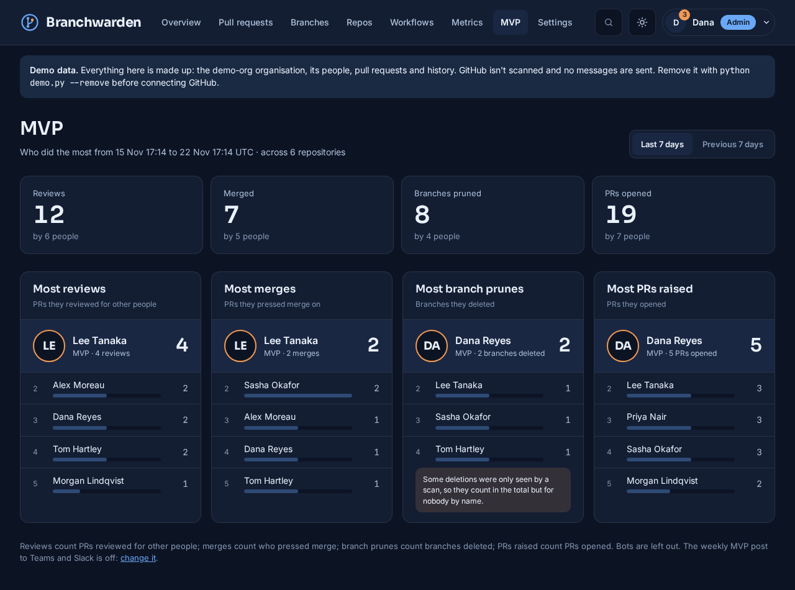

*The note on the prunes board is because three of the week's deletions were only seen by a scan.*

---

## Deliveries and scans

Every message is queued per channel and retried with back-off when Teams or Slack answers 429 or 5xx. Other errors are permanent and shown as failed, with the reason, such as Slack's `HTTP 404: no_team` for a webhook that has been removed. One broken channel never holds up another. Webhook URLs and bot tokens are secrets, so they never appear in an error.

The full record is under *Settings › Deliveries*, for admins. Everyone else sees each channel's health on the overview.

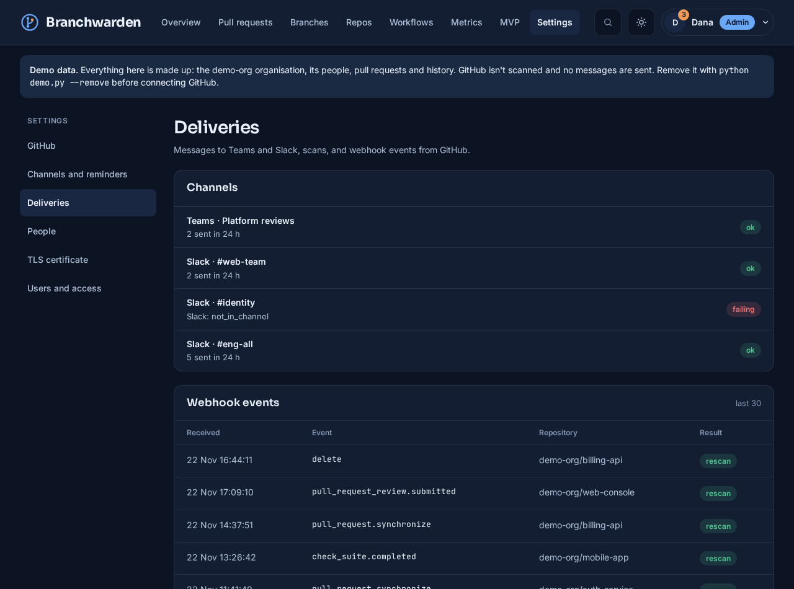

The same page lists each scan with:
- what triggered it (the schedule, a webhook, or someone pressing *Scan now*),
- how many repos, PRs and branches it read,
- how many events it found,
- how much of GitHub's hourly API budget was left.

Scans are built for large organisations:
- One request lists 100 repos, with each one's last push, open PR count and newest PR update. A scheduled scan skips the PR and branch queries for repos where none of that changed, and still reads every repo in full at least once an hour.
- Four repos are read at a time.
- When GitHub asks clients to slow down, the worker waits and tries again.

Each scan's skipped repos and request count are listed alongside the rest. Listing all 26 repos of one real account took a single request; only 2 of them had open PRs.

If scans stop altogether, every page shows a banner saying so: no full scan has finished for twice the scan interval, so PRs, reminders and messages are on hold.

In the end-to-end test, a full scan of the two test repos took about 4 seconds, and after several scans the token still had 4,986 of its 5,000 hourly points left.

---

## API, command line and Prometheus

Everything the dashboard shows or does is also a JSON API under `/api/v1`, so Branchwarden can be driven by scripts, CI and AI agents. Admin settings are covered too. Secrets stay write-only, as in the dashboard.

**Tokens.**
- **Personal:** each person makes their own on the API tokens page, under their name: read-only, or read and write, with an optional expiry. A token acts with its owner's role at the moment of each request, so changing someone's role changes what their tokens can do.
- **Service:** admins make service tokens, with a role of their own, for scripts and Grafana.
- **Storage:** a token is shown once and only its hash is kept, with when it was last used.
- **History:** every change made through the API appears in the change history, naming the token that made it.

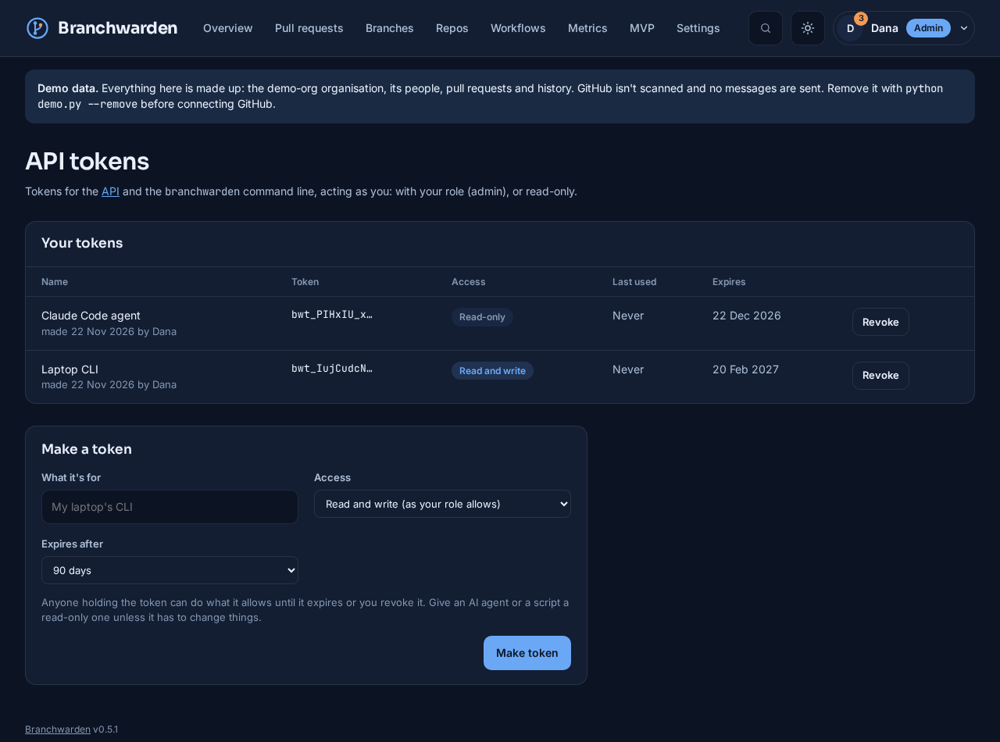

**The same rules as the dashboard, by construction.** One check decides what a viewer, member or admin may do, and both the dashboard and the API use it. Every change runs through the same code too: the same validation, the same messages and the same history lines. In CI, every endpoint is called as a viewer, a member and an admin, and with a read-only token. Each must be allowed or refused exactly as its page is. The OpenAPI document served by the app is validated and checked against the routes, so the documentation can't drift.

**Safe by default.**
- Tokens are sent as bearer tokens only; cookies aren't accepted, so a cross-site form has nothing to ride on.
- HTTPS only, with a rate limit per token.
- Requesting reviewers takes a dry run, which says what would be sent to GitHub without sending it.

**The `branchwarden` command line** wraps the API for the terminal, scripts and AI agents.
- **The token** lives in the operating system's keychain.
- **The certificate:** while Branchwarden uses its self-signed certificate, the CLI shows the certificate's fingerprint at login and pins it. A different certificate at that address is then refused.
- **Output:** `--json` gives the API's own documented JSON, and `--quiet` gives just ids.
- **Safety:** exit codes say what happened, nothing prompts when there's no terminal, and anything that writes to GitHub asks first and has a dry run.

This is real output against the demo, as Dana:

```text
$ branchwarden me
Reviews waiting on dana: 3
ID  PR                TITLE                             STATE                  WAITING ON               FOR
1   auth-service #77  AUTH-214 Rotate signing keys wi…  Awaiting review        dana, demo-org/identity  2 days
11  mobile-app #210   MOB-512 Offline mode for the in…  Awaiting review · big  dana                     36 h
13  web-console #96   WEB-12 Dark mode for the settin…  Awaiting review        dana                     24 h

$ branchwarden prs list --filter stalled
ID  PR                 TITLE                       STATE                      WAITING ON  FOR
8   data-pipeline #55  Backfill the events table   Conflicts · big · stalled  sam         21 days
3   auth-service #74   Refactor the session store  In review · big · stalled  reviewers   16 days

$ branchwarden workflows --problems
REPO           WORKFLOW       RUNS  PASSED  FAILING SINCE  MISSED  STATE
auth-service   Nightly build  13    77%     2026-11-20     1       active
data-pipeline  Docs backup    5     100%                           disabled_inactivity

$ branchwarden prs reviewers add 8 --user sam --dry-run
Would request sam on GitHub.
```

With the agent's read-only token, `branchwarden scan` answers "This token is read-only." and exits with code 3.

**For AI agents, an MCP server.** `branchwarden mcp` serves the same things as tools for Claude Code, Claude Desktop and other MCP clients. It signs in the same way as the CLI, and adding it to Claude Code is one line: `claude mcp add branchwarden -- branchwarden mcp`.
- **Reading:** an agent can ask what's waiting on you, which PRs have stalled, which workflows are failing or which branches to tidy. Those tools are marked read-only.
- **Acting:** the tools that change things say so. Requesting reviewers is marked as writing to GitHub, and it's a dry run unless the agent explicitly asks otherwise, so it shows what it would do first.
- **The token sets the limits:** given a read-only token, an agent can look but not change anything, whatever it tries. The server refuses.

The API tokens page shows how to connect, with this server's own details filled in, including the fingerprint to trust while its certificate is self-signed:

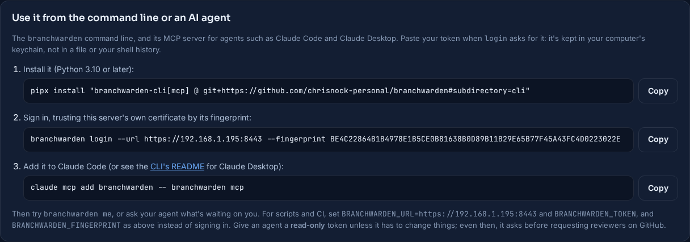

**Over HTTP, for agents on other machines.** `branchwarden mcp --http` serves the same tools over MCP's streamable HTTP. It keeps no token of its own:
- **Each client brings its own token.** It sends its own Branchwarden API token, which is checked with Branchwarden and used only for that client's calls, so each agent gets exactly what its own token allows.
- **Bad tokens are refused and throttled.** A request without a valid token gets 401, and repeated bad tokens from one address are throttled.
- **Tokens aren't sent in the clear.** Beyond the machine it runs on, it needs TLS (or a proxy in front that does it).

The server moved to version 2 of the MCP SDK at the same time.

**As a service next to the app.** The image includes the command line, so `podman-compose --profile mcp up -d` runs the HTTP server as one more container. There's a quadlet for it too. It's off unless asked for.
- **One certificate:** it reaches the dashboard over the stack's own network, pinning the dashboard's certificate. It serves that same certificate, so agents trust one fingerprint for both. When the certificate is replaced in the dashboard, it notices and restarts with the new one.
- **Bad tokens can't lock everyone out:** every client's check reaches the API from this one container. So it caps bad tokens in total, below the point where the API would throttle its address. Someone guessing from many machines can't lock everyone else out, and tokens already checked keep working.
- **A real client:** Claude Code, on another machine on the LAN, connected to it and used it. With a read-only token, it answered what was waiting on the user and which PRs had stalled. Asked to start a scan, it reported the refusal word for word. It needed the self-signed certificate trusted through `NODE_EXTRA_CA_CERTS`, which the README now says.


*A real Claude Code session against the released 0.8.0 with demo data. The server's LAN address is shown as branchwarden.example, and the token is cut short; the rest is as it came.*

In CI, the MCP SDK's own client starts the server over stdio and calls its tools against the running app with the demo data. Over HTTP, two clients with different tokens each get their own token's rights. CI also starts the service in the real stack on every push, and checks that it refuses a request without a token, answers one with a token, and serves the dashboard's certificate.

**Prometheus.** `/metrics/prometheus` serves the headline numbers for Grafana and alerting, labelled by repo:
- open PRs by state, and flagged ones,
- branches by status, and reviews waiting per reviewer,
- review and merge times, as medians and 90th percentiles,
- failing workflows and repo health,
- the worker's own health: the last scan, errors, the API budget, whether scans have stopped, and messages pending and failed.

It's scraped with a read-only service token, so there's no separate secret to manage. These lines are from a real scrape of the demo:

```text
branchwarden_reviews_waiting{reviewer="dana"} 3
branchwarden_pull_requests_flagged{repo="demo-org/data-pipeline",flag="stalled"} 1
branchwarden_branches{repo="demo-org/auth-service",status="stale"} 2
branchwarden_time_to_merge_hours{repo="demo-org/billing-api",quantile="0.5"} 45.124
branchwarden_scans_stopped 0
branchwarden_messages{status="failed"} 0
```

---

## Connecting GitHub

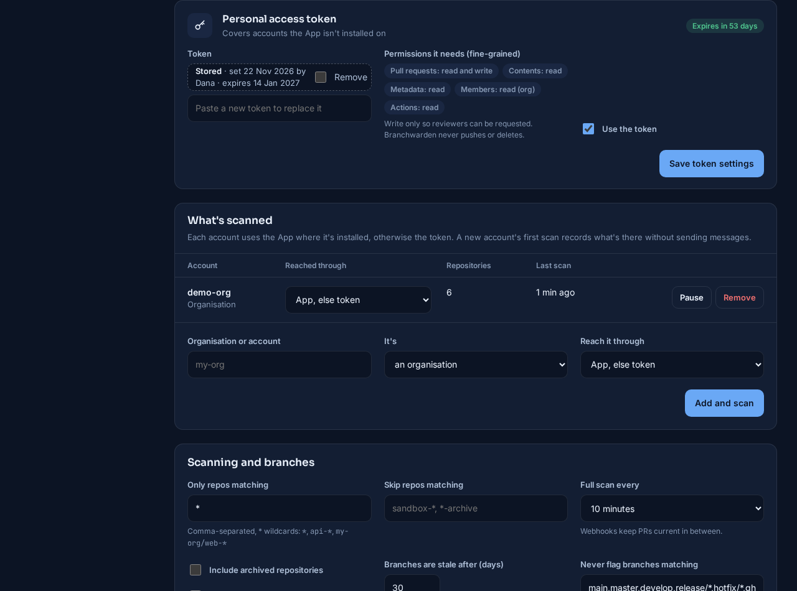

Two kinds of connection, usable together. Both need read access to pull requests, contents, metadata, members and Actions, plus write access to pull requests, only for requesting reviewers:
- **A GitHub App** suits organisations. It has its own API budget and sends webhooks, so PR changes show up in seconds instead of at the next scan. Once its ID and private key are in, the page lists every installation and its permissions.
- **A fine-grained personal access token** is the quickest start. Branchwarden reads its expiry date from GitHub and warns 14 days ahead.

Each account can be set to use the App, the token, or the App with the token as fallback. Repos are included or skipped by pattern, and archived repos and forks are left out unless you ask for them.

---

## Who gets in

**Sign in with GitHub** works with an OAuth App or the GitHub App's own credentials.
- **Who gets which role:** admins list logins, `org/team` slugs or whole organisations against each role (admin, member, viewer).
- **Every sign-in:** the person's role is worked out again from their GitHub teams. Anyone matching no list is turned away, so having a GitHub account isn't enough.
- **The token:** the sign-in uses PKCE and a state check. The GitHub token is only used to read the person's teams, and is never stored.
- **Landing page:** people who sign in this way go straight to My work.
- **Fallback:** local accounts keep working, so an admin can always get in.

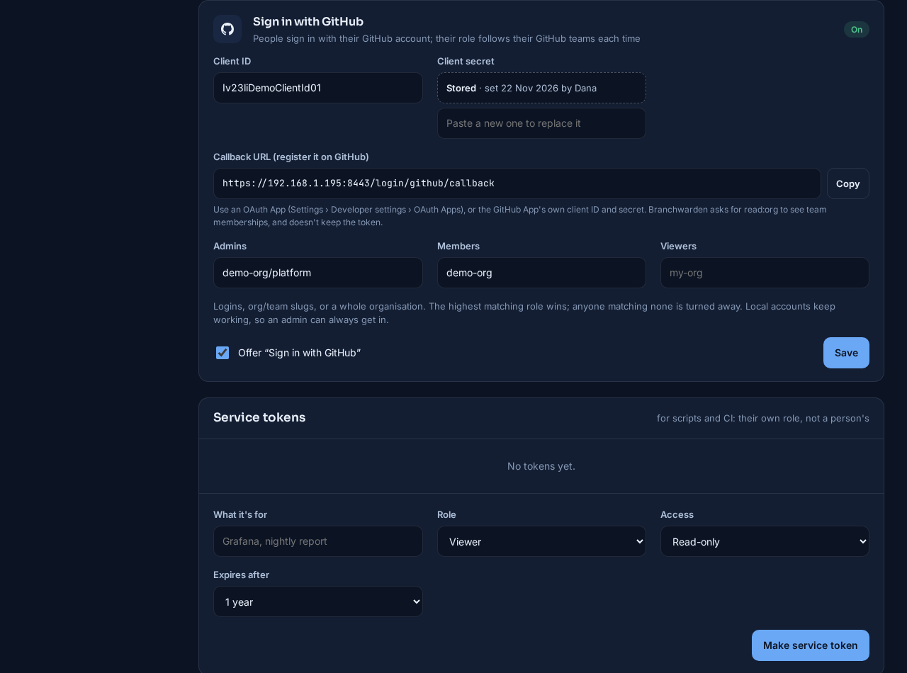

The three roles:
- **Viewers** read everything outside Settings, including their own My work.
- **Members** can also request reviewers, snooze reminders, ignore branches and start a scan.
- **Admins** also get Settings: connections, channels and rules, deliveries, people, the certificate and users.

---

## Security

The project was built against a security review of all my repos, with its "secure by default" checklist applied from the first line:

- **HTTPS only.**
  - The dashboard serves TLS 1.2 and up. On the first start it generates a self-signed certificate for the host's names and addresses.
  - An admin can upload a real one. It's checked before anything changes (the key must match, and the certificate must be in date), and the previous one is kept so it can be restored.
  - HSTS is on, and cookies are always `Secure`.
- **Secrets sealed at rest.**
  - The GitHub token, the App's private key, the webhook secret, the sign-in client secret and every channel's webhook URL or bot token are encrypted with AES-256-GCM.
  - The key is generated into its own volume, apart from the database, and can be rotated.
  - No secret is ever shown again once saved.
- **Nothing open by default.**
  - There's no default admin: the first account needs a one-time code from the server's log.
  - The database has no default password and isn't reachable from outside.
  - Webhooks without a valid signature are refused, and so is everything when no secret is set.
  - Forms carry CSRF tokens, sign-ins are throttled, and channel URLs must be HTTPS on Slack's or Microsoft's hosts.
- **A private route for reports:** vulnerabilities go through GitHub's private vulnerability reporting, as the repo's SECURITY.md explains.
- **Data kept no longer than needed.** Closed PRs are kept for 365 days (the metrics use them). Messages, workflow runs and scans are kept for 90 days. Older records are removed every hour.

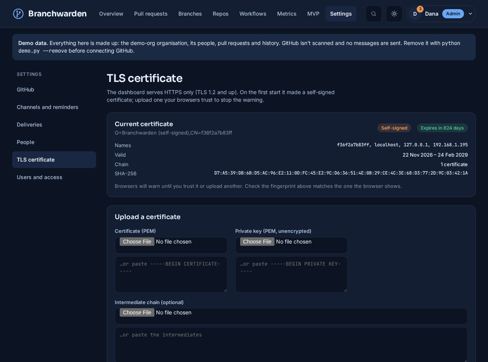

---

## How it runs

Three containers with podman-compose or Docker Compose: Postgres, a worker (scans, rules, auto-assign, delivery and housekeeping) and the dashboard (gunicorn over HTTPS). Settings, channels and rules are all changed in the browser. The `.env` file holds only the database password, the published port and the certificate's names.

- **The image:** each release is published for amd64 and arm64 at `ghcr.io/chrisnock-personal/branchwarden`, so installing is `podman-compose pull && podman-compose up -d`, and so is updating.
- **Upgrading older installs:** a step-by-step guide covers moving an install built on the server to the published image, and going back. It was tested by upgrading a real 0.1.0 install with data and sealed secrets, then rolling it back. That test caught a bug: an older backup wouldn't restore over a newer database. It was fixed in 0.6.2, and CI now checks that case on every push. The whole upgrade and rollback was repeated against 0.8.0, and every step worked as written.
- **Dependency updates:** Dependabot opens grouped update PRs weekly, and CI tests each one.
- **Health checks:** compose checks the dashboard through `/healthz`, which also checks the database. It checks the worker by a heartbeat that keeps beating through long scans.
- **Running as a service:** Podman quadlet files run the same containers as systemd services, on the same volumes, for an always-on server. The optional MCP service has one too. Volumes that two containers share are labelled to work with SELinux enforcing.
- **Backups:** one command writes the database, the encryption key, the TLS certificate and the settings to a single file, encrypted with [age](https://age-encryption.org) to a public key, so the server can make backups it can't read. Another command restores them on the same host or a fresh one. CI backs up the real stack, destroys it, restores it and checks a sealed secret still decrypts, on every push.
- **Trying it without GitHub:** `python demo.py` in the worker loads made-up activity for a demo organisation: six repositories, eight people, PRs in every state and five weeks of history. While it's loaded, every page says so, nothing is scanned or sent, and connecting GitHub is refused until `python demo.py --remove` takes it out.

## Status

Version 0.8.1 (November 2026). It fixes three bugs found in a bug hunt of the newest code:
- **The morning message:** it now belongs to the account that set it up. Before, it kept going after that account was removed, and another account could switch it off or redirect it.
- **API booleans:** the API accepted the string "false" as true.
- **The MCP gate:** a short outage counted as bad tokens.

Each fix has a test, and each finding is recorded as an issue, with two smaller ones still open. 0.8.0 runs the MCP server as an optional service next to the app, and fixes the shared volumes' SELinux labels for hosts that enforce it. 0.7.0 added the MCP server over HTTP and the morning message in Teams, and moved to Python 3.15 and version 2 of the MCP SDK. 0.6.0 added the MCP server for AI agents, 0.6.1 the connection steps on the API tokens page, and 0.6.2 the upgrade guide and a fix for going back to an older backup. 0.5.0 brought the API, the command line, the Prometheus endpoint and the Slack morning message, and 0.5.1 tightened API tokens after a security review: tokens of people who sign in with GitHub now follow their GitHub access, and bad tokens are throttled. Encrypted backups came in 0.4.1, demo mode and the integration and browser tests in 0.4.0, repositories and their health in 0.3.0, and workflows in 0.2.0.

- **Continuous integration:** every push runs 177 tests and three checks, and the [current status](https://github.com/chrisnock-personal/branchwarden/actions/workflows/ci.yml) is public.
  - **Unit tests (141):**
    - PR states, an author's next step, branch rules and CODEOWNERS matching,
    - reviewer selection and working-hours maths,
    - message rendering and escaping, and Slack API answers,
    - webhook signatures, encryption and key rotation, the GitHub sign-in role rules and certificate checks,
    - the MVP rankings and the weekly post,
    - cron parsing, reading workflow files, matching scheduled runs to their due times (including runs hours late, and dropped ones), and when a workflow counts as failing or fixed,
    - importing past PRs, skipping unchanged repos, waiting out GitHub's rate limits, health checks and the scans-stopped rule,
    - repository health flags, PR size and stall rules, and ticket keys,
    - who may do what, the API accepting only real true/false values, the OpenAPI document (valid, and matching every route), the CLI's parsing and output, and its certificate pinning against a real HTTPS server, and the MCP server's HTTP token gate, its throttle, its refusal to send tokens in the clear, its cap on bad tokens in total, not counting an outage as bad tokens, and the MCP service pinning the certificate fingerprint the dashboard shows, including for a certificate chain.
  - **Integration tests (35), against a real Postgres:**
    - the scanner end to end against a stand-in for GitHub: a silent first scan, then opened, ready, review, merged and closed events, and deleted branches recorded,
    - unchanged repos skipped with a single request,
    - messages routed to the right channel, then sent, retried after a minute, or failed for good, without the webhook URL ever appearing in an error,
    - a workflow starting to fail,
    - the demo data loading, refusing to mix with real data, and coming out again,
    - every page rendering with it, and forms posting (and refused without their CSRF token),
    - every API endpoint called as each role and with a read-only token, and allowed or refused as its page is; tokens expiring, being revoked, following their owner's role, and lapsing for a GitHub sign-in that's 30 days old; bad tokens throttled,
    - every CLI command against the running app, with its exit codes,
    - the MCP server over stdio, driven by the MCP SDK's own client: its tools against the demo, the reviewer dry run, and a read-only token refused an action,
    - the MCP server over HTTP with the SDK's HTTP client: a read-write and a read-only client each limited to their own token, and requests without a valid token refused,
    - the Prometheus output, parsed with Prometheus's own client library,
    - the morning message: not before its time or on days off, once a day, retried when Slack is busy; and to Teams instead, with no Slack set up, its webhook URL stored encrypted; sent only while the account that set it up exists, not changeable by another account claiming the same login, and kept for people who opted in before upgrading.
  - **Browser test, in Chromium:** first-run setup, every section from the header, a repository page, filters, a workflow row, the theme switch, a form and the menu, and an API token made on its page and then used. It fails on any script error.
  - **Backup round trip:** the real stack with docker compose, backed up, destroyed and restored, and then restored again over a newer database, as when going back after an upgrade.
  - **Checks:** `pip-audit` (no known vulnerabilities in the pinned versions) and `gitleaks` (no secrets anywhere in the history).
  - **Releases:** the release workflow builds the published image only from a tag that matches the version in the code and whose commit has passed CI.
- **End-to-end test:** run against two throwaway private repositories. It covered:
  - a first scan and three live events,
  - Teams and Slack delivery, and Slack threads, against local stand-ins,
  - a digest, and a refused review request,
  - a simulated week of reminders: sent on the first due time, held for the repeat interval, stopped at the maximum, silent on Sunday, and skipped for a snoozed PR,
  - auto-assign making one attempt per PR,
  - the start of a GitHub sign-in, and the refusal of a forged one.
- **In real use:** a GitHub App installation on a real organisation, with real Teams and Slack workspaces. The one problem it found, merges counting 0 on a new install, was fixed in 0.2.1 by importing the last 180 days of PRs.
- **Made-up demo activity** was used to check the pages a small test can't fill, and for every screenshot here.
- **Not yet tested:**
  - scans of an organisation with hundreds of repositories,
  - the quadlet files, outside a dry run,
  - GitHub Enterprise Server,
  - a full GitHub sign-in,
  - an auto-assigned review on a repo with more than one person,
  - the morning message in a real Slack workspace or Teams chat (channel messages have been),
