# CallNest

**A call recorder for contact centres and anyone else who has to keep calls, built on open standards: it captures calls from a phone system, stores them so they can be trusted, and turns them into something you can search, listen to, check and act on.** It runs on your own server as a handful of containers, and call audio never has to leave it.

A recording nobody can find, or nobody can prove is unaltered, is not worth much. CallNest takes recordings from Asterisk, SIPREC session border controllers, plain SIP or a packet capture, links each one to its call record, measures exactly what was captured and what was lost, and seals it into a tamper-evident chain. On top of that sit the things people actually use recordings for: transcripts, alerts on what was said, compliance checks, quality scoring, and answers to questions about calls, with every word of evidence checked against the transcript.

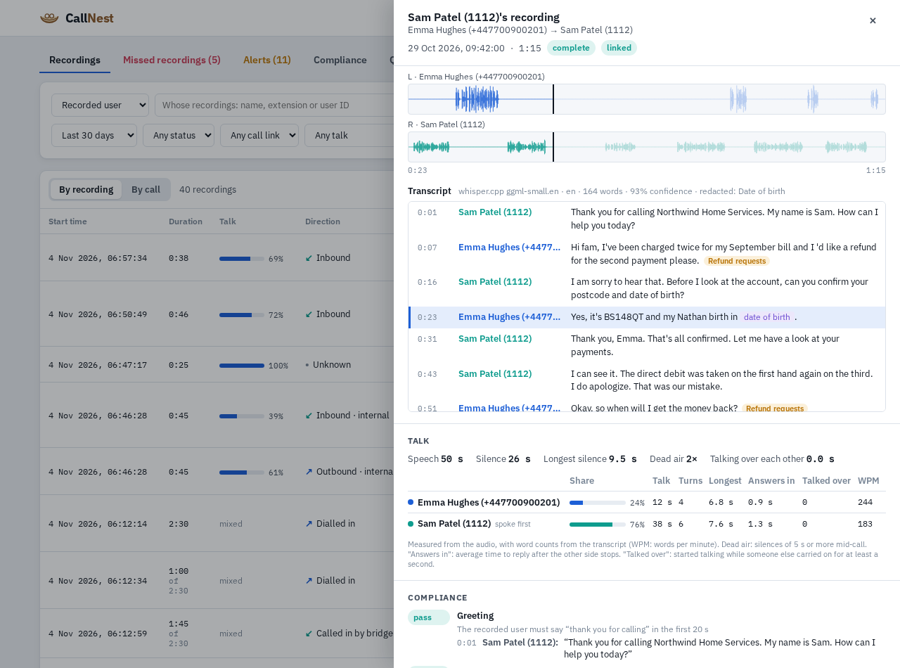

*A billing call playing at 0:23. Each party has their own waveform, and the transcript follows along: click any line to play from there. The line being spoken is the one where the customer gave a date of birth, which was taken out of the transcript and muted in the audio.*

Everything on this page comes from a real run. The company is fictional and the voices are synthesised, so transcripts contain the mistakes a speech model makes on them ("Nathan birth" for "date of birth"). The calls themselves went through the same pipeline as any other: 38 recordings from five kinds of source, with Asterisk, [CallRaven](../callraven/README.md)'s SIPREC client and CallOwl as the real systems on the other end.

---

## At a glance

| | |
|---|---|
| **Capture** | Live over SIPREC (RFC 7866) or plain SIP, post-call from Asterisk, packet capture import, file upload; G.711, G.722, Opus; SRTP and SIP over TLS |
| **Find and listen** | One row per recorded person, search by anyone or by words said, a player with per-party waveforms, gaps and a synced transcript |
| **Transcripts** | Per-speaker transcripts on your own hardware, with card numbers, bank details and dates of birth removed before they are stored |
| **Conversation checks** | Talk metrics, phrase alerts, must-say and must-never-say compliance rules |
| **AI, if you want it** | Call summaries, QA scorecards and questions about calls, on a local model or Claude, with every quote checked against the transcript |
| **Call records** | Links recordings to Open CDR call records, fills in what the recorder couldn't know, and flags calls that should have been recorded and weren't |
| **Trust** | Encryption at rest, a signed hash chain, RFC 3161 timestamps, retention rules, legal hold, a log of who heard what, backups |
| **Access** | Viewers scoped to groups and platforms, two-step sign-in, API keys for machines, a REST API for everything |

---

## Capture from whatever you have

**Live, over SIPREC.** CallNest is a Session Recording Server: point a session border controller, or any SIPREC client, at it and calls appear in the list the moment they start. **Plain SIP** works too, so any PBX can dial CallNest into a call as an ordinary party, for a conference, a dictation line or a monitoring leg. It answers, listens and records. On both, the recorder writes each stream's packets to disk as they arrive and, at the end of the call, measures every stream: packets, loss, jitter and gaps. Each packet is placed by its RTP timestamp, so lost audio stays as silence in the right place and the two sides stay aligned. If the recorder restarts mid-call, the session is closed at the last packet captured and still uploaded, with a note saying so.

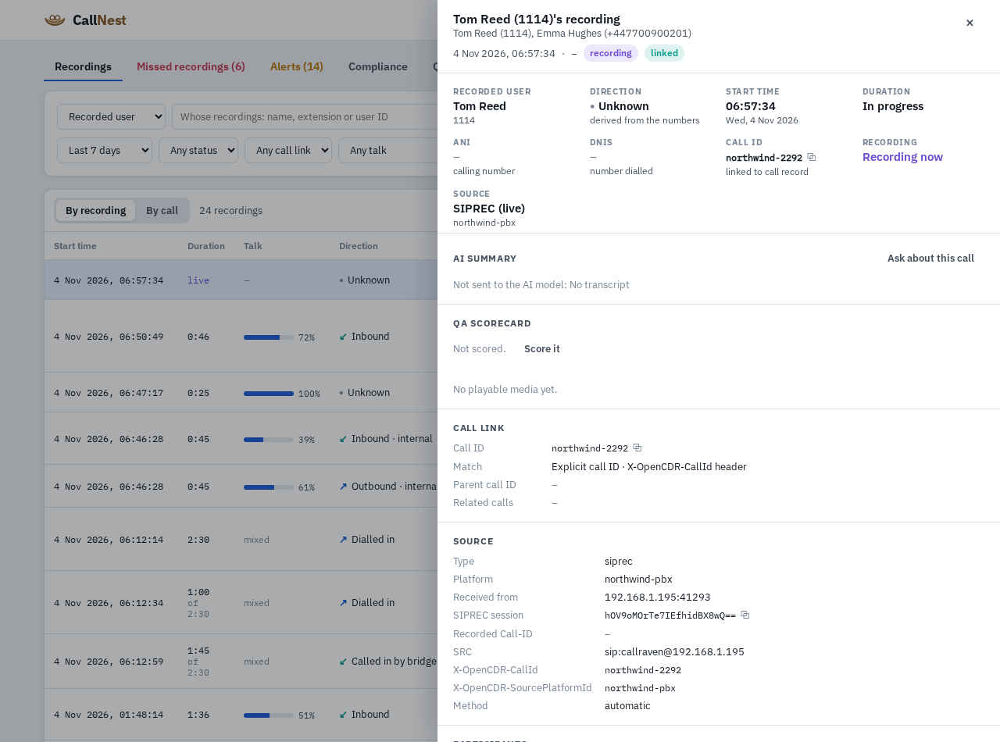

*A live SIPREC session from CallRaven's SIPREC client, seconds after it started. It is already in the list, marked "Recording now", and linked to its call record by the `X-OpenCDR-CallId` header.*

Encrypted media is decrypted as it arrives: SDES-SRTP with both AES-128 suites, with keys held only in memory and never written to disk or logs. Signalling can run over TLS, with client certificates if you want them.

**After the call, from Asterisk.** A MixMonitor hook and a small push script send each recording when it ends, and keep it in a spool if CallNest is unreachable. Both legs of a call can be recorded separately, one per person, sharing an ID. For this page, a real Asterisk 20 recorded an internal call with both legs, and dialled the recorder in over SIP for a dictation line.

**From a packet capture.** Upload a pcap or pcapng file from tcpdump, Wireshark or CallRaven and CallNest makes a recording of it. It finds the RTP streams from the packets themselves rather than trusting addresses in the signalling, decodes them, and reads the caller, callee and codecs from the SIP in the capture. Below, a real capture of a call to an IVR, imported with no other information. A capture with no call ID can't be linked for certain, so CallNest suggests a match from its call records and waits for an admin to confirm it.

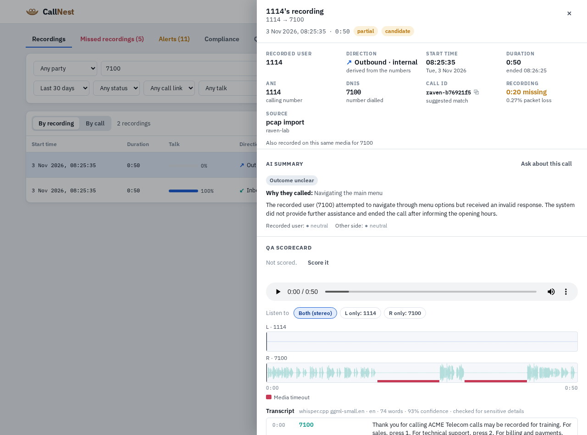

*A real capture of a call to an IVR. The parties came from the SIP in the file, the gaps in the audio were measured, and the suggested call record scores 100% but stays a suggestion until someone confirms it. Nothing is linked on a guess.*

**By upload.** A JSON metadata part plus audio files (WAV, Ogg/Opus, MP3). Retrying with the same key returns the same recording, so scripts can retry safely.

Whatever the source, the worker keeps the original byte for byte as evidence, renders a stereo playback copy with one party on each channel, and makes a small Opus archive copy.

---

## Find the call

The list has one row per recorded person, so anyone's recordings can be found on their own: an internal call between two recorded users appears once for each. Direction is shown as that person saw it. Badges on each row show what's known about the call at a glance: alerts, compliance failures, sensitive details, QA score, legal hold. A second view, **By call**, shows one row per recording with everyone on it.

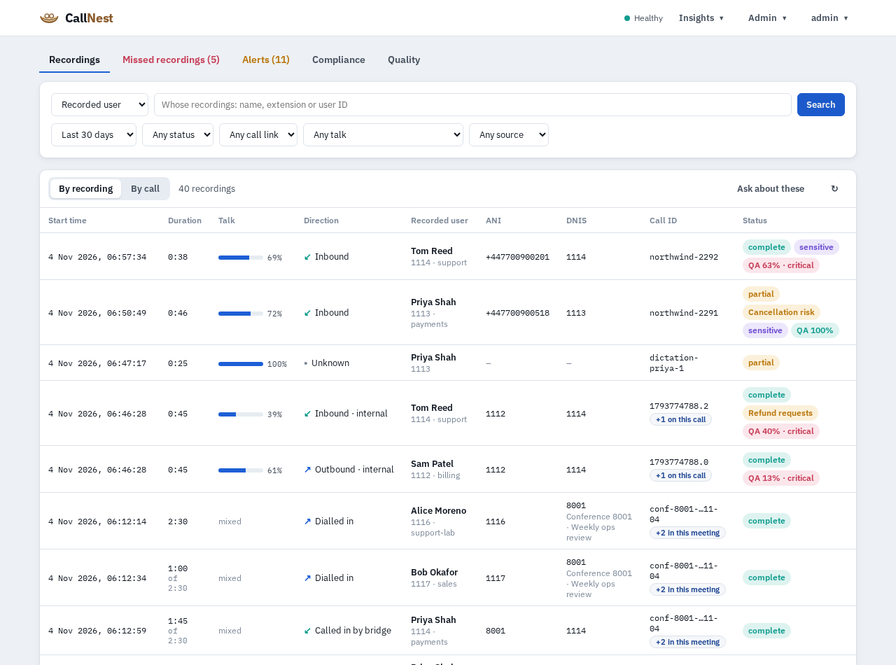

*40 rows from the 36 recordings of the last 30 days. Anyone recorded on the same call gets a row of their own, marked "+1 on this call".*

Search by recorded user, by anyone on the call, by call ID, Asterisk linked ID or SIP Call-ID across all time, or by **words said**. Words said takes web-search syntax with English stemming: `refund or credit -cancel` finds calls that mention a refund or a credit but not cancelling, and `refund` also finds "refunded". Filters narrow by status, source, call link and talk pattern: long monologues, does most of the talking, mostly listens, long silences.

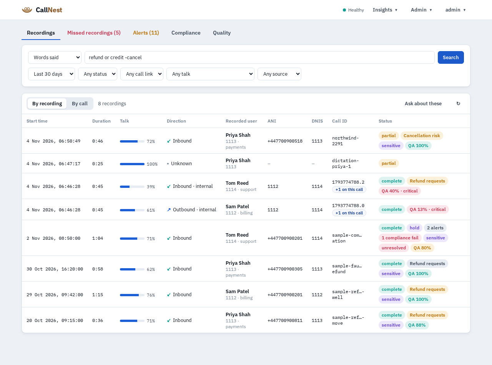

---

## Listen, and see what was lost

The player shows one waveform per party. On stereo recordings, **Listen to** plays one person in both ears. Gaps are drawn on the timeline and named: striped amber for an intentional pause, such as during a card payment, and red for audio that went missing.

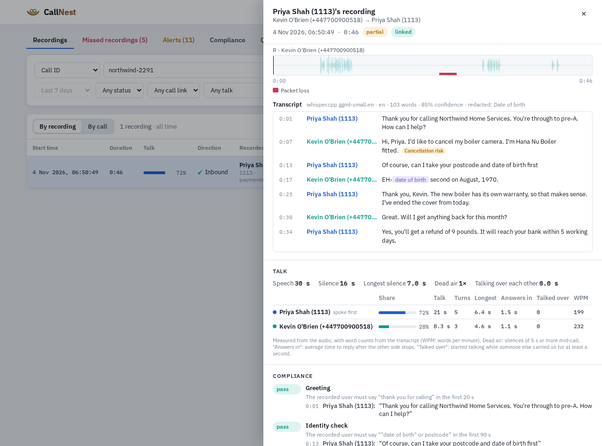

*During this SIPREC call, 2.5 seconds of one direction's packets were deliberately dropped on the wire. The recorder counted exactly the 125 packets dropped, reported the gap as `packet_loss` at the right moment, and marked the recording `partial`. The other direction shows no loss.*

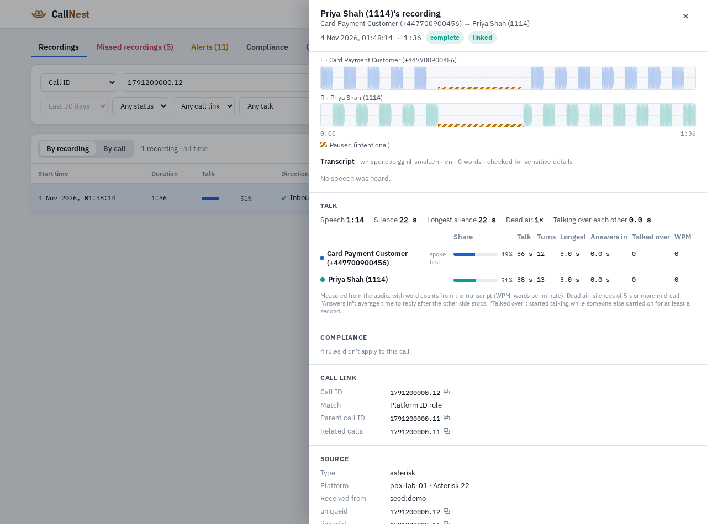

*A generated test call with two intentional pauses for a card payment. Pauses don't count as lost audio.*

A recording is never quietly incomplete. Its status says `partial`, the detail page shows why, and the event timeline records everything that happened to it: when it started, how it was correlated, what was redacted, and what changed afterwards. Every file is listed with its SHA-256.

---

## Transcripts, without the sensitive parts

Transcription is optional and runs on your own hardware using whisper.cpp, on a CPU or a shared GPU server. On the GPU used here, each call took 3 or 4 seconds. Each party's channel is transcribed on its own, so every line is labelled with who said it without guessing, and CallNest finds each person's turns of speech from the audio itself, because Whisper's own timestamps drift across long silences. Transcripts go into a full-text index for search, and are sealed into the integrity chain like the audio.

**Redaction** removes card numbers, security codes, expiry dates, sort codes, account numbers, IBANs and dates of birth before the transcript is stored, so they never reach the database, search, alerts or the AI model. It copes with how people really say these things: spoken digits, "double five", and a card number read in groups across several turns with the agent saying "yep" in between. You can add your own patterns, such as a policy number format.

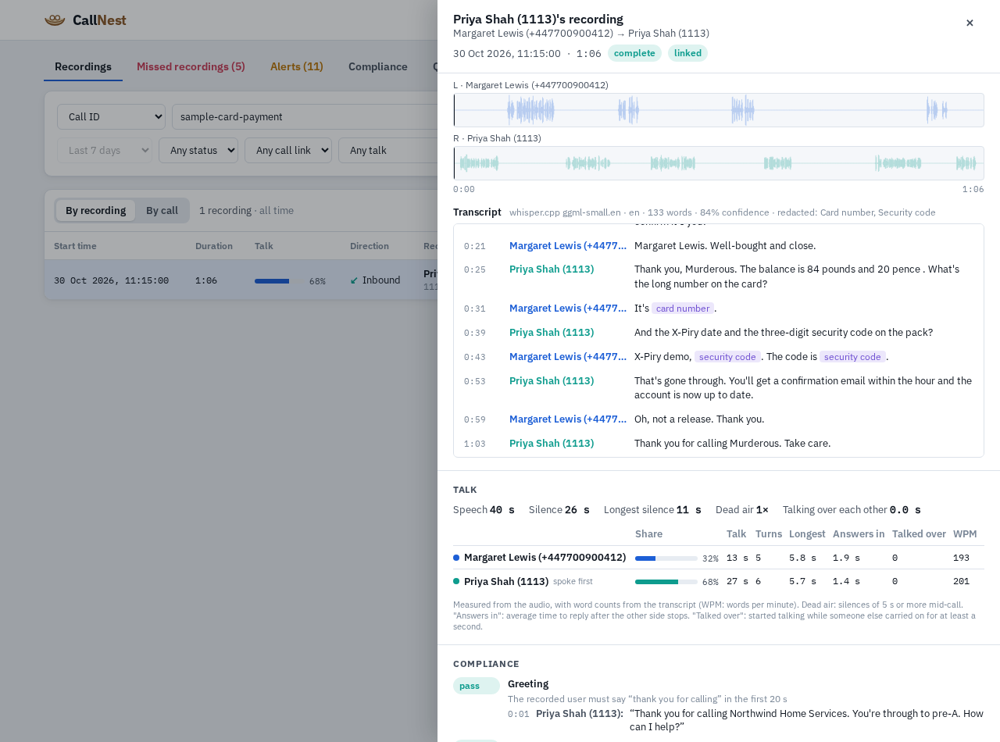

*A customer read out a card number, then the expiry date and security code. All of it was replaced with labels, the expiry under "security code". Findings record what kind of detail was said and when, never its value. Here, 20 of the 38 recordings had something removed.*

Optionally, the audio is muted too. Clean playback and archive copies replace the originals, and the replaced files stay listed with their hashes, so the integrity chain still verifies. The uploaded or captured original is kept as evidence that only admins can fetch.

---

## Talk metrics

Every finished recording is measured, with or without a transcript: each person's share of the talking, turns, longest turn, how quickly they answer, how often they talk over someone, and words per minute, plus silence, dead air and overlap for the call.

Talk analytics shows each recorded user's averages over 7, 30 or 90 days. Click a name to see their calls.

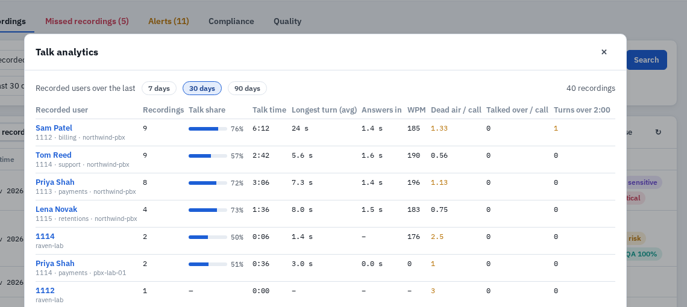

*Sam talks 76% of the time on average, with one turn over two minutes: a call explaining a new contract, which the "Long monologue" filter finds at once. On another call, where a customer argued with the agent, the metrics counted two interruptions and 3.27 seconds of overlap.*

---

## Phrase alerts

Saved searches that run on every new transcript. Choose the words, who has to say them (anyone, the recorded user, or the other side), and which calls count. **Try it** shows what a rule would have matched over the last 30 days before you save it, and a match can post to a webhook, in a form Slack and Teams accept.

Matches go to the **Alerts** tab to be reviewed, with a note if needed, and show as a tag on the transcript line.

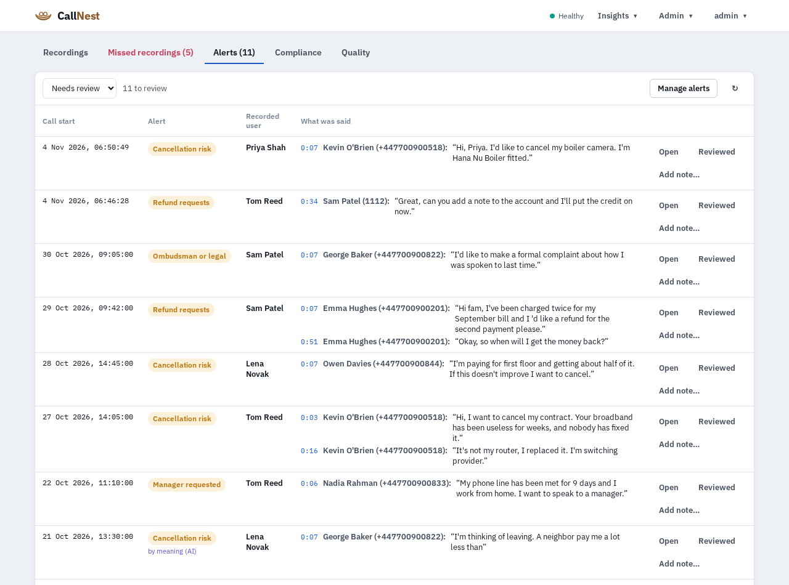

*Four alerts raised 14 matches on this run, three of them reviewed so far. "Cancellation risk" is limited to what the customer says, so an agent explaining a cancellation policy doesn't trigger it. The last match shown, "I'm thinking of leaving", was found by meaning, with no cancellation word in it.*

Words only go so far: people say "I've had enough, I'm taking my business elsewhere" without saying "cancel". So a rule can list other wordings, which is instant and predictable, and can also **match by meaning**, where the AI model looks for the same intent in any words. A meaning match only counts if the quote it gives is really in the transcript, said by the right person.

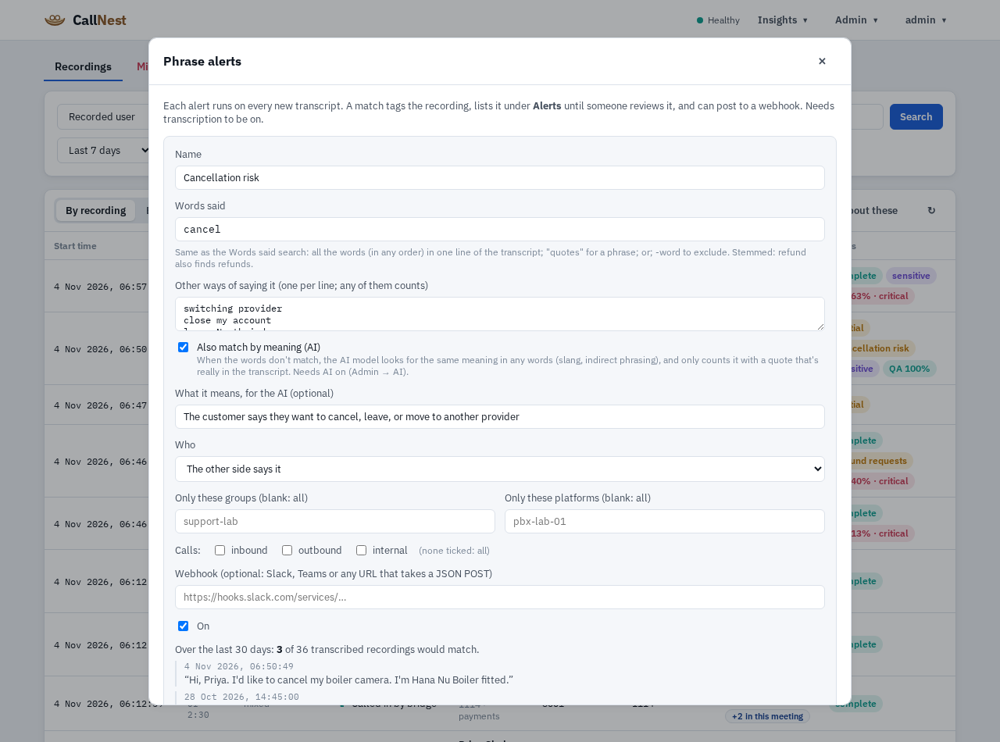

---

## Compliance checks

Rules for what must, or must never, be said. "The agent must say 'thank you for calling' in the first 20 seconds." "The agent must never say 'guarantee'." Each transcribed recording gets a pass, fail or not applicable for each rule, with the lines that prove it. A rule can be limited to certain groups, platforms, directions or a minimum call length. Results keep the rule as it was when checked, so editing a rule doesn't quietly rewrite the past.

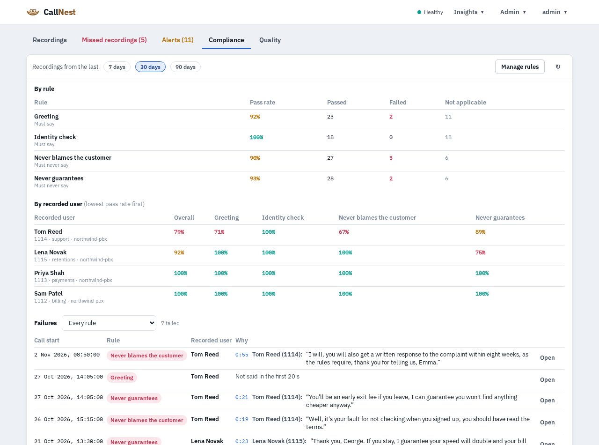

*Four rules over 30 days, with pass rates per rule and per recorded user, and each failure with its evidence. Tom's calls account for most of them.*

---

## AI, on your terms

All of this is optional and off by default. One language model serves the whole deployment: a **local model** on your own network (Ollama, LM Studio, vLLM), where nothing leaves it, or **Anthropic's Claude**, which gives better answers but sends transcripts to Anthropic and is billed by the token, with a daily budget.

Because these are call recordings, the rules are strict. Only transcripts are sent, never audio. Chosen groups and platforms can be excluded entirely. With Claude, a transcript is only sent if it has been redacted. Every request is in the audit log with its token count. And the answers are suggestions: they never change a recording or a compliance result.

**Call summaries** give why they called, what happened, the outcome, follow-ups, topics from your own list, sentiment at the start and end for each side, and escalation risk.

**QA scorecards** are your own checklist of weighted yes/no questions, some of them critical. The model answers each with word-for-word quotes, and CallNest checks every quote against the transcript. A "yes" with no real quote behind it earns nothing until a person confirms it. A reviewer can change any answer, and the change is kept beside the AI's original.

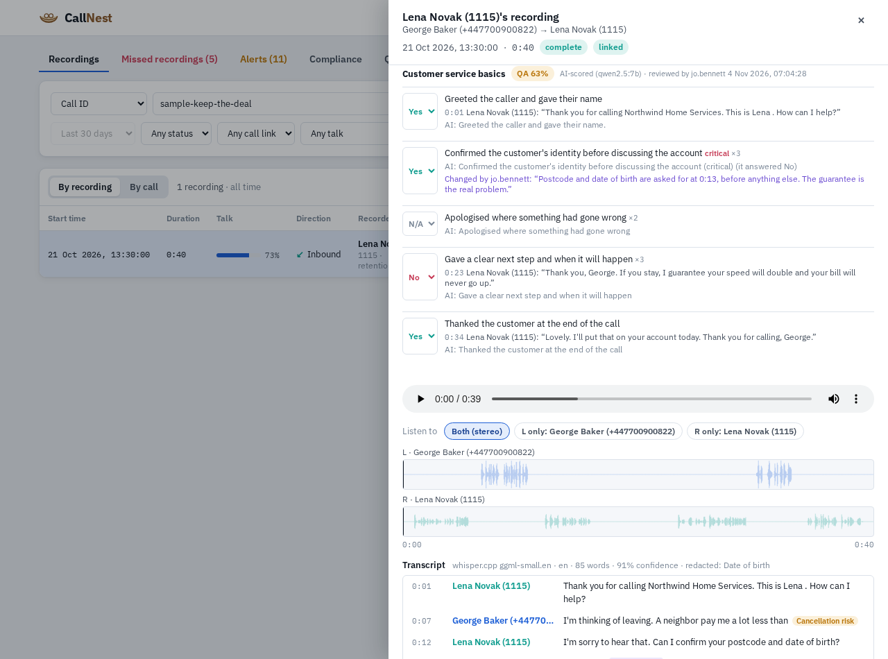

*The model marked the critical identity question "No" on this call. A reviewer changed it to Yes, with a note. The AI's answer stays visible, the score was recalculated, and re-scoring won't overwrite it.*

The **Quality** tab shows each scorecard's average, how often each question passes, and each person's average, lowest first, then the calls most worth a reviewer's time: critical fails and lowest scores first.

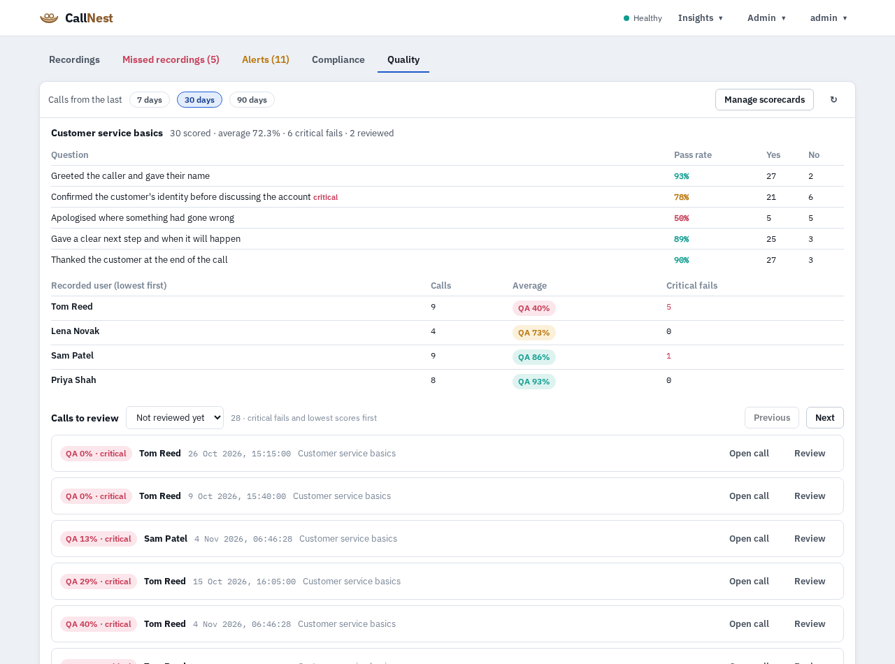

**Ask about calls** answers questions about one call, a search result of up to 25 calls, or a repeat caller. The answer refers to calls by name and time, each reference is a link, and only quotes that are really in the transcripts are shown. Questions cover only calls the person asking can already see.

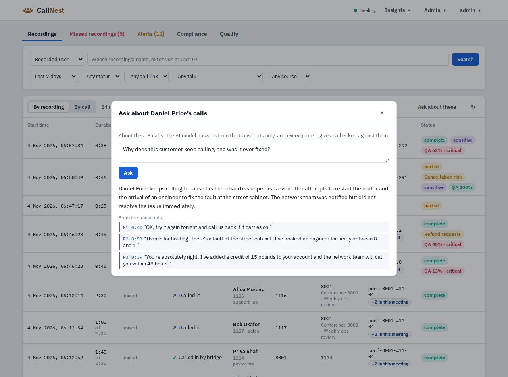

**What to expect from a small local model.** This run used Qwen 2.5 7B on an 8 GB GPU, and it's worth being plain about the results. Summaries and scores were mostly sound, and checking quotes against the transcript does what it's meant to, but the model does make mistakes. Read back against the calls, it got the critical identity question right on 20 calls of 30, so the scores on this page are a guide for a reviewer and no more. One summary said a customer left when they stayed. A meaning rule flagged one call that it shouldn't have. Asking a question failed about half the time (9 of 20 tries) with "the model gave no answer", and worked when asked again, because a local server can't force the model to answer in the structured form CallNest asks for. Claude can be made to, but Claude wasn't used for this run.

---

## Repeat callers

**Insights → Repeat callers** lists outside numbers that called more than once. It shows whether the same topic came up on more than one call, how many ended unresolved, and any calls that were never recorded. One button asks the model why they kept calling.

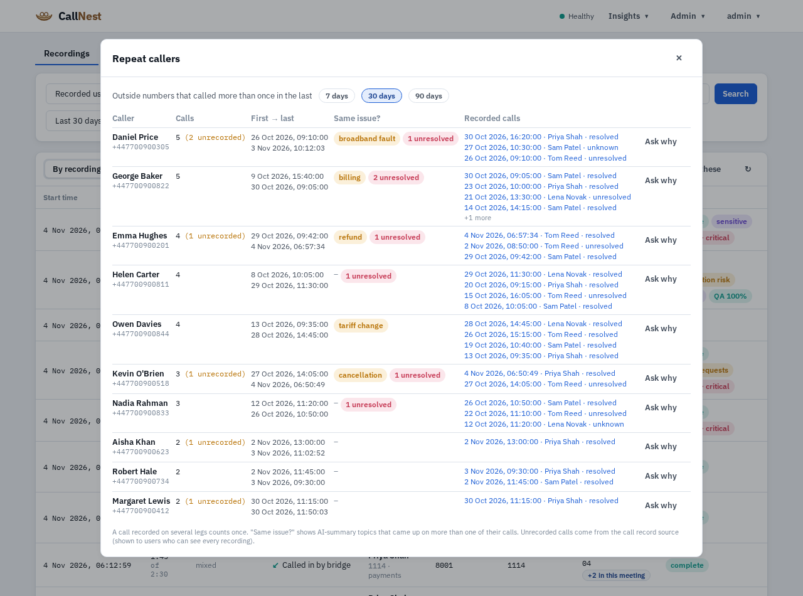

*Daniel Price called five times in eight days about the same broadband fault. Two of those calls appear only in the call records, because they were never recorded.*

---

## Call records and missed recordings

A recording source often knows little about a call. SIPREC, for one, says nothing about direction, or the agent's user or group. CallNest reads call records from **[CallOwl](../callowl/README.md)**, or anything serving the [Open CDR](../open-cdr/README.md) read API, and fills in what's missing. The SIPREC calls on this page showed "Unknown" direction while they ran. Once their records were read, they showed "Inbound", with the agent's group, and the timeline notes what changed and why.

The same records answer the question every recorder has to answer: **was everything recorded that should have been?** Any call where someone should have been recorded, because the record says so or because your policy says so, and wasn't, is flagged. So is a recording that covers too little of the call. Nothing is flagged until a grace period has passed, and a late recording resolves its own row. An admin can acknowledge a row, with a reason, which is audited.

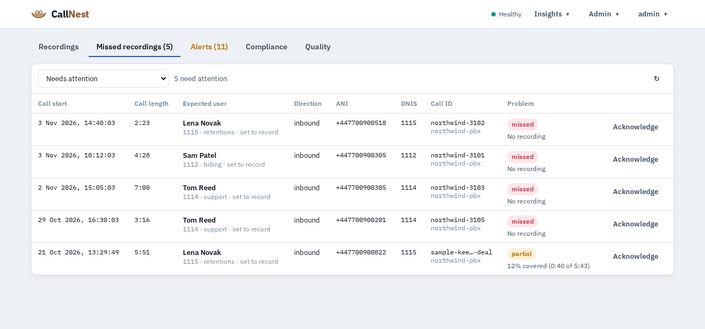

*Four calls that should have been recorded and weren't, and one recording that stopped after 40 seconds of a 5 minute 43 second call. A sixth was acknowledged with a reason, and a call marked "do not record" was correctly left alone.*

Reading is built for either side being offline. The read position only moves after a successful read, and a regular re-read of recent history catches records that arrive late.

---

## Keep what you must, delete what you should

**Retention policies** match groups, platforms and source types, and the first match by priority sets the keep-until date: seven years for payments and 90 days for support, in this run. You see a preview before applying a change to existing recordings, and **deletion stays off until you turn it on**. Until then, a list shows what would go.

Deleting removes the media, and replaces the recording with an entry in a **deletion log** that keeps the IDs, times, policy, reason and each file's SHA-256, but no names or numbers. The record of who listened to it stays. With encryption on, the recording's key goes too, so a copy of its media in an old backup can't be read.

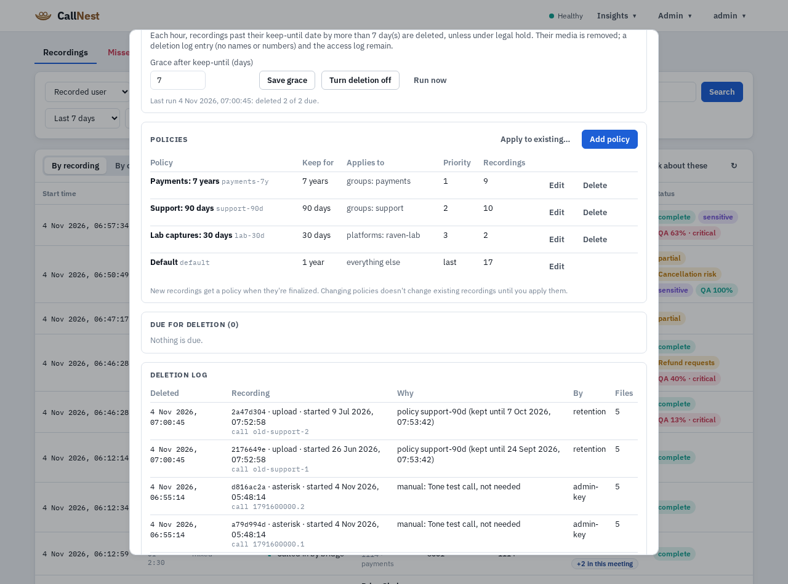

*With deletion turned on, the two support calls due for deletion went, while a third that was also past its date stayed under legal hold. Others here were deleted by hand, each with a reason.*

**Legal hold** overrides everything. A recording under hold can't be deleted by the retention job or an admin, and it stays until the hold is lifted.

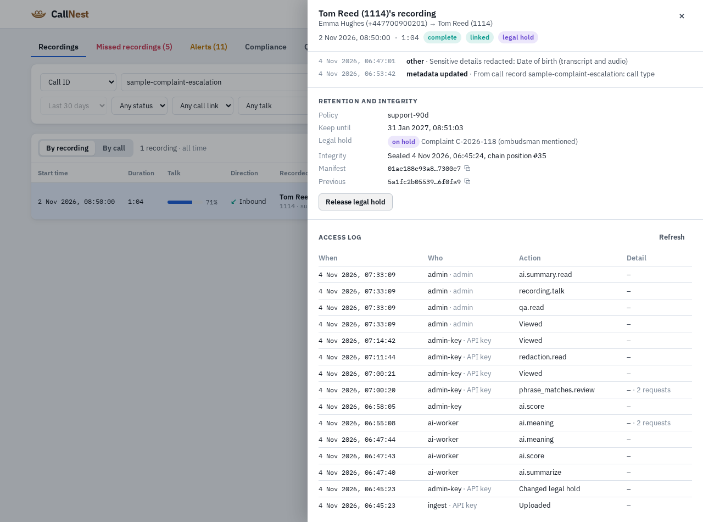

*The access log on a recording under legal hold: who viewed, played or downloaded it, every read of its transcript, and each request to the AI model.*

---

## Prove nothing changed

Each recording's identity, times and every file's SHA-256 go into a manifest, and each manifest includes the hash of the one before, forming a chain per tenant. On top of that:

- **Signing:** each manifest is signed (Ed25519) with a key that is never in the database, so someone who can write to the database can't rebuild a chain that passes.
- **Timestamping:** the newest manifest is timestamped by an external RFC 3161 authority, which proves the chain existed in that form at that time. Tokens can be exported and checked with plain `openssl`, with no CallNest involved. This run used DigiCert's service.
- **Encryption at rest:** each recording has its own key, wrapped under a master key, in AES-256-GCM chunks so the player can still seek.

To test it for this page, one recording's end time was changed directly in the database, behind CallNest's back. The next verify named the recording and the problem:

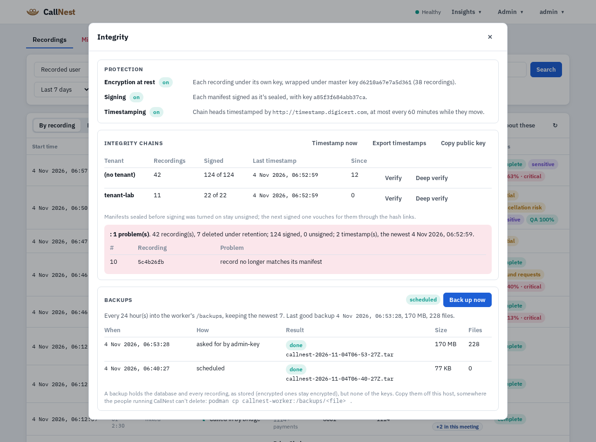

*42 recordings checked, 124 manifests signed, and 7 deletions accounted for by the deletion log, so a recording that disappeared any other way would be reported. With the change put back, verify passed again, and so did a deep verify, which also re-reads every stored file and checks the timestamp tokens.*

This is tamper-evident, not WORM storage. CallNest will show that something changed, but it can't stop a change made directly in storage or bring the original back. Where that matters, keep backups that the people running CallNest can't delete.

**Backups** are one tar file holding the database and every stored file from a consistent snapshot, on a schedule or on demand: 170 MB and 228 files here, in under two seconds. Encrypted media stay encrypted, and the keys are not in the backup. Restoring checks every file's hash and runs a deep integrity check, so you know the copy is whole.

---

## Who can see what

**Viewers** can search, read, play and download. They can be **scoped** to groups and platforms, and then see only those recordings. Anything else returns "not found", exactly as if it didn't exist, and counts of related recordings leave out rows they can't see.

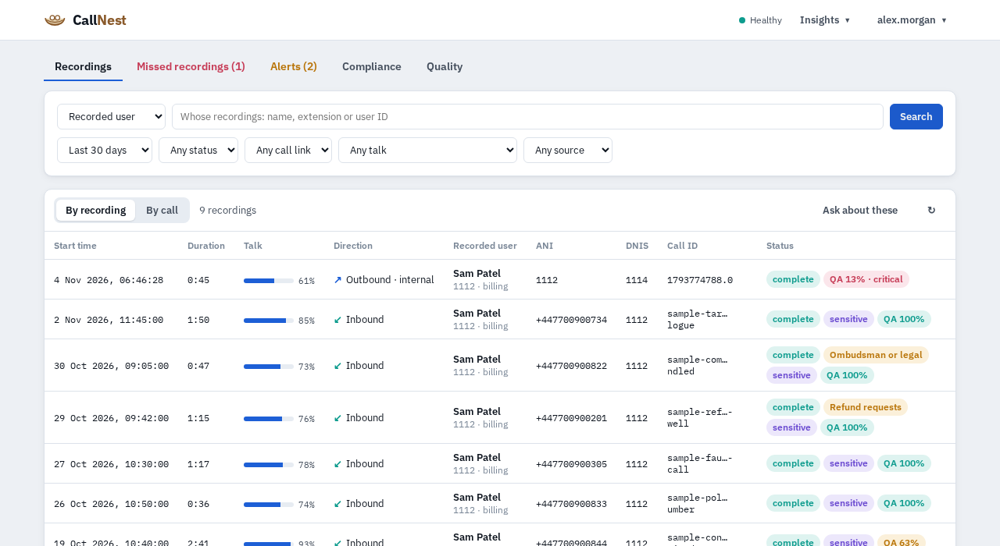

*A billing team lead sees the billing group's recordings and nothing else: 9 rows out of 40, 2 alerts out of 11, and no Admin menu.*

**Admins** also manage everything: users, rules, retention, legal hold and integrity. Machines use API keys with their own roles, and an ingest key can upload but can't list or play anything.

Sign-in has lockouts and rate limits, and passwords are stored hashed. **Two-step sign-in** uses any authenticator app, with single-use recovery codes, and can be required for admins or everyone. The audit log records every search, read, play and download, under the person or key that did it, and each recording shows its own.

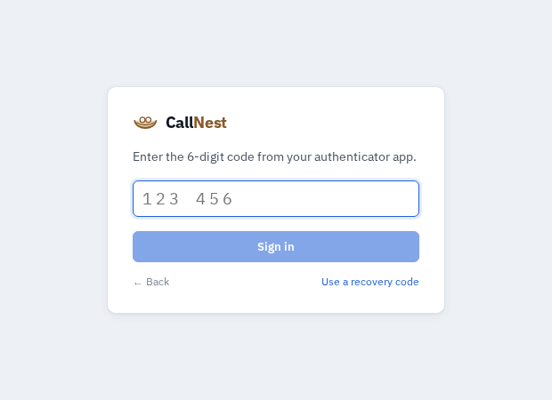

The UI has light and dark themes, and a card layout for narrow screens.

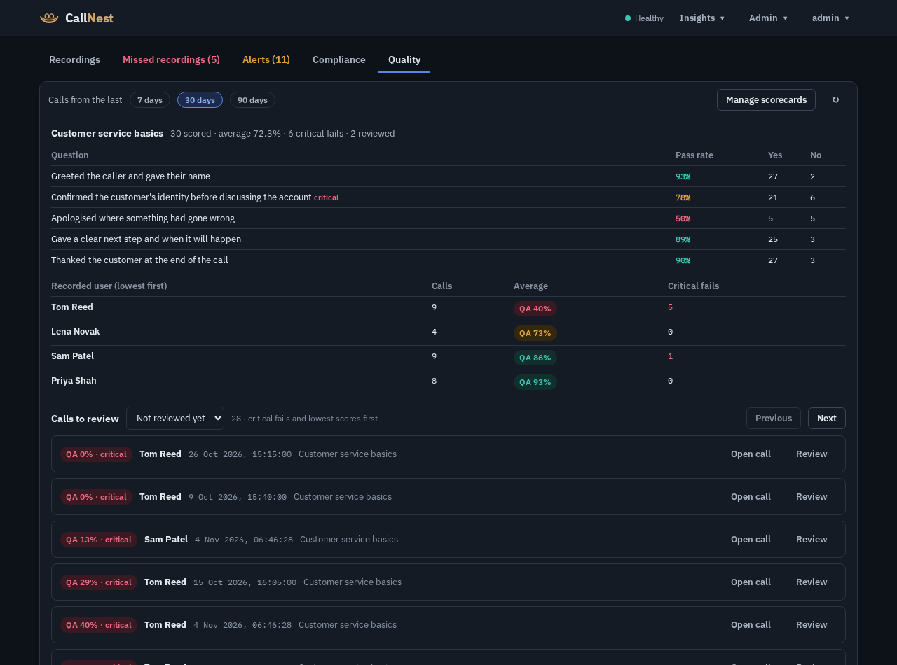

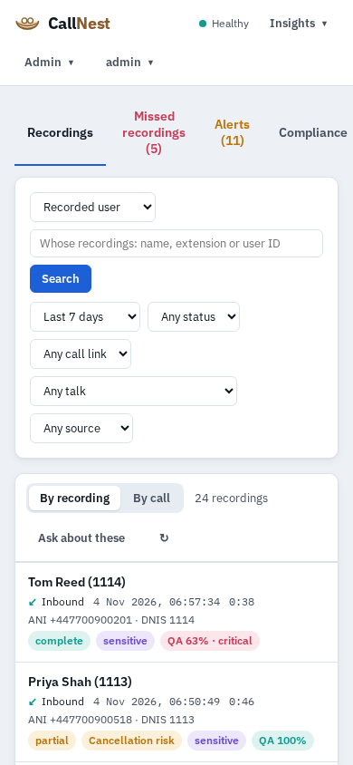

---

## Everything has an API

The UI is built on the REST API under `/api/rec/v1`, described by an OpenAPI 3.1 specification, so anything it does can be scripted, and the audit log treats scripts and people alike. Recordings carry standard metadata, designed to sit beside Open CDR call records: the call record says what happened on a call, and the recording record says what was captured.

---

## How it runs

Six containers under Podman or Docker Compose on one Linux host: the web UI behind nginx, the API, a worker, the SIP recorder, PostgreSQL, and a SeaweedFS S3 store for media that has no route to the outside, so audio can only be fetched through the API and every access is logged. Transcription and a local AI model are optional and can be shared with other services on the same machine. With this run's data in place, everything but the object store fitted in about 250 MB of memory.

---

## Status

A working prototype in active development. Upload, storage, search, playback, the integrity chain, the web UI, Asterisk ingestion, live recording over SIPREC and plain SIP, retention, two-step sign-in, encryption at rest, pcap import, transcription and the analytics and AI features are all in.

All 275 backend tests pass, against a real PostgreSQL and ffmpeg, including the paths not run for this page: SRTP in both suites, SIPREC pauses, G.722, and a backup restored and verified. A nightly CI job runs real calls through a real Asterisk 20. The features on this page were run for it, on the stack shown. Webhooks, Claude, SIP over TLS and SRTP were not, and rely on those tests. The tests use a stand-in for Claude, so the quality of its answers hasn't been judged here.

It has been tested with Asterisk and with CallRaven's SIPREC client, not yet with vendor session border controllers such as Cisco CUBE, AudioCodes or Oracle. Not yet supported: single sign-on, DTLS-SRTP (WebRTC-style media, refused with a clear error), SIP over plain TCP, registering to a PBX as an extension, participants added partway through a SIPREC session, live transcription during a call, and G.729. Backups are not encrypted as a whole, and they stay on the host until someone copies them off.
