# CallOwl

**A self-hosted call logging platform: it collects call detail records from any phone system that can produce the [Open CDR Standard](../open-cdr/README.md), stores them, and gives supervisors, operations and compliance staff one place to search, measure and audit them.** It's for organisations that run more than one phone platform, or that need to control exactly who can see which calls.

Each phone system keeps its own call log in its own format, usually behind its own screens and logins. Answering "what happened on this call?" or "how long are callers waiting across all our sites?" means going to each system in turn. CallOwl accepts records in one standard shape, whether they are pushed to it or pulled by it, and refuses any record that doesn't conform. What is in the store can then be filtered, compared and exported as one set, with access limited by team or platform and every query logged.

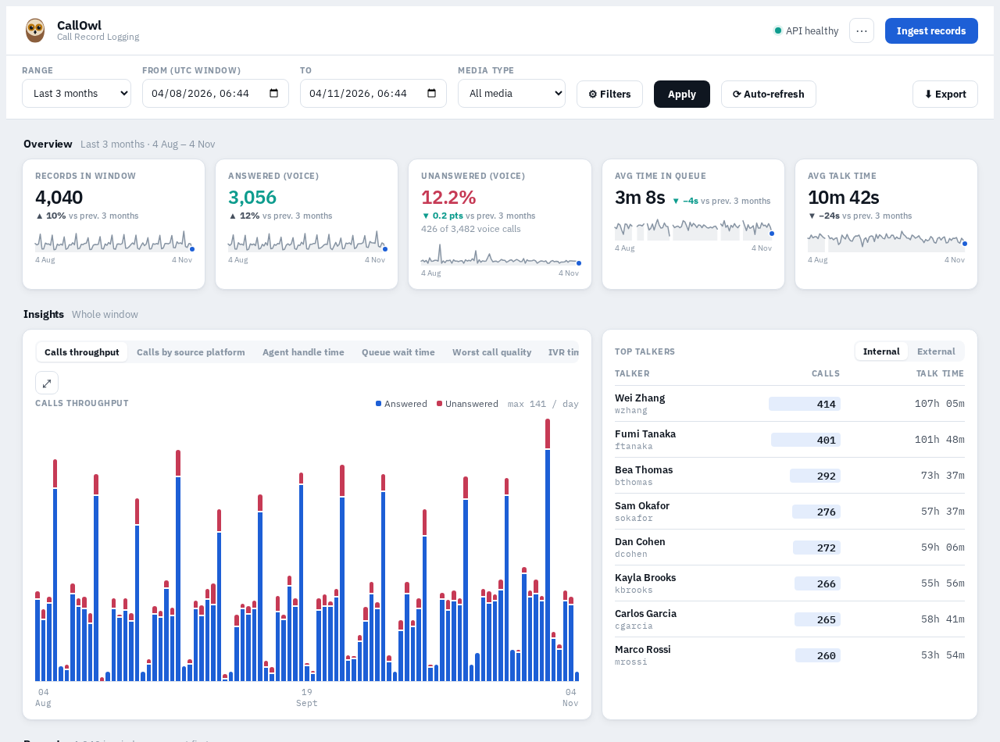

*Three months of calls across five platforms and two simulated extra sources: 4,040 records, 12.2% of voice calls unanswered, each headline compared with the previous three months, and daily volume showing the weekday and weekend pattern. These are generated records; see [About the data](#about-the-data).*

---

## At a glance

| | |
|---|---|
| **Overview and insights** | Headline figures with trends, six charts and rankings over any time window |
| **Search and drill-down** | Filters on people, queues, IVRs, groups and platforms, numeric conditions such as `mos < 3`, and CSV or JSON export |
| **Inside one call** | Participants, a call trace, an interaction timeline, linked call legs, routing, quality, recording and transcript references |
| **Getting records in** | Push through an API, pull from another Open CDR source, or run your own Python script against anything else. Every record is validated first |
| **Controlled access** | Admin and viewer roles, per-user limits by group or platform, personal API keys, two-factor login and account lockout |
| **Audit log** | Every query, ingest and admin action: who, when, what and the result |
| **Backup and recovery** | Scheduled dumps, continuous archiving for point-in-time recovery, and an optional off-site copy |
| **Running it** | HTTPS by default, alert webhooks, a public status page, Prometheus metrics, config export and key rotation |
| **Open API** | The standard's read API plus CallOwl's extensions, with interactive docs |

---

## Getting started

A new install starts empty, with a short guide on the dashboard. There are two ways to get data in: paste or post a record, or set up a source to poll. Once calls arrive, the guide can be dismissed and the dashboard fills in.

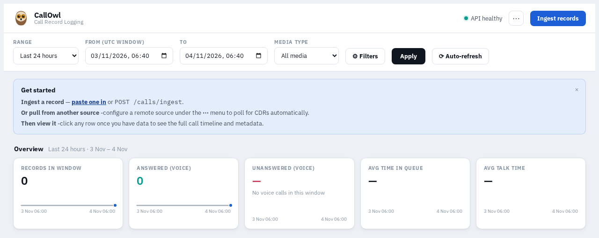

*First login on a fresh install. An empty chart offers to widen the time window, which also helps later when a short window has no calls in it.*

---

## Overview and insights

The top of the dashboard answers "how are we doing?" for the chosen window, from the last hour to the last six months or any custom range. Five figures sit in a strip: records, answered voice calls, unanswered voice calls, average time in queue and average talk time. Each has a sparkline and its change against the previous window of the same length, so a rise in unanswered calls is visible without having to pull last quarter's numbers. The page can refresh itself on a timer, for use on a wallboard.

Below that, the Insights tabs cover throughput split into answered and unanswered, calls by source platform, agent handle time, queue wait time, worst call quality and time spent in IVRs. The time-based tabs show a daily or hourly trend above a ranking, so the same view shows both when waits rose and which queue caused it. Any chart opens full size and can be exported as a PDF. Next to the tabs, Top Talkers ranks internal staff and external numbers by calls and talk time.

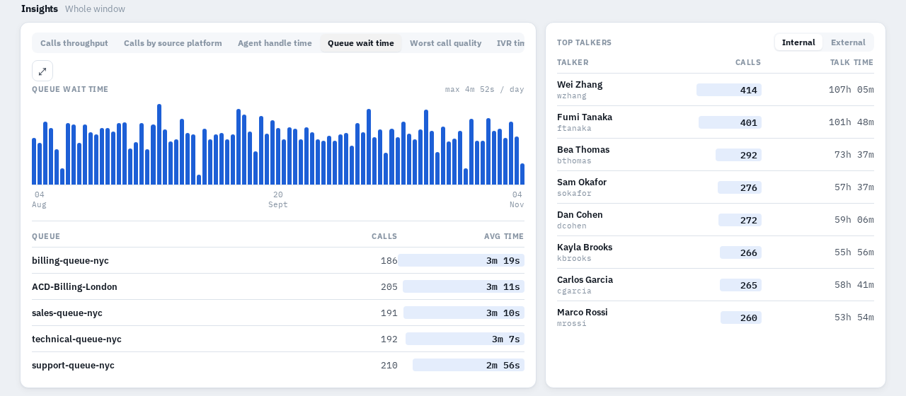

*Average queue wait per day, then each queue ranked by its average wait. `billing-queue-nyc` is the slowest at 3m 19s across 186 calls.*

Worst call quality lists the voice calls with the lowest MOS score in the window, so a bad day on one link shows up as actual calls to open, not just a lower average.

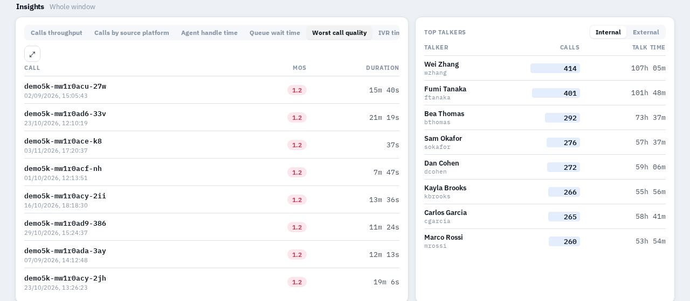

*The lowest-scoring calls in the window. Each row opens the call, where the latency, jitter and packet loss sit next to who was on it and which device they used.*

---

## Search, drill down and export

Every filter applies to everything on the page. Choose a person, and the figures, charts and records all narrow to that person, so the strip, the charts and the table always describe the same calls. Clicking a name in Top Talkers, a queue or an IVR adds that filter directly.

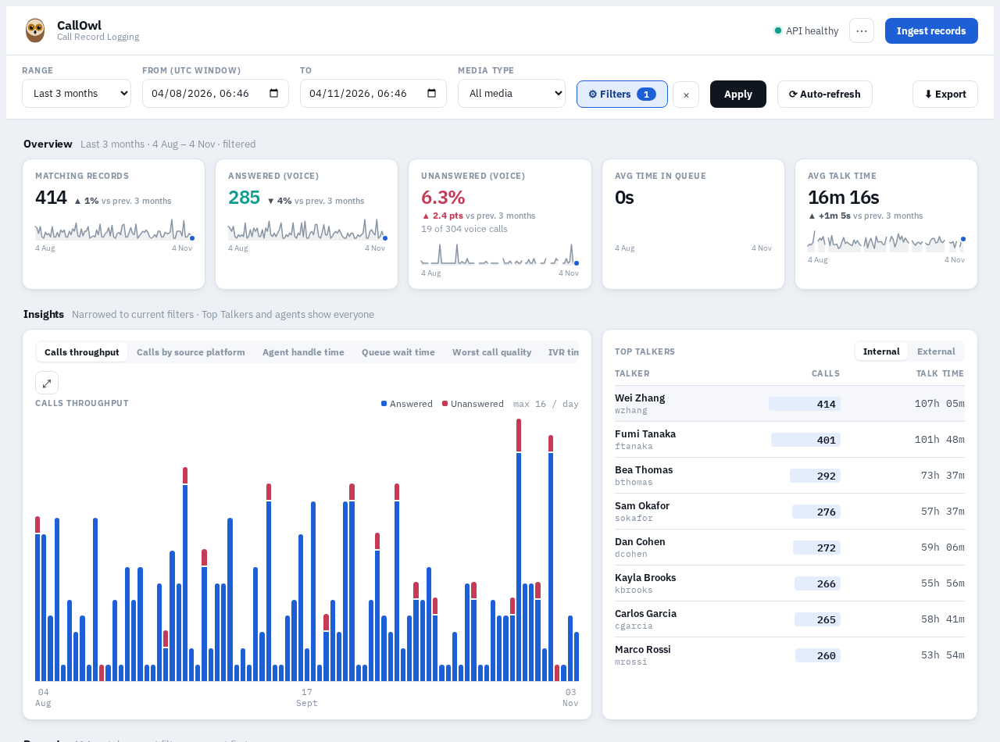

*One click on Wei Zhang in Top Talkers: 414 matching records and 6.3% unanswered, against 12.2% for everyone. The rankings deliberately keep listing everyone, so the next person is still one click away.*

Filters cover media type, groups, source platforms, participants (by name, user ID or extension), queues and IVRs. For anything more specific there is a small condition language over quality and timing fields: `mos`, `jitter`, `latency`, `packetLoss`, `duration`, `ivrTime` and `queueTime`, with the usual comparison operators. It is checked against a fixed list of fields on the server and never placed into SQL as text. A known call ID can be opened directly.

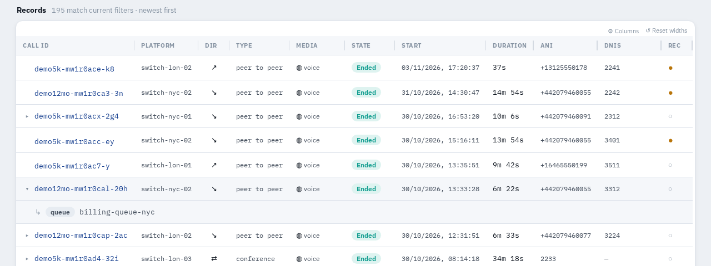

*`mos < 3, jitter > 50` finds 195 of the 4,040 calls. A row can be expanded in place to show the queue or IVR behind it.*

The records table has columns that can be resized, reordered and hidden, and it remembers the layout. Whatever is filtered can be exported as CSV or JSON: on this filter the CSV held exactly the 195 records on screen.

---

## Inside one call

Clicking a record opens everything known about the call: where it came from, its timing, how it was routed, each participant, the events in order, and references to its recording and transcript. Sections only appear when the record has something for them, so a simple call stays short and a complicated one shows it all.

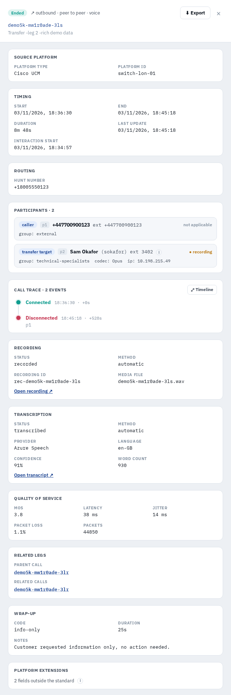

*The second leg of a transfer: two participants, a two-event trace, a recording and an en-GB transcript at 91% confidence, a MOS of 3.8, the leg it came from, and the agent's wrap-up code and note.*

CallOwl stores references, not media: Open recording and Open transcript link to wherever those files live. Fields a vendor adds outside the standard are kept and shown under Platform extensions, along with event metadata and device details, behind a small information button.

The Timeline button draws the call as one lane per participant, so a caller's hold time or an agent's wrap-up can be seen at a glance.

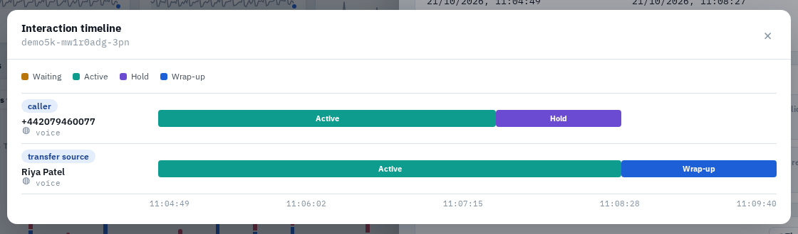

*A consult transfer. The caller goes on hold while the agent consults a colleague, and the agent's lane moves into wrap-up when the caller has gone.*

A transfer or consultation is several records linked together. Those links can be followed from one leg to the next, with a Back button to retrace the path.

  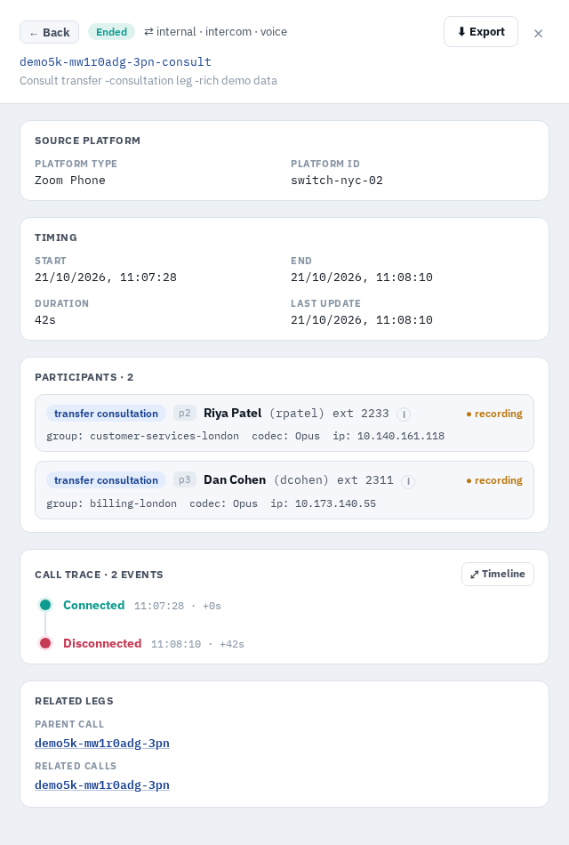
  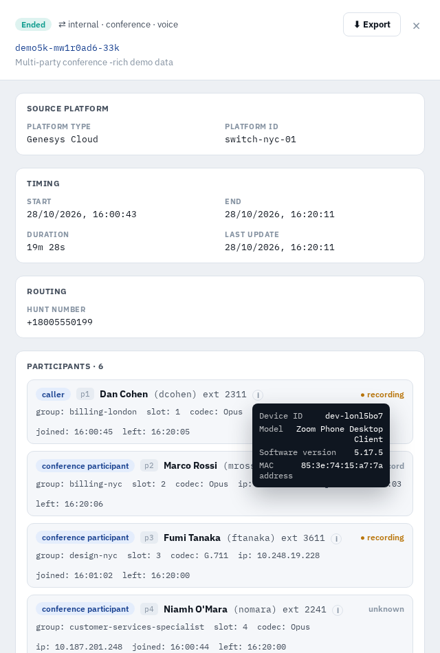

*Left: the consultation leg, opened from the main leg, with Back to return. Right: a six-party conference, with one participant's device details open (device, client software version and MAC address).*

---

## Getting records in

Everything arrives through the same gate. Each record is checked against the standard before it is stored, so the store only ever holds conforming data, and records are keyed by call ID, so sending one again updates it instead of creating a duplicate. In this run, 5,000 generated records were validated and stored in about 2.6 seconds.

**Push.** Other systems post one record or a batch of up to 1,000 to the ingest API, using a shared key or a personal API key. The dashboard has the same thing as a paste box for testing.

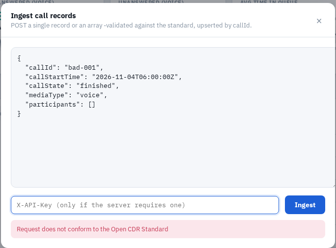

*`finished` isn't a call state the standard allows, so the record is refused and nothing is stored.*

**Pull from another Open CDR source.** Add a remote source's URL and credentials (an API key or OAuth2 client credentials), a polling interval and how far back to start. CallOwl remembers how far it has read and only fetches what is new. The credentials are encrypted at rest and never shown again.

A bad record doesn't hold up the good ones. In this run a simulated Cardiff site returned 183 records, of which 180 were stored and 3 were set aside with the reason for each. Polling the same data a second time, as a different source, left the store with no duplicates.

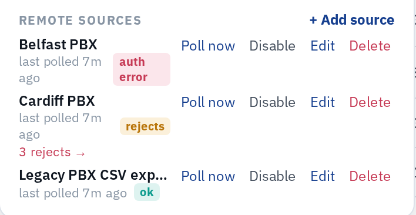

*Three sources and how each last went. Belfast was given a wrong key on purpose, to show the failure.*

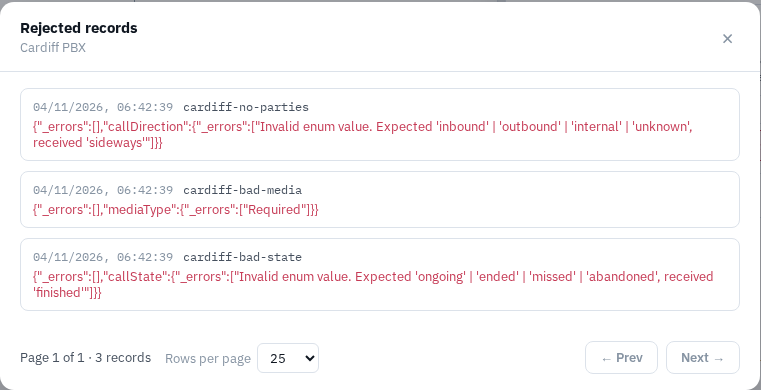

*The three records Cardiff sent that didn't conform, kept for review with the exact field and reason.*

**Run a script for everything else.** Many phone systems will never offer an Open CDR API. For those, an admin writes a short Python script that fetches whatever the system does produce and maps it into the standard's shape. CallOwl runs it on the same schedule, passes it the point it last read up to, and puts its output through the same validation. Scripts run as a non-root user with a time limit and memory and output caps, and any credentials they need are encrypted. This is a tool for trusted admins, not a sandbox against hostile code.

  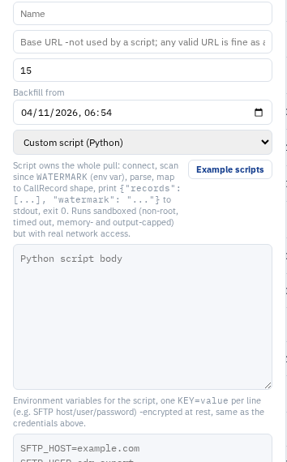
  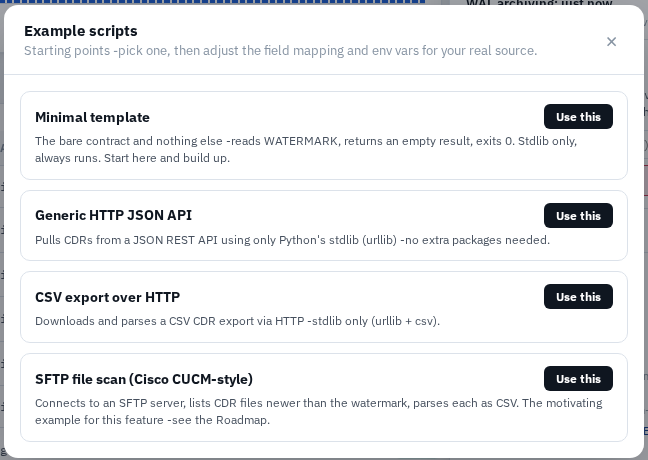

*The script form and its four starting points, including an SFTP scan for Cisco CUCM-style CDR files. In this run a 25-line script read a legacy CSV export over HTTP and brought in 40 calls.*

---

## Who can see what

Logging in is always required. There are two roles, admin and viewer, and any account can also be limited to certain groups, certain source platforms, or both. Limits are enforced on the server for every read, so charts, tables, exports and API calls all see the same restricted set, and a request for something out of scope simply returns nothing.

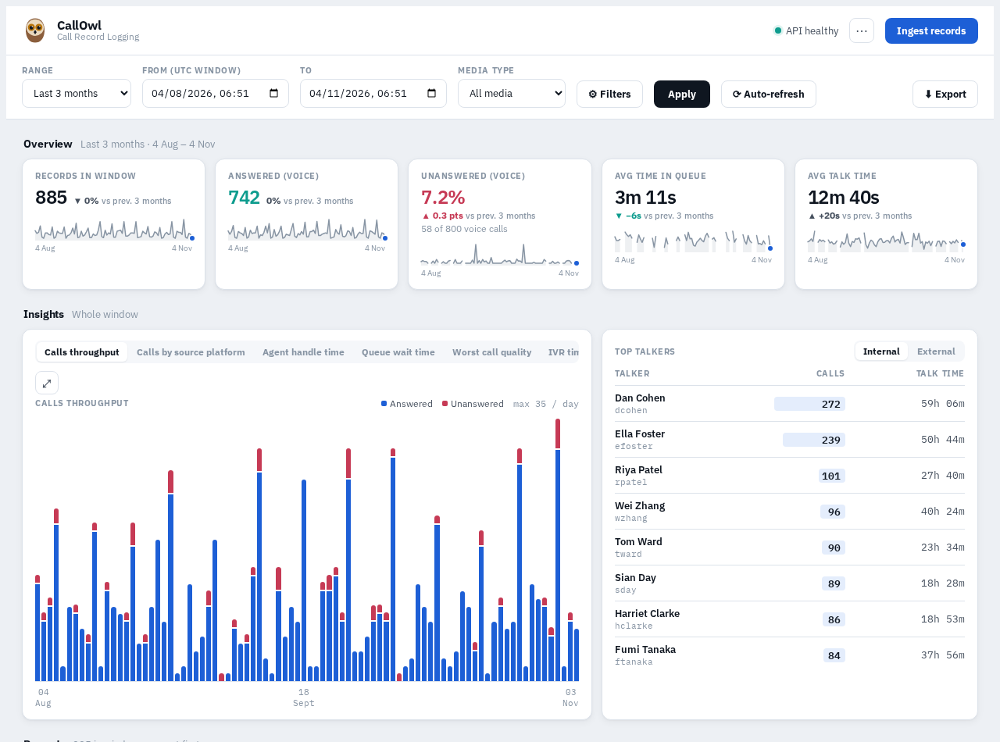

*The same three months as a viewer limited to `customer-services-london` and `billing-london`: 885 calls instead of 4,040, with different rankings. Everything on the page is scoped, not just the table.*

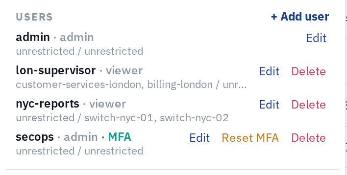

*Accounts with their role and scope: one limited by group, one by platform, and one admin with two-factor login enabled.*

Each user can create named API keys that act as that user, with the same role and scope. A key is shown once, stored only as a hash, and can be revoked at any time. Passwords are hashed with bcrypt, sessions are held in the database so logging out or deleting a user ends them at once, and accounts can use authenticator-app codes with one-time recovery codes.

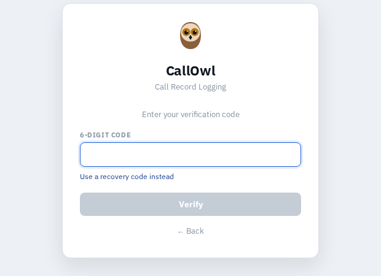

*The second step of login for an account with two-factor enabled. An admin can reset it for someone who has lost their device.*

Password guessing is limited in two ways: by address, and by username, which also stops slow attempts spread across many addresses. In this run the sixth wrong password for one username was refused outright, with a lockout that lasts 15 minutes by default.

---

## Audit log

Every request is logged automatically by one piece of middleware, so a new feature can't forget to be audited. That covers queries, ingest, logins including failures, user and key changes, and backups. Each entry has the actor, time, request, status and, where available, the number of records. Admins can filter it and export it as CSV or JSON. It is kept for 90 days by default.

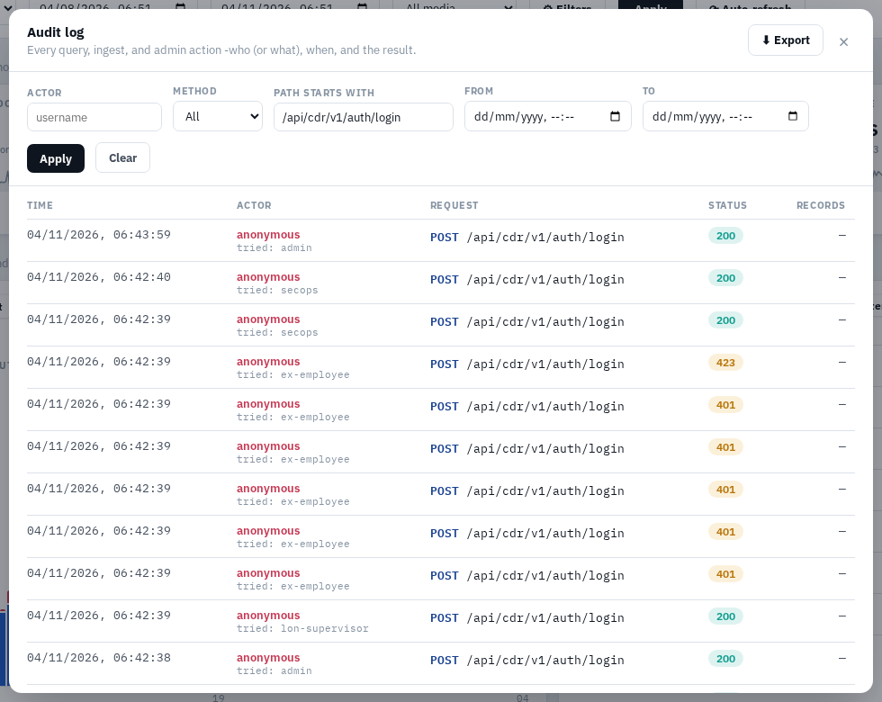

*Login attempts in this run. Failed attempts record the username tried, never the password. `ex-employee` gets five 401s, then a 423 when the lockout starts.*

---

## Backup and recovery

There are three layers, for three different problems.

- **Scheduled dumps** give a portable copy of the database, daily by default and kept for 14 days. Admins can also take one on demand and download it. In this run a deliberate deletion of 5,000 records was undone from the dashboard by uploading a 2.3 MB dump, which took 1.3 seconds. A restore replaces the whole database, including its sessions, so anyone who logged in after that dump was taken has to log in again.
- **Point-in-time recovery** continuously archives the database's write-ahead log with pgBackRest to a self-hosted S3-compatible store, with a full base backup every day, so a database can be taken back to a moment rather than to the last dump.
- **An off-host copy**, off until configured, sends both of the above to a separate S3-compatible bucket, to cover losing the machine itself.

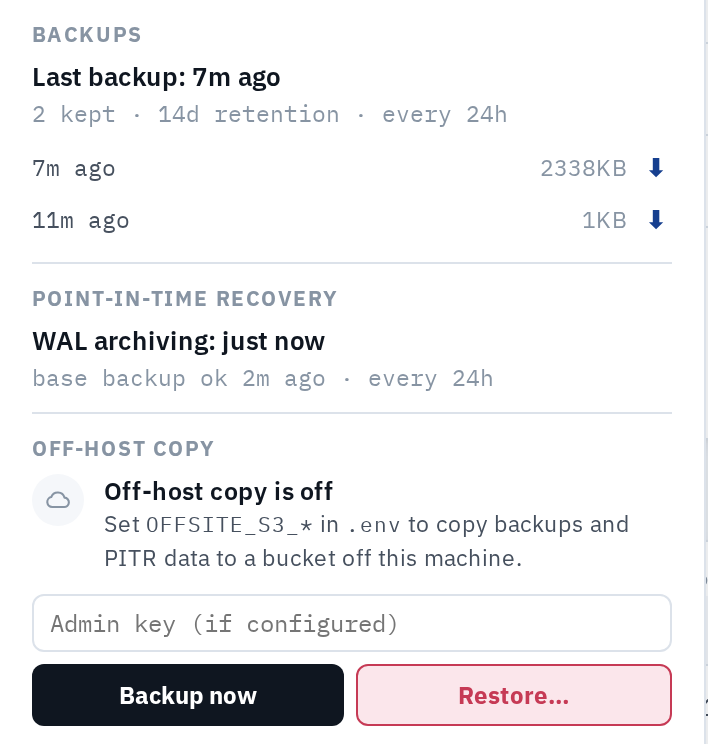

*The state of all three layers, on one panel. The same checks feed the alerts below.*

The repository's disaster recovery guide has the step-by-step procedures, and they have been rehearsed against a scratch database.

---

## Running it

**Alerts.** A scheduled check watches backups, archiving, off-host copies and every remote source, and posts to a webhook when something becomes unhealthy, again every six hours if it stays that way, and once when it recovers. Slack and Discord incoming webhooks work directly. In this run Belfast's wrong key raised an alert within a minute, and correcting the key produced a recovery message at the next check.

**HTTPS.** The dashboard is HTTPS-only from the first start, with a generated self-signed certificate. A real certificate can be uploaded from the dashboard: it is checked against its key, loaded by nginx without a restart, and rolled back if nginx rejects it. The panel warns as expiry approaches.

**Status page.** An optional public page reports whether the API and database are up, with no login. It deliberately shows nothing else, and it is off until an admin turns it on.

**Moving between environments.** Users, API key names and remote source definitions export as a JSON file for setting up a second environment. No password, key or credential is ever included: importing creates a fresh password for each user, shown once.

**Monitoring and upkeep.** The backend exposes Prometheus metrics for request durations and polling outcomes. All four main secrets can be rotated with an old and a new value valid together, so nothing has to change at the same moment. Scheduled jobs take a lease in the database, so running more than one backend won't poll a source twice.

  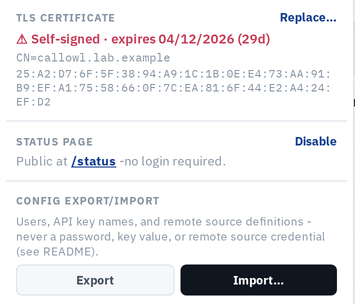
  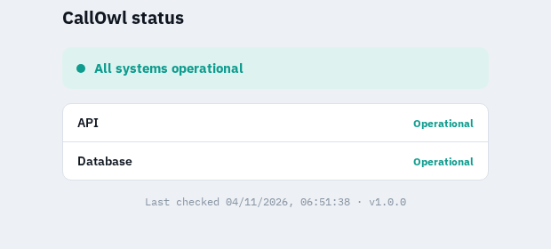

*Left: a 30-day certificate uploaded in this run, with its expiry warning, and the status and config panels. Right: the public status page.*

---

## An open API

CallOwl serves the standard's read API, so any tool written for the standard can fetch records from it: list calls by time window, fetch one call, and get summary statistics. Its own additions are marked as platform extensions: the insights, ingest, administration and authentication endpoints. Everything the dashboard shows comes from the same API, and the standard filters work on the statistics endpoints too. Interactive docs are built in.

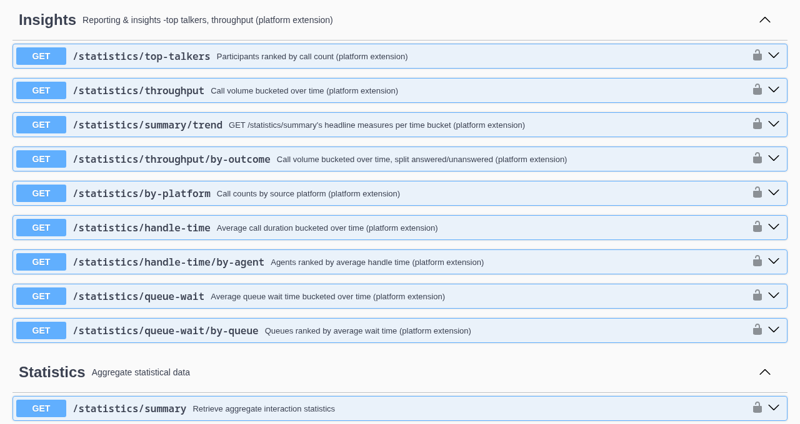

*The Insights group in the built-in API docs. Each endpoint is marked as a platform extension, so it's clear what goes beyond the standard.*

---

## Dark mode and phones

The dashboard has light and dark themes, or can follow the system setting.

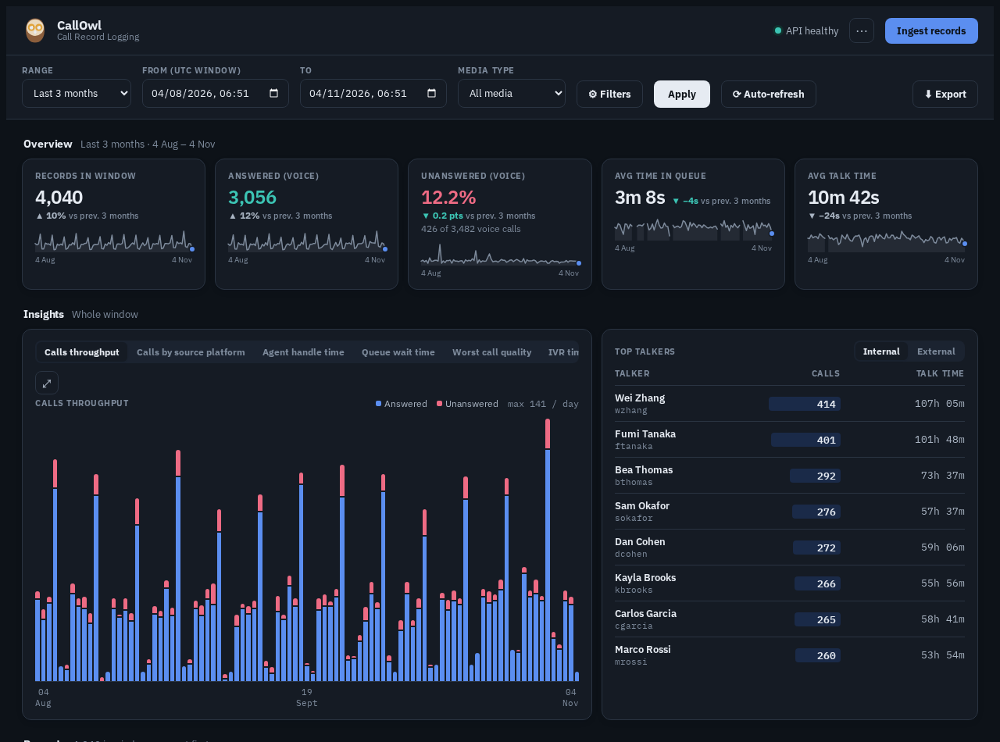

Below tablet width it becomes one column, and the records table turns into a list.

  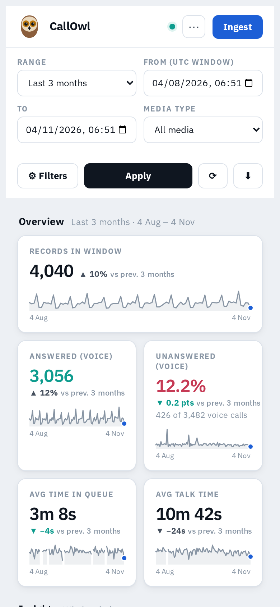
  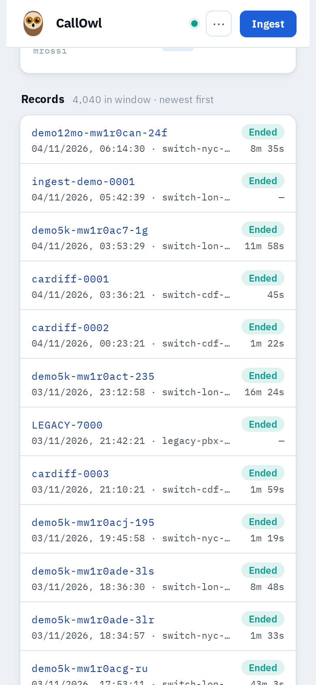
  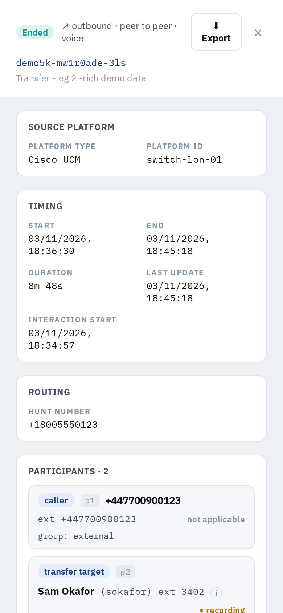

*The overview, the records list and a call's details, at 390 px wide.*

---

## How it runs

A set of containers under Docker Compose or Podman: an nginx front end that serves the React dashboard and terminates HTTPS, a Node/TypeScript API, PostgreSQL, a SeaweedFS object store for the archive, and small containers for scheduled and off-host backups. There is no third-party service behind it and no outside request for fonts, so it suits on-premises installs. A record is stored verbatim as JSON, with a few columns copied out for indexing, so what comes back through the API is what went in.

---

## Status

CallOwl is a working platform at version 0.2.0, well past a prototype in its security and recovery features, but not yet audited for production. It runs on a single PostgreSQL node, and statistics are computed when asked for, not pre-aggregated, so very large stores are untested. About 90 automated tests run in CI, the backend's against a real PostgreSQL, alongside type checks and builds on both sides.

### About the data

The screenshots come from a run on 4 November 2026 on a fresh install. The call data is synthetic: about 10,000 records over a year from CallOwl's own demo generator, the standard's six example records, and 220 records from simulated sites that polling and the custom script fetched for real. The people and numbers are invented. Vendor names such as Cisco UCM and Genesys Cloud are labels in those records: CallOwl takes records in the Open CDR format, and doesn't have built-in connectors for those products. These were actually run: ingest and rejection, polling, the custom script, scoped access, two-factor login, lockout, alerts, certificate replacement, config export and import, CSV export, and backup and restore from a dump. Point-in-time archiving and base backups ran, but a point-in-time restore did not. The off-host copy, key rotation, OAuth2 sources, PDF export and running more than one backend weren't exercised here, and are described from the code and the project's documentation.
