# CallRaven

**A containerised SIP softphone and test tool for phone systems.** It places and answers real calls, then captures, measures, transcribes and grades them, from its web UI or entirely through its REST API.

CallRaven is for the people who build, run and change phone systems: PBXs, SIP trunks, IVRs and contact-centre voicebots. A desk phone tells you a call worked. CallRaven tells you what was said, what the network did, how it sounded, and whether it still behaves the way it did last week, and it can do that on a schedule, from CI, with nobody listening.

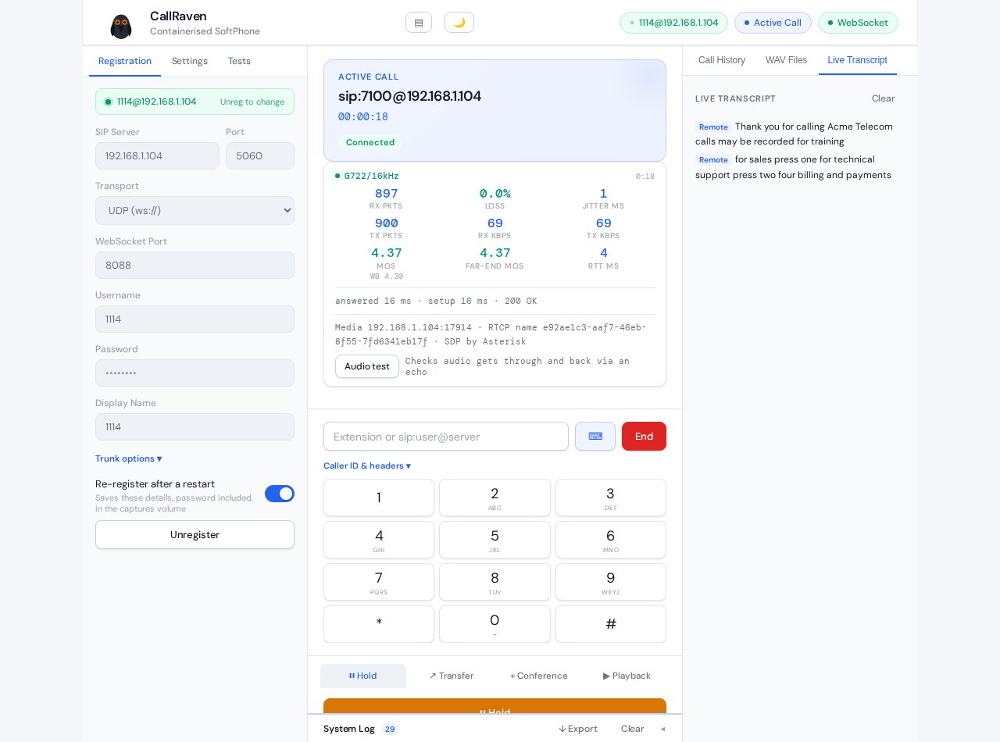

*A call to a FreePBX IVR, 18 seconds in: G.722, no loss, 1 ms jitter, MOS 4.37 both ways, 4 ms round trip, and the IVR's words in the transcript on the right.*

---

## At a glance

| | |
|---|---|
| **Softphone** | SIP over UDP, TCP, TLS and WebSocket; IPv4 and IPv6; Opus, G.722, G.711; SRTP; hold, call waiting, transfers, 3-way conference; DTMF both ways |
| **Every call recorded and measured** | A packet capture of every SIP message and all the audio, a SIP ladder diagram, live MOS, loss, jitter and round-trip time, call-quality trends over weeks |
| **Every word transcribed** | Live and post-call transcription on the box (Whisper), split by who was speaking; recordings kept locally or sent to a SIP-REC recorder |
| **Automated testing** | Test plans, IVR mapping with change detection, voicebot tests with a scripted or AI caller, load testing, sign-off reports |
| **AI where it helps** | Plain-English explanations of failed calls, AI-judged checks, an AI caller and an AI voicebot, with Claude or a model you run yourself |
| **Built to be driven** | A REST API and WebSockets for everything the UI does, an OpenAPI spec, and one call to run any test from CI and get a pass or fail |

It runs as one container, needs no audio hardware, and works headless.

---

## A softphone you can script

CallRaven registers to your PBX like any phone, or stands in for your carrier on an IP trunk, and places and answers calls from the browser or the API. It does everything a desk phone does in a test lab: hold and resume, call waiting, blind and attended transfer, a 3-way conference, DTMF in either direction, playing a recording into the call.

What a desk phone can't do is present any caller ID you like, add your own SIP headers to test routing and number presentation, refuse calls with a chosen SIP code to test hunt groups and failover, or play dead entirely so a caller's INVITE times out.

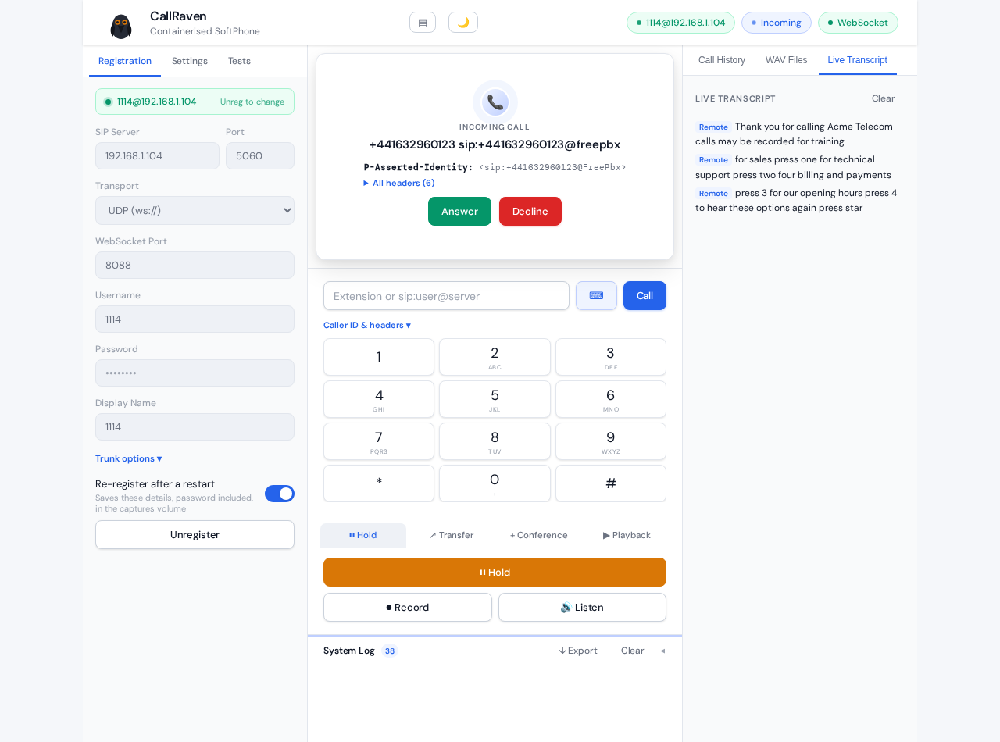

*Another CallRaven called this one with a P-Asserted-Identity and a test header; the ringing call shows what the PBX actually passed through.*

It also gets the awkward corners of SIP right, the ones that interop testing finds first: reliable provisional responses (PRACK), session timers, mid-call re-INVITEs that change codecs or renumber payload types, SRTP re-keys, T.38 fax switch-overs, STUN for media behind NAT.

---

## See exactly what happened

Every call keeps a packet capture with every SIP message and all of its RTP and RTCP, ready for Wireshark. Without leaving the browser, the **SIP ladder** draws the message flow between the participants, with the SDP of each offer and answer, and where the audio started in each direction, so one-way audio stands out at a glance.

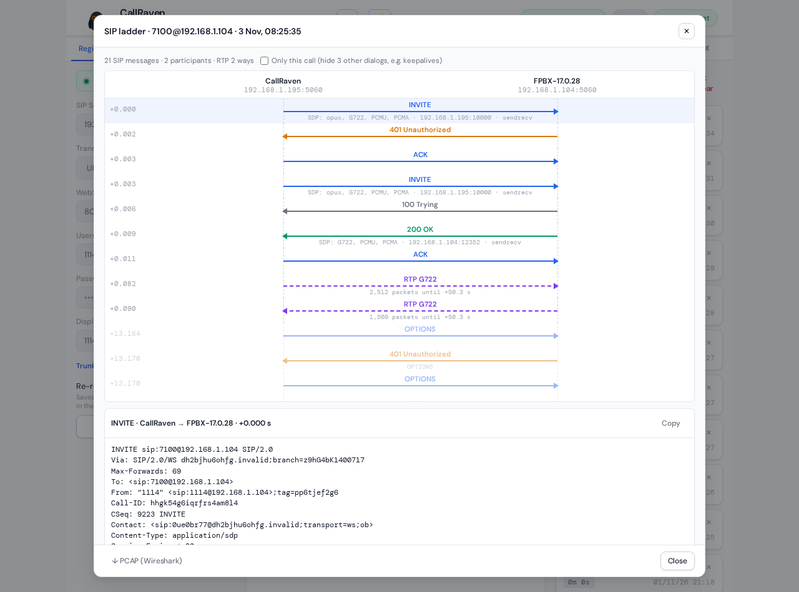

While a call is up, CallRaven shows its codec, packets, loss, jitter and round-trip time, and an estimated MOS (ITU-T E-model) for what you hear and what the far end hears. Every call's figures go into the history, and **Trends** looks across weeks of calls for routes and trunks that are getting worse: "jitter on calls to 2000 via trunk-b has risen from 3 ms to 16 ms since Wednesday".

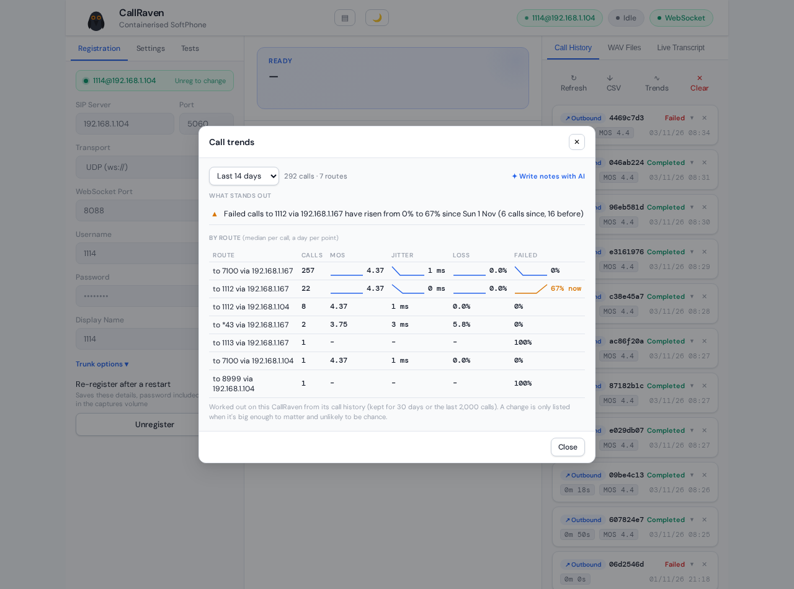

*292 calls on 7 routes over two weeks. The one finding is real: calls to extension 1112 started failing on 1 November, when the machine behind it went down.*

---

## Hear and read every call

**Listen** plays the call in the browser, both sides. Every call can be recorded, locally or to a SIP-REC compliance recorder, and transcribed as it happens and again afterwards, by a Whisper model running on the box (or a GPU server you point it at): the far end and CallRaven's own audio on separate channels, so the transcript says who said what.

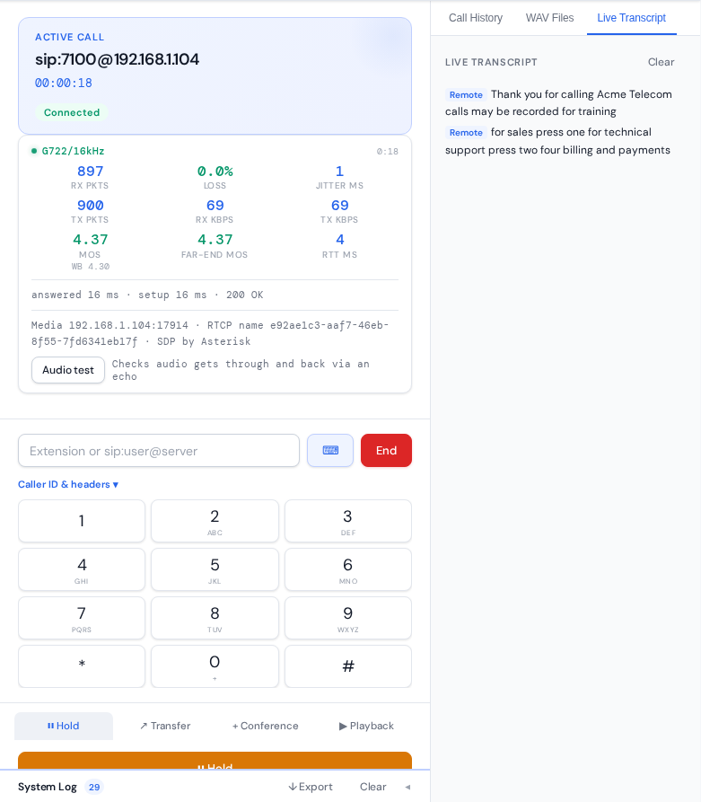

---

## Test it automatically

Hand-testing a phone system means calling it, listening, pressing keys and writing down what happened. CallRaven does that for you, the same way every time.

### Test plans

A test plan is a call and a list of checks: answered within 10 seconds, the codec is Opus, the audio flows both ways, the menu offers billing, press 2, it says "leave your message", the caller hangs up, MOS above 3.5. Each step passes or fails and says what it found. Plans are written in a few lines of YAML (so they live in git), built in the UI, or drafted by AI from a sentence.

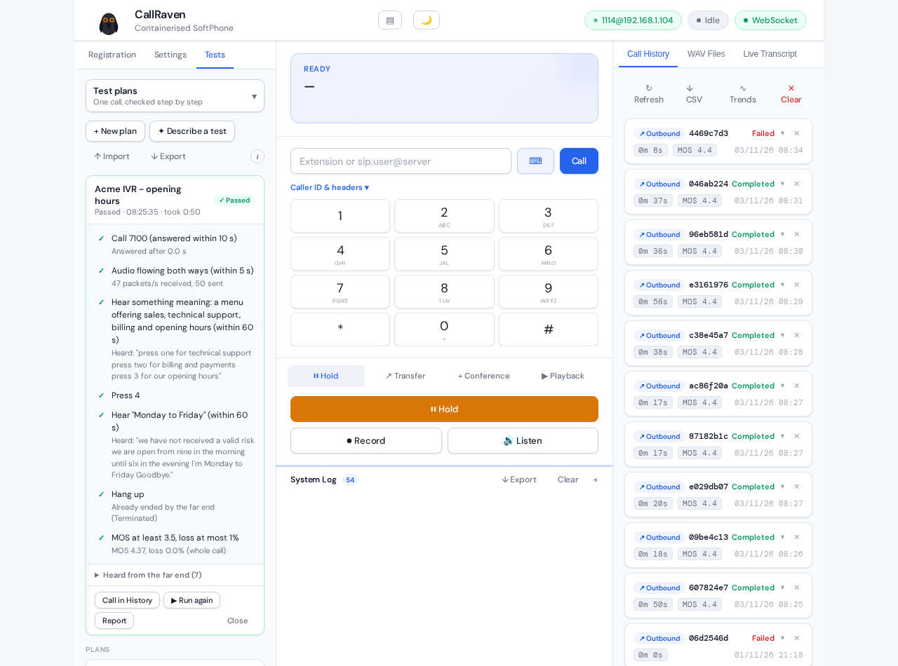

```yaml
name: Acme IVR - opening hours
steps:
  - call: 7100
    answerWithinS: 10
  - audio
  - hear: a menu offering sales, technical support, billing and opening hours   # judged by AI
    timeoutS: 60
  - press: 4
  - hearWords: Monday to Friday
    timeoutS: 60
  - hangup
  - quality: {minMos: 3.5, maxLossPercent: 1}
```

Finished runs become **sign-off reports**: an HTML page, a PDF, or JUnit for CI, with each step, the call's quality, the transcript, and an optional summary.

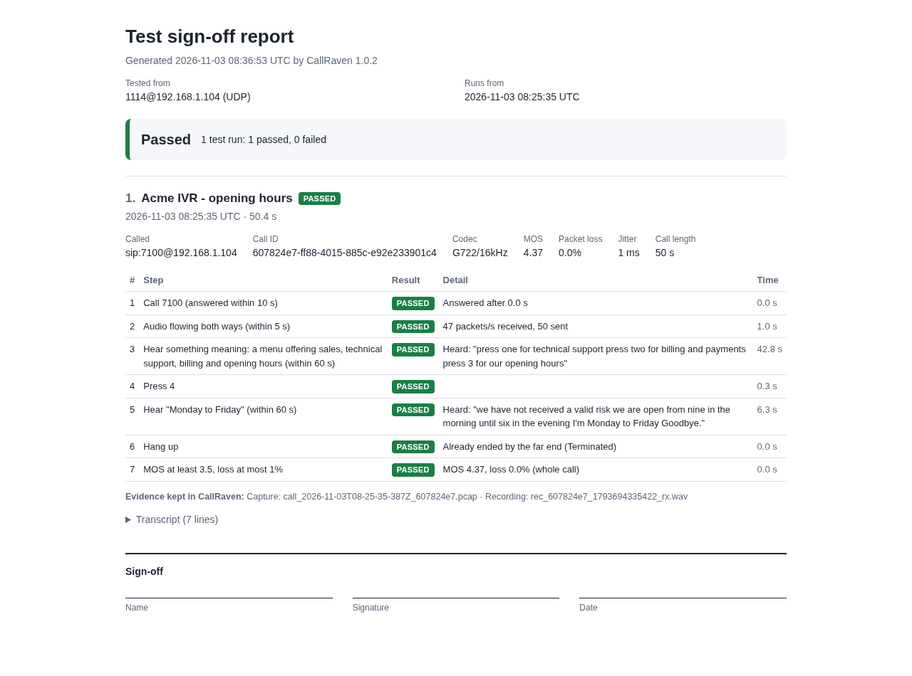

### IVR maps

Give CallRaven the number of an IVR and it maps the whole menu tree on its own: one call per menu, listening to each prompt, working out which keys it offers, and going down every branch. Map it again after a change and it lists exactly what's different: an option added or gone, a prompt that says something new, opening hours that changed.

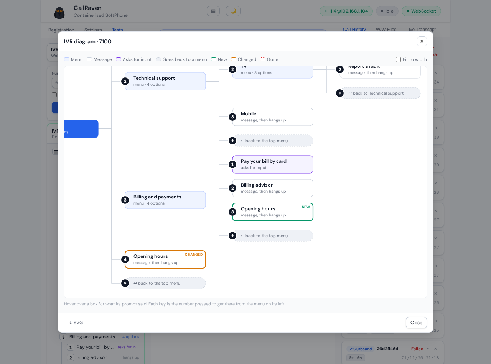

*The Acme test IVR mapped after a change: under Billing a new option 3 (opening hours) appeared, and the opening hours message itself changed, from "9 until 6, Monday to Friday" to "8 until 8, Monday to Saturday".*

### Voicebot tests

Contact centres are replacing keypad menus with voicebots you talk to. CallRaven tests them by holding a real spoken conversation: a scripted caller, or one played by AI from a goal and a few facts, speaking in a synthesised voice. It listens to each reply, answers when the bot stops, and grades what the bot said.

It also tests what real callers do to a bot: it times every answer, talks over the bot to see whether it stops, coughs to see whether it doesn't, and puts it on a bad line: café noise, packet loss, jitter, a narrowband codec. **Compare lines** runs one scenario on a clean line and on bad ones, and tells you whether a failure was the line or the bot.

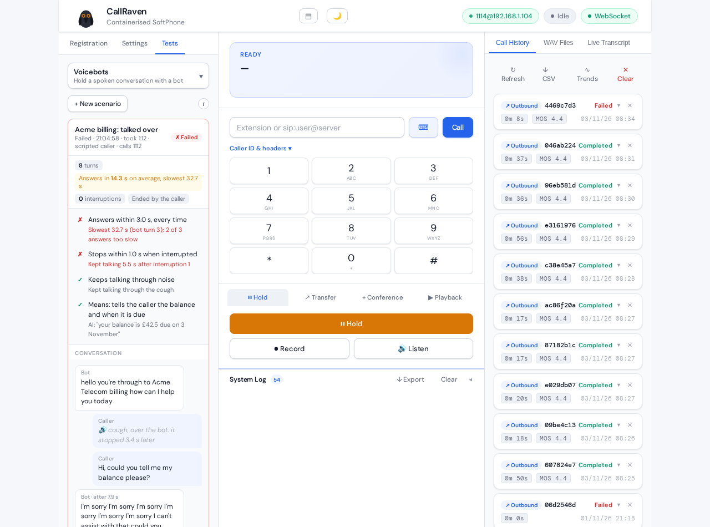

*CallRaven's own voice agent under test. It talked through a cough (good), but kept talking for 5.5 s after the caller interrupted, lost the account number said over it, and once took 32.7 s to answer.*
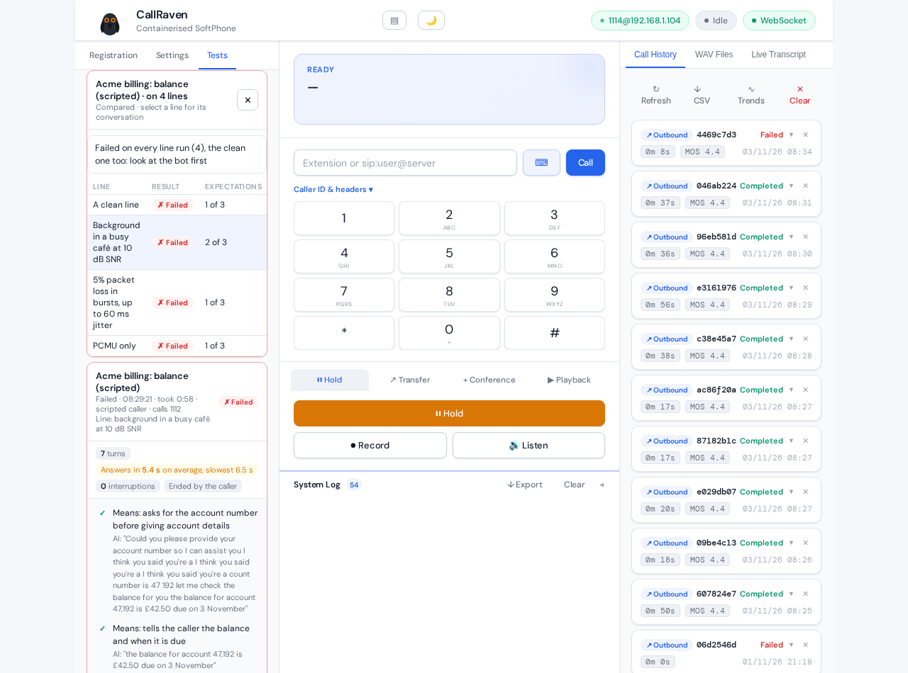

*The same bot on four lines. It failed on the clean line too (it gave out the balance before asking for the account number), so the comparison says to look at the bot first. With café noise it behaved better but slowed down: every answer took over 5 seconds.*

CallRaven can also **be** the voicebot: give it a role and it answers calls and holds the conversation, which makes a second CallRaven a target your tests can really talk to.

### Load runs

How does the PBX cope with 50 calls at once? CallRaven places them, from a block of extensions so the PBX sees 50 phones, and measures every call's setup time and quality. It can also be the carrier at the far end of a trunk and answer whatever the PBX sends it, or have 50 phones register at once, as after a power cut, and time the registrar.

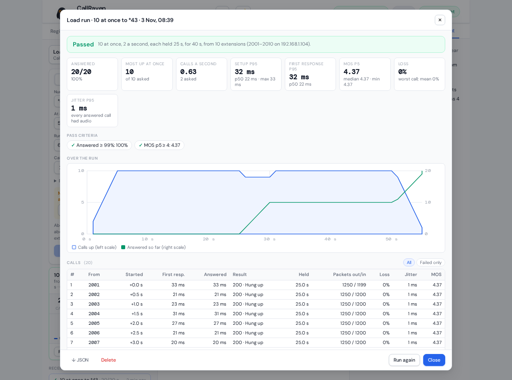

*20 calls from 10 extensions to a FreePBX echo test, 10 at once: all answered, setup p95 32 ms, no loss, MOS 4.37. A registration run on the same extensions registered all 10 in 17 ms (p95), refreshed and unregistered them.*

### From CI

Everything above runs through the API, and one request, `POST /api/runs`, starts any test and answers with a verdict when it's done, with a JUnit report for the CI job. A nightly job can map the IVR, run the voicebot tests and fail the build when something changed.

---

## AI, on your terms

AI is optional and off until you turn it on. When it's on, it explains a failed call in plain English from its signalling and measurements, judges checks by meaning ("the bot confirmed the new address"), plays the caller in voicebot tests, plays the bot as the voice agent, and writes report summaries and trend notes. It works with Claude or a model you run yourself (Ollama and the like), so call data can stay on your network; what it says is checked against the data, and a number it makes up is caught.

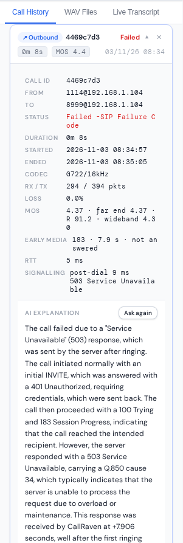

*A call to a number with no route, explained by a 7B model running on the same machine. It reads the signalling correctly (the challenge, the early media, a 503 with Q.850 cause 34) though it overstates how far the call got: smaller models do, which is why every quote and number is checked.*

---

## On a phone

The same web UI works on a phone. Below tablet width it becomes one column: registration, settings and the tests fold away behind one bar so the dialer comes first, and everything else, from live call quality to test runs and call history, works as it does on a desktop.

<p>
  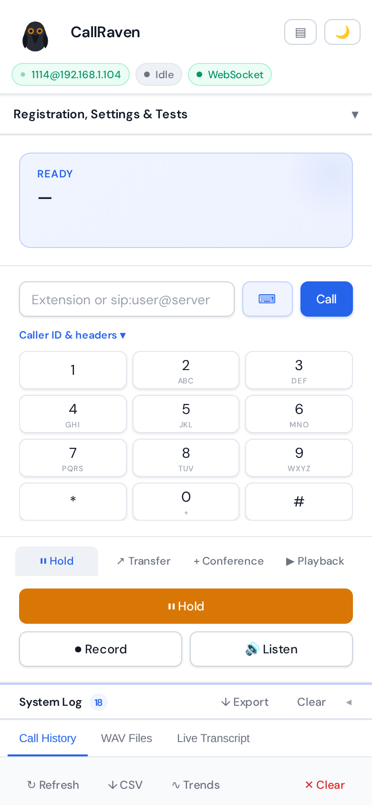
  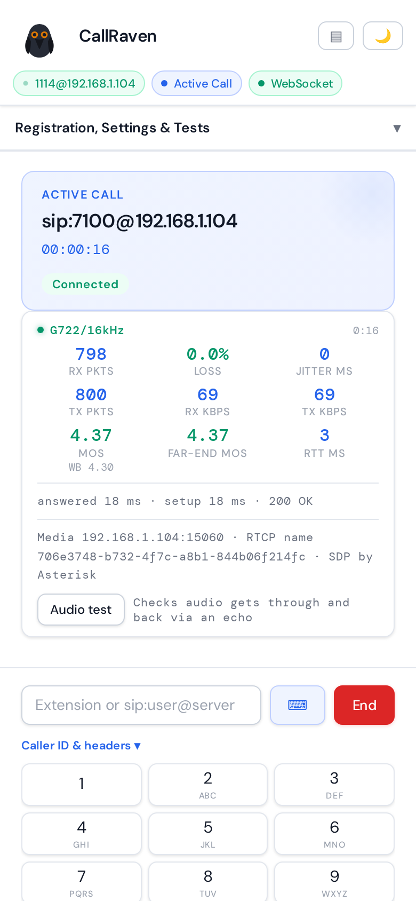
  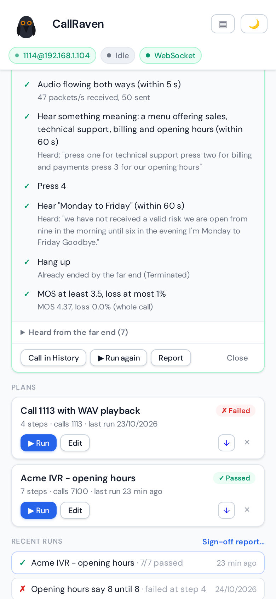
  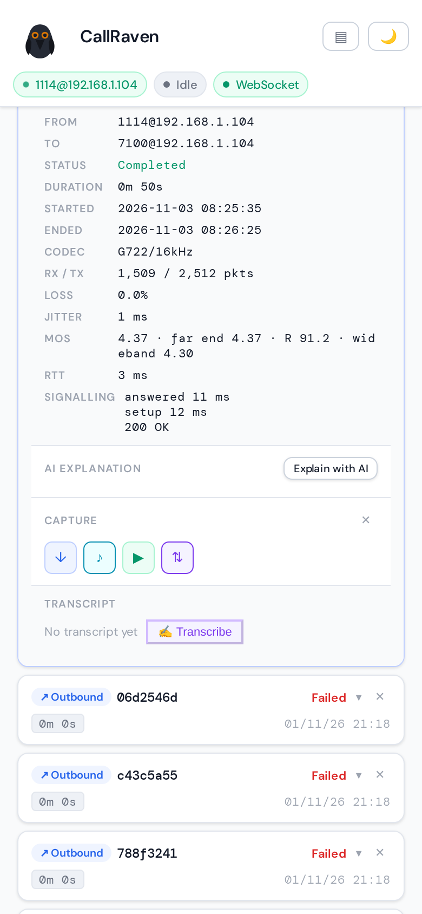
</p>

*The dialer, a call in progress with its quality figures, a test plan run, and a call's details in the history, at 390 px wide.*

---

## How it runs

One container (Docker or Podman), host networking, and a web UI on port 3000. Everything it needs is inside: the SIP stack, packet capture without tcpdump, the speech recognition, the synthesised voice. A REST API and WebSockets cover everything the UI does, documented in an OpenAPI 3.1 spec, behind one API key.

---

## Status

CallRaven is under active development. Its own CI places real calls through Asterisk on every change: calls and transfers, codecs, SRTP, IPv6, PRACK, T.38, test plans, IVR maps, voicebot tests and load runs among them.
