# CallRoost

**The tester of testers: a test platform for compliance capture and telephony tools.** CallRoost is a phone system with known answers, for testing the tools that test, record and log calls. Every number on it behaves exactly as written down, every time, and CallRoost says in advance what each call should leave behind: the IVR tree a mapper should find, the call's outcome, its CDR rows, its Open CDR record, its recording and the verdict a compliance checker should reach.

Testing a call tester, a recorder or a call-record pipeline against a real PBX only tells you that something happened. CallRoost tells you what should have happened, so a test can say right or wrong. It is Asterisk 20, configured from YAML, with its expected outputs worked out from the same YAML and checked against real calls.

It started as a simple test harness for my own tools: a few IVRs for CallRaven's IVR mapper to find, the same every time. Then each of the other tools needed the same thing. CallOwl needed call records with known answers, CallNest needed recordings that go wrong in known ways, and both needed a contact centre's queues and transfers and a SIPREC source. One piece at a time, the harness grew into a platform in its own right.

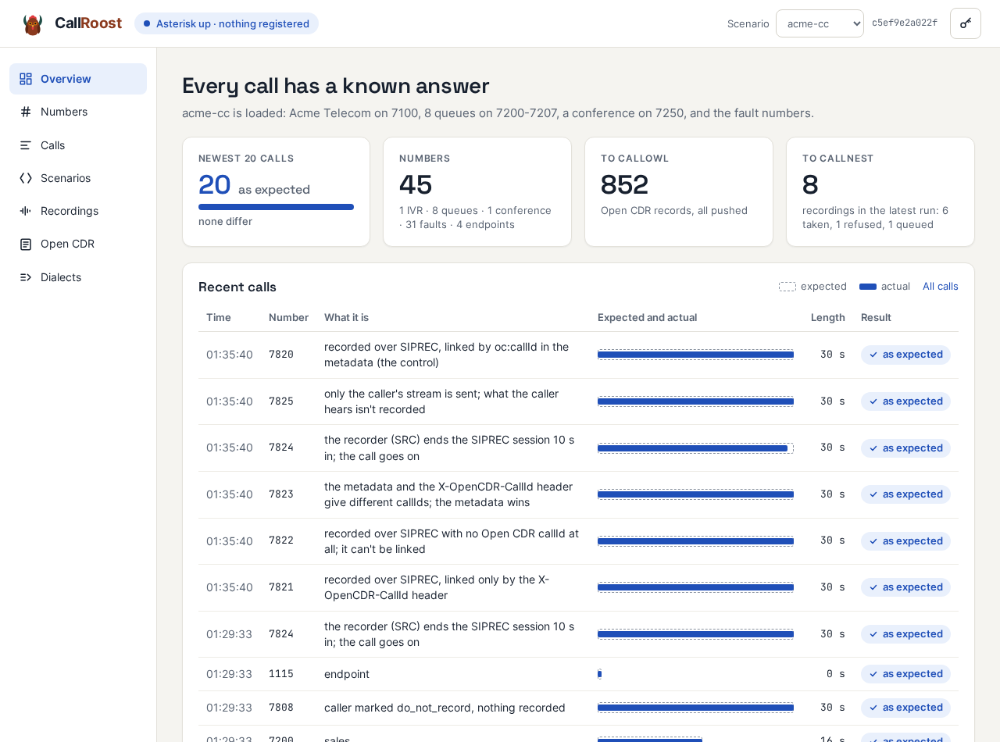

*After the 9 November run of all 58 reference calls on the contact-centre scenario: the newest 20 all as expected, among them the six SIPREC numbers checked against what CallNest holds; 852 Open CDR records, all with CallOwl; and the latest recording run, where CallNest took six recordings, refused 7804's as it should, and 7803's waits out its 20 minutes.*

---

## At a glance

| | |
|---|---|
| **IVRs from YAML** | Menus, messages and inputs; a scenario can extend another, so "v2 of the IVR" is just the change; one command switches a number from v1 to v2 |
| **Fault numbers** | 25 numbers that misbehave on purpose: busy, 503, 404, rings forever, early media, silence, hold music, a hang-up mid-prompt, DTMF sent three ways, a mid-call re-INVITE or UPDATE |
| **Call records with answers** | CDRs and channel events from every call, the rows each call should leave predicted to the second, and every call turned into Open CDR and pushed to CallOwl |
| **Recordings that go wrong on purpose** | Ten numbers, each recording and posting to CallNest with one thing wrong: missing, cut short, late, one-sided, unreadable, no call record, wrong time zone |
| **A contact centre** | Queues of virtual agents that ring, answer, speak, put the caller on hold, and hang up or really transfer the caller, blind or attended; ringall queues and conferences |
| **SIPREC from the PBX** | Six numbers recorded over SIPREC, each with one thing wrong in the session or its metadata, for testing a SIPREC recorder |
| **CDR dialects** | The same calls in three invented vendor formats, each with an answer key, for testing tools that map vendor data |
| **Twins and bad networks** | An IVR cloned from a CallRaven map, and a second instance with loss and jitter applied |

---

## IVRs that are the same every time

A scenario is a YAML file: numbers, menus with their keys, messages and inputs, spoken by text-to-speech or from recordings. CallRoost compiles it into Asterisk's dialplan and reloads Asterisk without dropping anyone. A scenario can extend another and give only what changes, so the Acme Telecom IVR's "release" is a 16-line file: billing gains a key 3 and the opening hours change.

For every IVR, CallRoost works out the tree a mapper should find: every key path, what is said there, and where a key loops back to a menu already seen. That is what CallRaven's IVR mapper is tested against. On 30 October it mapped Acme Telecom on CallRoost and found all 19 entries with no differences. Mapped again after switching to v2, it found all 20 and reported the two real changes, plus one false one: its speech recognition heard "for TV, press 2" as "forty b press two". Because the right answer was known, that was plainly the recogniser's mistake, not the IVR's.

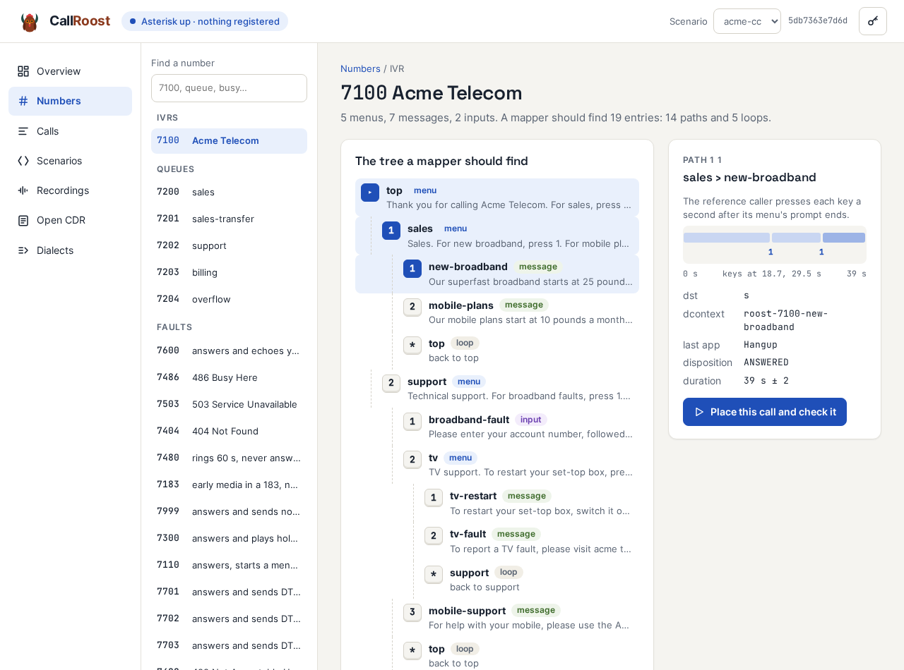

*Path 1 1, sales then new broadband: the reference caller presses its keys at 18.7 and 29.5 s, and the call should leave one row, 39 s long, ending in the new-broadband node.*

Pick any path and CallRoost shows the reference call: when each key is pressed (a second after the menu's prompt ends) and the CDR row Asterisk should write, timed from the prompts' real lengths. **Place this call and check it** makes the call from CallRoost itself and opens the result.

---

## Every call checked against its answer

Asterisk writes a CDR row per leg and an event for everything inside the call. CallRoost predicts those rows before a call is made: for a menu nobody answers, the caller is given up on in the timeout extension after three tries; for a busy number, one BUSY row with Hangup(17); for a queue, a row per agent tried and per leg after a transfer, each with its start, duration and billable time.

Each call in the log is set against its prediction. Expected is drawn as a dashed outline and actual as a solid bar, so a match fills its outline and a difference shows as a gap.

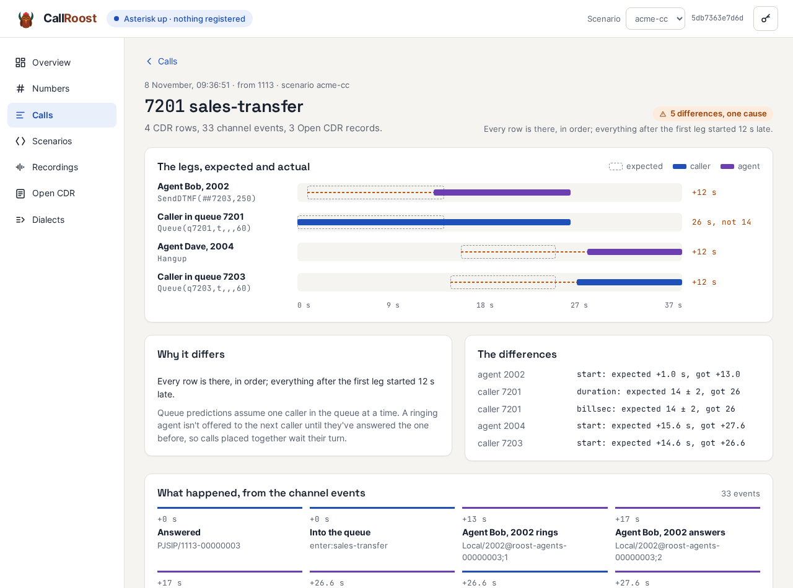

*Four calls placed to the same queue at once. This one waited 12 s for the agent, who was still ringing for another caller; everything after that ran exactly to plan, 12 s late. CallRoost says so, rather than listing five unrelated errors.*

The full set of reference calls (every fault number, every IVR path, every queue, the endpoints and a number that doesn't exist) runs with one command, `checkcdr`. On 8 November all 47 matched, row for row. With the newer contact-centre and SIPREC numbers added, the set is 58 calls, and on 9 November all 58 matched.

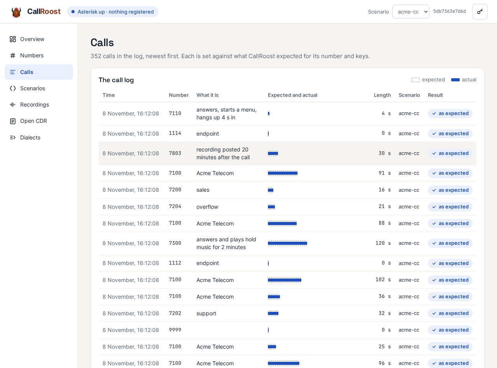

---

## Numbers that misbehave on purpose

Whatever the scenario, the fault numbers are always there, each with the outcome a caller should see: the SIP response, whether it's answered, early media, when the far end hangs up, what the caller hears. 7486 is busy, 7503 unavailable, 7480 rings for a minute, 7183 plays "not in service" as early media, 7999 answers and says nothing for five minutes, 7110 hangs up four seconds into a menu. 7701-7703 send the caller DTMF by RFC 4733, SIP INFO and in-band tones; 7461 and 7462 refresh the session mid-call by re-INVITE and by UPDATE. Extension 1115 has SIP session timers on, so every call to or from it is refreshed every 45 s.

CallRoost's own test caller checks all of them, including an in-band DTMF decoder for 7703.

---

## Recordings that go wrong on purpose

Ten numbers, 7800-7809, each answer and play 30 seconds of known audio. CallRoost records the caller's channel and posts it to CallNest through CallNest's own Asterisk integration, after doing one thing wrong:

| Number | What happens | What CallKestrel should find |
|---|---|---|
| 7800 | recorded and posted normally | covered |
| 7801 | not recorded | missed |
| 7802 | the recording stops 10 s in | partial |
| 7803 | posted 20 minutes after the call | late |
| 7804 | its WAV headers destroyed; CallNest refuses it | missed |
| 7805 | the far side's stream is silence | both-sides check fails |
| 7806 | recorded, but no CDR | an orphan |
| 7807 | the call record's times are local time labelled UTC | time-zone check flags it |
| 7808 | the caller is marked do-not-record | nothing expected |
| 7809 | the call record has no group | incomplete, still checked |

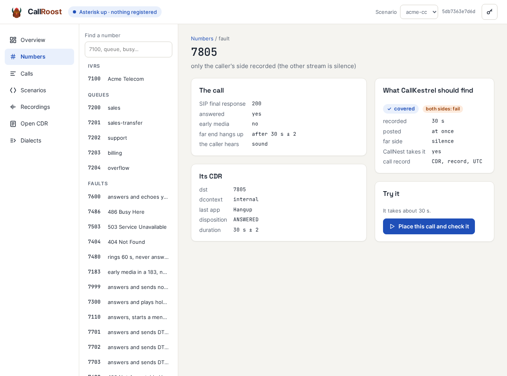

*7805 records the call but replaces the far side's audio with silence: a compliance checker should find the call covered, with its both-sides check failing.*

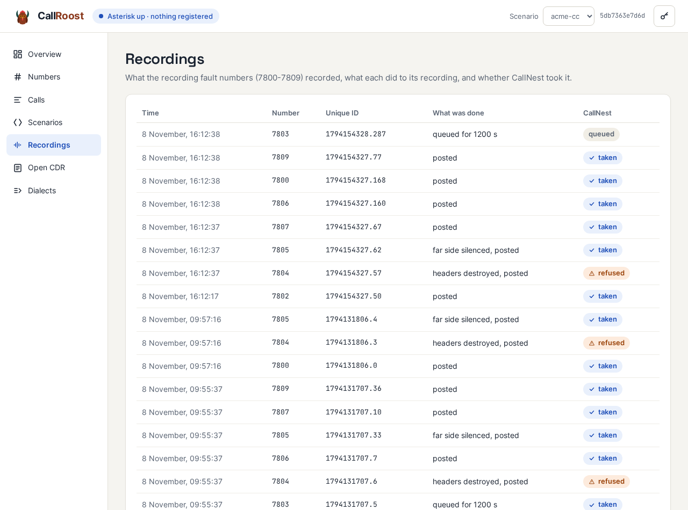

*The 16:12 run: CallNest took every recording but 7804's, which it refuses as "not a readable audio file"; 7803's waits its 20 minutes before it's posted.*

---

## A contact centre that behaves

Queues of virtual agents: each rings for a set time (or never), answers, says its line, talks, then hangs up or blind-transfers the caller by pressing ## and a number, as a person on a FreePBX phone would. The transfer is a real one, so the CDRs split exactly where a real PBX's do. Agents that never answer, failover to the next agent, a queue that gives up and sends the caller elsewhere: each has its legs predicted, and each matched Asterisk to the second.

The harder cases are there too. In a ringall queue every agent rings at once and the first to answer gets the caller, while the others' legs end unanswered. An agent can put the caller on hold, with hold music and hold and resume events in the call record. An attended transfer is the agent pressing *2 and a number, talking to whoever answers, then hanging up, which leaves a real attended transfer and the caller IDs Asterisk rewrites along the way. In a conference, agents are brought in as the caller joins and leave one by one. All of these are predicted leg by leg, and each matched in every CDR row and Open CDR record.

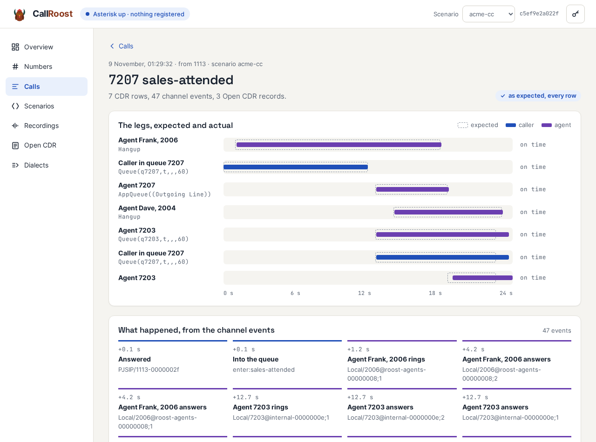

*An attended transfer on a real call: seven CDR rows, every one where it was predicted. Frank talks to the caller, dials billing, waits while Dave answers, then hangs up; the caller's queue leg carries on, bridged to Dave.*

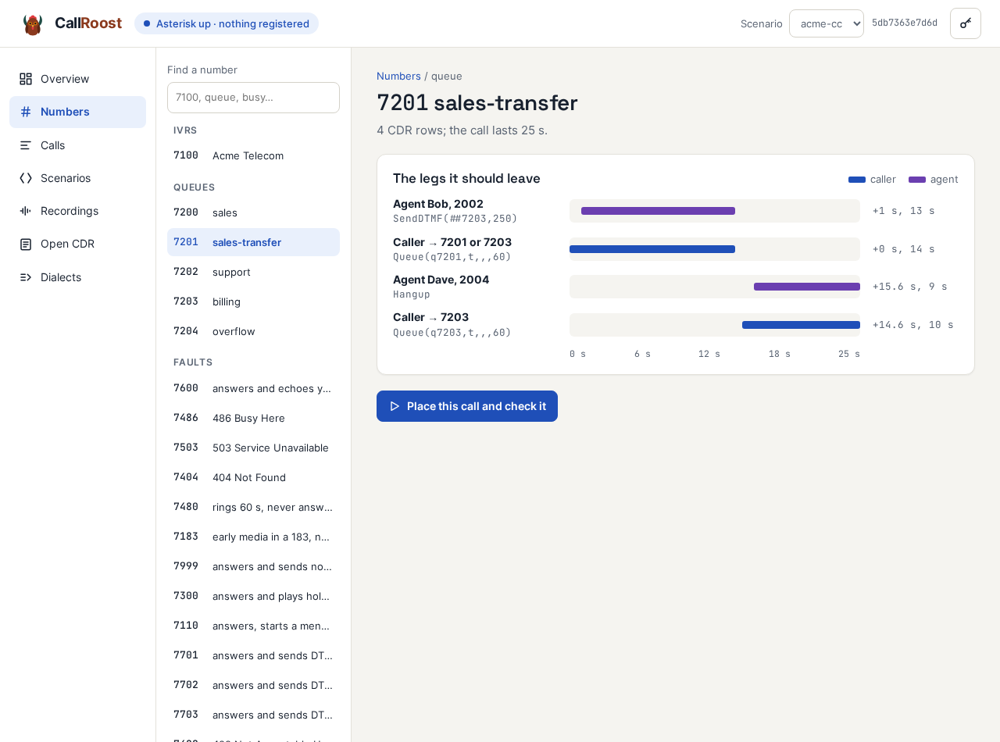

*Bob answers after 4 s, talks, and presses ##7203; the caller goes to billing, where Dave answers. Four rows, each with its start and length. Asterisk writes the first caller row's destination as 7201 or 7203 depending on a race inside it, so either is accepted.*

---

## SIPREC from the PBX side

Asterisk has no SIPREC client, so CallRoost has its own. It listens in on each direction of a call and sends both streams to a SIPREC recorder, with the session's metadata, without sitting in the call's path or changing its CDRs. Six numbers, 7820-7825, each record over SIPREC with one thing wrong:

| Number | What's wrong |
|---|---|
| 7820 | nothing: the Open CDR call ID is in the metadata (the control) |
| 7821 | the call ID is only in a SIP header |
| 7822 | the call ID is in neither |
| 7823 | it's in both, and they disagree |
| 7824 | the recording session ends 10 s in |
| 7825 | one stream only |

For each, CallRoost says what the recorder should end up holding. All six matched CallNest on the first live run, and again on 9 November.

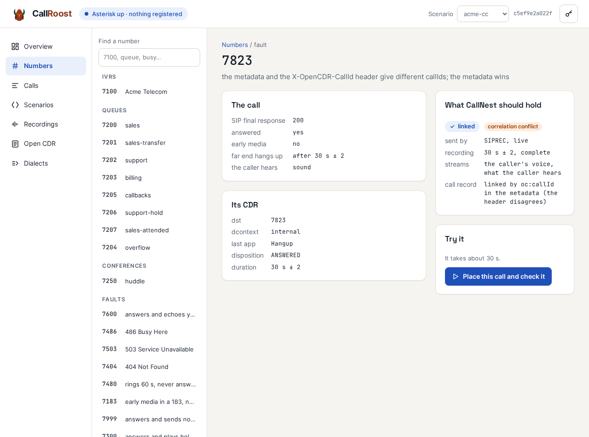

*7823 sends two different call IDs, one in the metadata and one in a header. CallNest should link the recording by the metadata and record the conflict.* This gives CallNest a second, independent SIPREC source beside CallRaven.

---

## Call records for CallOwl, in Open CDR

Every finished call becomes Open CDR records, one per channel, using the same Asterisk mapping CallNest uses for recordings, so a recording and its call record share an ID. Queues, agents, transfers and IVR paths are in the record; so is the SIP Call-ID. Records go to CallOwl as calls finish, and wait and retry while it's down.

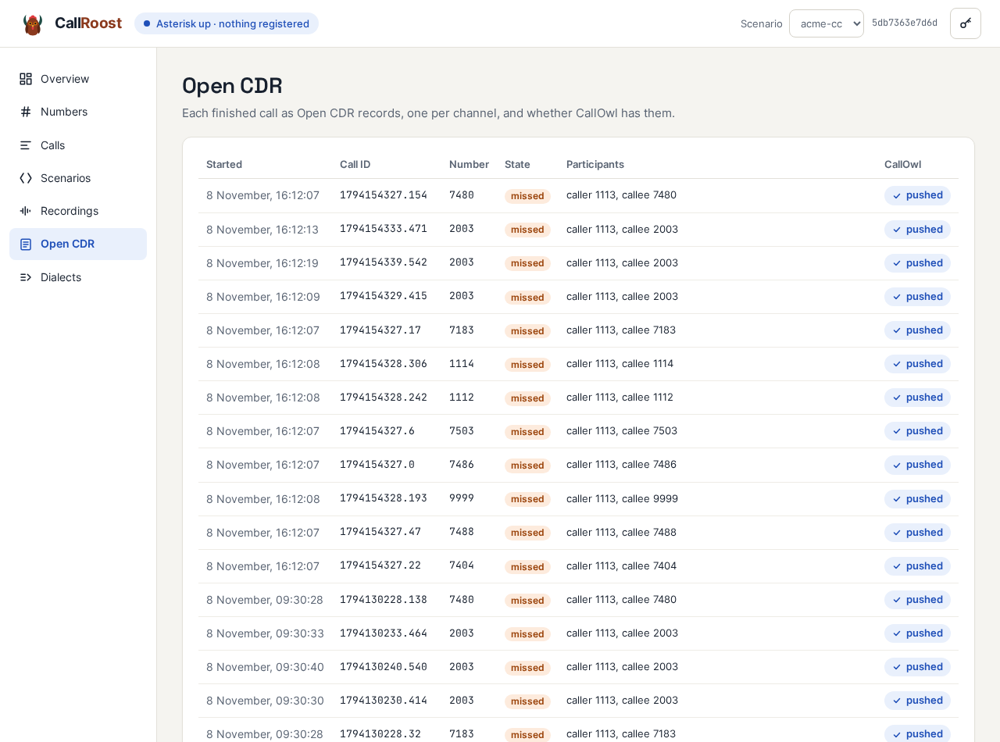

*Unanswered calls are records too: busy, unavailable, an endpoint nobody is registered on, an agent who never picks up.*

---

## CDR dialects for testing data mapping

Tools that read call records from many vendors have to map each vendor's format. CallRoost writes the same calls in three invented formats with the problems real ones have: renamed fields and epoch-millisecond times; one record per interaction with local time and no zone; split date, time and offset columns in Latin-1 with numeric status codes. Each comes as a daily file and over HTTP with its own paging style, and each has a hand-written answer key. CallRoost runs the key against the true records: all three were right for all 402 records of 8 November.

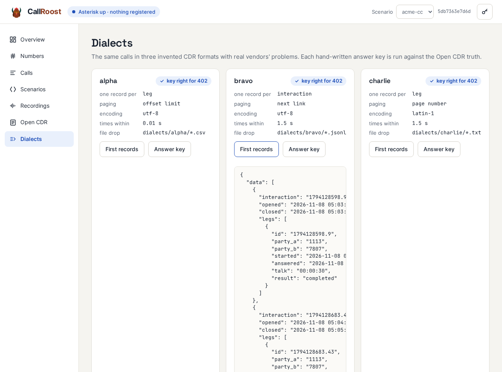

---

## Scenarios, edited and checked as you type

The editor compiles a scenario as you type and shows what a mapper should see change against the scenario it extends: for Acme v2, billing's prompt now offers 3, a new entry at 3 3, and the opening hours' new text. Scenarios saved here are kept beside the repository's, which can't be overwritten from the browser.

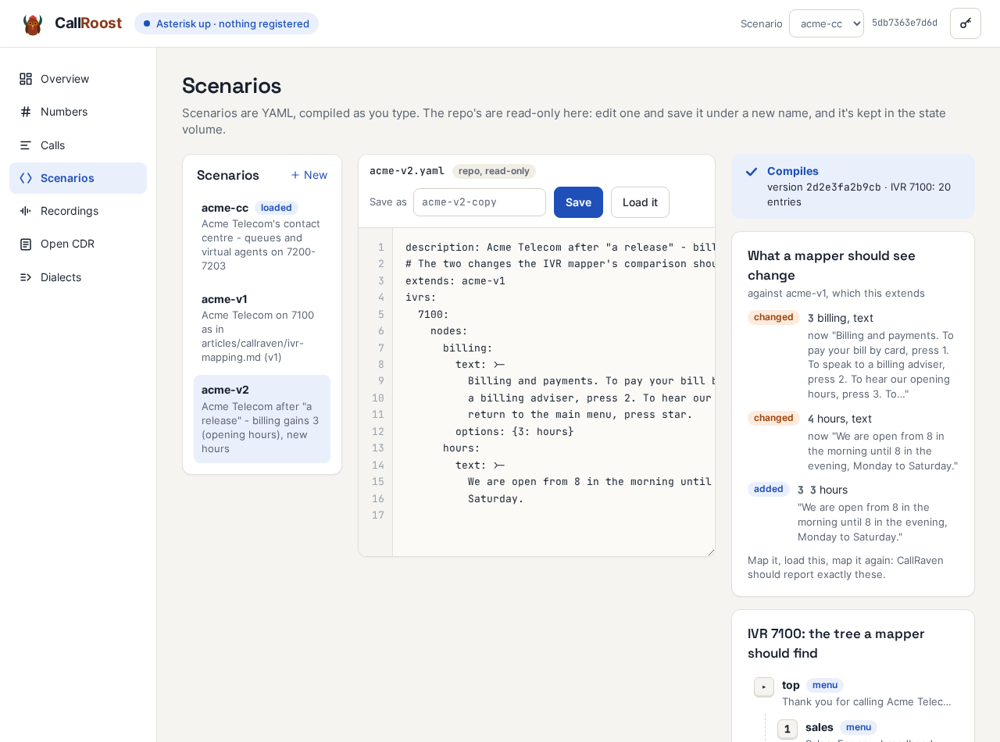

CallRaven's own CI IVRs are a scenario as well, built from Asterisk's stock voicemail prompts just as the CI builds them, so CallRaven's maps of them can be checked against a known tree. A real IVR can be cloned too: `roost import-map` turns a CallRaven map into a scenario, a twin to test against without calling the live system, and checks that the twin maps back to the same tree.

---

## A bad network on demand

A second CallRoost, in its own network namespace, applies loss, delay and jitter to everything it sends, and says what it applied, so a caller's quality figures can be checked against it. Configured for 80 ms ± 20 ms and 5% loss, it measured 82.8 ms and 5.0% from outside, while the normal instance stayed under 1 ms with no loss.

---

## How it runs

One container: Asterisk 20, the YAML compiler, an HTTP API and the web UI on port 8160, and SQLite for the call log. It uses host networking, with its own SIP and RTP ports so it can share a machine with CallRaven. Everything the UI shows is in the API, documented in OpenAPI, behind an API key with a read-only variant.

---

## Status

CallRoost is the lab fixture the other tools in the family are tested against. Its rule is that nothing goes in without its expected output: every feature came with the answer a test should get, and was checked with real calls, not only unit tests. Next is a second peer that isn't Asterisk, rvoip, so that call testers meet a SIP stack with different habits, and SIPREC for every call rather than only its six numbers.
