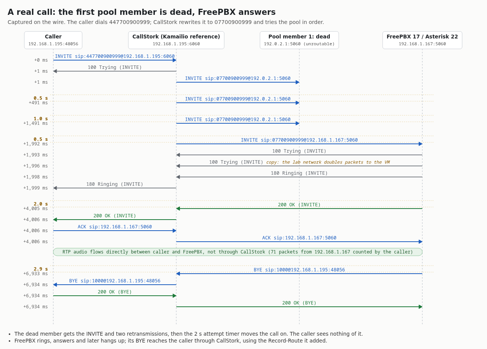
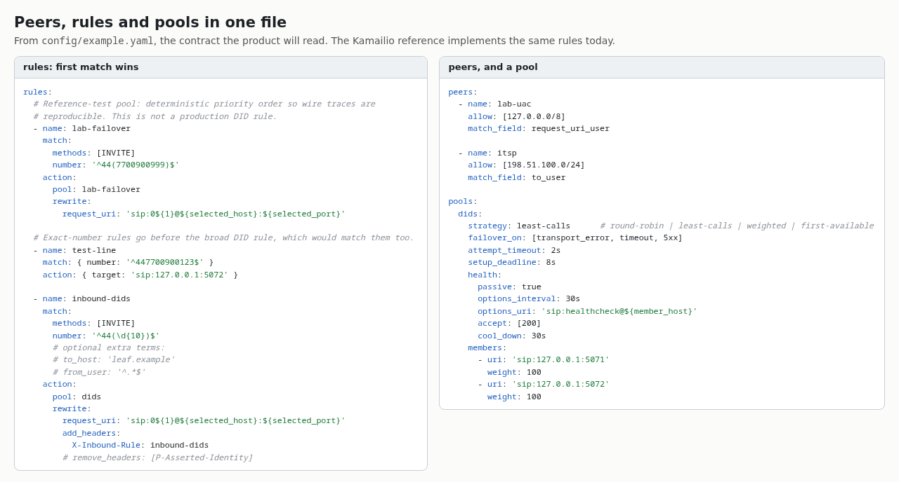
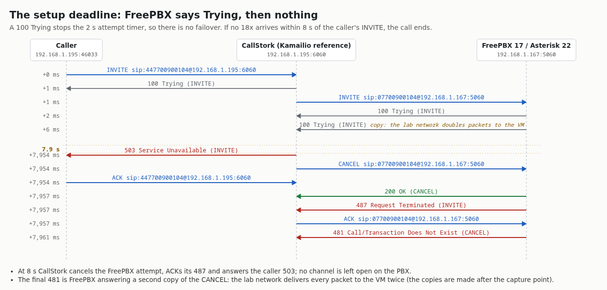
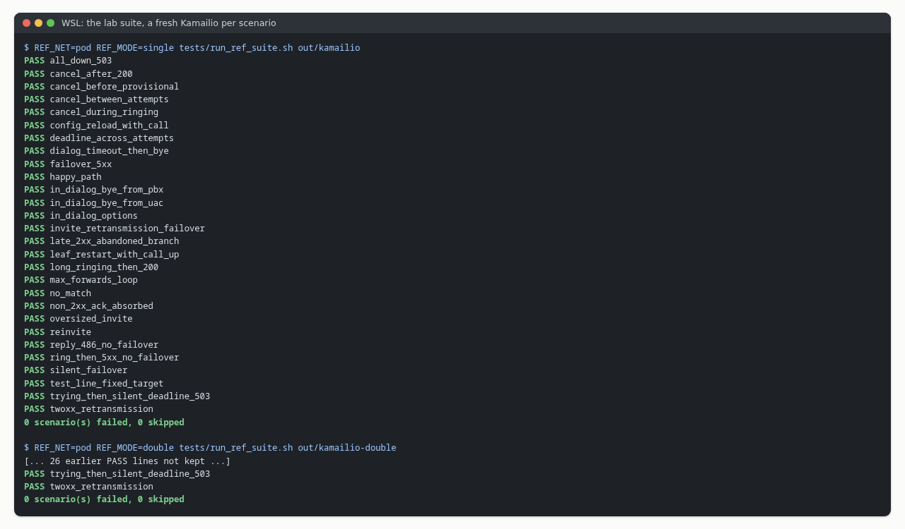
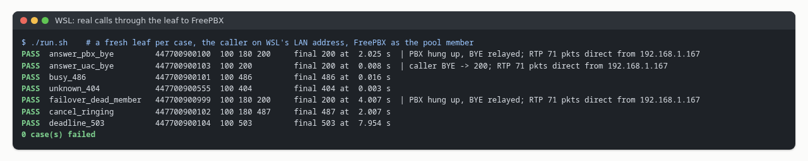

# CallStork

**An inbound SIP dispatcher for small phone systems: it takes every call from a carrier, another PBX or a SIP endpoint at one address, picks the right rule for the dialled number, and hands the call to one PBX in a pool, failing over to the next when one is down.**

A phone system with more than one PBX still has one front door: the carrier sends every call to a single SIP address. Something has to sit at that address and decide where each call goes. Usually that's a full SBC or a hand-written Kamailio or OpenSIPS config, which is a lot of machinery for "send these numbers to that pool, and if a PBX doesn't answer, try the next one". CallStork aims at the small version of that job: it delivers each call to the right PBX, as the name suggests. You give it a short YAML file of peers, rules and pools. It stays in the signalling path, so it sees every BYE, but it never touches the audio or the caller ID.

*A real call, captured on the wire. The first pool member is an unroutable address. CallStork sends it the INVITE and two retransmissions, gives up after its 2 s attempt timer and tries FreePBX, which rings for 2 s, answers and hangs up 2.9 s later. The caller sees one 100 Trying, one 180 Ringing and the 200 OK. The audio never passes through CallStork.*

---

## At a glance

| | |
|---|---|
| **Rules** | Match the dialled number (from the Request-URI or the To header) with regexes in file order; rewrite it; add headers |
| **Pools** | Send each call to one PBX in a pool, chosen by least calls or a fixed order, with OPTIONS health checks |
| **Failover** | On no answer, 5xx or a network error, try the next PBX, but never once the caller has heard ringing |
| **Timers** | 2 s to hear anything from a PBX, 8 s per call to start ringing, then as long as it rings |
| **The awkward cases** | CANCEL at every stage, ACK absorption, retransmissions, late answers, in-dialog requests, restarts with calls up |
| **Tested** | 28 wire scenarios in two Record-Route modes, and real calls to FreePBX 17 / Asterisk 22 |

Today CallStork is a Kamailio 6.1 reference configuration, a YAML contract and a test harness. The standalone program (Go, built on the `sipgo` library) comes next and has to pass the same tests.

---

## Peers, rules and pools in one file

A **peer** is anything allowed to send calls in: a carrier, an internet telephony provider, another PBX, or a desk phone sending a direct INVITE. Each peer has the addresses it may send from and says where to find the dialled number: in the Request-URI, as most IP trunks do, or in the To header, as registration trunks do. Everything else is refused with a 403.

**Rules** are tried in file order and the first match wins. A rule matches the dialled number, after an optional leading `+` is stripped, with a regex. The rewrite uses the regex's captures, so `^44(\d{10})$` with `sip:0${1}@…` turns 447700900100 into the national 07700900100 that a UK PBX expects. A rule can also add headers (the PBX side uses `X-Inbound-Rule` to tell the rules apart) or send the call to one fixed address instead of a pool. A number no rule matches gets a 404 straight away, and no PBX hears about it.

A **pool** is a list of PBXs and a way to choose between them. The reference does least calls (fewest calls in progress) and a fixed priority order; the contract also names round robin and weighted. Each member gets an OPTIONS ping every 30 s, and one that stops answering is skipped until it answers again. The caller's From and To headers and the SDP are never rewritten. Caller ID is left to the PBX.

## Failover the caller doesn't notice

Each attempt is a separate SIP transaction with its own branch. If a PBX doesn't answer at all, replies 5xx, or can't be reached, CallStork tries the next member. The caller has only seen 100 Trying, so the switch is invisible to them, as in the call at the top of this page. Retransmissions of the caller's INVITE during the switch are absorbed, so a call never reaches two PBXs at once.

Some outcomes stop the search: busy (486), not found (404) or any other 4xx or 6xx is a real answer and goes back to the caller. Once a PBX has sent 180 or 183 the caller has heard ringing, so a 5xx after that goes back too: being moved to a second PBX mid-ring would be worse than a failed call. If no member is left, or all are down, the caller gets a 503.

## Timers that follow the call, not the PBX

There are two timers. The **attempt timer** gives a PBX 2 s to say anything at all. A 100 Trying is enough to stop it, because a PBX that has said Trying is alive and working on the call. The **setup deadline** gives the whole call 8 s, counted from the caller's INVITE and across every attempt, to start ringing. When it passes, CallStork cancels the attempt in progress and answers the caller 503. It doesn't move on to another member: by then the caller has waited long enough.

Once a PBX sends 180 or 183 the deadline no longer applies. The call can ring for up to three minutes, in line with SIP's Timer C for proxies, until someone answers or someone hangs up.

The first version of the reference got both timers wrong: ringing calls were cut off after 8 s, and the deadline was per attempt, so a PBX that said Trying and went quiet was failed over after 8 s instead of the call ending. A review against the spec caught it, and three scenarios now cover it.

## The cases where hand-written proxies break

Routing an INVITE is the easy part. The harness concentrates on the moments when two things happen at once:

- **CANCEL** before the PBX has answered anything, during ringing, between two attempts, and after the call was answered.
- **ACKs:** the ACK for a busy or error response is absorbed by CallStork, while the ACK for a 200 goes to the PBX.
- **Retransmissions:** of the caller's INVITE during failover, and of the PBX's 200 (which must reach the caller).
- **In-dialog requests:** BYE from either side, re-INVITE and OPTIONS follow the Record-Route path. A BYE still gets through after CallStork has been **restarted** or its configuration **reloaded** with the call up, because CallStork keeps no per-call state once a call is set up.
- **Guards:** too many hops gets 483, and an INVITE too large for UDP gets 513.

Each scenario runs a fake caller and two fake PBXs in Python, using only the standard library. The PBXs can be told to answer, ring, stay silent, return 5xx or busy, or answer late. The harness checks what each side saw, including the Request-URI every PBX received. That check was added after a review of the traces found a failover, after a timeout, sending the second PBX the caller's original number instead of the rewritten one. Every run writes a verbatim, timestamped trace. The traces for both modes, one Record-Route header, and the RFC 5658 pair used when CallStork has two network addresses, are in the repository as the reference the standalone program must match.

## Checked against a real PBX

The same reference was then run on a LAN address, with a FreePBX 17 (Asterisk 22) virtual machine as the pool. A test caller sent each call with a real SDP offer, and a small dialplan on FreePBX gave each test number one behaviour: ring then answer, busy, ring until cancelled, answer and stay up, or say Trying and nothing else. All seven cases passed, twice. In every answered call the audio went directly between FreePBX and the caller: the caller counted 71 RTP packets, all from FreePBX's own address.

Two things learned from the run are written up in the repository. FreePBX accepts calls from unknown sources and checks for them before it checks headers, so CallStork has to be identified by its IP address and port. And in this lab, a WSL2 instance and a VMware virtual machine on the same Windows host, every packet sent to the VM arrives twice. SIP takes the copies as retransmissions and calls still work, but the copies show up in traces (the ladders above mark them).

---

## How it runs

The reference is a single Kamailio configuration file plus two data files, the allowed peers and the pool members. It runs in the official Kamailio container image. One script starts a fresh Kamailio container for each scenario and runs the whole suite. The harness needs only Python 3. On WSL2 the suite runs inside a Podman pod: mirrored networking there drops loopback UDP packets over 1472 bytes, which the oversized-INVITE test sends.

## Status

Phase 0 of a planned product, built in November 2026: the design is settled and proven on the wire, but there is no standalone program yet.

- **Working:** the Kamailio reference (UDP, IPv4), the YAML contract, the harness with 28 scenarios passing in both Record-Route modes, and the real-PBX run above.
- **Next:** the standalone Go program, with `check` and `test` commands that validate a config and run the scenarios against it, then a web page for the config. The plan is tracked as [issues](https://github.com/chrisnock-personal/callstork/issues).
- **In review:** two gaps found while writing this page are fixed in a [pull request](https://github.com/chrisnock-personal/callstork/pull/15) awaiting review. A 200 that a PBX sends after CallStork has given up on its attempt was passed on to the caller; now CallStork answers it and hangs it up on the PBX, as the design asks. And the 503 now carries `Retry-After`. Three new scenarios bring the suite to 31, all passing in both modes. A [second pull request](https://github.com/chrisnock-personal/callstork/pull/16) adds the real-PBX run as a repeatable tool, with a guide to preparing FreePBX or Asterisk for it.
- **Not yet:** TCP and TLS, registering to a carrier as a client, and a real carrier in front of it.

Source and reference documentation: [github.com/chrisnock-personal/callstork](https://github.com/chrisnock-personal/callstork).
