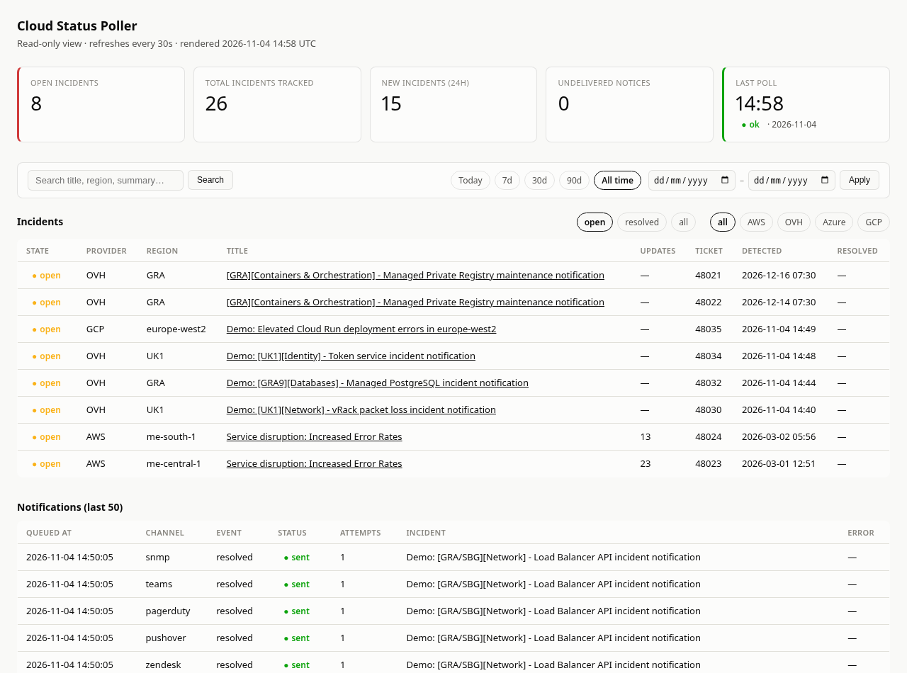
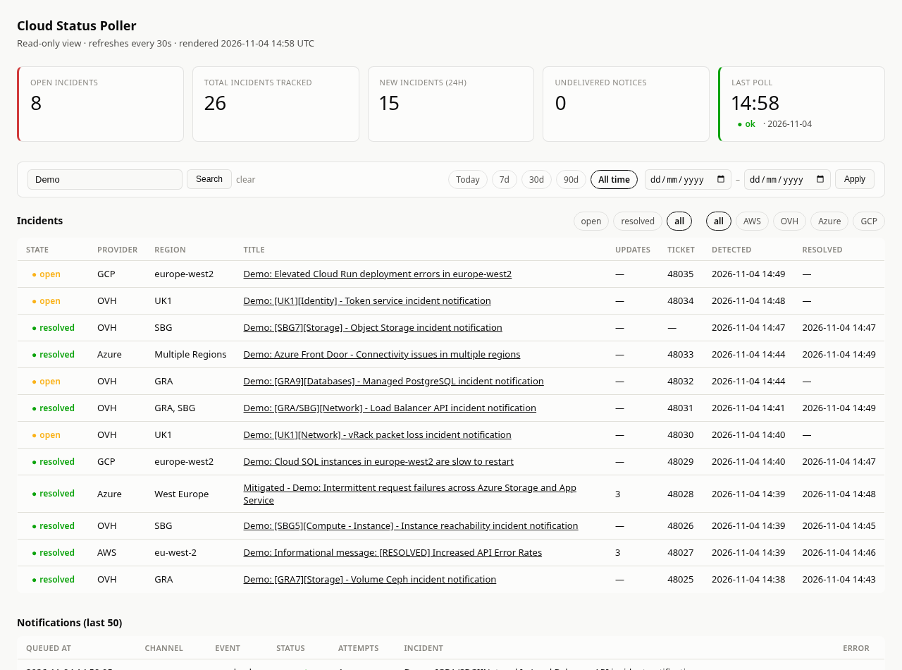
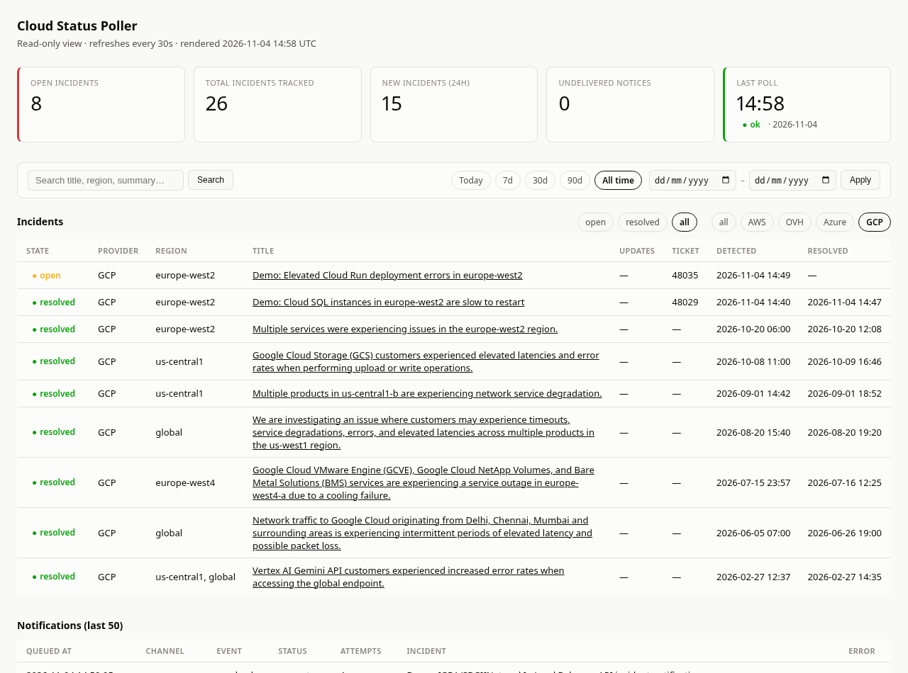
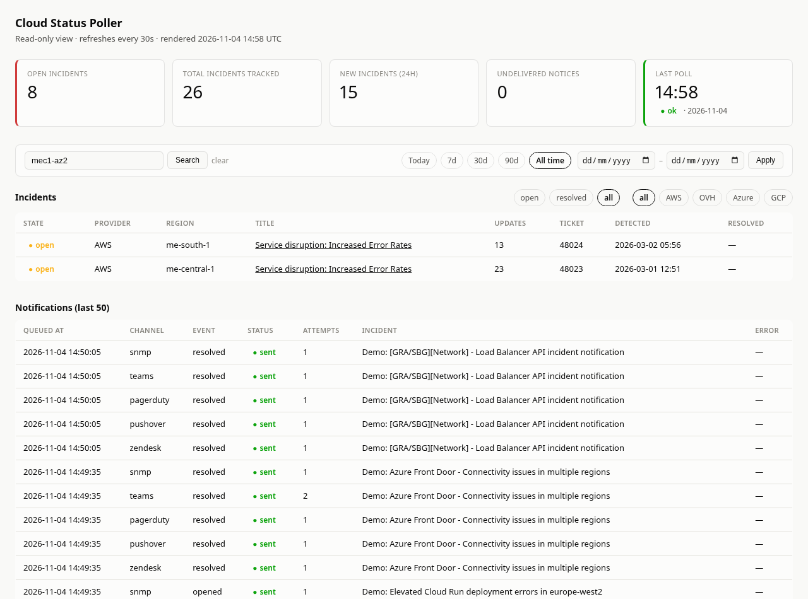
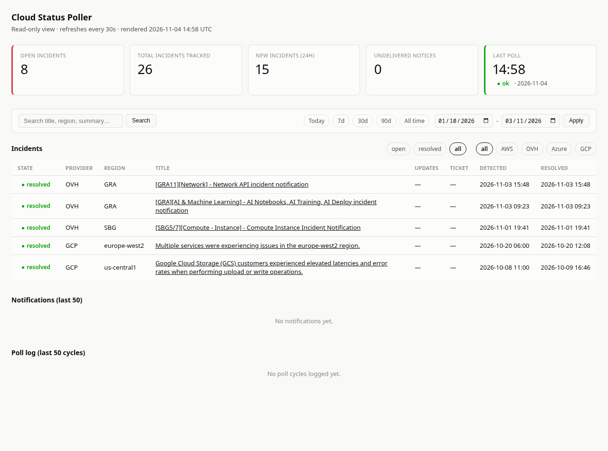
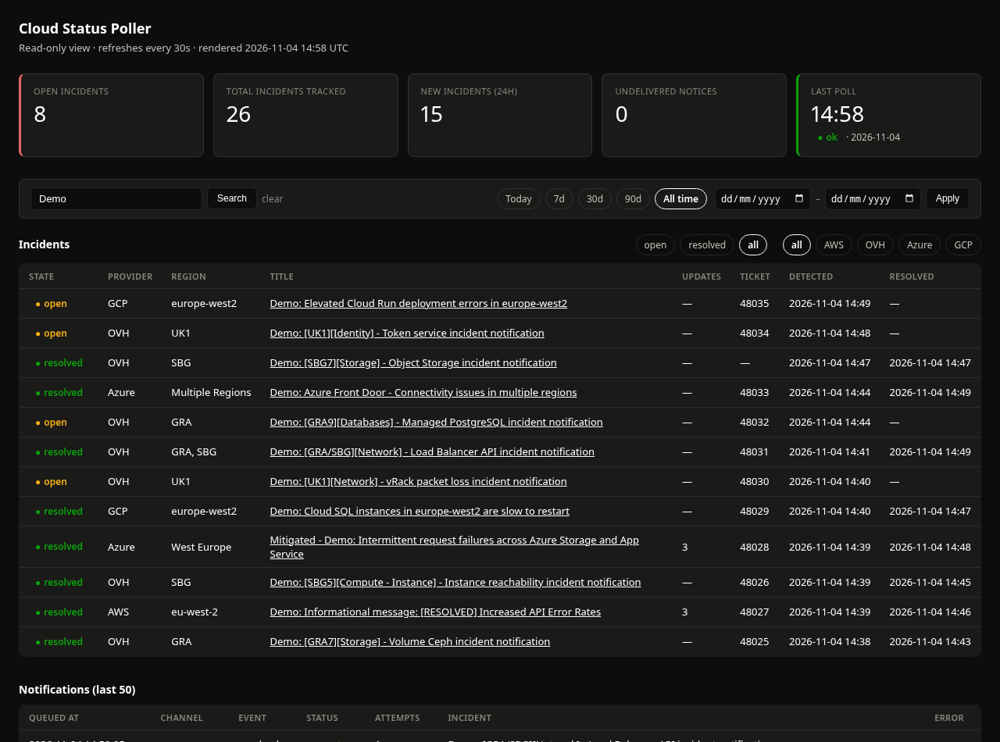
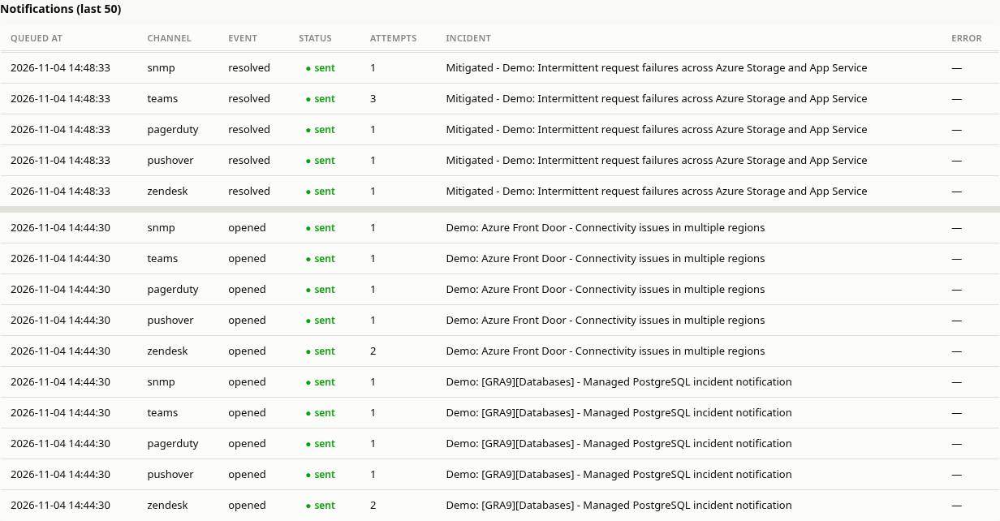
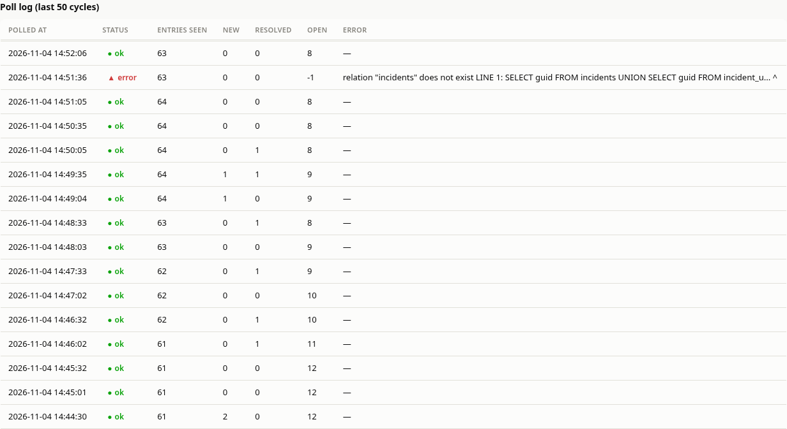

# Cloud Status Poller

**A small service for support and operations teams that watches the public status feeds of AWS, OVHcloud, Microsoft Azure and Google Cloud, tells you when an incident touches a region you care about, through Zendesk, PagerDuty, Pushover, Microsoft Teams or SNMP traps, and follows up when the provider says it's over.**

When a cloud provider has a problem, the first place to say so is usually its status page, and nobody is paid to sit and refresh four of them. Customers notice first, or a support engineer finds out by chance. Each provider also publishes differently: one posts every update as a separate entry, another rewords its entries, another just removes them when the event ends. Cloud Status Poller reads all four on a schedule, works out which incidents matter to you, and turns each one into a single ticket and alert, with a record of what happened and when.



*The dashboard at the end of a 20-minute run on 4 November 2026, with real feeds from all four providers. The AWS rows are real: one long-running event in each of two Middle East regions, with 23 and 13 updates on a single ticket each. Entries starting "Demo:" were scripted for this page, so that tickets could open and close during the run. The two OVH rows at the top are real maintenance notices, dated by when the work is scheduled.*

---

## At a glance

| | |
|---|---|
| **Four providers** | AWS, OVHcloud, Azure and Google Cloud, each read in the way its feed needs; any of them can be switched off |
| **Filtering** | By region, using each provider's own region names, and optionally by keyword |
| **Zendesk tickets** | One ticket per incident with the provider, region, link and timeline; provider updates added as internal notes; moved to pending when the incident ends, for a person to close |
| **Alerts** | Pushover, PagerDuty, Microsoft Teams and SNMP traps, in any combination, with or without Zendesk; old events and planned maintenance don't interrupt anyone |
| **Failure handling** | Each channel fails and retries alone through a delivery queue; a cycle that fails sends nothing and is recorded with its error; an unreadable feed closes nothing |
| **Dashboard** | Read-only web view: summary tiles, incidents, search, filters by state, provider and date, and a log of every notification and poll |
| **History** | Every incident and update is kept in PostgreSQL, with the provider's own timestamps, ready for SQL reporting |

---

## From a status feed to a ticket

Every five minutes by default, the poller reads each provider's feed and compares it with what it already knows. A new incident in a watched region gets a Zendesk ticket and an alert straight away. An incident that was already over the first time the poller saw it is recorded for history, without raising anything nobody needs to act on. When an open incident ends, the ticket gets an internal note and moves to **pending**, and closing it stays a human decision.



*The twelve scripted incidents at the end of the run. Seven went from open to resolved, four are still open, and one (`[SBG7]`) was already over when first seen, so it has no ticket. The Load Balancer incident named two regions and shows both. Updates counts the later entries attached to one incident.*

A ticket carries what the person picking it up needs. This is one the poller raised during the run, as sent to the Zendesk API:

```
Subject:  [GCP] europe-west2 – Demo: Cloud SQL instances in europe-west2 are slow to restart
Priority: high    Tags: cloud-status, auto-raised

Provider: GCP
Region:   europe-west2
Link:     https://status.cloud.google.com/incidents/demoGcp001

--- Timeline ---
Incident published: 2026-11-04 14:40 UTC
Last updated:       2026-11-04 14:40 UTC
Detected by poller: 2026-11-04 14:40 UTC

--- Detail ---
Cloud SQL: We are investigating slow restarts of Cloud SQL instances in europe-west2.
```

Priority, tags and the Zendesk group that receives the tickets are all settings. Across the run the poller raised 15 tickets, added 6 internal notes and moved 7 tickets to pending.

---

## Alerts: reaching people and systems

A ticket records an incident, but it doesn't wake anyone. Four more channels can run alongside Zendesk, or instead of it: any one of them is enough. Each is on once its settings are filled in.

| Channel | What it sends |
|---|---|
| **PagerDuty** | An Events API v2 alert, which clears itself when the incident ends |
| **Pushover** | A push message to a phone, with a link to the status page; emergency priority repeats until someone acknowledges it |
| **Microsoft Teams** | An Adaptive Card posted to a channel through a Workflows webhook, with the provider, region and a button to the status page |
| **SNMP traps** | A v2c trap to each receiver, for network monitoring systems, with a MIB file so they decode by name |

Across the run, each of the four delivered 18 notices: 11 incidents opening and 7 ending. PagerDuty's alert carries a key that its all-clear reuses, so the same alert closes when the incident does. This is what the scripted Cloud SQL incident sent, shortened:

```json
{
  "event_action": "trigger",
  "dedup_key": "cloud-status-19",
  "payload": {
    "summary": "[GCP] europe-west2 – Demo: Cloud SQL instances in europe-west2 are slow to restart",
    "source": "GCP europe-west2",
    "severity": "error"
  }
}
```

And this is a trap as a real `snmptrapd` decoded it, using the project's MIB, also shortened:

```
SNMPv2-MIB::snmpTrapOID.0 = OID: CLOUD-STATUS-POLLER-MIB::cspIncidentResolved
CLOUD-STATUS-POLLER-MIB::cspProvider = STRING: OVH
CLOUD-STATUS-POLLER-MIB::cspRegion = STRING: GRA
CLOUD-STATUS-POLLER-MIB::cspTitle = STRING: Demo: [GRA7][Storage] - Volume Ceph incident notification
CLOUD-STATUS-POLLER-MIB::cspIncidentId = INTEGER: 15
```

**Not everything should wake someone.** A status feed holds months of history and next month's maintenance, and a new install would otherwise page someone for all of it. So Zendesk records every incident, while the alert channels skip anything published more than 24 hours ago and all scheduled maintenance. Both rules are settings. In the run, the two AWS events from March and two real OVH maintenance notices each got a ticket and no alerts: of the 72 alerts sent, none was about them. Alerts cover new and resolved incidents by default, and a channel only hears that an incident ended if it heard it begin. Provider updates go to Zendesk as notes, and can be turned on for Pushover, Teams and SNMP.

---

## Four providers, four ways of publishing

The useful part of this project is the difference between the feeds. Treating them all the same produces wrong tickets, so each provider has its own rules, based on what its feed really publishes.

| Provider | Source | How one incident is recognised | How it knows the incident is over |
|---|---|---|---|
| **OVHcloud** | RSS history feed | One ID for the incident's whole life | The status word on the newest update: Resolved, Completed or Postmortem |
| **AWS** | One RSS feed per region | Every update is a separate entry, so entries in a region belong to the open incident until one resolves it | `[RESOLVED]` or "Service is operating normally" in the title |
| **Azure** | RSS feed of events in progress | Titles get reworded, so any change counts as an update to the open incident in that region | A title starting "Mitigated" or "Resolved", or the event leaving the feed |
| **Google Cloud** | Structured `incidents.json` | One stable ID | The incident has an end time |

AWS shows why this matters. Its real feed for the Middle East (UAE) region held 24 entries about one event that began on 1 March 2026, and the poller turned them into one incident and one ticket with 23 updates. Its text also can't be trusted for keywords: a real update says power "has not yet been restored", which is not a resolution, so the poller only looks at the provider's own markers. In the run, a scripted AWS event went through exactly that wording and stayed open until its `[RESOLVED]` message.

Azure's feed only lists events in progress, so an event can end by disappearing. The run covered both endings: a scripted West Europe event was reworded three times and finished with "Mitigated", all on one ticket, and a scripted Azure Front Door event simply left the feed and was closed on the next poll. That check needs a successful read of the feed, so a network failure can't close every open incident at once.



*Google Cloud's real incident history, with the provider filter on. Seven real incidents were already over when first seen, so they are recorded without tickets, with real durations from a two-hour event to one that lasted three weeks. The two rows at the top are scripted.*

---

## Choosing what you see

**Regions** come first, using each provider's own names. AWS uses codes such as `me-central-1`, and Google Cloud location IDs such as `europe-west2` or `global`. OVH codes match as whole words, so `GRA` finds `[GRA]` and `GRA11` but not the "gra" in "upgrade" or "migrated". Azure names match exactly, so `West US` isn't `West US 2`, and `Central US` isn't `South Central US`. Include `Multiple Regions` to catch broad Azure events, or use `*` for all of them.

**Keywords** are an optional second filter. With one AWS region, three OVH regions and two Google Cloud locations watched, the real feeds gave 10 incidents with no keywords set, 4 with `Compute,Storage`, and 6 with `incident`. That last one drops OVH's maintenance notices, but also AWS, whose entries don't use the word, and the filter applies to every provider. Entries that don't pass are never stored or sent anywhere.

---

## The dashboard

The dashboard is a read-only web page that refreshes every 30 seconds. It runs only `SELECT` queries, so it's safe to leave on a wall screen or give to people who shouldn't be able to change anything. Five tiles show open incidents, the total tracked, new incidents in the last 24 hours, notices not yet delivered, and how the last poll went.

Search covers titles, summaries, regions, providers and every stored update, not just the newest one. Here, the name of a single AWS Availability Zone finds the two long-running events it was mentioned in:



Incidents can be filtered by state and provider, and by Today, 7, 30 or 90 days, or a custom date range. The date filter applies to the notification and poll logs too, which is why both are empty for this period: this instance didn't exist yet.



The page follows the browser's light or dark setting. On a phone the tiles stack and the tables scroll sideways.



---

## When things go wrong

An unattended service has to cope with the things it depends on failing. Every notice goes through a delivery queue: a poll records the incident and queues one notice per channel in the same database transaction, and sends them once that's committed. So each channel fails and retries alone, and notices for one incident stay in order. The run included five deliberate faults, and the services here were stand-ins, set up to refuse requests for a minute or so at a time.

**Zendesk refuses new tickets.** Two incidents arrived during the fault. Both were recorded straight away and their alerts went out on the first attempt, so a Zendesk problem didn't delay anyone being told. Their tickets followed a minute later, with no duplicates.

**Zendesk refuses updates.** Two incidents ended during a second fault. The dashboard showed them as resolved at once, and both tickets moved to pending when the next retry went through, about a minute later.

**PagerDuty and Teams fail.** One PagerDuty alert hit a `503` and went through on its next attempt. Teams refused five requests with a `429`, affecting four notices: all were delivered, the slowest on its third attempt, three and a half minutes later. Failures are treated the way each service asks: a `429` from PagerDuty or Teams is retried, while Pushover says never to repeat a 4xx, so that notice is marked failed and shown on the dashboard.



*Two parts of the notifications log. In the upper one, a resolved notice took three attempts on Teams and one everywhere else. In the lower one, two incidents arrived during the Zendesk fault: Zendesk took two attempts, and the four alert channels one each.*

**The poll itself fails.** For one cycle the `incidents` table was renamed, as a bad migration might. The poller recorded the failure with its error, carried on, and the next cycle ran normally. No incidents were lost or duplicated. Because nothing is sent until the database has committed, a cycle that fails partway can't raise a ticket and then forget it: a separate test forced that case, and the incident got exactly one ticket once polling recovered.



*The middle of the poll log, with polls every 30 seconds. An open count of -1 marks a cycle that couldn't read the database. New and Resolved count incidents, so the Zendesk fault at 14:44 doesn't hold them back: two new incidents show at once.*

The poller also treats feed content as untrusted, because it ends up on a web page. A scripted entry with a `javascript:` link and a `<script>` tag in its text was stored with the link replaced by the feed's own address and the tag removed.

For checking a setup, `--dry-run` reads the feeds and logs what it would do without sending anything, and `--once` runs a single poll for use from cron. No notification channel, a half-configured one, no regions, or a bad setting such as an unknown PagerDuty severity stops it at startup with a clear message.

---

## Reporting

Everything is in PostgreSQL, so reporting is a SQL query. The feed's own timestamps are kept apart from the time the poller stored each row, which separates how long an incident lasted from how long the poller took to notice.

```sql
SELECT provider, AVG(resolved_at - detected_at) AS avg_resolve_time
  FROM incidents
 WHERE state = 'resolved' AND resolved_at > detected_at
 GROUP BY provider;
```

---

## How it runs

Three containers under Docker or Podman Compose: PostgreSQL 16, the Python poller, and the Flask dashboard, which listens on localhost by default. Settings live in one `.env` file, with the notification channels, regions per provider, keywords and the poll interval, and incident history and undelivered notices survive restarts in a database volume.

---

## Status

A small working tool, written for one job. 31 unit tests cover each channel's messages against its published limits, which failures retry, delivery order and startup checks. A scripted end-to-end run passed 37 checks on top of that, and the region and status matching rules were checked with 38 one-off test cases, then against the live feeds of all four providers. There is no test suite for the feed parsing yet.

The screenshots come from a run on 4 November 2026: 42 polls, one every 30 seconds instead of the default five minutes, over about 20 minutes. The AWS, OVH and Google Cloud feeds were real and live, and scripted entries marked "Demo:" were added to them. SNMP traps went to a real `snmptrapd`. Zendesk, PagerDuty, Pushover and Teams were stand-ins that recorded each request, built from each service's published API rules, and the faults above happened on those stand-ins only.

Some limits to know about:

- **The alert channels haven't met the real services yet.** PagerDuty, Pushover and Teams have only been tested against stand-ins, so a Teams card, for one, hasn't been seen in Teams itself.
- **An SNMP trap has no acknowledgement.** `sent` means it left the host, not that a receiver got it.
- **Azure hasn't been tried on a live event.** Its feed was empty throughout, so Azure handling is built from its published incident history and reports of how the feed behaves, then tested with scripted entries in that format. Real entries may differ.
- **Events in the same region can merge.** AWS and Azure give no event ID in their feeds, so two separate events open in one region at the same time share one incident, one ticket and one alert.
- **OVH maintenance notices count as incidents.** They raise a ticket like any other entry, though no alerts by default, and are dated by their scheduled time, so they can show a future date. A keyword filter can leave them out.
- **Feed failures are easy to miss.** A feed that can't be reached doesn't count as a failed poll: the dashboard still shows `ok`, with fewer entries seen.
