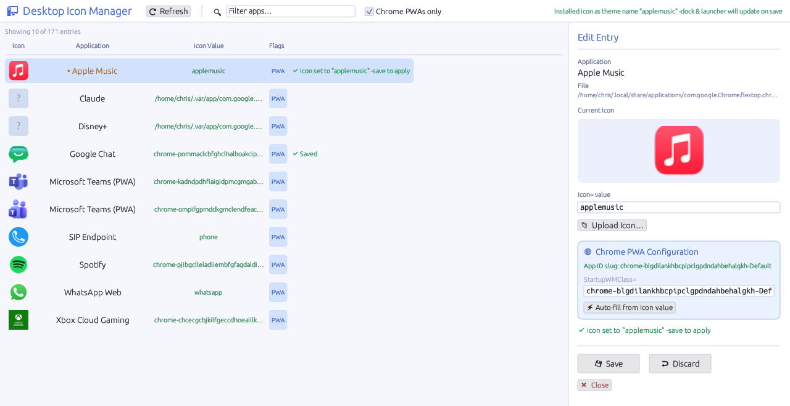
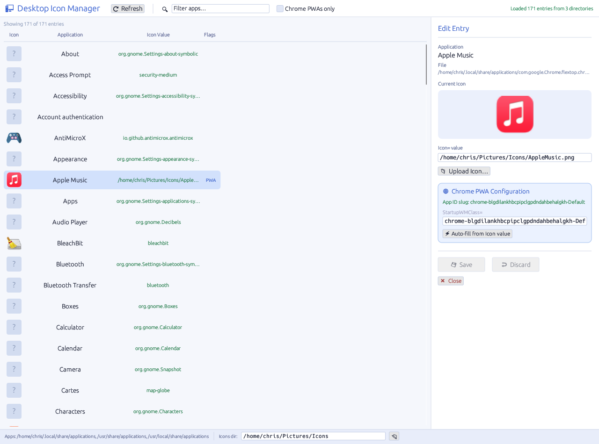
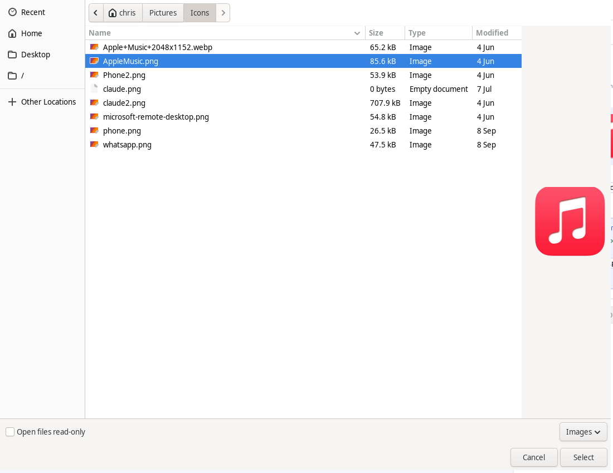
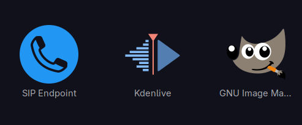
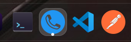
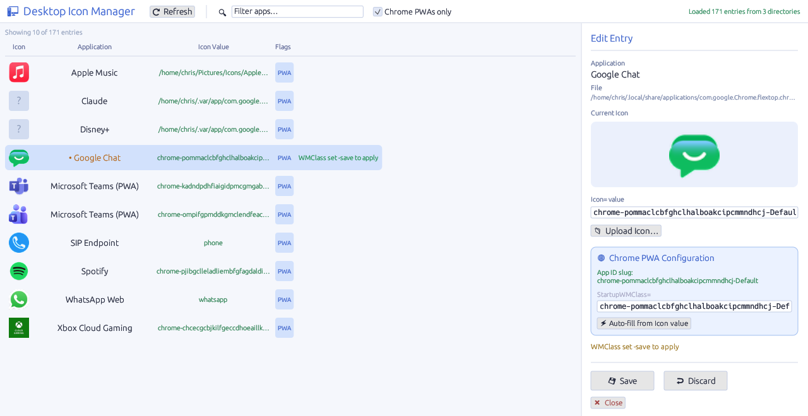
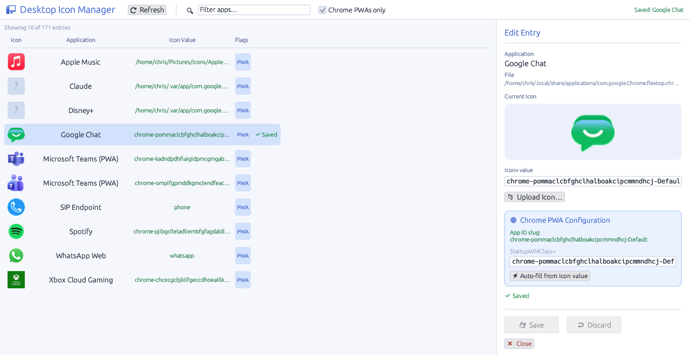
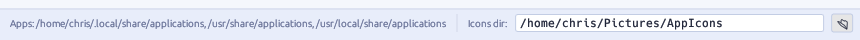

# Desktop Icon Manager

**A small native Linux app for changing the icon of any application in your menu and dock, including Chrome web apps, without hand-editing `.desktop` files.**

On Linux, the icon an application shows in the app grid, the dock and the alt-tab switcher comes from a line in its `.desktop` file. Changing it by hand means finding the right file among a hundred or more, knowing that a dock ignores an icon given as a file path, rasterising the image into the icon theme at several sizes, and refreshing the icon cache. Chrome web apps (PWAs) add one more trap: if the launcher's `StartupWMClass` doesn't match the window Chrome opens, the dock can't connect the two and shows the wrong icon or a second, generic one. Desktop Icon Manager does all of this from one window: pick the app, pick an image, save.

*The ten Chrome web apps on a Fedora 44 laptop. Apple Music's icon has just been uploaded: the app installed it into the icon theme and changed `Icon=` from a file path to the theme name `applemusic`, ready to save.*

---

## At a glance

| | |
|---|---|
| **Every app in one list** | Reads every `.desktop` entry in the user and system application folders, with a live preview of each icon, a search over names and icon values, and a "Chrome PWAs only" filter |
| **Change an icon properly** | Upload a PNG, JPG, SVG, ICO, BMP or WebP image: it is installed into the icon theme at every standard size and `Icon=` is set to a theme name, so docks and launchers pick it up |
| **Chrome web app fixes** | Spots Chrome PWA entries, shows their app ID, and sets `StartupWMClass` in one click so the dock matches the window to its launcher |
| **Safe edits** | Nothing is written until you press Save; Save changes only the `Icon=` and `StartupWMClass=` lines; Discard reloads the entry from disk |

It is a single native binary (Rust and egui), with no GTK or Qt needed to run it.

---

## Every application in one list

The app reads every `.desktop` file in `~/.local/share/applications`, `/usr/share/applications` and `/usr/local/share/applications`. When the same file exists in more than one, your own copy wins, as it does in the desktop itself. Each row shows the application's icon, its name, the current `Icon=` value and a **PWA** badge for Chrome web apps.

*171 entries on a Fedora 44 GNOME laptop. Icons in the hicolor theme or given as a file show a preview. GNOME's own apps use icons from the Adwaita theme, which the preview doesn't search, so they show a placeholder; their `Icon=` value is still shown and can be changed.*

The search box matches both names and icon values, so "settings" finds 28 entries, most of them GNOME Settings panels whose names don't contain the word but whose icons are `org.gnome.Settings-…`. **Chrome PWAs only** cuts the list to the web apps (10 on this machine). Opening an entry shows its file, a large preview of its icon and its `Icon=` value, which you can also edit by hand.

---

## Change an icon so the dock uses it too

**Upload Icon…** opens the desktop's own file picker, filtered to images.

The tool then does what you would otherwise do by hand:

1. Copies the original into your icons folder (`~/Pictures/Icons` unless you choose another).
2. Rasterises it to 16, 32, 48, 64, 128, 256 and 512 pixels and installs each into `~/.local/share/icons/hicolor/<size>/apps/` (an SVG goes into `scalable/` as it is).
3. Copies a fallback into `~/.local/share/pixmaps`.
4. Runs `gtk-update-icon-cache` so the change shows straight away.
5. Sets `Icon=` to the bare theme name (`applemusic`), not a file path.

The last step is what makes the difference. A file manager will show an icon given as a path, but docks and panels look icons up by theme name for pinned and running apps, and can quietly ignore a path. Before the upload, Apple Music's entry pointed at `/home/chris/Pictures/Icons/AppleMusic.png`; after saving, its file had exactly one line changed, to `Icon=applemusic`.

  
  

*A Chrome web app given a new icon: in the GNOME app grid, and running in the dock.*

---

## Chrome web apps that match their windows

Chrome names each installed web app's launcher after its app ID (`com.google.Chrome.flextop.chrome-<appid>-Default.desktop`), and the tool recognises them from that name or from an `Icon=` of the form `chrome-<appid>-Default`. For these entries the edit panel adds a **Chrome PWA Configuration** box with the detected app ID and the `StartupWMClass=` value.

`StartupWMClass` is how the dock ties a window to its launcher. If it doesn't match the window, the dock can show the running app with a generic icon, or as a second icon next to the pinned one. **Auto-fill from Icon value** sets it to `chrome-<appid>-Default`.

*On this machine six of the ten web apps had Chrome's `crx_<appid>` form. Google Chat's became `chrome-pommaclcbfghclhalboakcipcmmndhcj-Default`; the row turns orange with a dot until it's saved.*

---

## Nothing changes until you save

Edits stay in the app until you press **Save**. Saving rewrites only the `Icon=` and `StartupWMClass=` lines of the `[Desktop Entry]` section (adding them if they are missing) and leaves every other line and section as it was. **Discard** reloads the entry from disk, and **Refresh** rescans every folder.

Entries in `/usr/share/applications` belong to root, so saving one fails with a clear error. The fix is the desktop's own: copy the file into `~/.local/share/applications`, where your copy takes precedence, and edit that.

---

## Where your icons live

The status bar shows which application folders were read and where uploaded icons are kept. Type a new folder and press Enter, or browse to one; it must be an absolute path and is created if it doesn't exist.

---

## How it runs

A single binary for Linux x86-64, built with Rust and [egui](https://github.com/emilk/egui), that runs on X11 or Wayland (through XWayland) with OpenGL 2.1 or later. A build script installs the few system libraries it needs with apt, dnf/yum, zypper, pacman or xbps, builds it, and optionally installs it to `~/.local/bin` with its own icon and a menu entry. Build and usage details are in the [project README](https://github.com/chrisnock-personal/desktop-icon-manager).

---

## Status

Version 1.0: a small, single-purpose tool. It has unit tests for reading malformed `Icon=` values without crashing. The screenshots on this page are from the current build, run on Fedora 44 against a real laptop's application entries; the app grid and dock shots are from the author's GNOME desktop.
