# FleetWright

**A self-hosted tool for keeping a fleet of Ubuntu and Fedora servers up to date: it reaches each host through a small agent or over SSH, shows what's pending across the fleet, and installs updates by hand, in booked maintenance windows, or automatically by kind of update, with a record of every package it changes.**

Keeping servers patched is mostly bookkeeping: which hosts have security updates waiting, which can take them tonight, which must wait for a window, which need a reboot afterwards, and what actually changed. A shell loop or a cron job of `apt upgrade` does the installing, but answers none of those questions, and tools that do tend to be large or tied to one distribution. FleetWright is one small service that works the same way for apt and dnf, whether a host runs its agent or is reached over SSH.

Source code: [github.com/chrisnock-personal/fleetwright](https://github.com/chrisnock-personal/fleetwright)

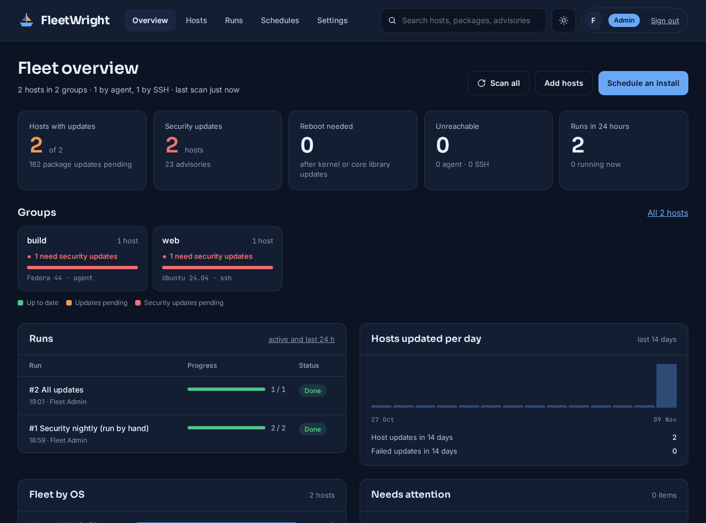

*The overview after a test run on 9 November 2026 against two real virtual machines, one Ubuntu 24.04 host reached over SSH and one Fedora 44 host running the agent. Every number on these pages comes from those hosts.*

---

## At a glance

| | |
|---|---|
| **Two ways to reach a host** | An agent (a Python service that connects out, so the host needs no open port), or agentless over SSH with a stored key. Both run the same update code |
| **Ubuntu and Fedora** | apt and dnf, with security updates told apart from bug fixes and enhancements, and Fedora's advisory severities |
| **Fleet view** | Totals across the fleet, groups and tags, a filterable host list built for thousands of hosts, and each host's pending updates and history |
| **Installs** | Pick updates by hand, by kind, or all; roll them out in batches with a canary host first; stop after a set number of failures; reboot never, if needed, or always |
| **Auto-install policies** | Install chosen kinds of update (security above a severity, kernel, bug fixes, enhancements) on a daily, weekly or monthly window, each with its own on/off switch |
| **Booked installs** | One-off installs for a set window, optionally needing an admin's approval |
| **History** | Every run, every host's output, and every package version change, kept in PostgreSQL |
| **Secure by default** | HTTPS from the first start, agents that check the server's certificate, pinned SSH host keys, encrypted keys, no default password, three roles and an audit log |

---

## The fleet at a glance

The overview answers the first question of a patching day: what's waiting, and where. It counts hosts with updates, hosts with security updates, hosts waiting for a reboot and hosts that can't be reached, then shows a card per group. Each card has a bar split into up to date, updates pending and security updates pending, so a group that needs attention stands out without opening it. Below are the latest runs, how many hosts were updated each day for two weeks, the mix of operating systems, and a list of hosts that need attention: unreachable, failed in the last day, waiting on a critical update, or waiting for a reboot.

The host list is built for size rather than for two hosts. It filters by status (needs updates, security, reboot, unreachable, not scanned), group, operating system, connection and tag, searches host names, addresses, package names and advisory IDs, and pages through the results. Tick any number of hosts to scan them, install security updates or everything, schedule an install, reboot, tag them or move them to another group.

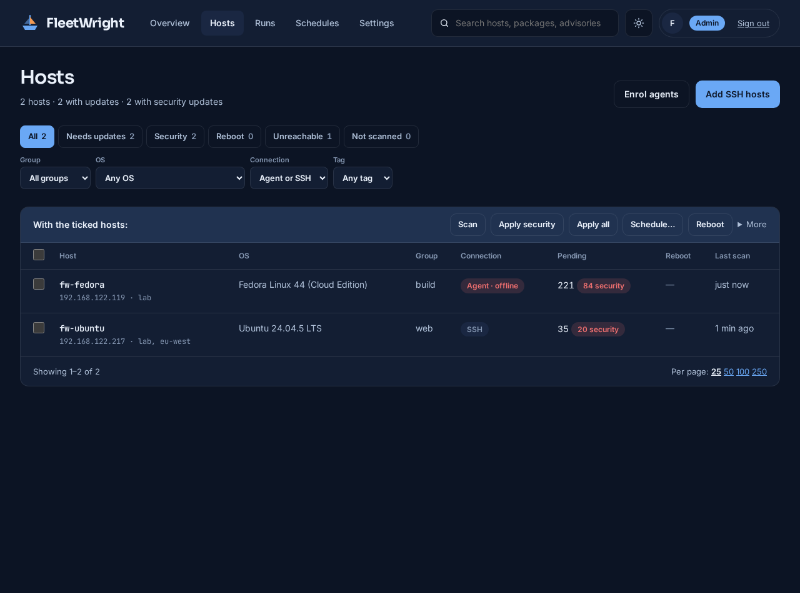

## Every host's updates and history

Each host has a page with what it is (OS, kernel, address, how FleetWright reaches it), its pending updates, and what has been done to it. Pending updates show the installed and available versions and what kind of update each one is. On Fedora that comes from the distribution's advisories, so FleetWright shows the advisory ID and its severity: of the 84 security updates the Fedora test host started with, the list put the critical `ca-certificates` update first, followed by the important ones.

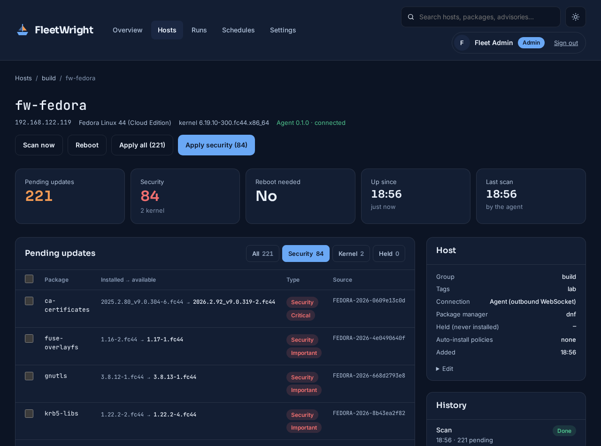

Updates can be ticked and installed straight away, or ticked and scheduled for later, in which case FleetWright installs exactly those versions: if a newer release lands before the window, it's skipped and shown in the run rather than slipped in. Each host also has a "never install" list. On the Ubuntu test host, `git*` was held, so after everything else was installed the two `git` packages were still pending, marked as held, and every run skipped them. Below that is every package version FleetWright has changed on the host, including the ones the package manager pulled in as dependencies, such as new kernel packages.

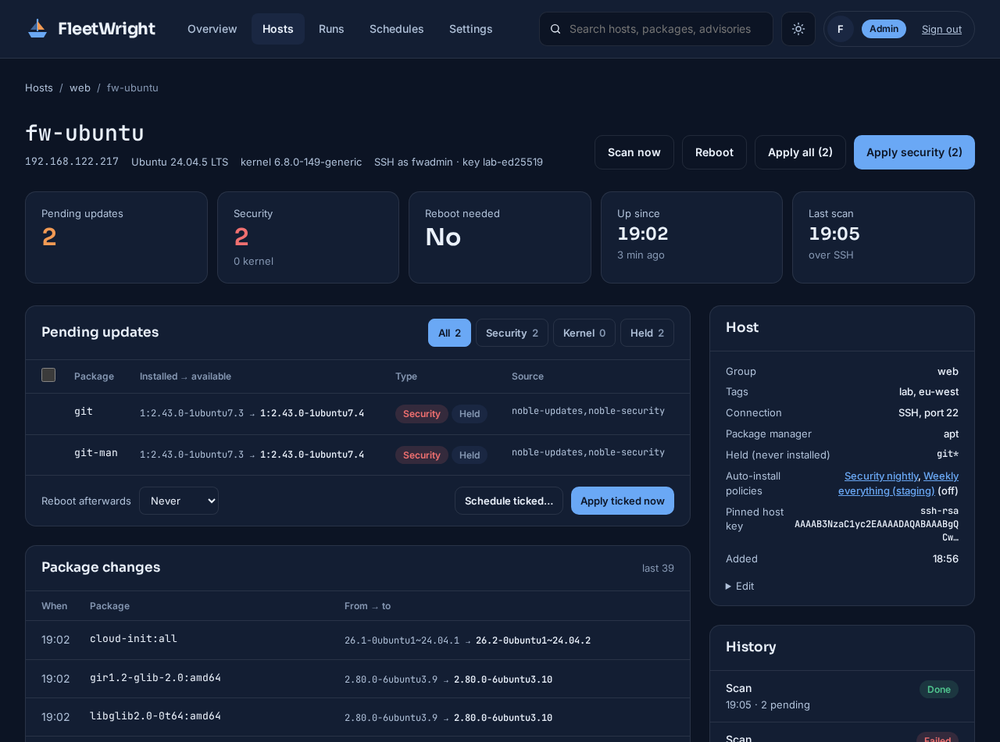

## Runs: batches, canaries and live output

Every install, reboot or scan that touches hosts is a run, split into one task per host. A run can go in batches: a fixed number or a percentage of hosts at a time, with one host on its own first as a canary. FleetWright starts the next batch only when the current one has finished, stops the run when too many hosts have failed, and starts no new host after a maintenance window closes. A run can be paused after the current batch, aborted, or re-run for just the hosts that failed.

Output streams into the browser as it happens, whether the host is reached over SSH or through its agent. This run applied the "Security nightly" policy to both test hosts, Fedora first as the canary:

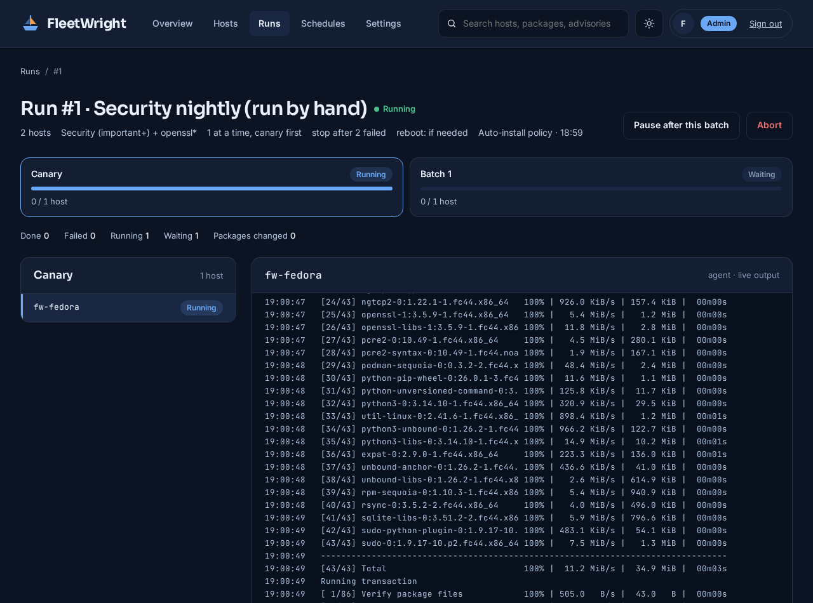

Every install first refreshes the package lists and rescans, so it installs what is pending now rather than what was pending at the last scan. It then installs, works out which package versions really changed, and checks whether the host needs a reboot. With "reboot if needed", the Fedora host rebooted after its 43 updates. FleetWright waited for the agent to reconnect from the new boot before marking the host done and moving on to the Ubuntu host, which took 18. A second run installed everything else on the Ubuntu host and rebooted it over SSH, then waited for the host to come back and rescanned it.

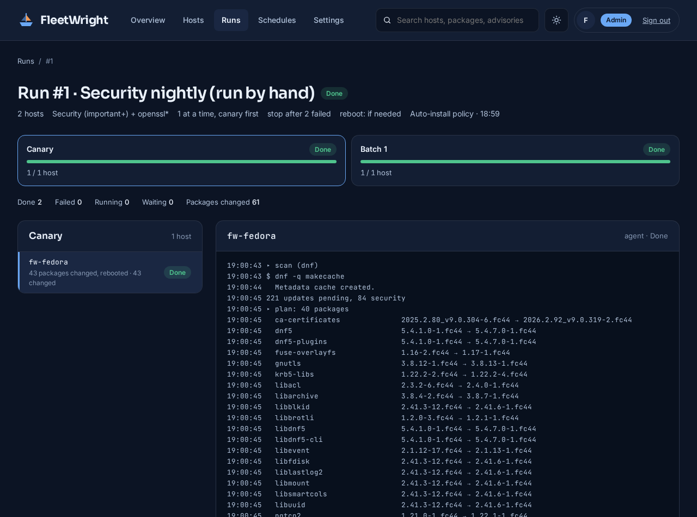

## Auto-install policies and booked installs

The Schedules page puts everything that will happen by itself in one place: a calendar of the next seven days, the auto-install policies, and one-off installs booked for a window.

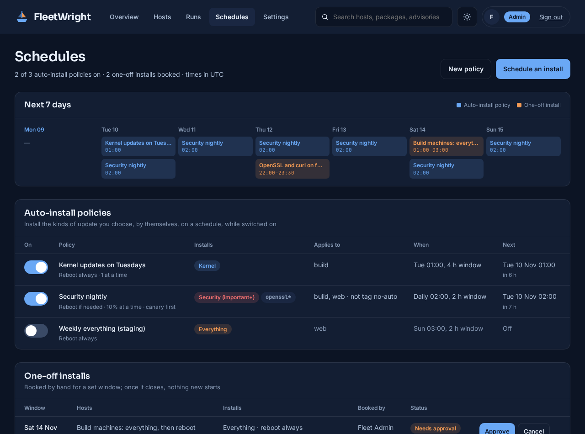

An **auto-install policy** says which kinds of update to install, on which hosts, and when. The kinds are security updates (optionally only those at or above a severity), kernel updates, bug fixes and enhancements. Package patterns can be added to always include or never install. A policy applies to groups, tags or every host, minus hosts with an excluded tag. It runs daily, weekly on chosen days or monthly, in a window of a set length, and sets the hosts per batch, the canary, when to stop and when to reboot. Each policy has an on/off switch, and while you edit it, it shows what it would install if it ran now. For the "Security nightly" policy on the test hosts, that was 58 updates on 2 hosts.

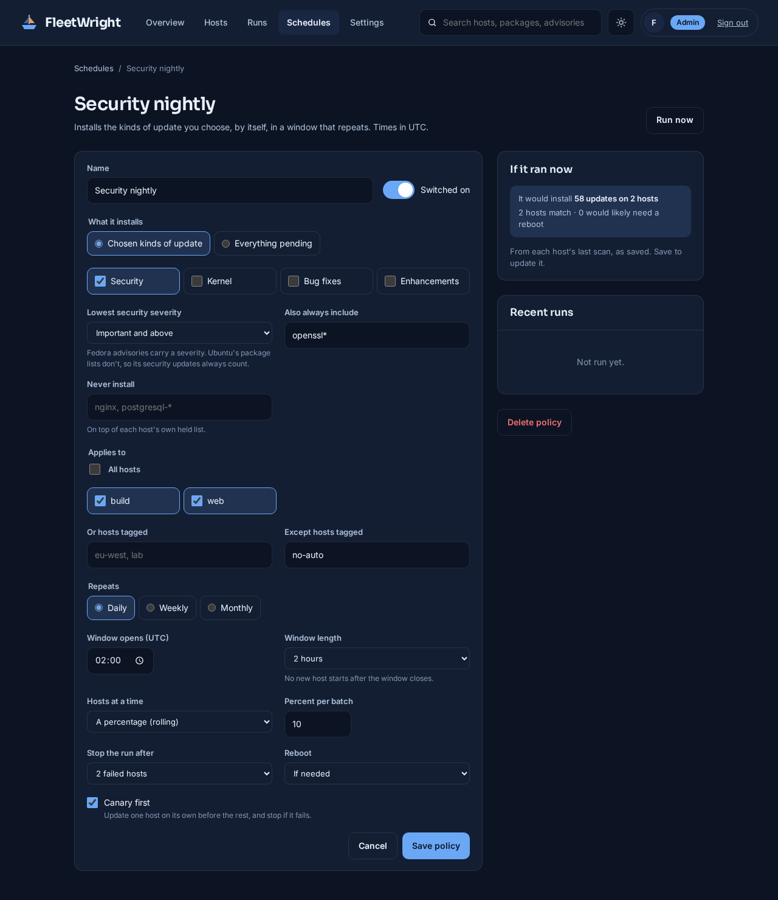

A **booked install** runs once, in the window you choose: hosts ticked on the Hosts page or updates ticked on a host, plus whole groups or tags. It installs everything, chosen kinds, or the exact updates you picked. You also choose what happens if the window closes mid-run, how many hosts at a time, and whether to reboot. A booking can require an admin's approval. If nobody approves it before its window opens, it's marked missed rather than run late. Two were booked for the test: three named updates for the Ubuntu host on Thursday evening, and an approval-required "everything, then reboot" for the build group on Saturday night.

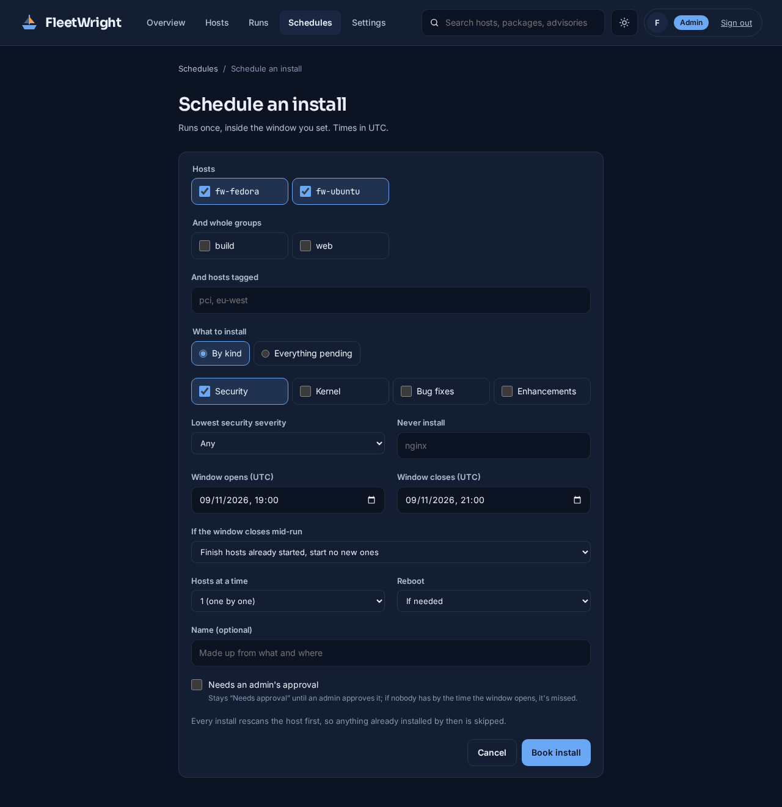

## Agents and agentless hosts

The **agent** is a small Python service that runs on the host as root under systemd. It connects out to FleetWright over a WebSocket, so the host needs no open port and can sit behind NAT. It scans for updates on its own timer, staggered across the fleet, and runs only FleetWright's update operations, never arbitrary commands. To add hosts, an admin creates an enrolment token that puts new hosts in a group with tags, optionally limited in uses and lifetime, and runs the one-line install command it shows on each host. If a machine is enrolled again, for example after reinstalling the agent, FleetWright recognises it by its machine ID and keeps its history.

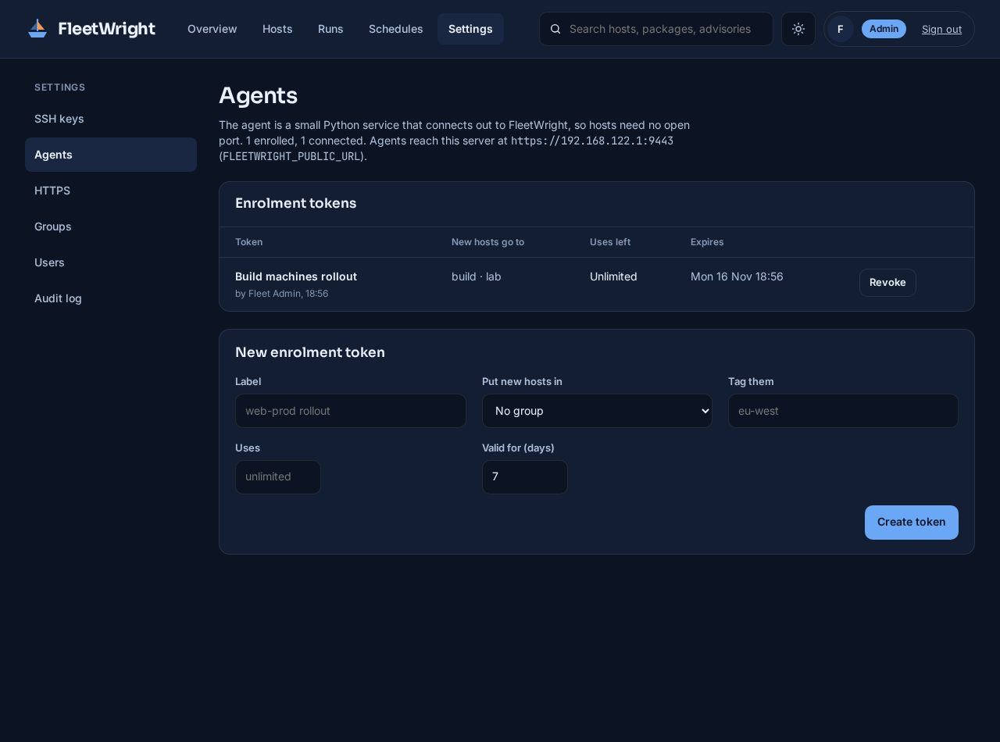

**Agentless** hosts need only SSH and passwordless `sudo` for `python3`. FleetWright connects with a stored key, sends its update script on standard input and streams the output back, running up to 50 hosts at once per worker. Hosts are added in bulk, one `name address[:port]` per line. Both kinds of host appear side by side everywhere else.

## Secure by default

FleetWright serves **HTTPS from the first start**, with a self-signed certificate naming its public address. The HTTPS settings page shows the certificate's names, expiry and SHA-256 fingerprint (to check against the browser's warning). You can upload your own certificate and key, which FleetWright checks before using, keeping the previous pair in case the new one won't load, or generate a fresh self-signed certificate. Session cookies are HTTPS-only.

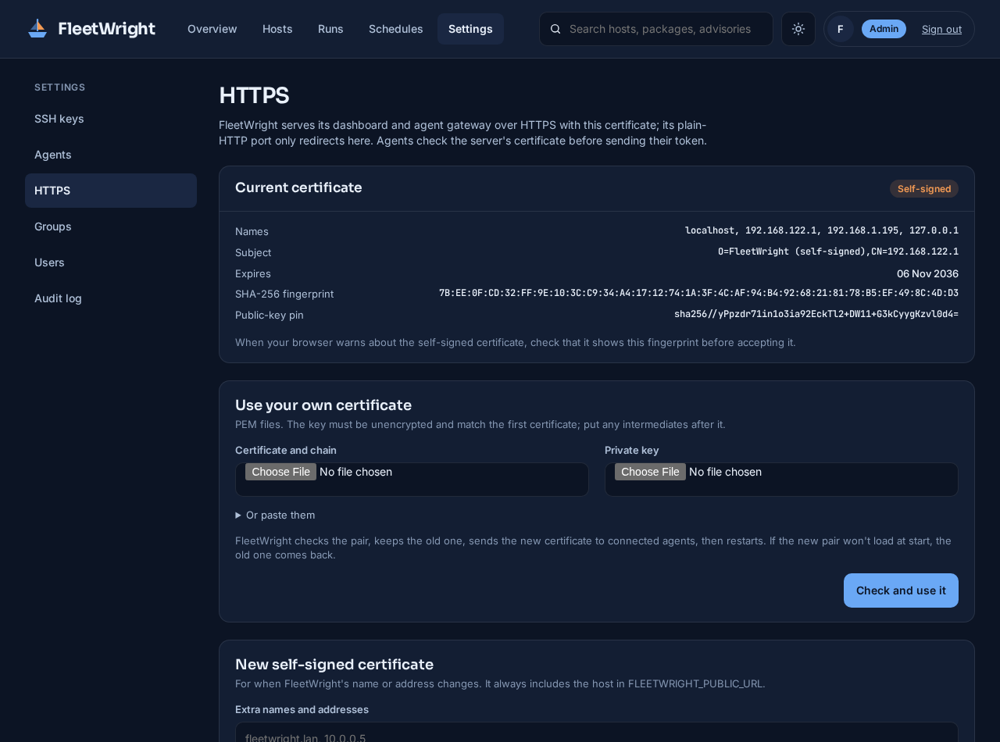

**Agents check the server before trusting it.** The install command pins the server's public key, so a host can't be served a different install script, and the agent trusts exactly the certificate it enrolled with. Because it checks during the TLS handshake, its token is never sent to anything else. When the server's certificate is replaced, FleetWright first sends the new one to every connected agent over its existing connection. In the test, the agent picked up the new certificate, the server restarted with it, and the agent reconnected by itself. Agents refuse plain HTTP unless they are explicitly enrolled with `--insecure`.

**SSH host keys are pinned.** The first connection records the key a host offers; after that, only that key is accepted during the SSH handshake. A host that offers a different key is refused before FleetWright logs in or sends anything, and its page says so:

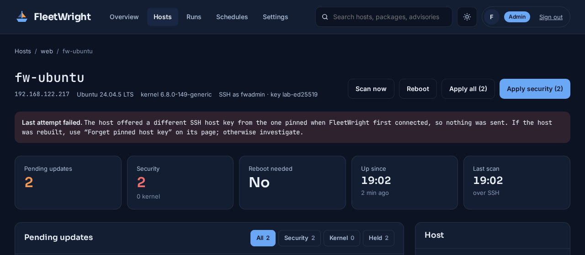

There's no default password: the first admin needs a setup code printed in the server's log, and everyone else gets a single-use setup link. There are three roles: admins change everything, operators run updates and edit schedules, and viewers look. SSH private keys are stored encrypted; agent tokens, enrolment tokens and setup links are stored only as hashes. Every change goes into the audit log.

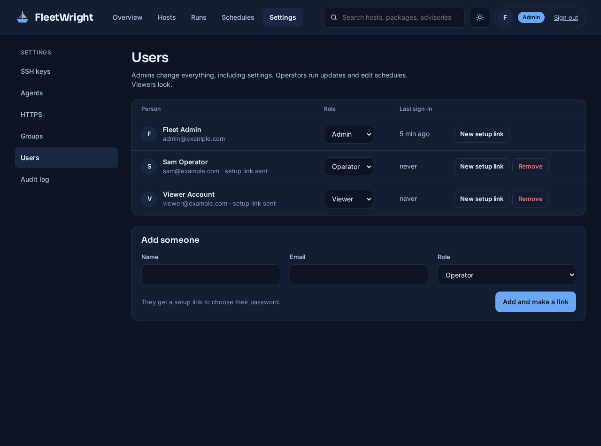

## Light theme and small screens

The interface is dark by default and has a light theme, remembered per browser. It shares its look with [Skyfarer](../skyfarer/README.md).

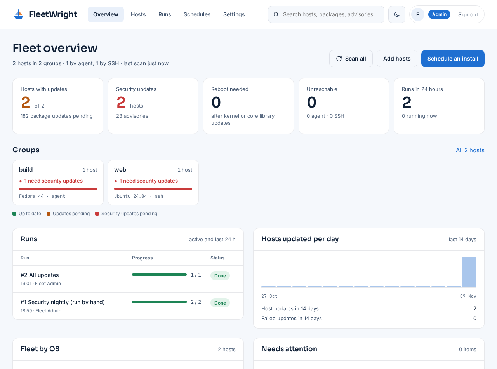

It works at phone width, with the tiles, cards and tables stacking into one column.

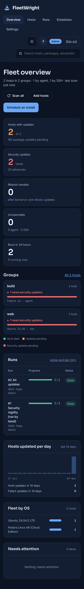

On first start, before any accounts exist, FleetWright asks for the setup code from its log:

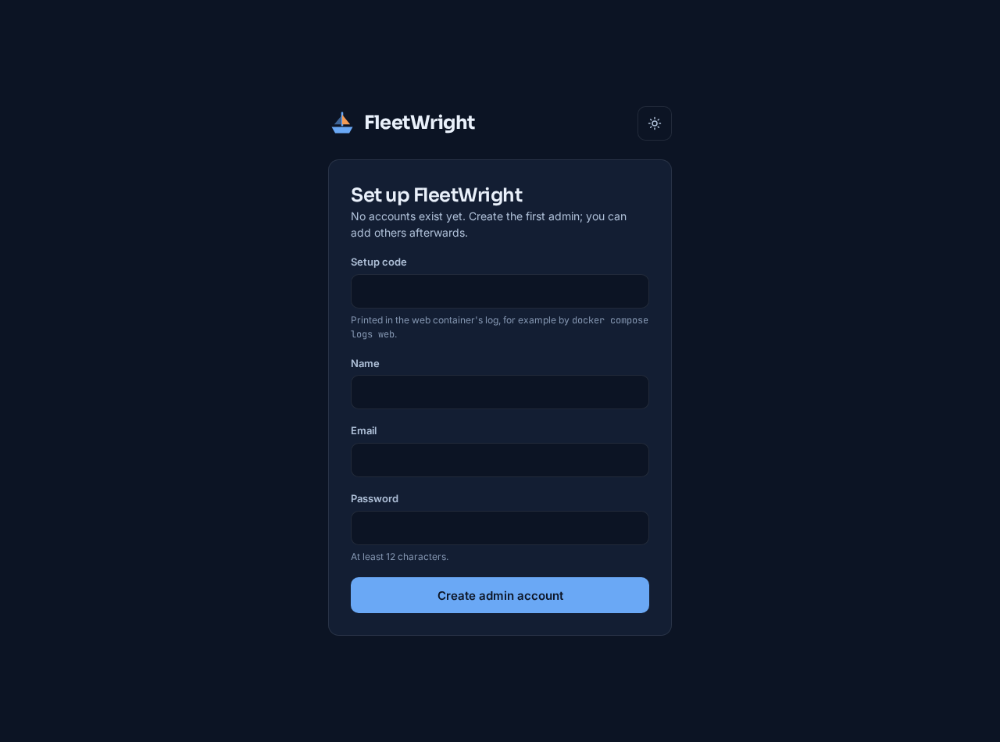

---

## How it runs

Three containers with Docker Compose or Podman: PostgreSQL, the web app (dashboard and agent gateway, in Python with FastAPI) and one or more workers. Postgres is also the job queue, so more workers can be added without any other moving parts. The agent needs `python3` and `python3-websockets`, both packaged on Ubuntu and Fedora.

## Status

A first version, built and tested on 9 November 2026 against Ubuntu 24.04 and Fedora 44 virtual machines, one reached over SSH and one through the agent. Tested end to end: scans, picked, policy and booked installs, a canary rollout with a reboot through the agent, a reboot over SSH, held packages, a refused SSH host key, pinned agent enrolment and certificate replacement with an agent connected. Unit tests cover the package-list parsing, update selection, schedules and batching. It has only been run against two hosts so far: a load test with hundreds of hosts, notifications, agent self-update and backups are next on the [backlog](https://github.com/chrisnock-personal/fleetwright/blob/main/BACKLOG.md).
