# Marginalia

**A Markdown editor for documentation kept in git. You open a page from a local repository or from GitHub, write in it like a word processor, leave review comments on words or images, and publish the result as a branch and pull request.**

Teams that keep runbooks, guides and handbooks as Markdown in git get version history and review, but at a cost: everyone who wants to fix a typo or question a sentence has to work with raw Markdown, branches and diffs. Marginalia puts a quiet, writing-first editor in front of the repository and keeps the repository as the only store: no database, and no copy of the documents on the server. Edits and review comments become one normal commit on a new branch, which goes through the team's usual pull request process.

Source code: [github.com/chrisnock-personal/marginalia](https://github.com/chrisnock-personal/marginalia)

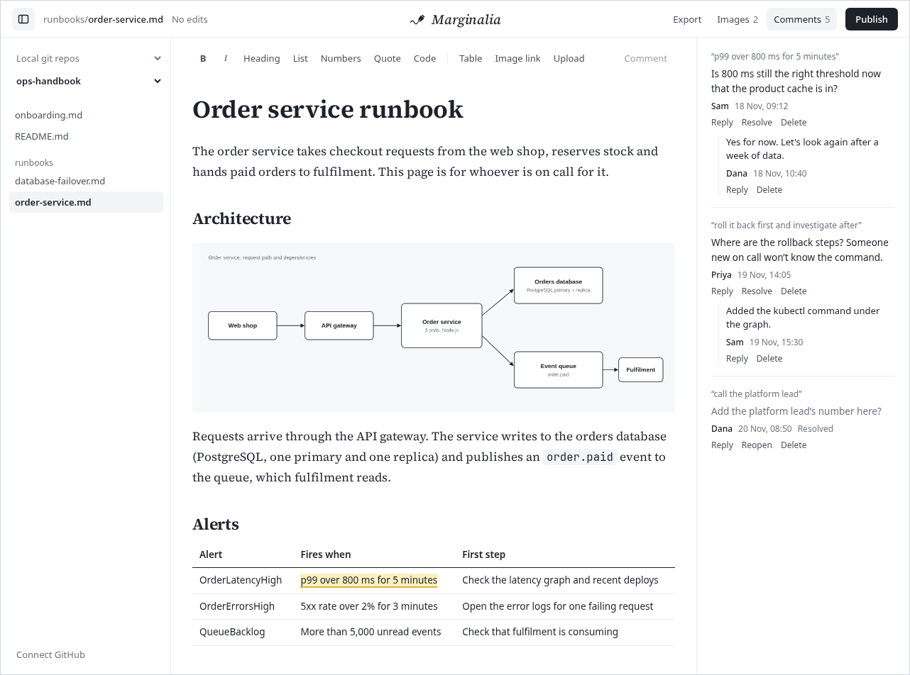

*Every screenshot on this page comes from the real product, working on a made-up `ops-handbook` repository: an order service runbook, a database failover page and an onboarding page, reviewed by Dana, Sam and Priya. Yellow highlights mark open comments.*

---

## At a glance

| | |
|---|---|
| **Writing** | A rich editor that reads and writes Markdown: headings, bold and italic, lists, quotes, code blocks, tables with row and column tools, and images by URL, upload, paste or drag and drop. The file list and comments can be hidden, leaving only the page |
| **Comments** | Comments on selected text or on a whole image, with replies, resolve and reopen. They are kept in a `comments.json` file in the repository, next to the documents, and follow the text when it moves |
| **Images** | A list of every image in the repository. Renaming or moving one rewrites the links to it in every Markdown file; deleting one removes it and its embeds |
| **Publishing** | One branch and one commit with the edited pages, images and comments, then a pull request on GitHub. Only what you changed is rewritten. Your own checkout is never touched, and publishing stops if the base branch moved after you opened the page |
| **Export** | A single self-contained HTML file with print styles and the images embedded, with the comments as an appendix if you want them |
| **Sources and sign-in** | Local git repositories, kept up to date with their `origin`, and GitHub repositories through its API. Sign in to GitHub with an OAuth App or a personal access token, held only in the server's memory |

---

## Writing

The editor works on the formatted page, not on Markdown syntax, and stays out of the way: one thin bar along the top shows the file and whether it has unpublished changes, with Export, Images, Comments and Publish on the right. The writing fills the space between the file list and the comments, and hiding either panel gives that room to the page. The toolbar above the page covers bold, italic, headings, bulleted and numbered lists, quotes, code blocks, tables and images. What you write is turned back into Markdown (GitHub Flavoured Markdown, so tables survive) when you publish.

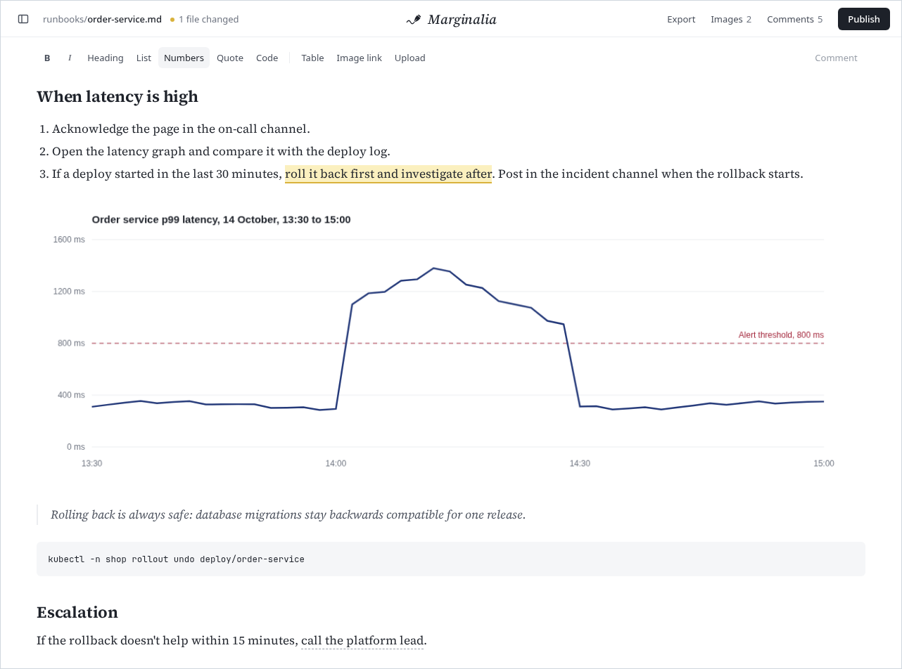

*Dana hides both panels to work on the rollback step: the button at the top left hides the file list and the Comments button hides the comments, and the page widens to fill the window. The top bar shows the unpublished change. The choice is remembered in the browser, and starting a comment brings the comments back.*

**Tables** are inserted from the toolbar and edited in place. Tab moves from cell to cell, and **+ row**, **+ col**, **− row** and **− col** appear while the cursor is inside a table.

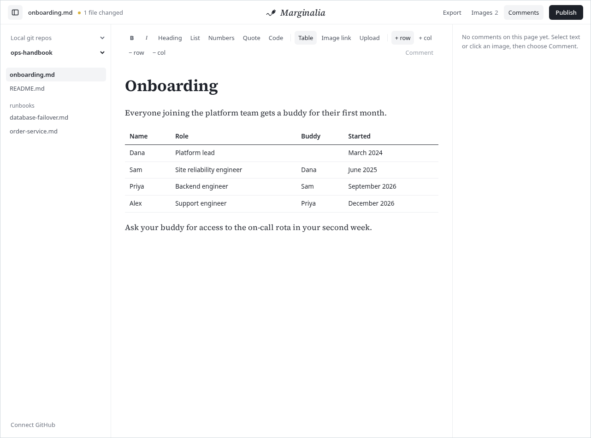

*Alex joins the onboarding table. The top bar now shows "1 file changed".*

**Images** go in four ways: by URL (or a path in the repository), by choosing files, by pasting from the clipboard, or by dropping them on the page. Pasted, dropped and chosen images are kept in an `assets/` folder next to the document and travel in the same commit as the text. Until then they exist only in your browser. Images already in the repository are shown from the base branch, with links relative to the page, as GitHub would show them.

**Only what you changed is rewritten.** The editor rebuilds the page's Markdown when you publish, which would normally re-pad every table and shift blank lines. Marginalia puts back the original text of every table you didn't touch, writes changed tables in compact form and keeps the file's final newline. When the publish shown below moved an image, the runbook's diff was exactly one line: the image link.

---

## Comments in the margin

Select some text, click **Comment**, write the note and add your name. The comment appears in the right-hand panel with the words it refers to, and those words are highlighted in the page. Each comment can be replied to, resolved (it turns grey and its highlight becomes a dashed underline) or deleted. Your name is remembered in the browser for the next comment.

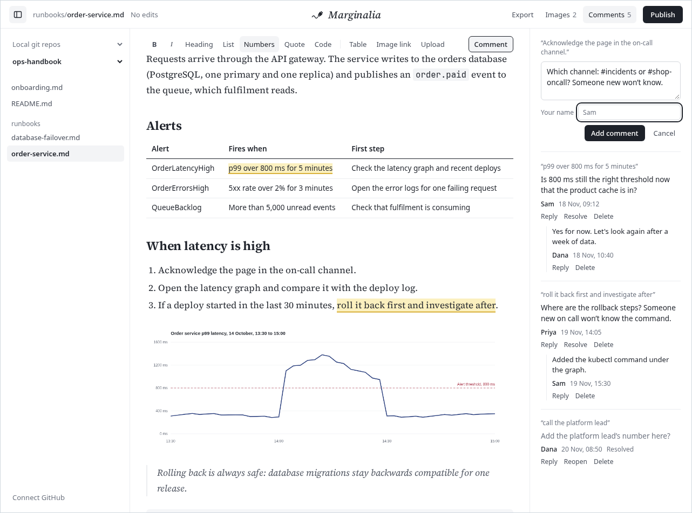

*Sam asks which on-call channel the runbook means. Below, Sam's question about the alert threshold already has Dana's reply.*

**Comments on images.** Click an image instead of selecting text, and the comment is attached to the image file rather than to a sentence. The image gets an outline in the page, and the comment shows the image's path. If the image is later renamed or moved with the image list, its comments follow it.

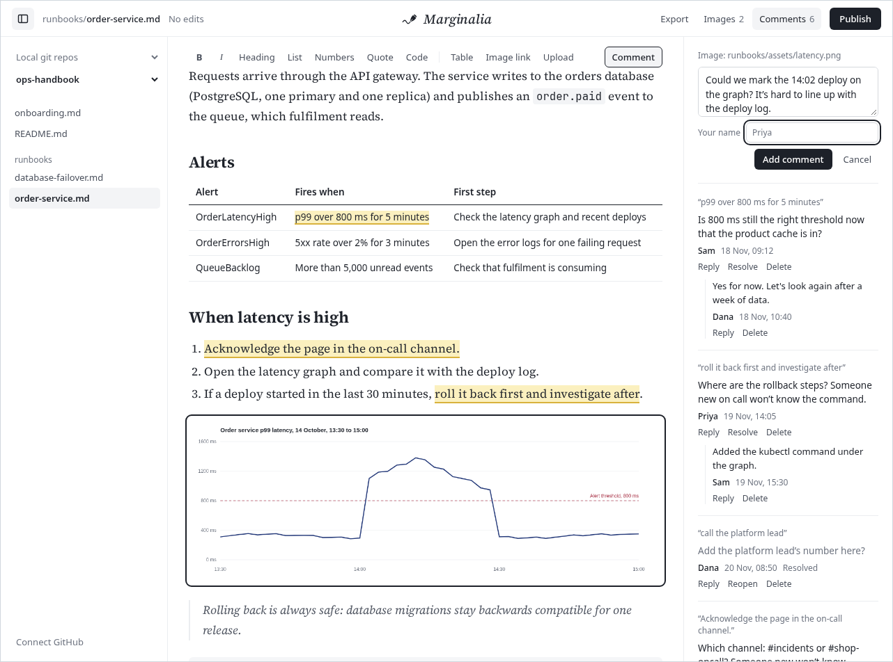

*Priya asks for the 14:02 deploy to be marked on the latency graph.*

**Where the comments live.** Comments are saved in `comments.json` at the root of the repository and published in the same commit as the edits, so they are reviewed, versioned and merged like everything else. Nothing about them is stored in Marginalia itself.

**How comments find their text again.** A comment doesn't store a position in the editor, which would be meaningless after the next edit. It stores the quoted words, up to 40 characters on either side, and where they were in the page. When a page opens, Marginalia looks for the quote at its old position first, then by the surrounding words, then anywhere on the page, so comments stay attached through ordinary edits around them. If the quoted words are deleted, the comment stays in the panel without a highlight; it is never silently dropped from the file.

---

## Images across the repository

**Images** lists every image in the repository, with a thumbnail and its path. Changing the path and clicking **Rename / move** moves the file and rewrites every Markdown link to it, in every Markdown file in the repository, not only the open one. **Delete** removes the file and the image embeds that pointed to it. Comments on a moved image follow it to the new path; comments on a deleted image are removed.

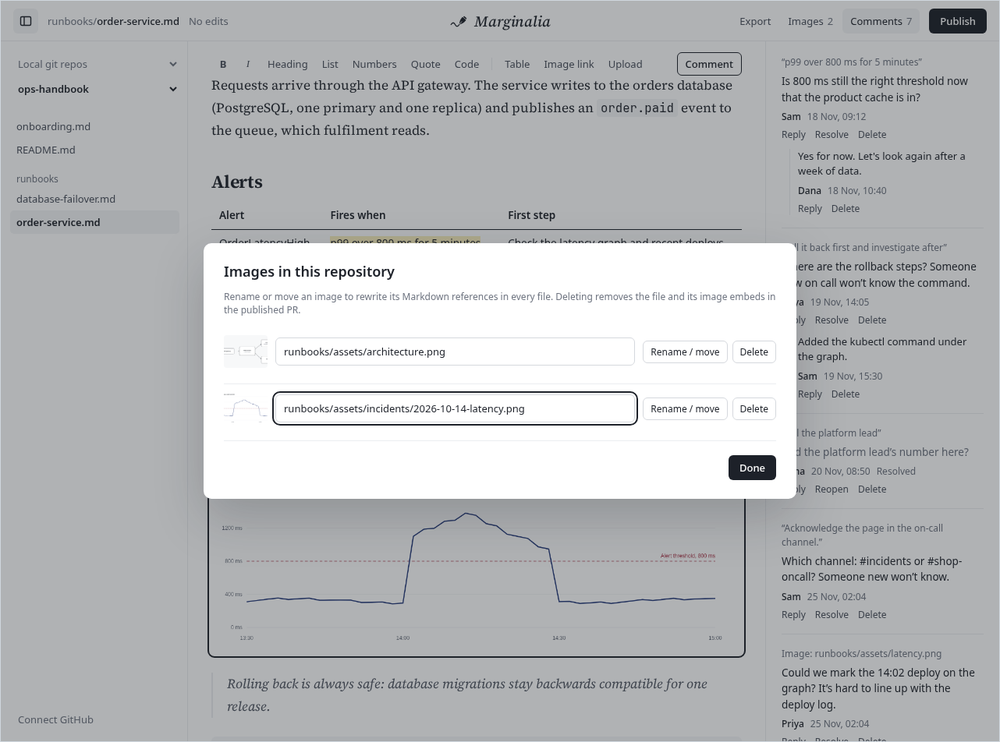

*The latency graph moves into an `incidents/` folder with the date in its name. In the published commit, git records it as a rename, the runbook's link points to the new path, and Priya's comment on the graph points there too.*

Like the writing, all of this stays in the browser until you publish: the moved file, the deleted file and the rewritten pages go into the same commit.

---

## Publishing as a pull request

**Publish** asks for a branch name (suggested from the page name), a commit message, and the pull request's title and description, then lists every file that will be in it: edited pages, moved and deleted images, and `comments.json` with its comment count.

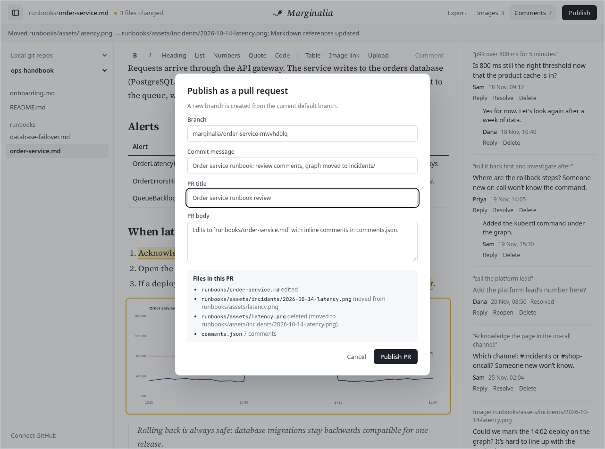

*Dana publishes the review: the runbook with its rewritten image link, the moved graph and the seven comments.*

Marginalia then creates a new branch from the base branch with exactly one commit:
- **Local repositories:** it fetches from `origin` first and builds on the latest `origin` version of the base branch, falling back to the local branch when there is no reachable `origin`. The page you edit was read from that same commit, so a publish can't overwrite someone else's newer work. It writes the files in a temporary git worktree, commits, pushes the branch to `origin` and removes the worktree; your own checkout, including any work in progress, is never modified. If `origin` is on GitHub, it opens the pull request with the GitHub CLI; otherwise it pushes the branch and says no PR was created. A dry-run setting stops after the commit, for trying it out.
- **GitHub repositories:** it builds the commit through GitHub's API (blobs, a tree, a commit and a branch), with no clone at all, and opens the pull request.

In the demo, the publish produced one commit touching three files: `comments.json` gained the two new comments (seven in all), the graph was recorded as a rename, and the runbook changed by one line.

**Someone else changed the page.** Marginalia records the base branch's commit when you open a page. When you publish, it checks again before writing anything. If the branch has moved, publishing stops and offers to reload the page with the newer version.

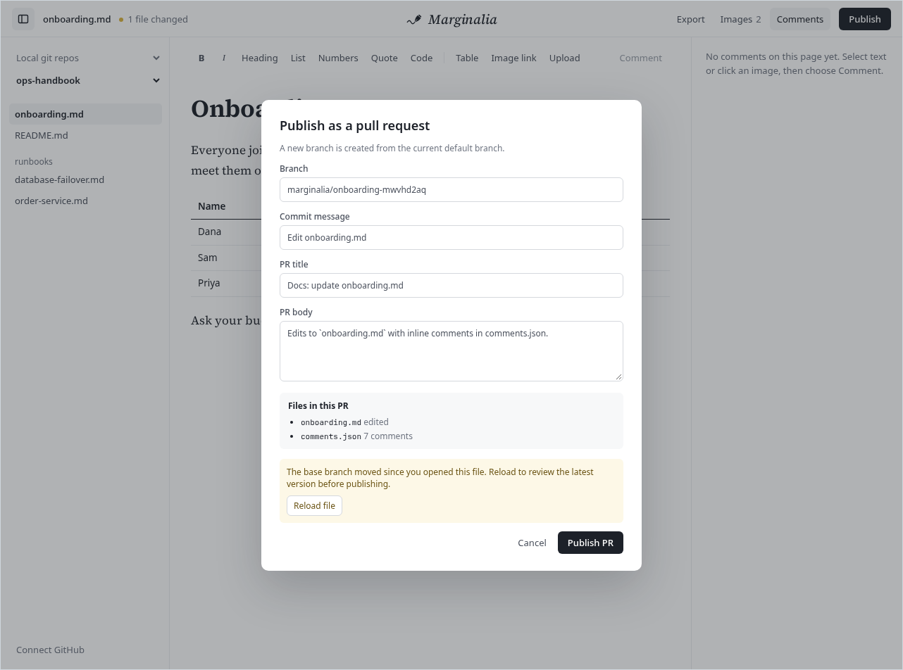

*Sam pushed a change to the onboarding page from another clone while Dana was editing it. Dana's publish is refused, and **Reload file** brings in Sam's change.*

The check is deliberately cautious: any new commit on the base branch counts, even one to a different file. Merging the two versions automatically isn't done yet.

---

## Export and PDF

**Export** turns the open page into a single HTML file with clean print styles, without the editor around it. It can be downloaded, or opened straight into the browser's print dialog to save as PDF. The images are embedded in the file, including ones that are staged or moved but not yet published, so it works offline and can be sent on its own: the runbook's export was 73 KB with both images inside it and no links back to the server. The page's comments can be included as an appendix, each with the quoted words or image path, the author and the time.

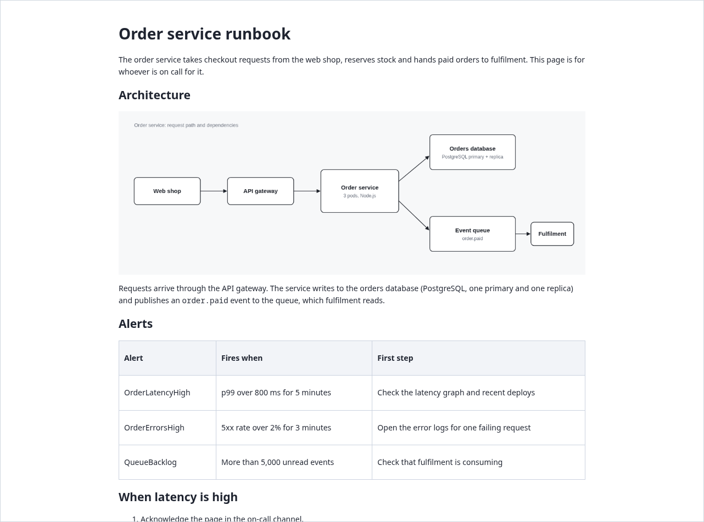

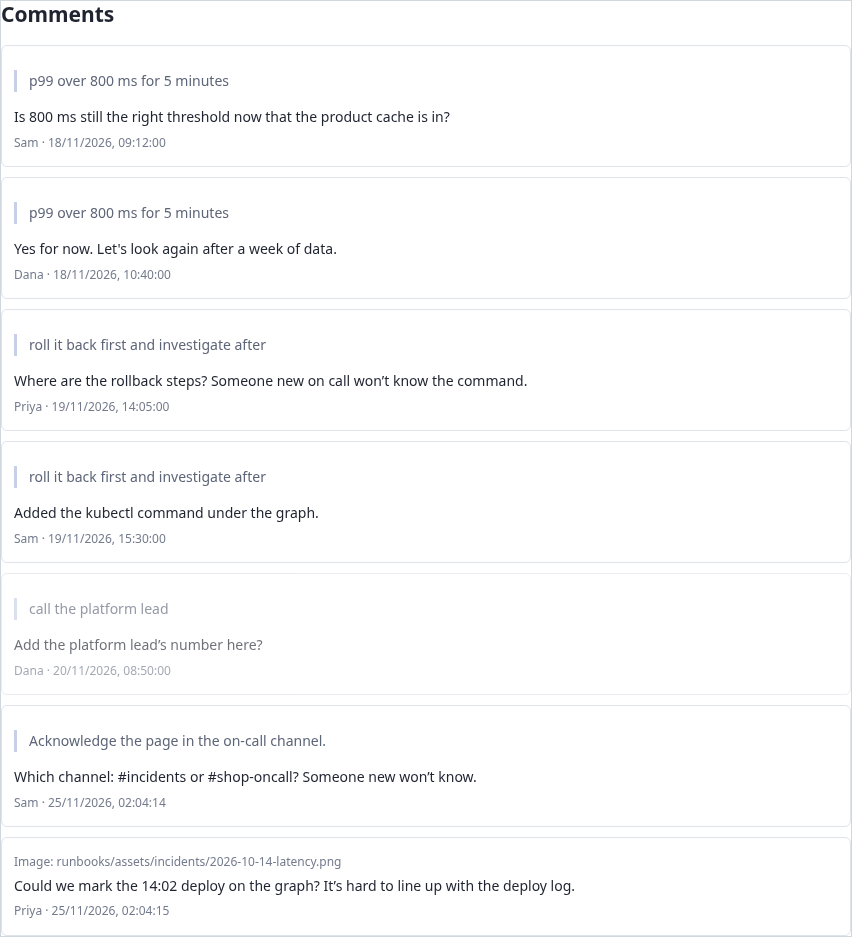

*The runbook as exported, and its comments appendix, with Priya's comment on the moved graph last.*

---

## Sources and GitHub sign-in

Local repositories are listed by path when the server starts. For GitHub, **Connect GitHub** at the bottom of the file list connects in one of two ways: through a GitHub OAuth App, if one is set up, or by pasting a personal access token. Either way, the token is checked with GitHub, kept only in the server's memory, and never stored in the browser or written to disk. For running without a browser sign-in, a token can also be given at startup, in an environment variable or a file.

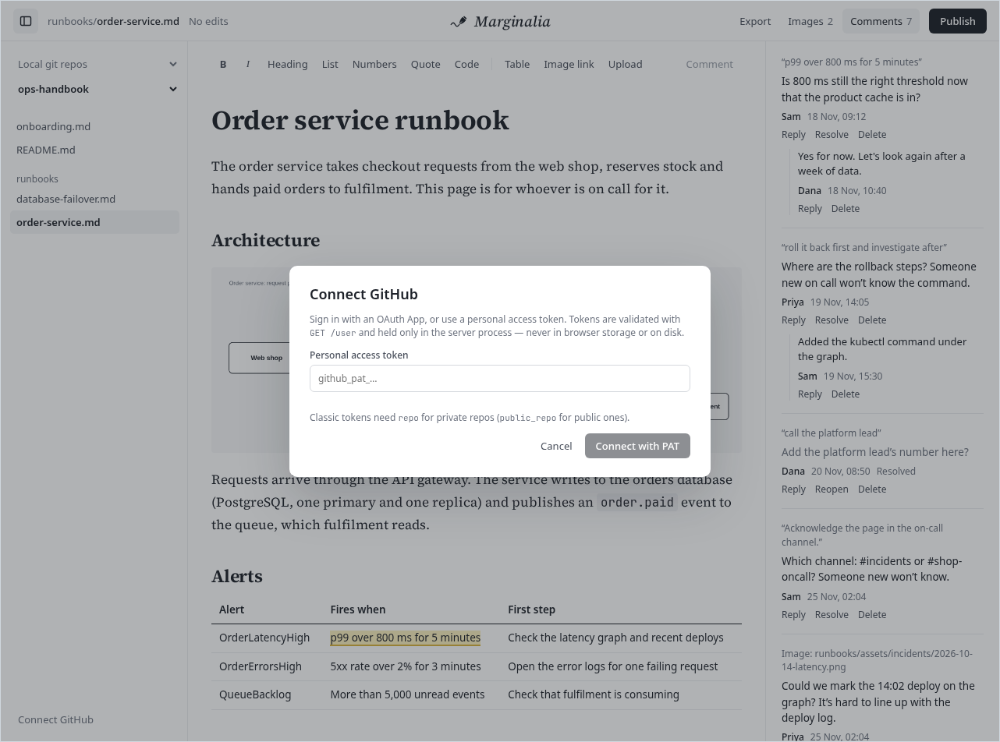

---

## On a phone

On a narrow screen the top bar shrinks to the file name and **Publish**, with Export, Images and the comments in a menu. The toolbar scrolls sideways, and the file list, page and comments become one scrolling page. The file list steps aside once a file is open.

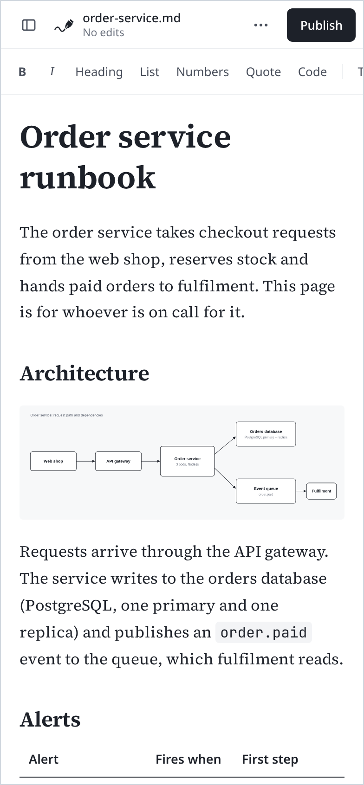

---

## How it runs

One Node.js process serves the editor and its API; there is nothing else to run, and no database. It needs `git` for local repositories (and the GitHub CLI to open pull requests from them). It's set up with environment variables: the local repository paths, an optional GitHub token or OAuth App, and the port. The editor is built with React and TipTap, and the server with Express.

## Status

An early prototype (version 0.1.0, November 2026), built for one person at a time: one GitHub identity per server, and one open document at a time. 35 automated tests cover comment anchoring, the `comments.json` format, image path rewriting, Markdown table preservation, the export, the publish file list, conflict detection, OAuth and both git providers, alongside a TypeScript type check. Everything on this page was checked by running it against the demo repository, publishing to a real git remote and reading back the commits it made.

Known gaps:
- Opening another file discards unpublished edits to the current one without asking.
- New Markdown files can't be created from the editor yet ([#9](https://github.com/chrisnock-personal/marginalia/issues/9)).
- Comments are not posted as GitHub review comments; they stay in `comments.json`.
- Conflicts are detected but not merged.
- Setting it up needs Node.js, git and an environment variable, which keeps out people who don't use a terminal. A desktop app for Windows, macOS and Linux is planned ([#10](https://github.com/chrisnock-personal/marginalia/issues/10)).
