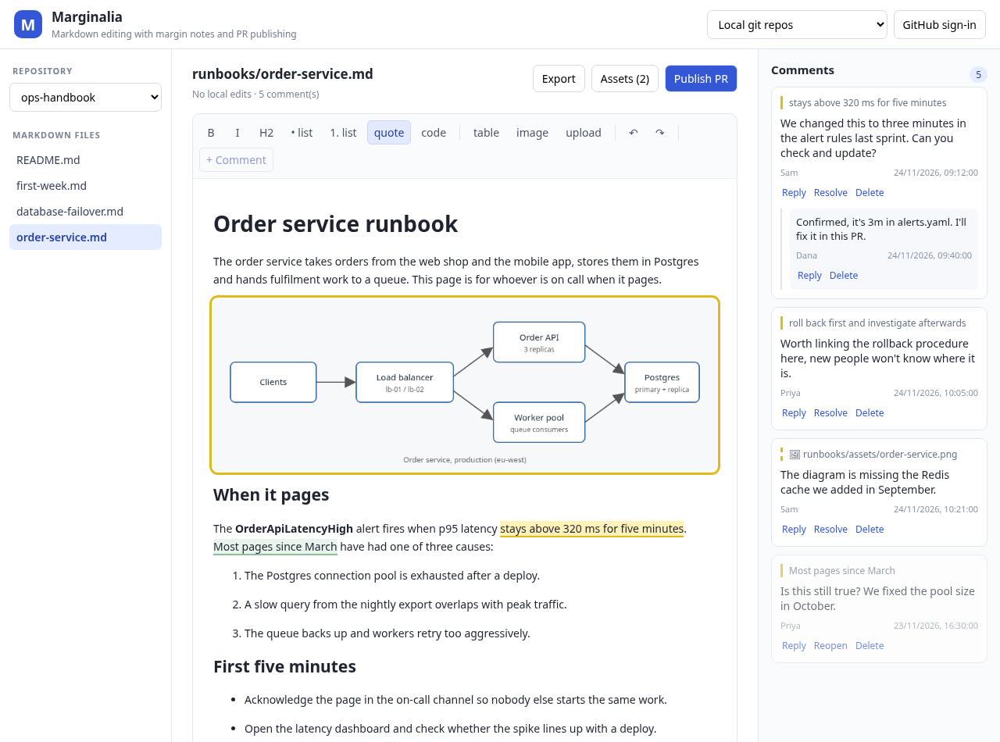
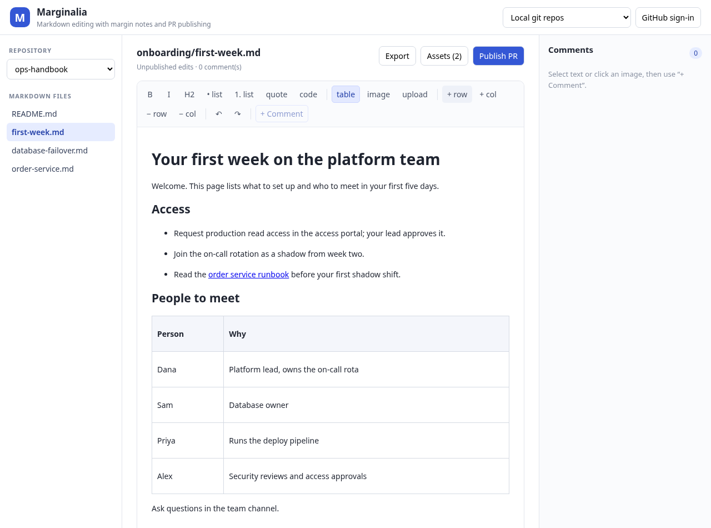
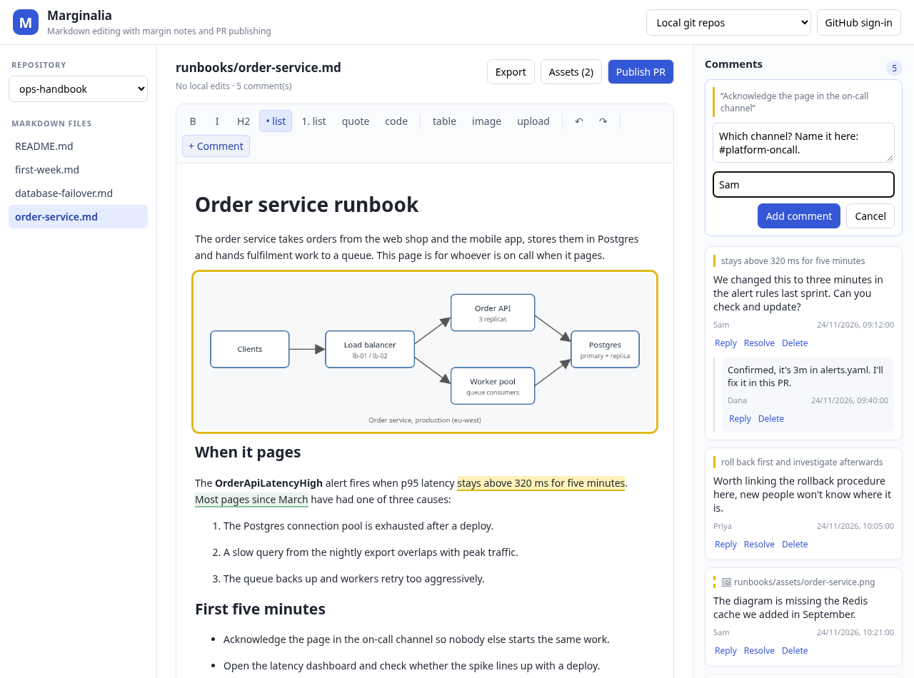
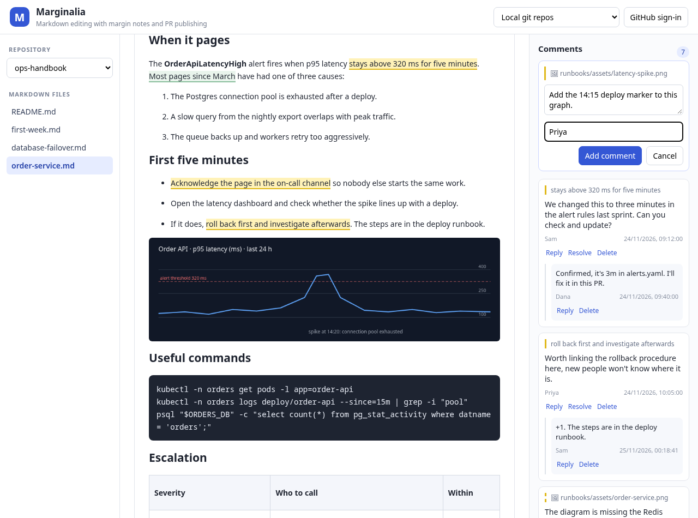
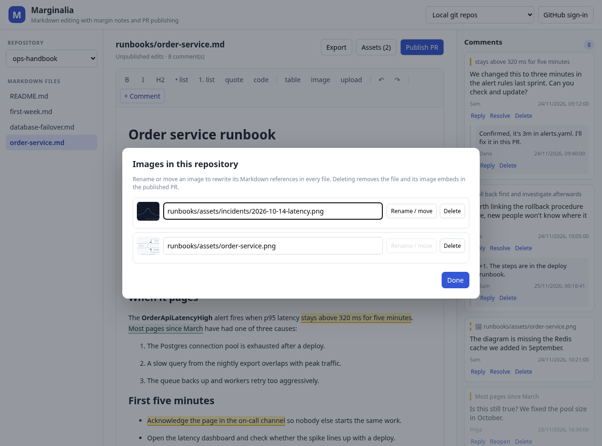
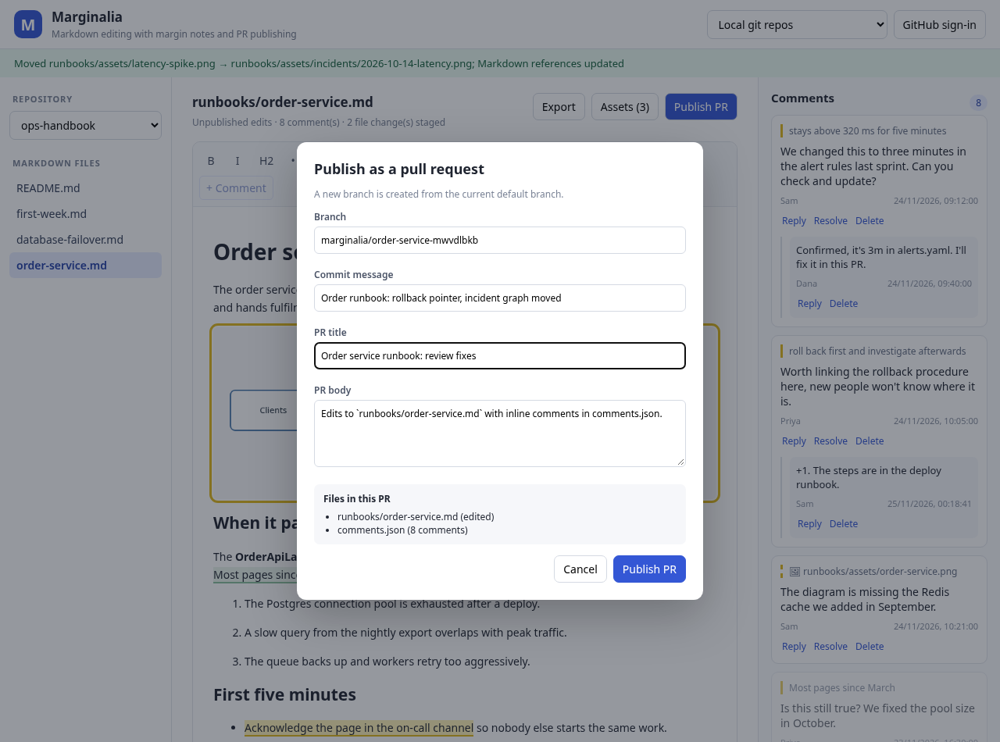
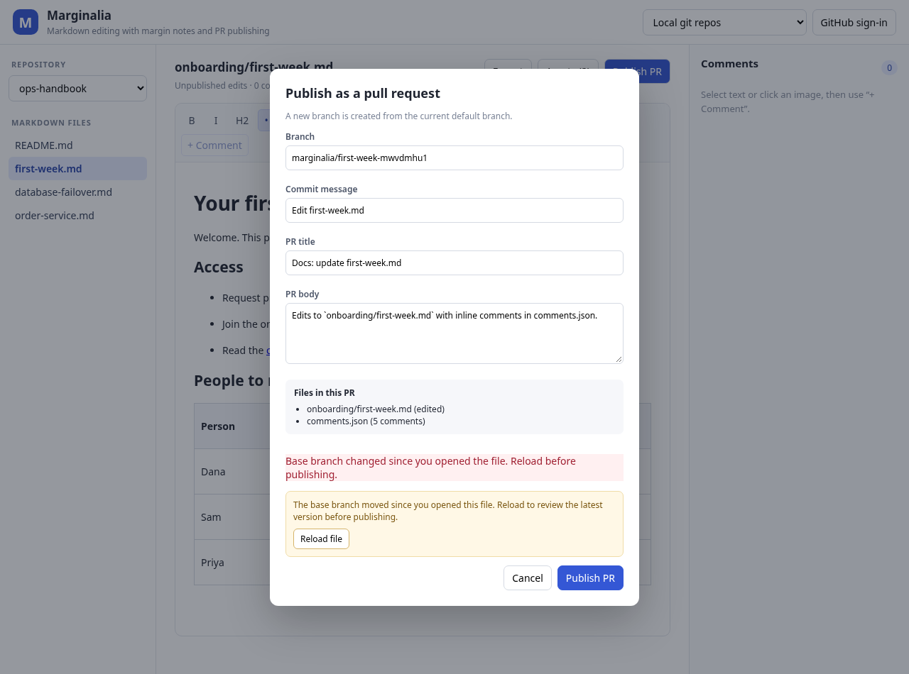
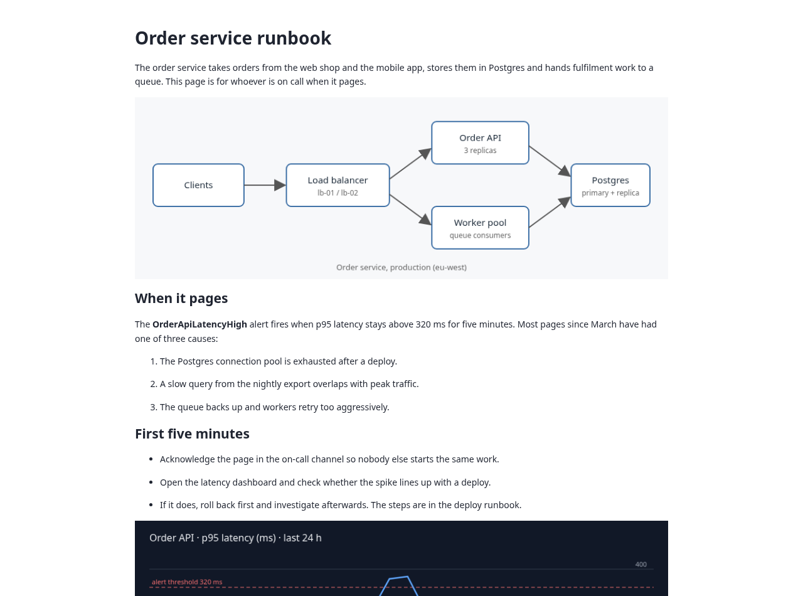
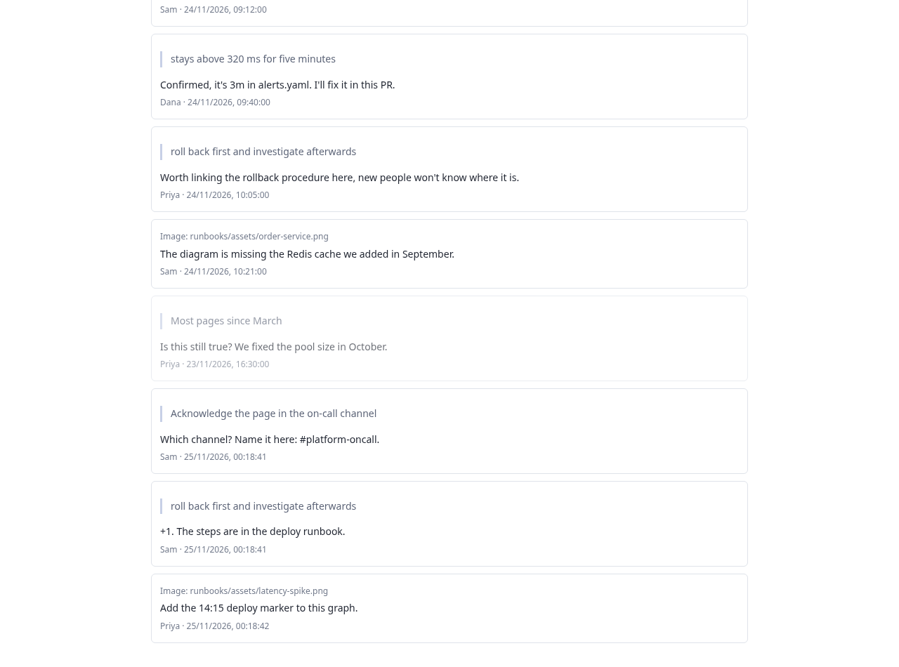
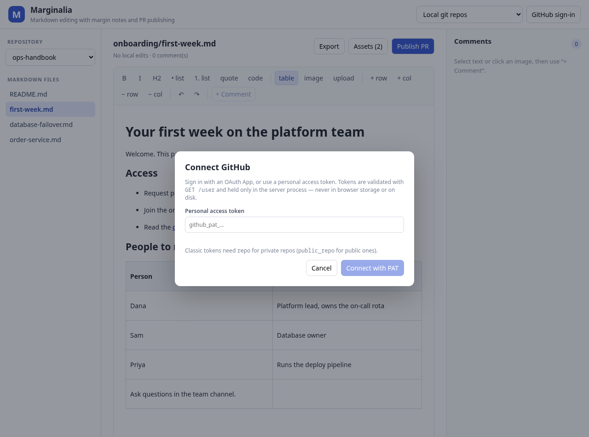

# Marginalia

**A browser-based Markdown editor for documentation kept in git. You open a page from a local repository or from GitHub, edit it like a word processor, leave review comments on words or images, and publish the result as a branch and pull request.**

Teams that keep runbooks, guides and handbooks as Markdown in git get version history and review, but at a cost: everyone who wants to fix a typo or question a sentence has to work with raw Markdown, branches and diffs. Marginalia puts a rich editor in front of the repository and keeps the repository as the only store: no database, and no copy of the documents on the server. Edits and review notes become one normal commit on a new branch, which goes through the team's usual pull request process.

Source code: [github.com/chrisnock-personal/marginalia](https://github.com/chrisnock-personal/marginalia)

*Every screenshot on this page comes from the real product, working on a made-up `ops-handbook` repository: an order service runbook, a database failover page and an onboarding page, reviewed by Dana, Sam and Priya. The yellow highlights are open comments, the green one has been resolved, and the outlined diagram has a comment of its own.*

---

## At a glance

| | |
|---|---|
| **Editing** | A rich editor that reads and writes Markdown: headings, bold and italic, lists, quotes, code blocks, links, tables with row and column tools, and images by URL, upload, paste or drag and drop |
| **Comments** | Comments on selected text or on a whole image, with replies, resolve and reopen. They are kept in a `comments.json` file in the repository, next to the documents, and follow the text when it moves |
| **Images** | A list of every image in the repository. Renaming or moving one rewrites the links to it in every Markdown file; deleting one removes it and its embeds |
| **Publishing** | One branch and one commit with the edited pages, images and comments, then a pull request on GitHub. Your own checkout is never touched. Publishing stops if someone else changed the base branch after you opened the page |
| **Export** | An HTML page with print styles, with the comments as an appendix if you want them, ready for the browser's Save as PDF |
| **Sources and sign-in** | Local git repositories, and GitHub repositories through its API. Sign in to GitHub with an OAuth App or a personal access token, held only in the server's memory |

---

## Editing

The editor works on the formatted page, not on Markdown syntax. The toolbar covers bold, italic, headings, bullet and numbered lists, quotes and code blocks, with undo and redo. What you write is turned back into Markdown (GitHub Flavoured Markdown, so tables survive) when you publish.

*A new person joins the onboarding table: with the cursor in the table, the toolbar adds **+ row**, **+ col**, **− row** and **− col**.*

**Tables** are inserted from the toolbar as a 3×3 grid and edited in place. Tab moves from cell to cell, and the row and column tools appear while the cursor is inside a table.

**Images** go in four ways: by URL (or a path in the repository), by choosing files, by pasting from the clipboard, or by dropping them on the page. Pasted, dropped and chosen images are kept in an `assets/` folder next to the document and travel in the same commit as the text. Until then they exist only in your browser, so nothing is written anywhere until you publish. Images already in the repository are shown from the base branch, with links relative to the page, as GitHub would show them.

---

## Comments in the margin

Select some text, click **+ Comment**, write the note and add your name. The comment appears in the right-hand panel with the words it refers to, and those words are highlighted in the page. Each comment can be replied to, resolved (it turns green and stays in the panel) or deleted. Your name is remembered in the browser for the next comment.

*Sam asks which channel the runbook means. Above it in the panel, Sam's earlier question about the alert threshold already has Dana's reply.*

**Comments on images.** Click an image instead of selecting text, and the comment is attached to the image file rather than to a sentence. The image gets an outline in the page, and the comment shows the image's path. If the image is later renamed or moved with the image list, its comments follow it.

*Priya asks for a deploy marker on the latency graph. Sam has already replied to her comment about the rollback steps, and the text now says where they are.*

**Where the comments live.** Comments are saved in `comments.json` at the root of the repository and published in the same commit as the edits, so they are reviewed, versioned and merged like everything else. Nothing about them is stored in Marginalia itself.

**How comments find their text again.** A comment doesn't store a position in the editor, which would be meaningless after the next edit. It stores the quoted words, up to 40 characters on either side, and where they were in the page. When a page opens, Marginalia looks for the quote at its old position first, then by the surrounding words, then anywhere on the page, so comments stay attached through ordinary edits around them. If the quoted words are deleted, the comment stays in the panel without a highlight; it is never silently dropped from the file.

---

## Images across the repository

**Assets** lists every image in the repository, with a thumbnail and its path. Changing the path and clicking **Rename / move** moves the file, and rewrites every Markdown link to it, in every Markdown file in the repository, not only the open one. **Delete** removes the file and the image embeds that pointed to it. Comments on a moved image follow it to the new path; comments on a deleted image are removed.

*The latency graph moves into an `incidents/` folder with the date in its name. In the published commit, git records it as a rename, the runbook's link points to the new path, and Priya's comment on the graph points there too.*

Like the editing, all of this stays in the browser until you publish: the moved file, the deleted file and the rewritten pages go into the same commit.

---

## Publishing as a pull request

**Publish PR** asks for a branch name (suggested from the page name), a commit message, and the pull request's title and description, then shows what's going in.

*Dana publishes the runbook edits, the moved graph and the eight comments.*

Marginalia then creates a new branch from the base branch with exactly one commit:
- **Local repositories:** it checks out the base branch in a temporary git worktree, writes the files there, commits, pushes the branch to `origin` and removes the worktree. Your own checkout, including any work in progress, is never modified. If `origin` is on GitHub, it opens the pull request with the GitHub CLI; otherwise it pushes the branch and says no PR was created. A dry-run setting stops after the commit, for trying it out.
- **GitHub repositories:** it builds the commit through GitHub's API (blobs, a tree, a commit and a branch), with no clone at all, and opens the pull request.

**Someone else changed the page.** Marginalia records the base branch's commit when you open a page. When you publish, it checks again before writing anything. If the branch has moved, publishing stops and offers to reload the page with the newer version.

*Sam committed to the onboarding page while Dana was editing it. Dana's publish is refused, and **Reload file** brings in Sam's change.*

The check is deliberately cautious: any new commit on the base branch counts, even one to a different file. Merging the two versions automatically isn't done yet.

---

## Export and PDF

**Export** turns the open page into a single HTML document with clean print styles, without the editor around it. It can be downloaded, or opened straight into the browser's print dialog to save as PDF. The page's comments can be included as an appendix, each with the quoted words or image path, the author and the time. Images are loaded from the Marginalia server, so print or save the PDF while it's running.

*The runbook as exported, and the end of its comments appendix, with Priya's comment on the latency graph last.*

---

## Sources and GitHub sign-in

Local repositories are listed by path when the server starts. For GitHub, **GitHub sign-in** connects in one of two ways: through a GitHub OAuth App, if one is set up, or by pasting a personal access token. Either way, the token is checked with GitHub, kept only in the server's memory, and never stored in the browser or written to disk. For running without a browser sign-in, a token can also be given at startup, in an environment variable or a file.

---

## How it runs

One Node.js process serves the editor and its API; there is nothing else to run, and no database. It needs `git` for local repositories (and the GitHub CLI to open pull requests from them). It's set up with environment variables: the local repository paths, an optional GitHub token or OAuth App, and the port. The editor is built with React and TipTap, and the server with Express.

## Status

An early prototype (version 0.1.0, November 2026), built for one person at a time: one GitHub identity per server, and one open document at a time. 18 automated tests cover comment anchoring, the `comments.json` format, image path rewriting, the export, conflict detection, OAuth and both git providers, alongside a TypeScript type check. Everything on this page was checked by running it against the demo repository, publishing to a real git remote and reading back the commits it made.

Known gaps:
- Comments are not posted as GitHub review comments; they stay in `comments.json`.
- Conflicts are detected but not merged. For a local repository, Marginalia only sees commits in your local checkout, not ones pushed to `origin` since your last pull ([#2](https://github.com/chrisnock-personal/marginalia/issues/2)).
- Publishing a page rewrites its whole Markdown from the editor, so tables and spacing can be reformatted along with the real edit ([#3](https://github.com/chrisnock-personal/marginalia/issues/3)).
- The export links to images on the running Marginalia server rather than embedding them, and images that are staged but not yet published don't show in it ([#1](https://github.com/chrisnock-personal/marginalia/issues/1)).
- The publish dialog lists only the open page and `comments.json`, not staged images or other pages whose image links were rewritten, though all of them are published ([#4](https://github.com/chrisnock-personal/marginalia/issues/4)).
