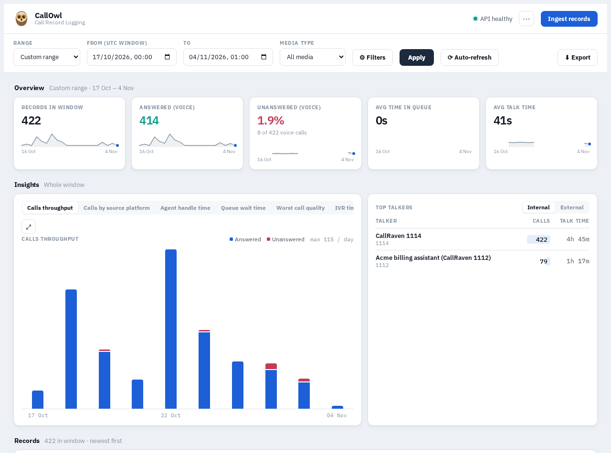
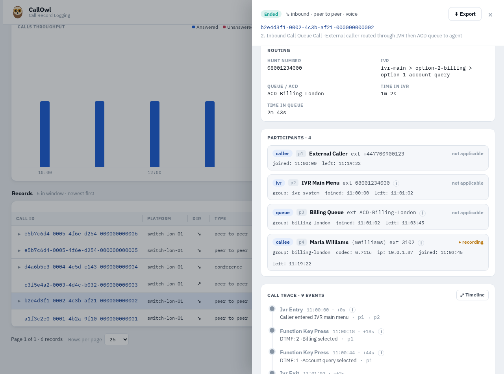
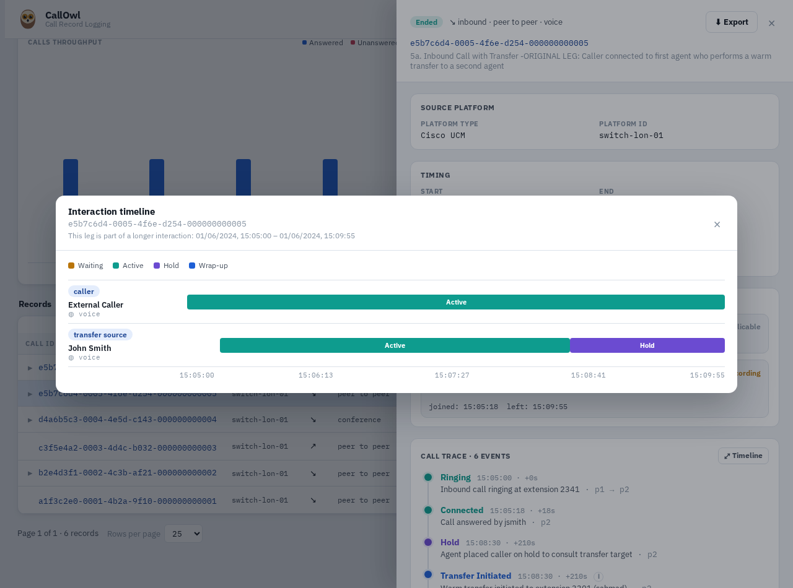
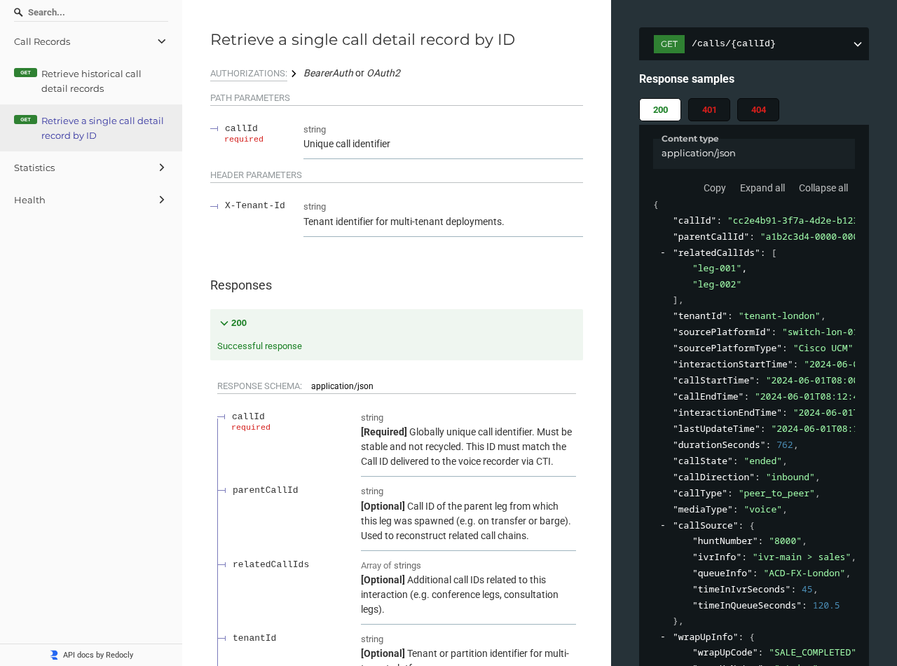
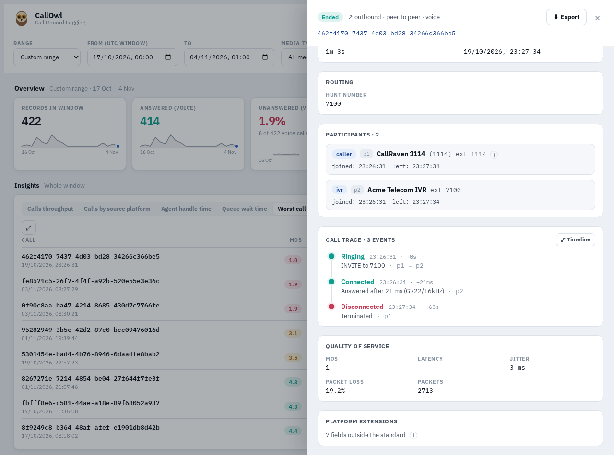
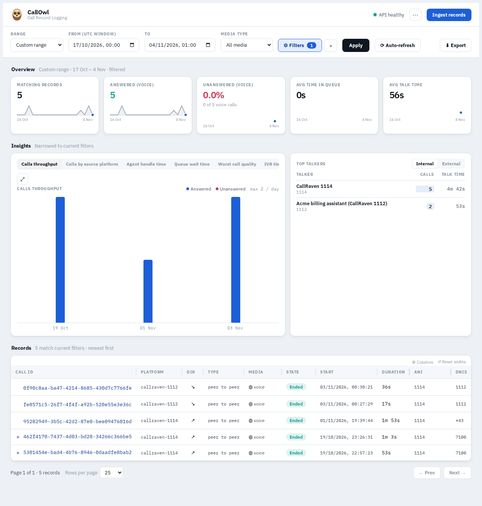

# The Open CDR Project

**An open, vendor-neutral standard for call detail records: one shape for the record of every call, whichever phone system made it, and one read API to fetch them.** It's for the people who build and run telephony, call recording and compliance systems, and for anyone who has to put call records from more than one of them side by side.

Every phone system logs its calls, and every one logs them differently. A Cisco switch, a cloud contact centre and an Asterisk box each have their own CDR format, field names and idea of what a transfer looks like, so reporting across them, or handing them to a recorder or a compliance tool, means writing a new integration for each. The Open CDR Project defines the record once: who took part and in what role, what happened and when, how the call was routed, how it sounded, and where its recording and transcript are. A system that writes it, and a tool that reads it, work together without either knowing about the other.

*422 real calls from two endpoints on a test phone system, three weeks of IVR and voicebot testing, held in CallOwl, a store and dashboard built on the standard. Every record was checked against the schema on the way in.*

---

## At a glance

| | |
|---|---|
| **One record per call** | Identity, timing, state, direction, type and media for voice, video, chat, instant message and email, in one JSON object |
| **Every party and every step** | Participants in 12 roles (caller, callee, IVR, queue, transfer, conference, barge, monitor, voicemail and more) and an ordered timeline from 30 event types |
| **Routing, quality and evidence** | Hunt number, IVR path and queue times; MOS, latency, jitter and loss; device details; references to the call's recording and transcript |
| **A read API** | Fetch records by time window with filters and paging, fetch one call, or get summary statistics, specified in OpenAPI 3.1 |
| **Room for the vendor** | Platform-specific data goes in its own block, so it never bends the shared fields |
| **Reference material** | The schema, a 14-page field guide, and worked example records for five common call scenarios |

---

## One record for every call

A record is a single JSON object. The fields every system can give are required: a call ID that is never reused, when the call started and ended, its state (ongoing, ended, missed, abandoned), its media type and its participants. The rest is optional and filled in where the system knows it: the direction, the type of call (peer to peer, group, conference, meeting, intercom, private wire, voicemail), the platform it came from, when the wider interaction began and ended, and links to the parent and related legs when one interaction spans several calls.

Each participant has an ID within the call, a role and an extension, and can carry a user ID, display name, group or skill group, its join and leave times, whether the switch was recording it, and the device it used (vendor, model, serial number, software version, MAC and IP address, audio and video codec). Turret systems get their own fields: the slot number and handset in use.

*The standard's queue-call example as CallOwl shows it: the hunt number, the IVR path the caller took (main menu, billing, account query), a minute in the IVR and 2m 43s in the queue, then four participants (the caller, the IVR, the queue and the agent who answered), each with their own times.*

---

## Transfers, conferences and the full timeline

Multi-party calls are part of the core design, not an afterthought. A conference lists every participant with their own join and leave times. A transfer is two legs linked to each other, so the original call and the consultation each keep their own record. Barge-in and silent monitoring have their own roles and events.

Every record can carry an ordered list of events: ringing, connected, hold and resume, each step of a transfer, conference joins and leaves, IVR and queue entry and exit, key presses, recording paused and resumed, parking, voicemail and the rest. Each event says who triggered it, who it was aimed at, and what happened in plain words. From that, a tool can rebuild exactly what the caller went through.

*The first leg of the standard's warm-transfer example, drawn from its events: the agent answers, puts the caller on hold at 15:08:30 to consult a colleague, and the leg ends when the transfer completes.*

---

## Routing, quality and the evidence

A record can say how the call arrived: the number dialled, the IVR path, the queue, and how long the caller spent in each. Afterwards, wrap-up data follows: the agent's wrap-up code, notes and how long it took.

For quality, a record carries the call's MOS, latency, jitter, packet loss and packet count. For compliance, it points to the evidence instead of embedding it: a recording block (recorded, not recorded or partial; how; the recording's ID, file name and where to fetch it) and a transcription block (status, method, provider, language, confidence, word count, whether it was redacted, and where to fetch it). A recorder and a call-logging system can then hold their halves separately and still agree on which call is which, because both use the same call ID.

---

## A read API, specified

The standard also defines how records are fetched, as an OpenAPI 3.1 spec that tooling can generate clients and servers from:

- `GET /calls` returns the records for a time window, filtered by media type, by groups to include or exclude, and by tenant, paged up to 1,000 at a time. Records come back in a fixed order (by last update), and a call that ends inside the window is included even if it started before it, so polling never misses one.
- `GET /calls/{callId}` returns one call.
- `GET /statistics/summary` returns totals for a window: answered and unanswered calls, calls abandoned in the IVR or the queue, and the average time callers spent in the IVR, in the queue and with an agent.
- `GET /health` reports the API's version.

Requests use bearer tokens or OAuth2, errors share one shape, and breaking changes only ever arrive as a new major version.

*The schema rendered as API documentation: each field marked required or optional and explained, with a full example record alongside.*

Anything a platform knows that the standard doesn't cover goes into `vendorSpecificFields`, with keys in reverse-DNS form, so a vendor can add its own data without adding fields to the core schema.

---

## Seen in use

The standard has been built into a small family of tools, and it is what lets them work together:

- **CallOwl** stores records written to the standard, serves the standard's read API, and adds a dashboard for browsing calls, participants and their timelines. Every record is checked against the schema when it arrives, so it only ever holds records that conform.
- **CallRaven**, a SIP softphone and test tool, records every call it makes with its quality figures. For this overview, its call history was turned into standard records by a short script and sent to CallOwl. The script only fills fields that CallRaven actually measured.
- **CallNest**, a call recorder, links each recording to its call record when the recording session carries the call's ID (CallRaven can send it as an `X-OpenCDR-CallId` header). It reads call records from any system that serves the standard's API, and stores transcripts using the standard's transcription fields.
- **Alfoir**, a platform for scheduled checks, can send a record to a CallOwl-style platform after each phone test it runs.

*One of those real calls, from 19 October: CallRaven 1114 calls the test IVR on 7100. The record shows who was on the call, its three events and its quality: MOS 1, 19.2% packet loss, 3 ms jitter. The seven CallRaven-specific figures, such as the codec and the round-trip time, sit apart under platform extensions.*

Because both endpoints write the same shape, one query covers both. Asking for every call with a MOS below 3.5 finds five, from both sides of the test: three that CallRaven 1114 placed, and two that the voicebot on 1112 received on 3 November, losing about a third of their packets.

*CallOwl's filter `mos < 3.5` over the same three weeks: five calls, from two sources.*

---

## How it's published

The standard is a set of files: the OpenAPI 3.1 schema (`cdr-schema.yaml`), a 14-page field guide covering every object, the API rules and the multi-party scenarios, and example API responses for five call scenarios (a simple inbound call, a call routed through an IVR and queue, an outbound call, a call that becomes a three-way conference, and a warm transfer with both legs). It needs nothing to run: a platform implements it, and CallOwl is a working example of one. The files are at [github.com/chrisnock-personal/open-cdr-project](https://github.com/chrisnock-personal/open-cdr-project).

---

## Status

A prototype, in the first of three planned phases. The schema is complete and its five example scenarios load into CallOwl and pass its validation. It is in use between CallOwl, CallRaven and CallNest, but no industry body has reviewed or endorsed it yet. The next phases are review by telephony vendors, recording and compliance specialists, a governance model for changes, and then a stable, versioned 1.0 that switch vendors could offer as a standard output. Reviews, issues and pull requests are welcome.
