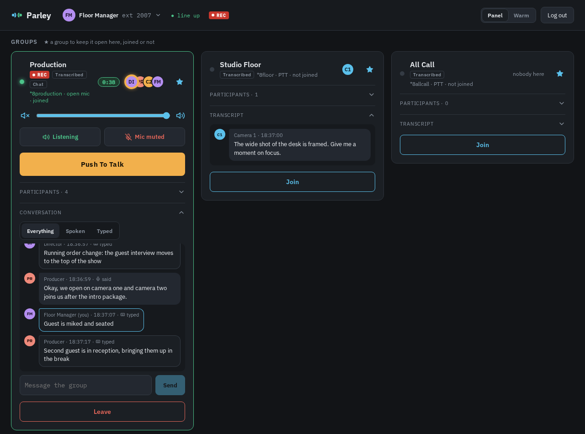
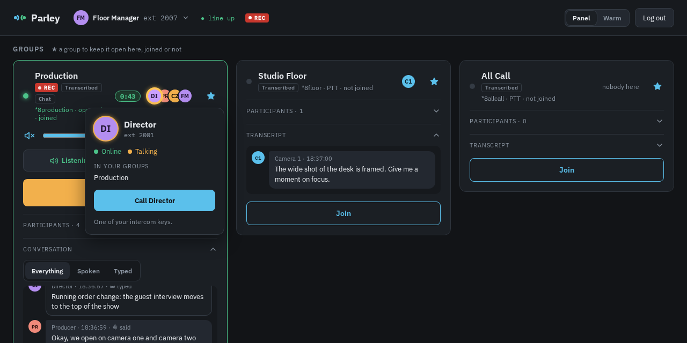
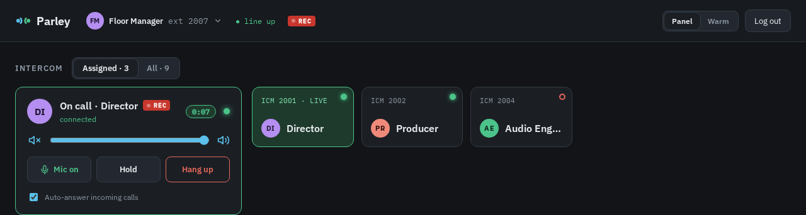
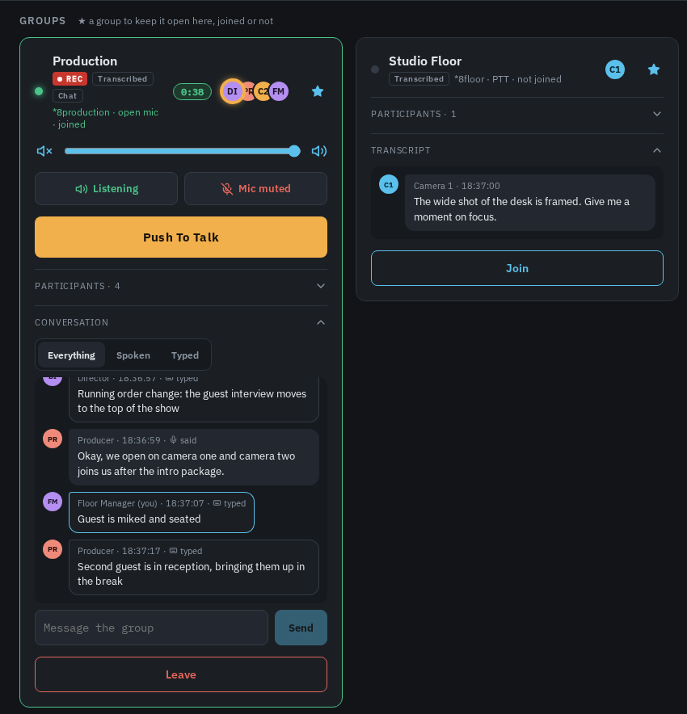
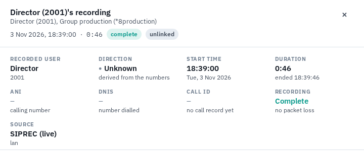
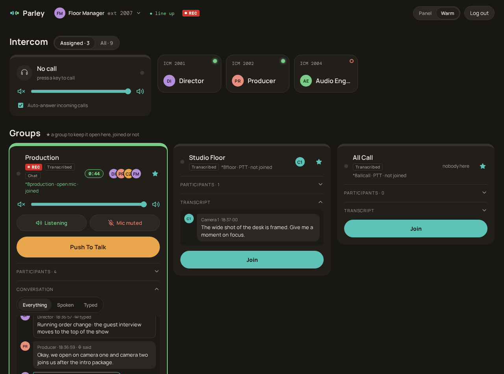
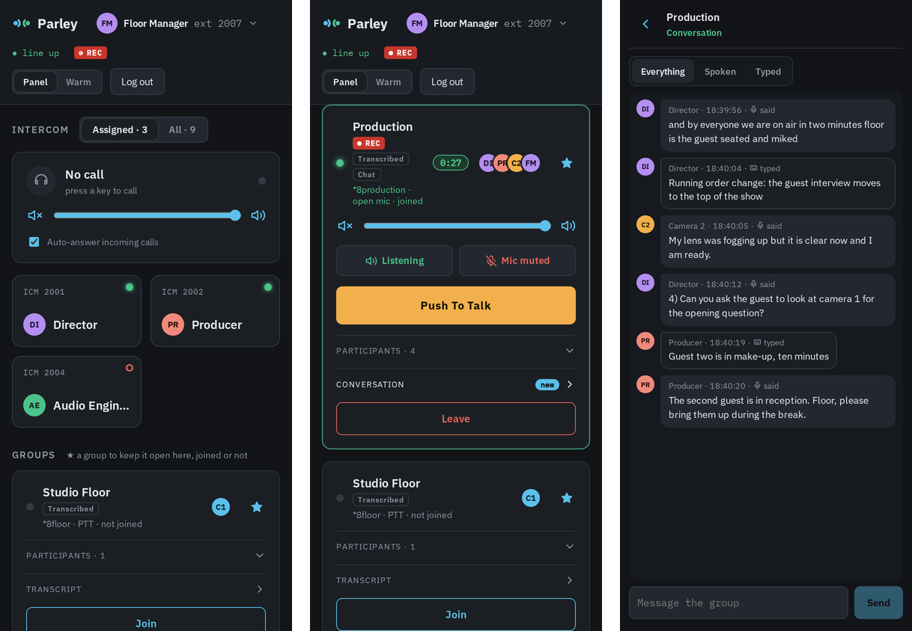
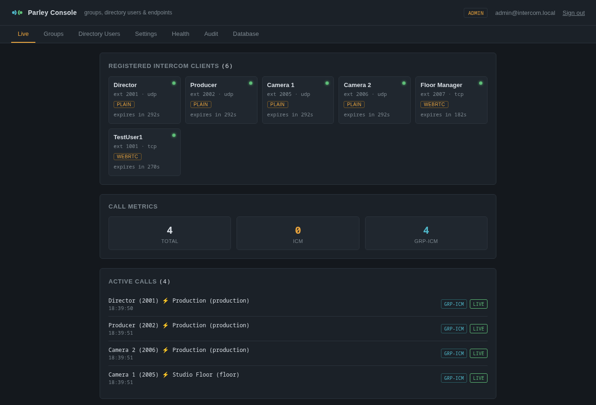
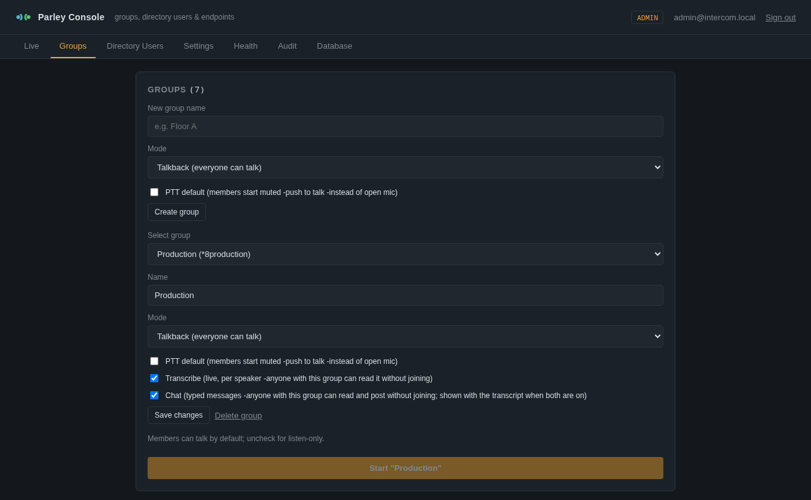
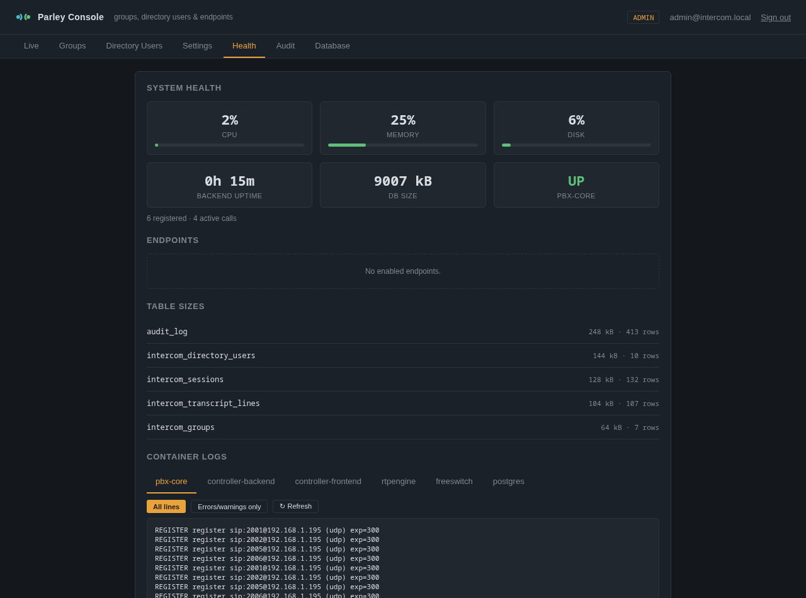

# Parley

**An IP intercom for crews who talk while they work: talk groups and direct calls in a web browser, with live transcripts, group chat and call recording.** It runs as a handful of containers on one server, and the people using it need nothing but a browser.

Live productions, events and operations rooms run on talkback. The director talks to the cameras, the floor manager to the producer, everyone to everyone when it matters. Dedicated intercom hardware does this well and costs accordingly; a conference bridge is cheap but has no idea who should hear whom. Parley sits between the two. Each person logs in from any browser (a desk PC, a laptop, an iPad), sees the groups they belong to and the people they can call, and joins as many groups at once as their job needs. What was said in a group is written down as it's said, typed messages sit beside it, and calls can be recorded to a compliance recorder.

*The Floor Manager (extension 2007) during a countdown. Production is joined and recorded, the Director is talking (the ring round the Director's avatar), and the conversation mixes what people said with what they typed. Studio Floor and All Call are favourites, so they stay open even though they aren't joined.*

---

## At a glance

| | |
|---|---|
| **Talk groups** | Open-mic or push-to-talk groups, as many joined at once as you like, each with its own talk, listen and volume controls; who's in each group and who's talking, before you join |
| **Direct intercom** | Press a key and the other person's intercom answers by itself; hold and resume; call anyone in the directory |
| **Conversation** | Live per-speaker transcripts and typed group chat, in one timeline, readable without joining |
| **Recording** | SIP-REC (RFC 7866) to any compliance recorder, per person, with participant metadata; a REC tag wherever it applies |
| **Admin console** | Live registrations and calls, groups, people and their keys, recording and retention settings, health, audit log, database backups |
| **Network** | Its own SIP core in TypeScript, media anchored for routed networks, WebRTC bridged to plain RTP, HTTPS and SIP digest authentication |

---

## Talk groups

A group is a party line: everyone in it hears everyone else who's talking. Groups are open mic (talk freely, mute when you need to) or push to talk (hold the big button). You can be in several at once, the way a floor manager listens to Production and Studio Floor together, and each group has its own talk button, listen mute and volume, so one noisy group can be turned down without leaving it.

Each group shows who's in it right now and who's talking, whether or not you've joined, so you can see where the conversation is before you walk into it. Star a group to keep it open as a full card; the rest fold into small tiles until you need them. Click anyone's avatar to see who they are, whether they're online or talking, which of your groups they're in, and to call them.

Muting and push-to-talk happen in your own browser, so pressing the button takes effect at once, with no signalling round trip and nothing for the server to get wrong.

---

## Direct intercom

The intercom panel holds your keys: one per person you call often. Press a key and the other person's intercom answers by itself, so you're talking straight away, the way a studio intercom works. It's a real call: either side can put it on hold and resume it. Anyone not on your keys can be called from the directory.

---

## Read what was said

Switch on transcription for a group and everything said in it is written down as it's said, attributed to the person who said it. Switch on chat and members can type to the group as well: for the things you'd rather not say over the air, or that need to stay on screen ("running order change", "second guest is in reception"). With both on, spoken and typed lines share one timeline, each marked *said* or *typed*, and a filter shows just one kind.

Both are readable by anyone with the group, joined or not, so someone walking back to their desk can catch up on what they missed without listening to it again. A *new* marker shows where there's something unread.

Transcription runs on your own server with whisper.cpp, sharing one GPU (or CPU) speech model. It listens to each member's own voice, so lines are attributed correctly even when two people talk over each other, and it never sends silence or a muted microphone. A pitch check keeps music, tones and other held notes out of both the transcript and the "who's talking" ring. In these runs each member's audio reached the transcriber within about 60 ms of them joining. It isn't perfect: the first word of an utterance is sometimes lost ("Standby everyone" came out as "and by everyone"), as the screenshots show.

---

## Recording

Turn on recording for a person and every call they make, direct or group, is recorded by any SIP-REC compliance recorder (RFC 7865/7866). Parley takes a copy of the media from its media relay, so nothing is added to the call's audio path, and the recorder gets one labelled stream per party plus metadata saying who they are. Recording fails open: if the recorder can't be reached, the call goes ahead unrecorded and the failure is logged.

Everyone can see it happening. A **REC** tag shows in the top bar when your calls are recorded, on a direct call while it's being recorded, and on a group while anyone in it is.

*The Director's leg into Production, recorded live by CallNest, another of my projects. The participants come from Parley's metadata, and each party is on its own channel.*

---

## Desk, laptop, iPad, phone

The client is a web page: nothing to install, and a person's groups and keys follow them to whichever device they log in on. It has two looks, a graphite **Panel** theme and a warmer, rounder **Warm** one.

On a phone the cards stack into one column, and a group's conversation opens full screen.

*Keys and groups, a joined group with push to talk, and the Production conversation full screen, at 390 px wide.*

---

## The admin console

Administrators run Parley from a separate console. **Live** shows who's registered and every call in progress, straight from the SIP core's own state, with the kind of call and its parties.

**Groups** and **Directory Users** are where groups are made (open mic or push to talk, transcribed, chat), people are added with an extension and password, given their keys and groups, and switched to recorded. **Settings** holds the recording server and how long transcripts and chat are kept.

**Health** shows the server's CPU, memory and disk, the database, whether the SIP core is up, and each container's logs. **Audit** is a searchable history of who did what: logins, changes, every call's start and end. **Database** downloads and restores backups, runs maintenance, and purges or archives old rows. Console users have viewer, editor or admin roles.

---

## Built for real networks

Parley's SIP core is its own code, written in TypeScript on the drachtio SIP engine, not a general-purpose PBX configured into shape. It handles registration, direct calls and group calls, and authenticates every registration and every call with SIP digest authentication, checking the caller is who they say they are.

Media goes through rtpengine, so calls work across routed networks and subnets where devices can't reach each other directly, and it bridges the browsers' encrypted WebRTC audio to plain RTP for the group mixer (FreeSWITCH's conference module, used purely as a mixer). The browser side runs over HTTPS with Parley's own local certificate authority, which a device trusts once, iPads included.

---

## How it runs

Seven containers under Podman (or Docker) Compose on one Linux host: the SIP core, rtpengine, FreeSWITCH, the transcriber, the API with PostgreSQL, and nginx serving the console and the client over HTTP and HTTPS. Transcription uses a whisper.cpp server, which can be shared with other services on the same machine.

---

## Status

Parley is a working prototype in active development. Every feature shown here was exercised for this page with real calls: a browser client logged in as the Floor Manager, four scripted crew members speaking into the groups, and recordings going to a real SIP-REC recorder. Features are tested by hand and with scripted SIP calls as they are built; there is no automated test suite yet. Next on the list are keyboard hotkeys, audio device selection, saved presets and an admin remote mute.
