# Playhall

**Game rooms for friends: a host opens a room, some people play, and everyone else pulls up a chair and watches.** It runs in the browser, with ten games (chess, checkers, Four in a Row, Snakes and Ladders, Ludo, Sea Battle, Blackjack, Texas Hold'em, a colour-matching card game and a crossword tile game), a chat for the players and a separate one for the people watching, and leaderboards that keep score over weeks and months.

Most online games give you a match against a stranger. Playhall is closer to a games night: a room that stays open, people drifting in, a queue for the next game, and a running argument in the corner about who should have played d4. The host decides who plays, who waits and what the people watching may say, and the scores carry on from one evening to the next.

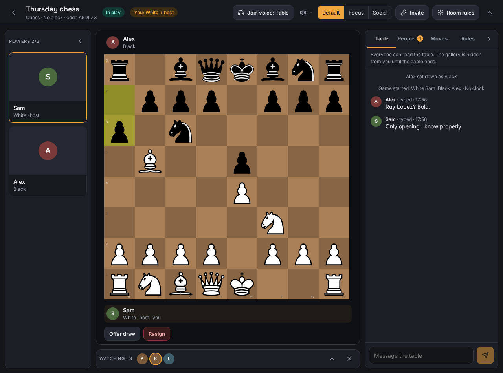

*Sam (White, and the room's host) against Alex in a game with no clock. Three people are watching; Kai's ring in the watchers' strip means he's asked for the next seat. The players' chat says they can't read what the watchers are saying until the game ends.*

---

## At a glance

| | |
|---|---|
| **Rooms with roles** | A host, players in seats, and everyone else watching; a queue for seats; who plays the next game |
| **Ten games** | Chess, checkers, Four in a Row, Snakes and Ladders, Ludo and Sea Battle; Blackjack, Texas Hold'em and Colour Clash with play chips and cards; Letterworks, a crossword tile game. One to four players, all drawn from one set of boards, pieces, cards, chips and dice |
| **Two conversations** | The table, which everyone reads, and the gallery, the watchers' own chat that players can't read during a game |
| **A room that gets out of the way** | Every panel around the board expands, shrinks or hides; three layouts; works on a phone |
| **The host's rules** | Who may sit down, what happens after each game, a move timer, an optional delay for watchers, who may write where, private rooms with a password, removing people |
| **Points and leaderboards** | 3 for a win, 1 for a draw or second place; weekly, monthly and all-time tables; every player's record, head-to-heads and replays |

---

## Rooms, players and people watching

Anyone with an account can open a room, pick the game and a time control, and decide whether it shows in the lobby or only to people with the invite link. The lobby shows each room's game, who's playing, how many are watching, and whether there's a free seat.

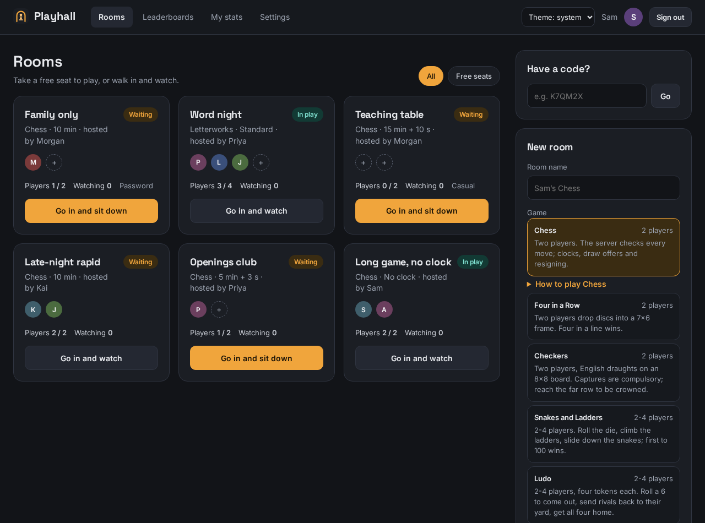

Inside a room there are three roles. The **host** runs it, and can play too. **Players** are whoever is sitting in the game's seats. Everyone else is **watching**. A watcher who wants to play asks for a seat and joins a queue; when a game ends, the host's rule decides who plays next: the same players, the winner stays and the next in the queue takes the other seat, or both rotate out.

You can come in as a guest with just a name, straight from an invite link. Guests can watch, and play if the host allows it; hosting a room needs an account.

---

## The table and the gallery

Watchers talking to players spoils games like chess, so every room has two chats. **The table** is the players' conversation: everyone can read it, and watchers can write there between games. **The gallery** belongs to the people watching: they can say "he's about to blunder the knight" without the player hearing it, because players can't read the gallery until the game is over. The host can relax either rule.

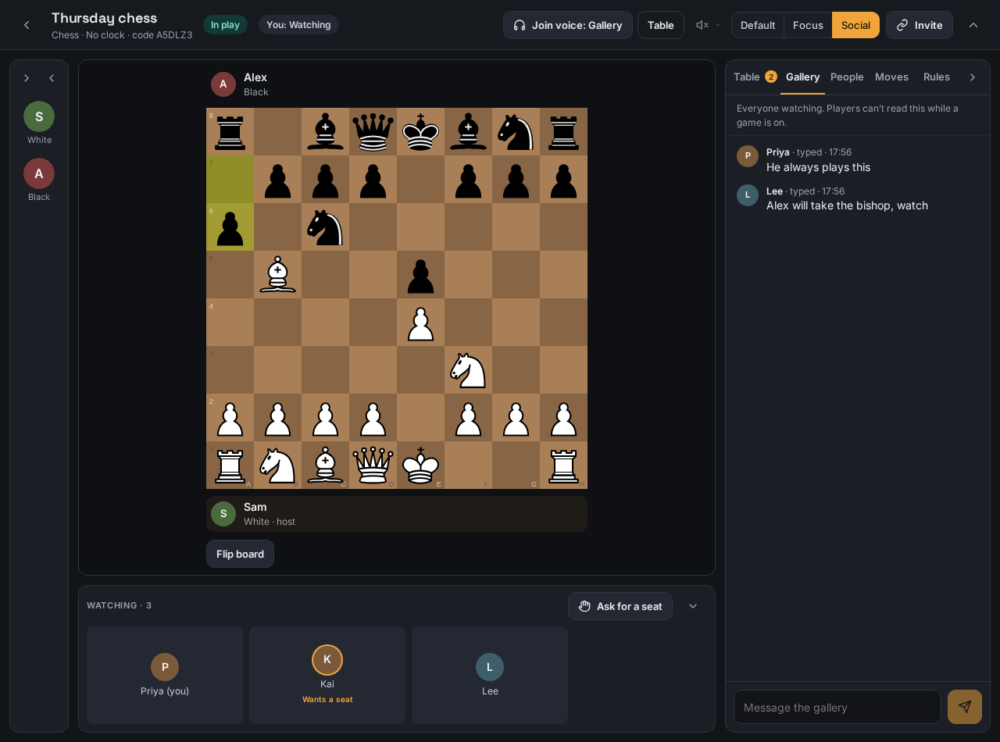

*Priya is watching in the Social layout, which gives the watchers more room. Her gallery chat is open; the Table tab shows three messages she hasn't read yet.*

---

## The games

**Chess** is checked move by move on the server, so nobody can play an illegal move or touch the other side's clock. It has clocks with increments (one minute up to fifteen, or none), draw offers, resigning, promotion, and every way a game can end: checkmate, stalemate, running out of time, repetition and the 50-move rule. The board is lichess's open-source chessground, and it flips round for the player with Black.

When a game ends, the room shows what it meant: the points each player won, their new totals and rank, and their record against each other.

*A four-move mate. Priya takes 3 points and moves to 119, second in the all-time table; she leads Lee 9 to 5 over their games together.*

**Four in a Row** is the first game built from Playhall's shared kit of boards, discs and player colours, which the games still to come will use too, so they look like one set. Hovering over a column shows where your disc would land, discs drop with a short animation, and the winning four are ringed.

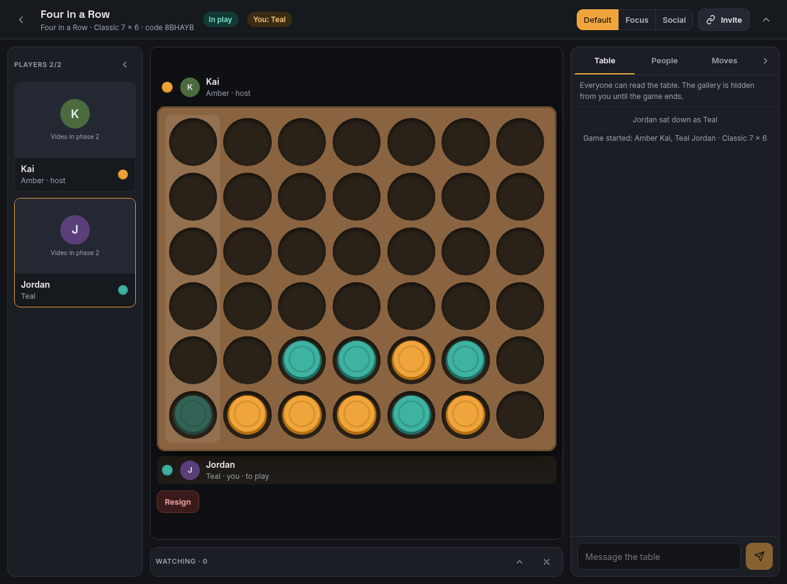

**Checkers** is English draughts. Captures are compulsory, so the board only offers a capture when there is one, and a piece that can keep jumping must: you click each landing square in turn. A man that reaches the far row is crowned and then moves backwards too.

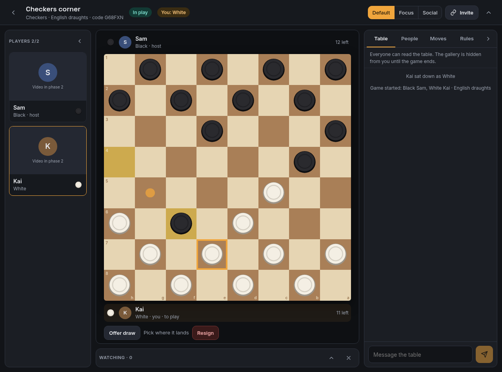

**Snakes and Ladders** and **Ludo** are for two to four players and bring in the dice: always rolled on the server, never in anyone's browser, so nobody can load them. Snakes and Ladders has its own drawn snakes and ladders and needs an exact roll to finish on 100. Ludo follows the usual rules: a 6 to bring a token out and another roll after a 6, rivals sent back to their yard (except on the starred squares), and an exact roll to get home. In both, everyone gets a finishing place, and second place earns a point.

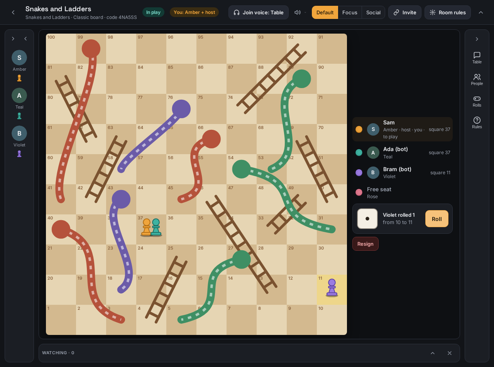
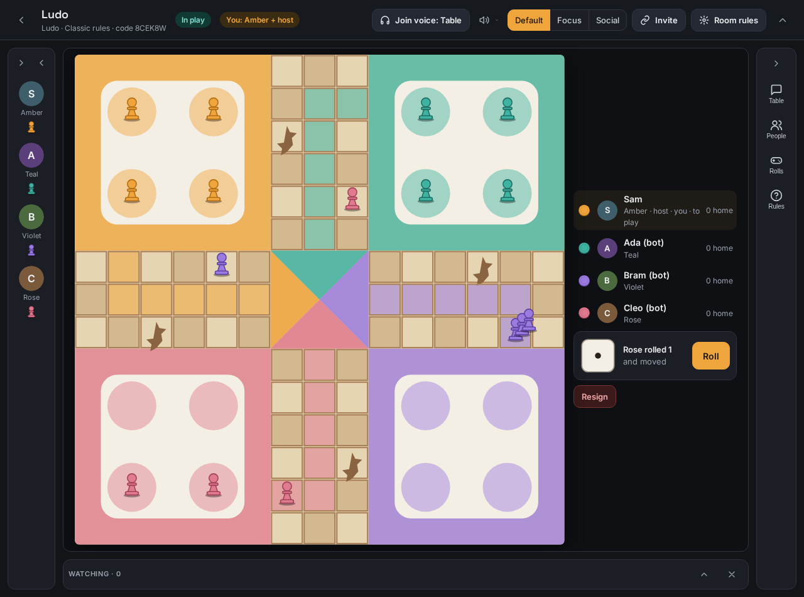

**Sea Battle** is the first game with hidden information. Each player's fleet is laid out at random (shuffle until you like it, then press Ready); you only ever see your own ships and the results of the shots, red for a hit and white for a miss, and people watching see the shots alone until the game ends and both fleets are shown.

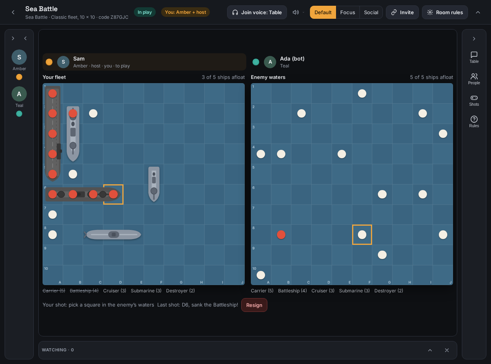

The five ships are drawn for Playhall: a carrier with its flight deck, a battleship with three turrets, a cruiser, a submarine and a destroyer. You can place them yourself: click a ship to pick it up, turn it, and a shadow shows where it would go, red if it won't fit. Or press Shuffle for a random layout.

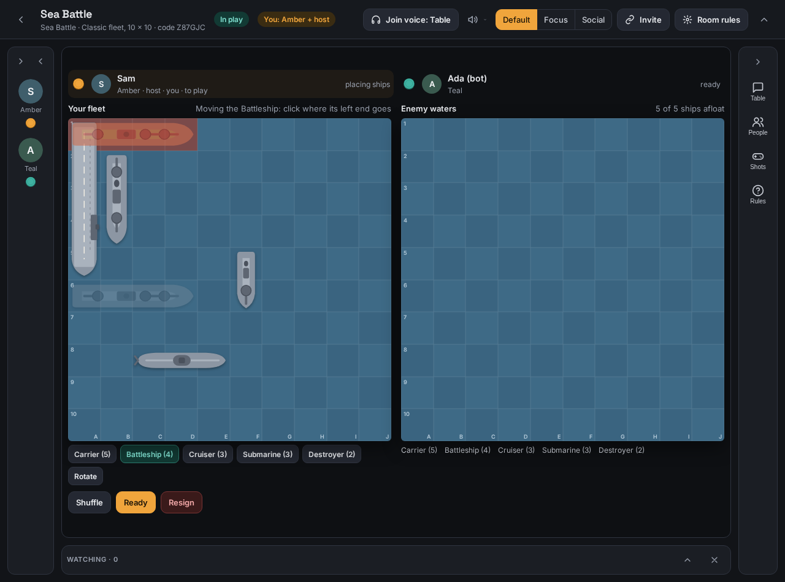

**The card games** share one deck design, a card back with the Playhall mark, and chips that always show their amount, and they use play chips only: nothing to buy and nothing to cash out. **Blackjack** is one to four players against the house over a session of 5, 10 or 20 hands, most chips at the end winning (a game on your own is practice and doesn't count). **Texas Hold'em** is a sit-and-go: everyone starts with the same chips, the blinds double every few hands, side pots look after short stacks, and the last player with chips wins. **Colour Clash** is our own colour-matching card game in the four player colours. In all three, your cards are hidden from everyone else, people watching included.

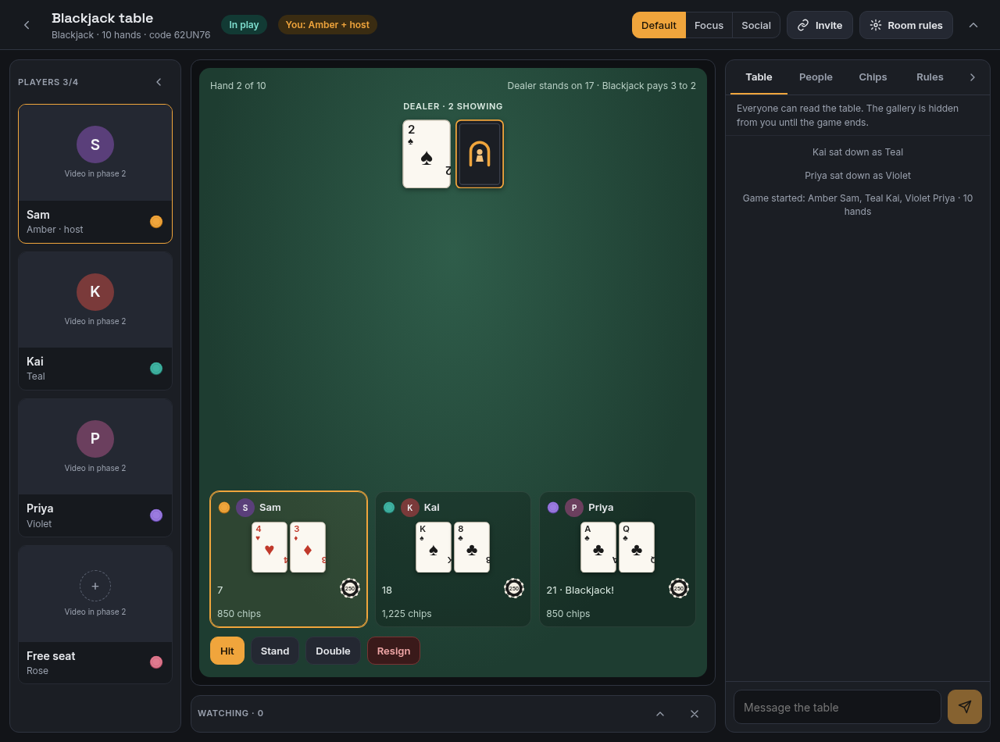
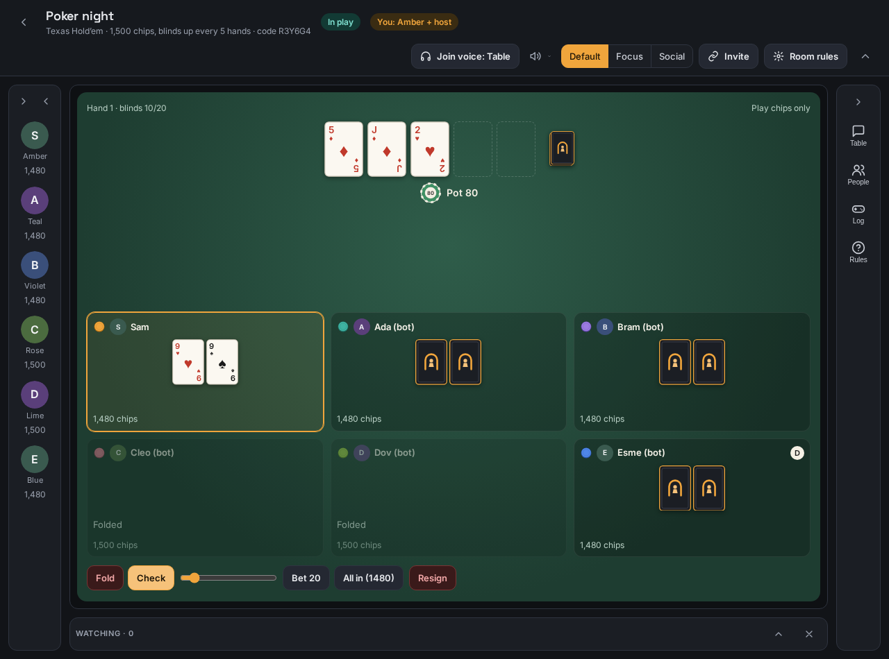

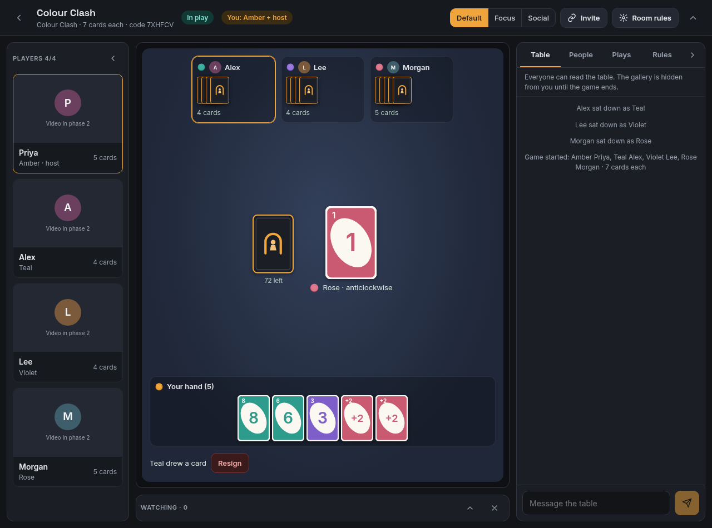

**Letterworks** is a crossword tile game for two to four players, on our own board layout and tile set rather than the commercial game's. You build words from a private rack of seven tiles: tap a tile then a square (or drag it), and Playhall shows the words you're making and what they'd score before you commit. Every word is checked against ENABLE, a public-domain list of about 173,000 English words, and one that isn't allowed is turned down before anything is placed, so there are no challenges and no penalties. The Moves tab keeps the words played, and a panel lists all 96 two-letter words.

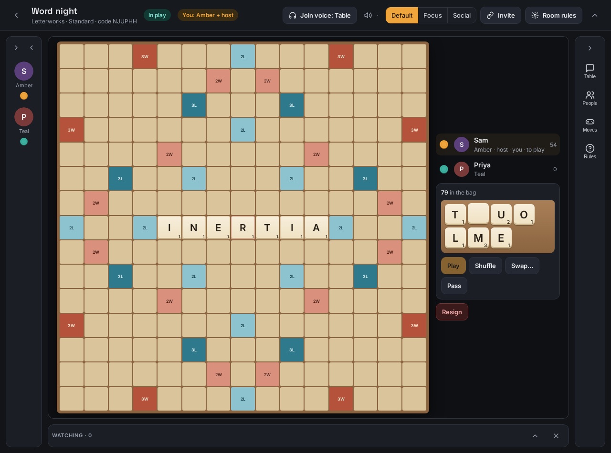

Every game explains itself. The **Rules** tab in any room, and **How to play** when you pick a game in the lobby, give the goal in a sentence and then the essentials: taking turns, how the pieces move, how a game ends, and a few tips. Each new game has to come with its own.

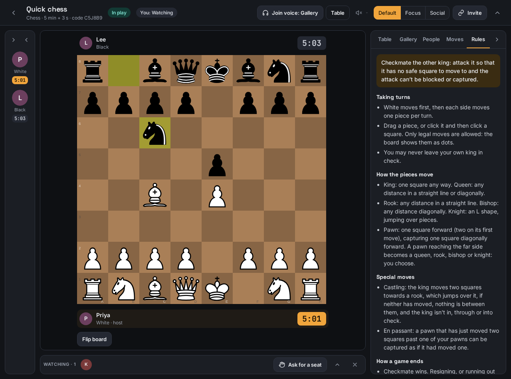

---

## A room that gets out of the way

The board always gets the space. Everything around it (the top bar, the players, the watchers, the chat) can be expanded, shrunk or hidden on its own, and three layouts set them all at once: **Default**, **Focus** for when you're playing, and **Social** for when the conversation matters more. Your choice is remembered for each game. Clocks and whose turn it is stay visible however small the panels get.

On a phone the board takes the full width and everything else stacks beneath it. There's a light theme too, which follows your system unless you pick one.

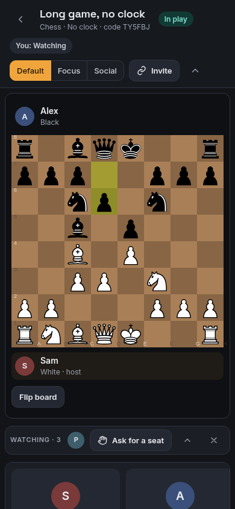
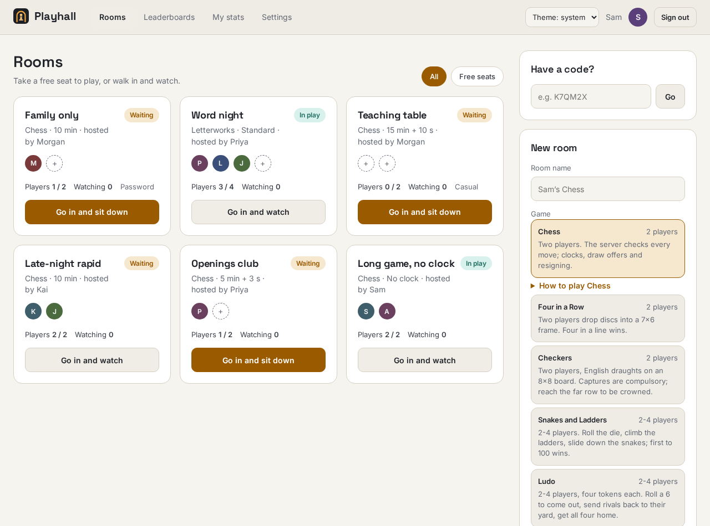

---

## The host's rules

The host sets how the room works and can change most of it at any time: whether anyone may take a free seat or only people the host seats, the after-game rule, the time control (between games), a **move timer** for the games with turns (15 seconds to 5 minutes a move; run out and you lose, or in a game for more players your roll is made for you), a **delay for watchers** (off unless the host wants it: watchers then see the board and the players' chat up to two minutes late, so nobody can feed a player moves), whether watchers may write at the table, whether guests may play, whether the room shows in the lobby, and whether its games count for the leaderboard. The host can also move a player to watching, remove someone from the room for good, hand the room to someone else, or close it. If a player's connection drops mid-game, they have a minute to come back (everyone sees the countdown); after that, a two-player game goes to their opponent, and in bigger games play carries on without them.

A room can also have a **password**. The host and anyone already playing go straight in; everyone else is asked for it, and changing it means everyone else needs the new one.

---

## Points, leaderboards and everyone's record

Every finished game is scored: **3 points for a win, 1 for a draw, 0 for a loss** (in games for three or more, second place will earn 1). The leaderboard ranks players for this week, this month and all time, separately for each game and for all games together, once they've played five games in the period. Only games between people with accounts, in rooms set to count, are scored; a game the host stopped doesn't count.

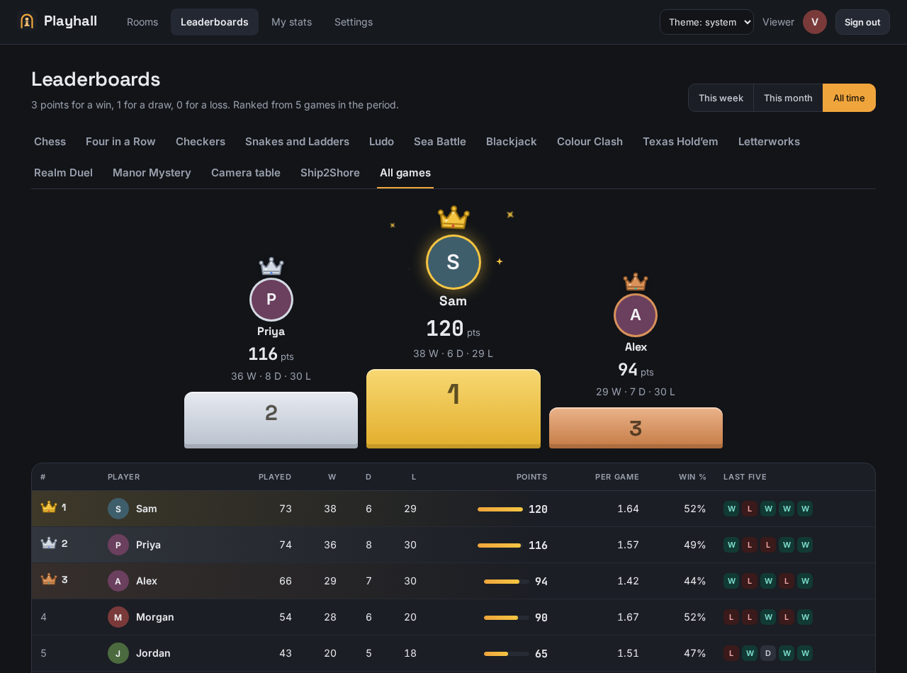

Each player has a page of their own: points, games played, points per game, win rate and their current streak; how they do as White and as Black; points week by week; how their games ended; their recent games; and their record against everyone they've played.

Finished games of chess, checkers and Four in a Row can be **replayed** move by move, from a player's recent games or from the card at the end of the game.

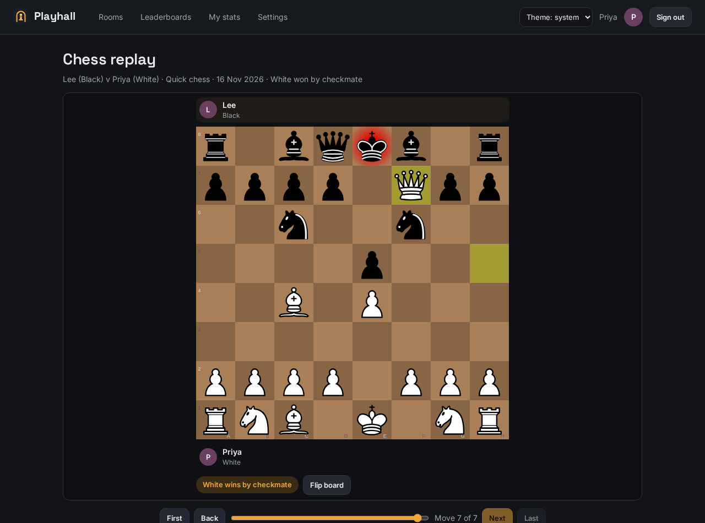

---

## What's next

Playhall is planned in five phases, with a backlog behind them.

1. **Phase 1, done: the games.** Nine games on one shared kit, and since then Letterworks.
2. **Phase 2, next: voice and video, and then any board game at all.** Voice and video in every room, split the same way as the chat, so watchers can talk among themselves without the players hearing. Video brings the **camera table**: the host points a camera (a phone on a stand will do) at a real board on their own table and moves the pieces for everyone, and Playhall keeps the rest: the seats and turns, a shared dice roller, a score pad, a move timer and the chat. That works for any board game, including all the ones nobody has written for Playhall, and the host enters the result at the end so it can still count.
3. **Phase 3: OpenBOR rooms.** The server runs the open-source OpenBOR engine for beat-'em-ups and streams the game into the room, and up to four players control it from their browsers with a gamepad or keyboard. Playhall supplies neither the engine nor any games: an admin installs the engine from its official releases, and players import their own games.
4. **Phase 4: share a game from your own PC.** A host runs any local-multiplayer game on their own computer; Playhall streams it to the room and friends play it remotely with their own controllers, which appear on the host's PC as ordinary game controllers.
5. **Phase 5: games from anyone.** A plug-in kit so other people's web games can run in a room, plus a faster, smoother version of sharing a game from your PC.

**In the backlog:** Ship2Shore, a hidden-role game for 5-11 players set aboard a 1943 merchant ship where the Royal Navy, enemy spies and a black-market fixer each steer for a different port and the crew throw suspects to the sharks; tournaments (knockout, round robin and Swiss, with Playhall pairing the players and opening the rooms each round); more games, among them a country-house murder mystery and a fantasy creature card duel, each under our own name and artwork; and computer opponents.

---

## How it runs

Playhall is a Node.js server with a Postgres database, packaged as two containers for podman or Docker Compose. People need only a browser. It comes with demo data (eight players, five rooms and two months of games), which is what's in these screenshots.

## Status

Early: phase 1 of five is done, and Playhall has been run on a home network, not yet in public. CI runs on every push: 77 unit tests of the game rules, the room logic and the scoring, including 100 random games of Hold'em that check no chips are ever created or lost; an end-to-end test that plays games of chess and Letterworks over the real WebSocket and checks the results, stats and private rooms; a browser test that plays on the real board on desktop and phone; loading and removing the demo data; and building and starting the container image.

Source: [github.com/chrisnock-personal/playhall](https://github.com/chrisnock-personal/playhall)
