# Skyfarer

**A small service for support and operations teams that watches the public status pages of nine cloud providers, tells you when an incident or maintenance touches a region you run in, through Zendesk, ServiceNow, Jira Service Management, PagerDuty, Pushover, Microsoft Teams, SNMP traps or webhooks of your own, and follows up when the provider says it's over. Admins set it up in the browser; everyone else just watches.**

When a cloud provider has a problem, the first place to say so is usually its status page, and nobody is paid to sit and refresh nine of them. Customers notice first, or a support engineer finds out by chance. Each provider also publishes differently: one posts every update as a separate entry, another rewords its entries, others just remove them when the event ends. Skyfarer reads them all on a schedule, works out which incidents matter to you, and turns each one into a single ticket and alert, with a record of what happened and when.

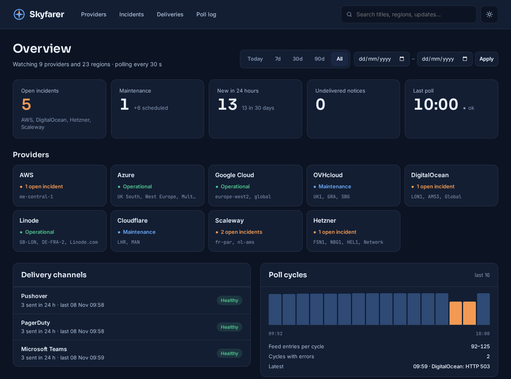

*The dashboard during a run on 8 November 2026, with the live feeds of all nine providers. Everything on it is real except two DigitalOcean incidents marked "Demo:", which were scripted so that alerts could be sent and an incident could close during the run.*

---

## At a glance

| | |
|---|---|
| **Nine providers** | AWS, Azure, Google Cloud, OVHcloud, DigitalOcean, Linode, Cloudflare, Scaleway and Hetzner, each read in the way its feed needs; any of them can be switched off |
| **Filtering** | By region, using each provider's own names (`me-central-1`, `LON1`, `fr-par`, `FSN1`, `LHR`), and optionally by keyword |
| **Incidents and maintenance** | Faults and planned work are told apart, so maintenance is recorded without paging anyone |
| **Tickets** | Zendesk, ServiceNow or Jira Service Management: one ticket per incident with the provider, region, link and timeline, a note for each update the provider posts, and pending (Zendesk) or resolved (ServiceNow, Jira) when the incident ends |
| **Alerts** | Pushover, PagerDuty, Microsoft Teams, SNMP traps and any number of outbound webhooks, in any combination, with or without tickets; old events and planned maintenance don't interrupt anyone |
| **Failure handling** | Each channel fails and retries alone through a delivery queue; an unreadable feed closes nothing and shows on the dashboard |
| **Dashboard** | Web view, dark by default with a light theme: provider and channel health, incidents, search, filters, and logs of every notification and poll |
| **Settings and access** | Providers, regions, channels and keys are edited in the browser by admins and applied from the next poll; viewers see the dashboard only; keys are encrypted and never shown again; every change is logged |
| **History** | Every incident and update is kept in PostgreSQL, with the provider's own timestamps, ready for SQL reporting |

---

## Nine providers, six ways of publishing

The useful part of this project is the difference between the feeds. Treating them all the same produces wrong tickets, so each provider has its own rules, based on what its feed really publishes.

| Provider | Source | How one incident is recognised | How it knows the incident is over |
|---|---|---|---|
| **DigitalOcean, Linode, Cloudflare, Scaleway** | Statuspage JSON API: incidents and scheduled maintenance | One stable ID; the region is in the affected components (`LON1`, `fr-par-1`, `Newark - (EWR)`) | Status `resolved` or `postmortem`, or `completed` for maintenance |
| **OVHcloud** | Statuspage RSS history feed | One ID for the incident's whole life | The status word on the newest update: Resolved, Completed or Postmortem |
| **Hetzner** | Atom feed of current and upcoming notices | The notice's ID, without the update counter Hetzner adds to it | The newest update says Resolved or Completed, or the notice leaves the feed |
| **AWS** | One RSS feed per region | Every update is a separate entry, so entries in a region belong to the open incident until one resolves it | `[RESOLVED]` or "Service is operating normally" in the title |
| **Azure** | RSS feed of events in progress | Titles get reworded, so any change counts as an update to the open incident in that region | A title starting "Mitigated" or "Resolved", or the event leaving the feed |
| **Google Cloud** | Structured `incidents.json` | One stable ID | The incident has an end time |

AWS shows why this matters. Its real feed for the Middle East (UAE) region holds 24 entries about one event that began on 1 March 2026, and Skyfarer turns them into one incident and one ticket with 23 updates added as internal notes. Its text also can't be trusted for keywords: a real update says power "has not yet been restored", which is not a resolution, so Skyfarer only looks at the provider's own markers.

Azure and Hetzner only list what is happening now, so an event can end by disappearing. That check needs a successful read of the feed, so a network failure can't close every open incident at once.

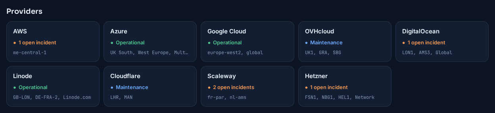

*One card per provider, with the regions it watches. During the run, Scaleway had two real open incidents in `fr-par`, Hetzner a real security advisory and router maintenance, and Cloudflare and OVHcloud real maintenance windows.*

---

## Choosing what you see

**Regions** come first, using each provider's own names. Codes match as whole words, so OVH's `GRA` finds `[GRA]` and `GRA11` but not the "gra" in "upgrade", Scaleway's `fr-par` also matches `fr-par-1`, and `NBG1` is not `NBG10`. On the Statuspage providers, regions are matched against the components an incident affects and its title, not its text, which tends to list every product the provider has. Azure names match exactly, so `West US` isn't `West US 2`. Every provider also takes `*` for everything it publishes.

Some notices name no region at all: a Hetzner advisory about a firmware flaw, or maintenance "on all of our core routers". Hetzner's categories, such as `Network`, can be watched like a region to catch those.

**Keywords** are an optional second filter over every provider. Entries that don't pass are never stored or sent anywhere.

---

## Incidents and maintenance

Each incident is shown with its state, provider, region, the provider's latest words on it, and how long it has lasted. Live incidents come first, then maintenance under way, then upcoming work with the soonest first, then everything that's over.

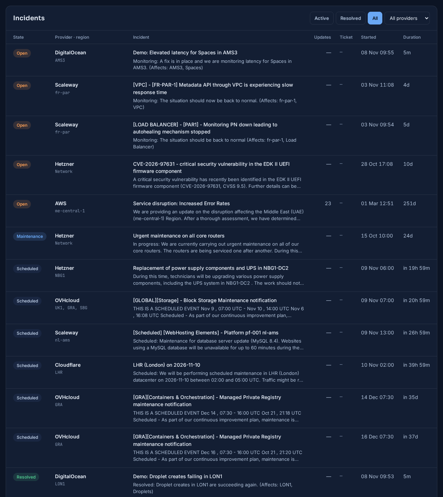

*All incidents during the run. The AWS row is the real UAE event, open for 251 days with 23 updates. Scheduled work shows when it starts, such as Hetzner's power work in NBG1-DC2. A resolved incident shows the provider's final word on it.*

Planned work is told apart from faults: from a Statuspage provider's maintenance list, from OVH's "scheduled event" marker, and from Hetzner's planned and in-progress labels or a start date in the future. Maintenance still gets a ticket, but by default no alerts.

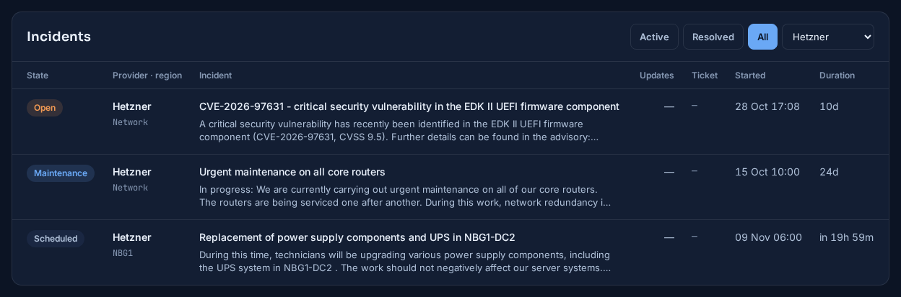

*Hetzner alone, with the provider filter on.*

---

## From a status feed to a ticket and an alert

Every five minutes by default, Skyfarer reads each provider's feed and compares it with what it already knows. A new incident in a watched region gets a ticket and an alert straight away. When the provider posts an update, the ticket gets it as a note, whichever provider it is: some publish each update as a new entry, others change the one entry in place, and Skyfarer notices both. An incident that was already over the first time Skyfarer saw it is recorded for history, without raising anything nobody needs to act on. When an open incident ends, a Zendesk ticket gets an internal note and moves to **pending**, so closing it stays a human decision; a ServiceNow record moves to **Resolved**, and the instance's own auto-close takes it from there; a Jira request is resolved through the workflow's own transition.

| Channel | What it sends |
|---|---|
| **Zendesk** | A ticket per incident with the provider, region, link and timeline; internal notes for updates; a note and pending status when it ends |
| **ServiceNow** | A record in the incident table through the Table API, with your assignment group, caller, category, impact and urgency; work notes for updates; Resolved with a close code when it ends |
| **Jira Service Management** | A request in a service desk, with your request type and fields; internal comments for updates; resolved through your workflow's transition when it ends |
| **PagerDuty** | An Events API v2 alert, which clears itself when the incident ends |
| **Pushover** | A push message to a phone, with a link to the status page; emergency priority repeats until someone acknowledges it |
| **Microsoft Teams** | An Adaptive Card posted to a channel through a Workflows webhook |
| **SNMP traps** | A v2c trap to each receiver, with a MIB file so they decode by name |
| **Webhooks** | As many as you need, each a request to its own URL, as a JSON document or a body of your own, optionally signed |

**Not everything should wake someone.** A status feed holds months of history and next month's maintenance, and a new install would otherwise page someone for all of it. So the ticketing systems record every incident, while the alert channels skip anything published more than 24 hours ago and all scheduled maintenance. Both rules are settings. In the run, none of the real incidents and maintenance notices in watched regions paged anyone, because all were older than a day or planned, while the two demo incidents, which were new, went to every channel.

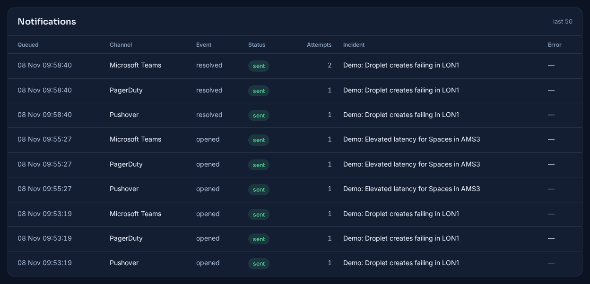

*Every notification of the run. When the LON1 demo incident ended, Teams answered `429 Too Many Requests`, and the notice went through on the next attempt about a minute later, while Pushover and PagerDuty had already delivered theirs. PagerDuty's all-clear reuses its alert's key, so the same alert closes.*

**ServiceNow** records carry a correlation ID, `skyfarer-<incident>`, so they can be found from the incident and matched by an instance's own dedup rules, and the dashboard links each incident to its record by number. In a test against a stand-in for the Table API, Skyfarer created nine records from the live feeds and the demo incidents, added the AWS event's 23 updates as one work note on a record created moments earlier in the same pass, and resolved the demo incident's record with its close code. It signs in as an integration user or with an OAuth token.

**Jira Service Management** was tested against a real Jira Cloud site with Atlassian's IT service management template. Skyfarer raised a request for each of the two demo incidents in the service project, as "Report a system problem", and when the LON1 incident ended it added an internal comment and moved the request to Completed through the workflow's Resolve transition. That real run also caught something no stand-in would have: Jira's Service Desk API offers an agent no transitions at all, because it lists only the ones a customer may make, so Skyfarer finds the transition through Jira's own issue API instead. A project key, request type or transition that doesn't exist fails with a list of the ones that do, so the test button tells you what to type.

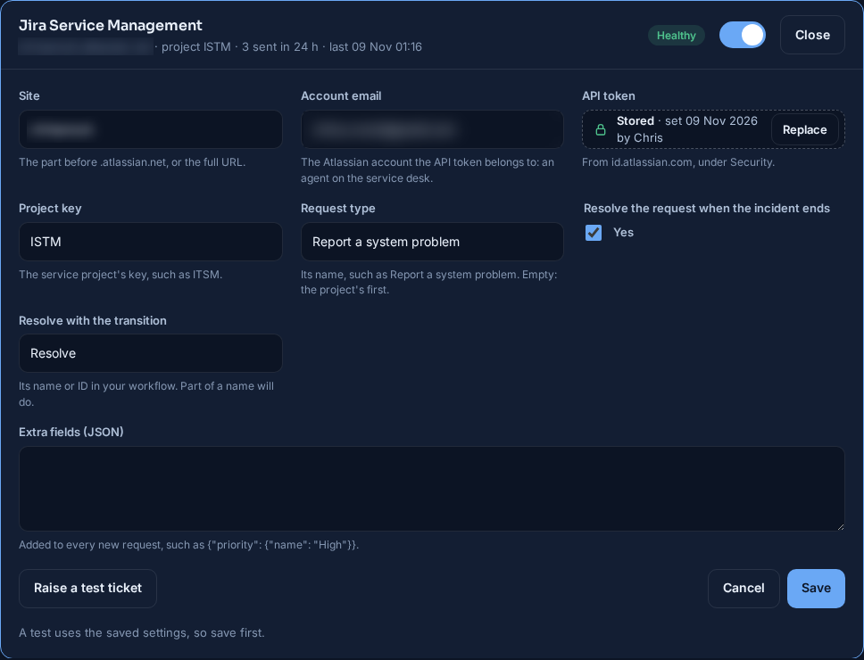

*The site name and account email are blurred.*

**Webhooks** cover everything else: a chat tool, an automation platform, an on-call service or a system of your own, as many as you need, each with its own events. By default a webhook sends every field as JSON; a template can reshape the body instead, and is checked when it's saved, so a typo in a field name or a template that wouldn't make valid JSON is refused with a message rather than failing later. With a Slack-style template, an incident opening and then closing sends bodies like these (an illustrative example, with a made-up incident link):

```json
{"text": "opened: [DigitalOcean] LON1 Droplet creates failing in LON1 https://status.digitalocean.com/incidents/abc123example", "incident": 48}
{"text": "resolved: [DigitalOcean] LON1 Droplet creates failing in LON1 https://status.digitalocean.com/incidents/abc123example", "incident": 48}
```

The incident number pairs an opening with its close. Each request can also carry headers such as an API key, and an HMAC-SHA256 signature of the body, so the receiver can check that it came from Skyfarer.

Each notice goes through a delivery queue: a poll records the incident and queues one notice per channel in the same database transaction, and sends them once that's committed. So each channel fails and retries alone, notices for one incident stay in order, and a cycle that fails partway can't raise a ticket and then forget it. Failures are treated the way each service asks: a `429` from PagerDuty or Teams is retried, while Pushover says never to repeat a 4xx, so that notice is marked failed and shown on the dashboard.

---

## The dashboard

The dashboard is a web page that refreshes every 30 seconds, for everyone who signs in. A viewer account sees this page and nothing else, so it's safe to leave on a wall screen or give to people who shouldn't be able to change anything. It opens in a dark theme; one button switches to light, and the browser remembers the choice.

Below the provider cards, a panel per notification channel shows whether it is healthy, retrying or failing, and a chart shows the last poll cycles, with failed ones marked.

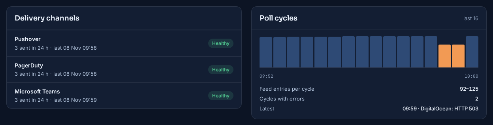

**A feed that can't be read is shown, not hidden.** During the run, DigitalOcean's feed was made to fail for 50 seconds. Its card said so, its open incident stayed open rather than being closed for lack of news, and the cycles were marked in the chart and the poll log. When the feed came back, nothing had been lost or duplicated.


Search covers titles, summaries, regions, providers and every stored update, not just the newest one. Incidents can be filtered by state and provider, and by Today, 7, 30 or 90 days, or a custom date range; the date filter applies to the notification and poll logs too.


*A search for `LON1` finds the demo incident and the real maintenance DigitalOcean has done there since last December, each with how long it took.*


The same page in the light theme, and on a phone, where the tiles and cards stack and the tables scroll sideways:

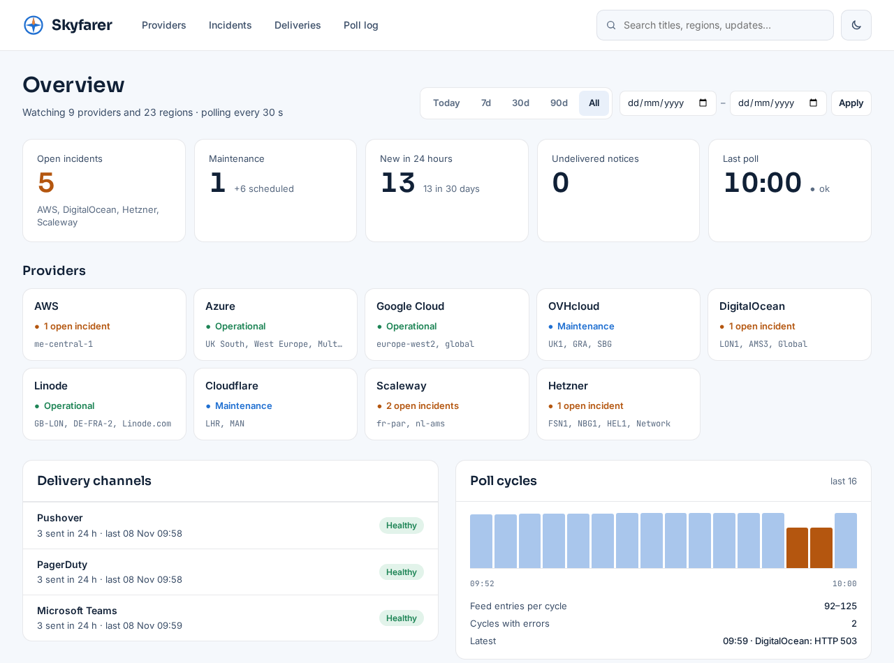

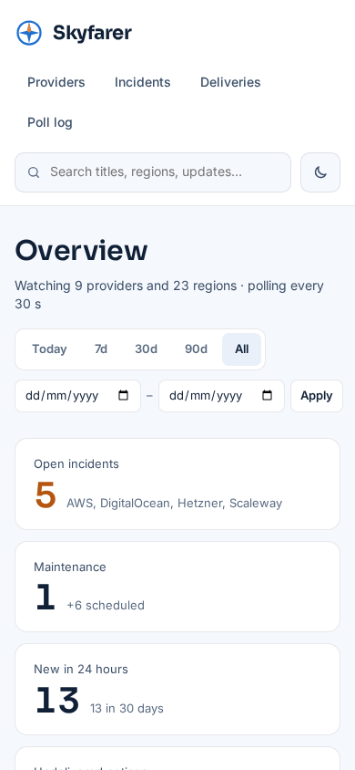

---

## Settings, sign-in and roles

Everything that decides what Skyfarer watches and where it sends things is set in the browser, under **Settings**, by an admin. Changes apply from the poller's next poll, without a restart. Only the secret key, the database connection and the dashboard's address stay in the `.env` file.

**The first start** imports whatever the `.env` file already had, then asks for the first admin account. That page wants a setup code that Skyfarer prints to its own log, so whoever happens to reach a new install first can't take it over.

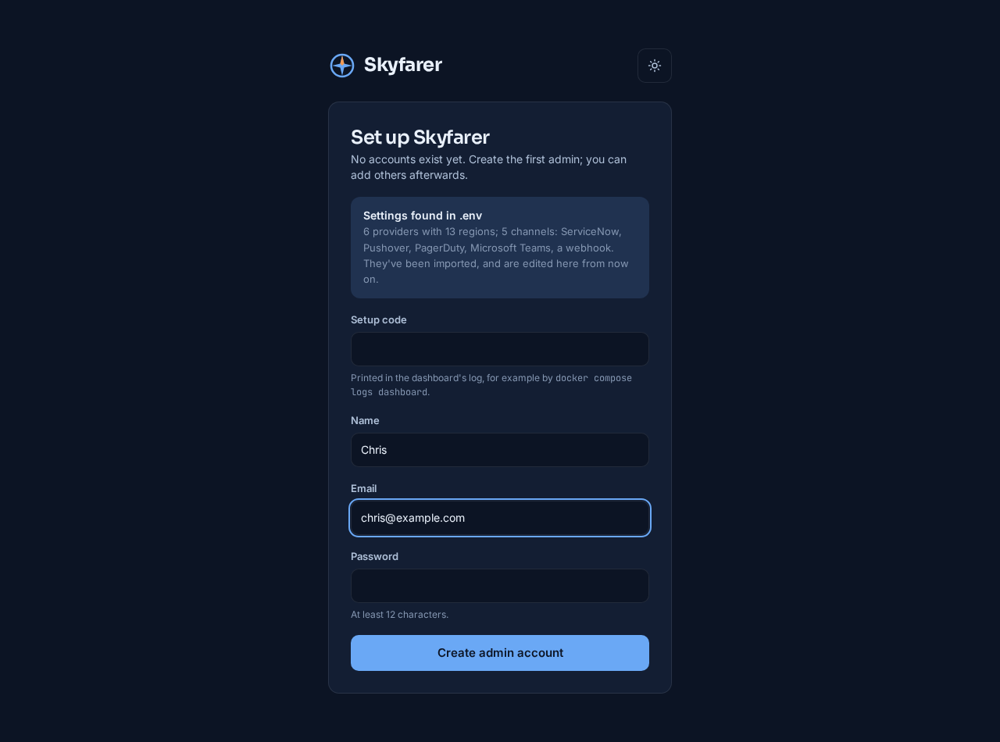

*The first start of the run: six providers with 13 regions and five channels came across from `.env`.*

**Providers and regions.** Each provider has a switch that stops it being read without forgetting its regions. Regions are tags, typed in or picked from suggestions in that provider's own naming, and the page also holds the keyword filter and how often to poll. Saving says exactly when the change will be used.

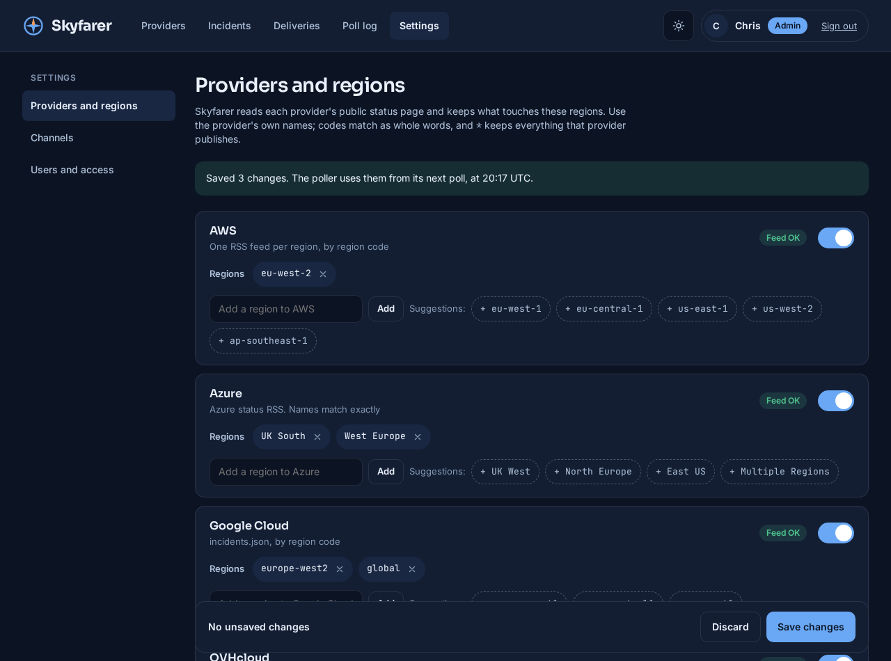

*After adding FRA1 to DigitalOcean, switching Scaleway on with `fr-par`, and removing HEL1 from Hetzner. The poller logged "Settings changed in the dashboard" on its next cycle and read Scaleway from then on.*

**Channels.** The alert rules come first: which events to send, how old is too old, how long to keep retrying, and whether maintenance counts. Then every channel has its own switch, status, editor and test button. A test uses the saved settings and does the real thing: a ServiceNow test creates a record and resolves it, a Jira test raises a request and resolves it, a Zendesk test opens a ticket and sets it to pending, a PagerDuty test triggers an alert and clears it.

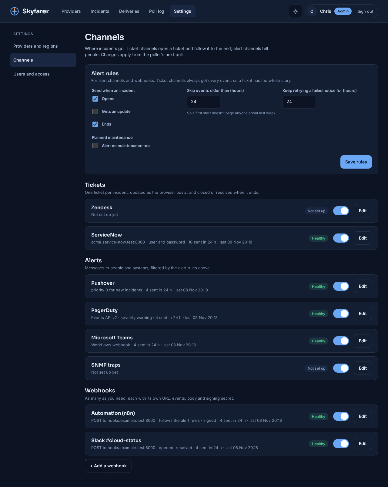

**Keys stay secret.** Passwords, tokens, routing keys, Teams' workflow URL and webhook headers are encrypted in the database and never shown again once saved. The editor says when and by whom each was set, and offers to replace or remove it. Settings are checked before they're saved: extra ServiceNow fields that aren't valid JSON, a webhook template with an unknown field, or a channel left half set up is refused with a message, and nothing changes.

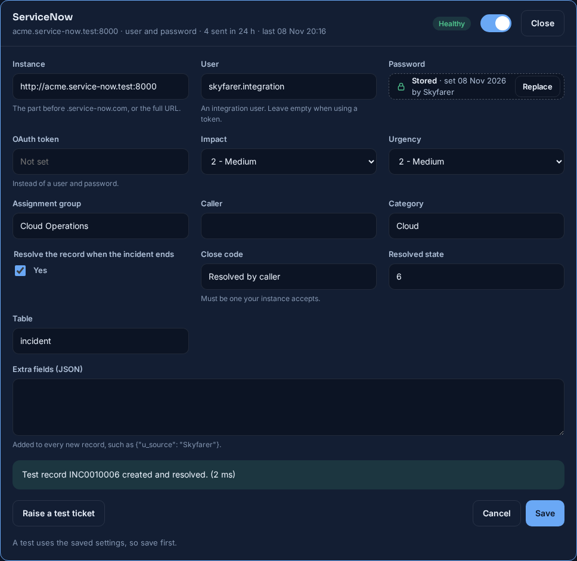

*Changing the assignment group, then raising a test ticket against the ServiceNow stand-in.*

**Webhooks** are added from the same page, each with its own URL, method, events, template, headers and signing secret, and each gets its own row in the dashboard's delivery health. In the run, a second webhook for a Slack-style channel was added in the browser; on the next demo incident both webhooks were called, the first with a signed JSON document and the second with its template, alongside ServiceNow, Pushover, PagerDuty and Teams.

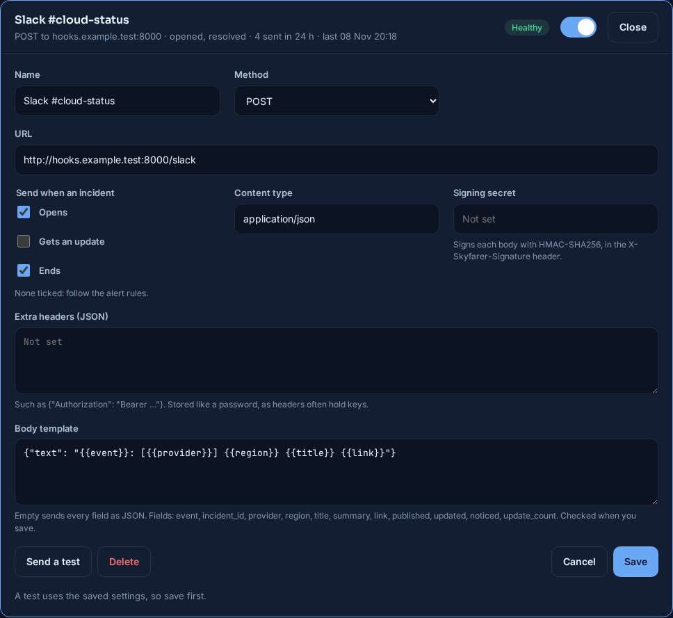

**People and roles.** Admins see and change everything; viewers see the dashboard and nothing under Settings, and the settings pages and actions refuse them even if they try the address directly. There's always at least one admin, and nobody can change their own role. Skyfarer sends no email, so adding someone gives the admin a one-time setup link to pass on; it works once, expires after 24 hours, and is also how a forgotten password is reset.

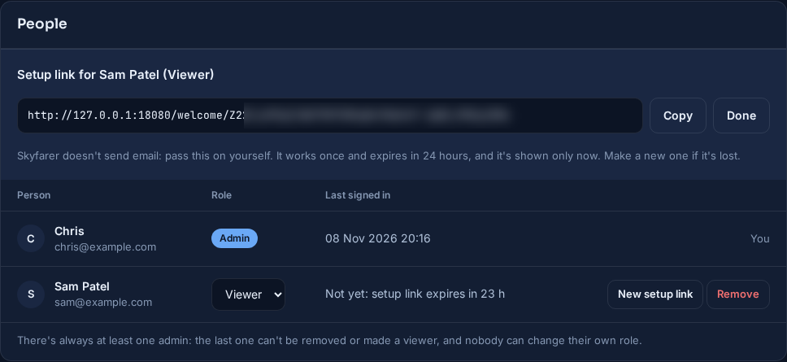

**Every change is recorded**, with who made it and when: regions added and removed, switches, field changes from one value to another, webhooks, and people. A secret change is recorded as "replaced", never with its value.

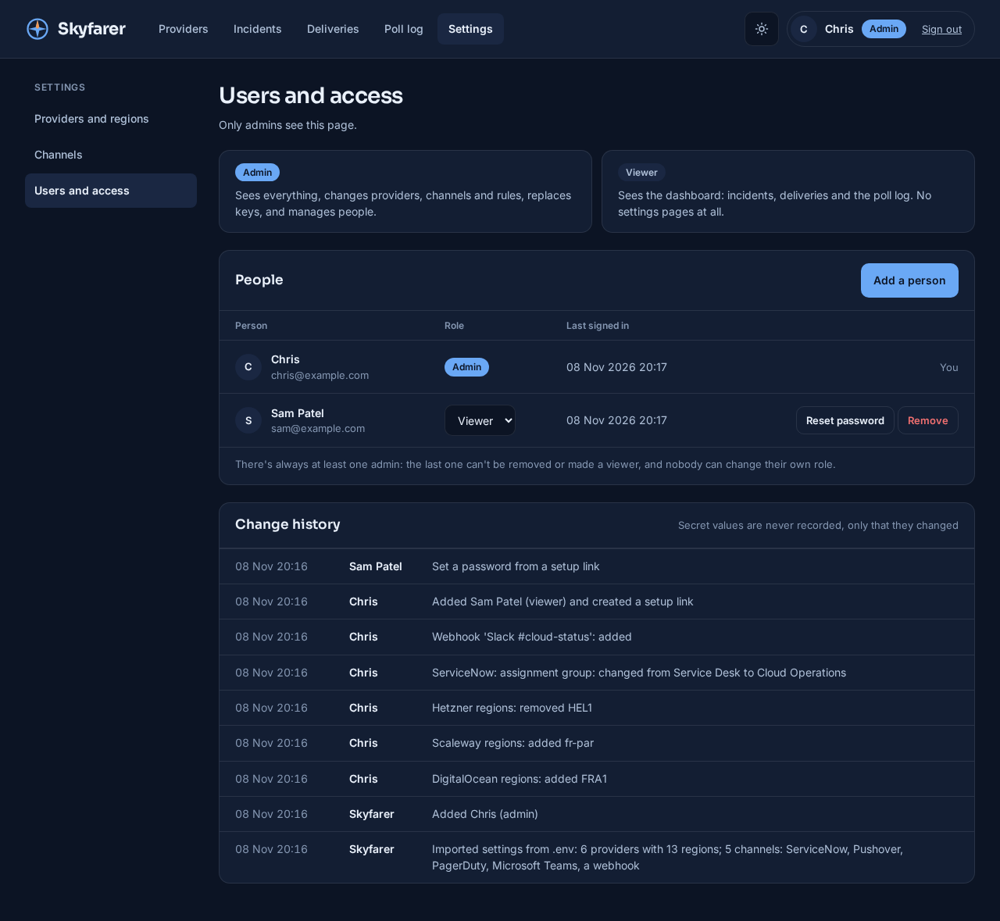

*The change history of the run, from the import on the first start to the viewer setting their password.*

A viewer signed in sees the same dashboard, without the Settings link:

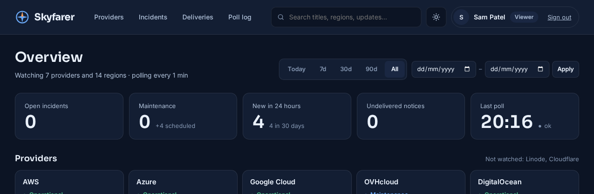

---

## Reporting

Everything is in PostgreSQL, so reporting is a SQL query. The feed's own timestamps are kept apart from the time Skyfarer stored each row, which separates how long an incident lasted from how long Skyfarer took to notice.

```sql
SELECT provider, AVG(resolved_at - detected_at) AS avg_resolve_time
  FROM incidents
 WHERE state = 'resolved' AND resolved_at > detected_at AND NOT is_maintenance
 GROUP BY provider;
```

---

## How it runs

Three containers under Docker or Podman Compose: PostgreSQL 16, the Python poller, and the Flask dashboard under gunicorn, which listens on localhost by default. A short `.env` file holds the secret key, the database connection and the dashboard's address; everything else, from regions to channel keys, is kept in the database with the incident history and undelivered notices, and survives restarts in a database volume. For checking a setup, `--dry-run` reads the feeds and logs what it would do without sending anything, and `--once` runs a single poll for use from cron.

A backup is a `pg_dump` of the database plus the secret key, kept apart. A restore was tested by wiping the database and loading the dump: incidents, settings, accounts and history came back, and the stored ServiceNow password still worked. Restoring with a different key brings everything back except the secrets, which are marked unreadable in Settings until entered again, and a webhook that has lost its signing secret is held back rather than sent unsigned.

---

## Status

A small working tool, written for one job. 94 unit tests cover each channel's messages against its published limits, which failures retry, delivery order and settings checks, region matching and parsing for the Statuspage and Hetzner feeds (using trimmed copies of real payloads), and how stored settings reach the poller, encryption of secrets, and the change history's wording.

The screenshots come from a run on 8 November 2026 with polls every 30 seconds instead of the default five minutes. All nine providers' feeds were live, and two scripted "Demo:" incidents were added to DigitalOcean's. Pushover, PagerDuty and Teams were stand-ins that recorded each request, set to refuse Teams for two minutes and to fail DigitalOcean's feed for 50 seconds. Zendesk was switched off for this run. An earlier run, on 4 November, covered Zendesk tickets, real SNMP traps decoded by `snmptrapd`, and five deliberate faults, including Zendesk refusing tickets and a database failure mid-poll, all recovered without lost or duplicated tickets. ServiceNow and the webhook were added afterwards and tested on their own run the same day, against a stand-in for the ServiceNow Table API and a receiver that checked every signature. The settings pages, sign-in and roles were tested on a third run that evening, driven through a real browser from the first start: the import, every settings page, refused bad values, tests through each stand-in channel, a second webhook receiving live notices, and a viewer refused by every settings page and action. Jira Service Management followed on 9 November, against a real Jira Cloud site. A run the same night, with eight providers' live feeds, checked updates from the providers that keep one ID per incident: a demo incident's update reached the ServiceNow stand-in as a work note on the next poll, and five polls over the real feeds' open incidents produced no false updates.

Some limits to know about:

- **Losing the only admin password needs the database.** Another admin can issue a setup link, but with a single admin there's no other way back in.
- **Keep the secret key.** Stored keys and passwords can't be decrypted without it; a lost key means entering them again.
- **Most channels haven't met the real services yet.** Jira Service Management has run against a real site; ServiceNow, PagerDuty, Pushover and Teams have only been tested against stand-ins. A ServiceNow close code must be one the instance accepts, and older instances use different ones.
- **Azure hasn't been tried on a live event.** Its feed has been empty whenever it was checked, so Azure handling is built from its published history and tested with scripted entries.
- **Events in the same region can merge.** AWS and Azure give no event ID in their feeds, so two separate events open in one region at the same time share one incident, one ticket and one alert.
- **Vultr isn't covered.** Its status page refuses automated requests.
- **An SNMP trap has no acknowledgement.** `sent` means it left the host, not that a receiver got it.
