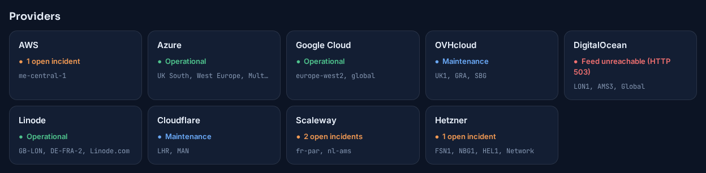
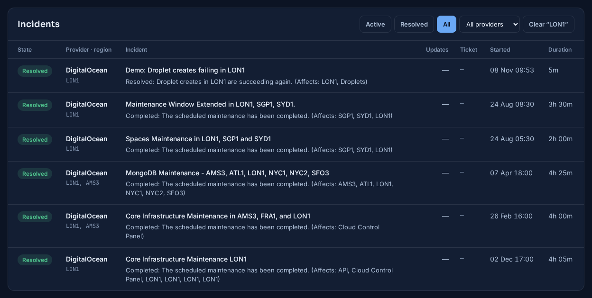
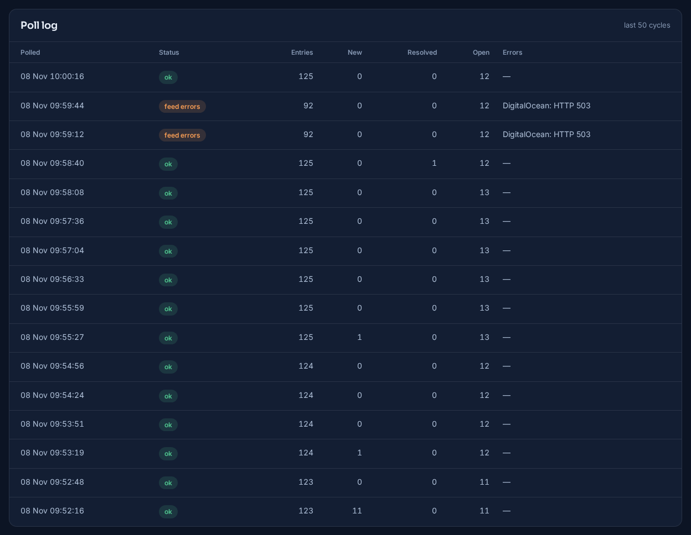

# Skyfarer

**A small service for support and operations teams that watches the public status pages of nine cloud providers, tells you when an incident or maintenance touches a region you run in, through Zendesk, PagerDuty, Pushover, Microsoft Teams or SNMP traps, and follows up when the provider says it's over.**

When a cloud provider has a problem, the first place to say so is usually its status page, and nobody is paid to sit and refresh nine of them. Customers notice first, or a support engineer finds out by chance. Each provider also publishes differently: one posts every update as a separate entry, another rewords its entries, others just remove them when the event ends. Skyfarer reads them all on a schedule, works out which incidents matter to you, and turns each one into a single ticket and alert, with a record of what happened and when.


*The dashboard during a run on 8 November 2026, with the live feeds of all nine providers. Everything on it is real except two DigitalOcean incidents marked "Demo:", which were scripted so that alerts could be sent and an incident could close during the run.*

---

## At a glance

| | |
|---|---|
| **Nine providers** | AWS, Azure, Google Cloud, OVHcloud, DigitalOcean, Linode, Cloudflare, Scaleway and Hetzner, each read in the way its feed needs; any of them can be switched off |
| **Filtering** | By region, using each provider's own names (`me-central-1`, `LON1`, `fr-par`, `FSN1`, `LHR`), and optionally by keyword |
| **Incidents and maintenance** | Faults and planned work are told apart, so maintenance is recorded without paging anyone |
| **Zendesk tickets** | One ticket per incident with the provider, region, link and timeline; moved to pending when the incident ends, for a person to close |
| **Alerts** | Pushover, PagerDuty, Microsoft Teams and SNMP traps, in any combination, with or without Zendesk; old events and planned maintenance don't interrupt anyone |
| **Failure handling** | Each channel fails and retries alone through a delivery queue; an unreadable feed closes nothing and shows on the dashboard |
| **Dashboard** | Read-only web view, dark by default with a light theme: provider and channel health, incidents, search, filters, and logs of every notification and poll |
| **History** | Every incident and update is kept in PostgreSQL, with the provider's own timestamps, ready for SQL reporting |

---

## Nine providers, six ways of publishing

The useful part of this project is the difference between the feeds. Treating them all the same produces wrong tickets, so each provider has its own rules, based on what its feed really publishes.

| Provider | Source | How one incident is recognised | How it knows the incident is over |
|---|---|---|---|
| **DigitalOcean, Linode, Cloudflare, Scaleway** | Statuspage JSON API: incidents and scheduled maintenance | One stable ID; the region is in the affected components (`LON1`, `fr-par-1`, `Newark - (EWR)`) | Status `resolved` or `postmortem`, or `completed` for maintenance |
| **OVHcloud** | Statuspage RSS history feed | One ID for the incident's whole life | The status word on the newest update: Resolved, Completed or Postmortem |
| **Hetzner** | Atom feed of current and upcoming notices | The notice's ID, without the update counter Hetzner adds to it | The newest update says Resolved or Completed, or the notice leaves the feed |
| **AWS** | One RSS feed per region | Every update is a separate entry, so entries in a region belong to the open incident until one resolves it | `[RESOLVED]` or "Service is operating normally" in the title |
| **Azure** | RSS feed of events in progress | Titles get reworded, so any change counts as an update to the open incident in that region | A title starting "Mitigated" or "Resolved", or the event leaving the feed |
| **Google Cloud** | Structured `incidents.json` | One stable ID | The incident has an end time |

AWS shows why this matters. Its real feed for the Middle East (UAE) region holds 24 entries about one event that began on 1 March 2026, and Skyfarer turns them into one incident and one ticket with 23 updates added as internal notes. Its text also can't be trusted for keywords: a real update says power "has not yet been restored", which is not a resolution, so Skyfarer only looks at the provider's own markers.

Azure and Hetzner only list what is happening now, so an event can end by disappearing. That check needs a successful read of the feed, so a network failure can't close every open incident at once.


*One card per provider, with the regions it watches. During the run, Scaleway had two real open incidents in `fr-par`, Hetzner a real security advisory and router maintenance, and Cloudflare and OVHcloud real maintenance windows.*

---

## Choosing what you see

**Regions** come first, using each provider's own names. Codes match as whole words, so OVH's `GRA` finds `[GRA]` and `GRA11` but not the "gra" in "upgrade", Scaleway's `fr-par` also matches `fr-par-1`, and `NBG1` is not `NBG10`. On the Statuspage providers, regions are matched against the components an incident affects and its title, not its text, which tends to list every product the provider has. Azure names match exactly, so `West US` isn't `West US 2`. Every provider also takes `*` for everything it publishes.

Some notices name no region at all: a Hetzner advisory about a firmware flaw, or maintenance "on all of our core routers". Hetzner's categories, such as `Network`, can be watched like a region to catch those.

**Keywords** are an optional second filter over every provider. Entries that don't pass are never stored or sent anywhere.

---

## Incidents and maintenance

Each incident is shown with its state, provider, region, the provider's latest words on it, and how long it has lasted. Live incidents come first, then maintenance under way, then upcoming work with the soonest first, then everything that's over.


*All incidents during the run. The AWS row is the real UAE event, open for 251 days with 23 updates. Scheduled work shows when it starts, such as Hetzner's power work in NBG1-DC2. A resolved incident shows the provider's final word on it.*

Planned work is told apart from faults: from a Statuspage provider's maintenance list, from OVH's "scheduled event" marker, and from Hetzner's planned and in-progress labels or a start date in the future. Maintenance still gets a Zendesk ticket, but by default no alerts.


*Hetzner alone, with the provider filter on.*

---

## From a status feed to a ticket and an alert

Every five minutes by default, Skyfarer reads each provider's feed and compares it with what it already knows. A new incident in a watched region gets a Zendesk ticket and an alert straight away. An incident that was already over the first time Skyfarer saw it is recorded for history, without raising anything nobody needs to act on. When an open incident ends, the ticket gets an internal note and moves to **pending**, and closing it stays a human decision.

| Channel | What it sends |
|---|---|
| **Zendesk** | A ticket per incident with the provider, region, link and timeline; a note and pending status when it ends |
| **PagerDuty** | An Events API v2 alert, which clears itself when the incident ends |
| **Pushover** | A push message to a phone, with a link to the status page; emergency priority repeats until someone acknowledges it |
| **Microsoft Teams** | An Adaptive Card posted to a channel through a Workflows webhook |
| **SNMP traps** | A v2c trap to each receiver, with a MIB file so they decode by name |

**Not everything should wake someone.** A status feed holds months of history and next month's maintenance, and a new install would otherwise page someone for all of it. So Zendesk records every incident, while the alert channels skip anything published more than 24 hours ago and all scheduled maintenance. Both rules are settings. In the run, none of the real incidents and maintenance notices in watched regions paged anyone, because all were older than a day or planned, while the two demo incidents, which were new, went to every channel.


*Every notification of the run. When the LON1 demo incident ended, Teams answered `429 Too Many Requests`, and the notice went through on the next attempt about a minute later, while Pushover and PagerDuty had already delivered theirs. PagerDuty's all-clear reuses its alert's key, so the same alert closes.*

Each notice goes through a delivery queue: a poll records the incident and queues one notice per channel in the same database transaction, and sends them once that's committed. So each channel fails and retries alone, notices for one incident stay in order, and a cycle that fails partway can't raise a ticket and then forget it. Failures are treated the way each service asks: a `429` from PagerDuty or Teams is retried, while Pushover says never to repeat a 4xx, so that notice is marked failed and shown on the dashboard.

---

## The dashboard

The dashboard is a read-only web page that refreshes every 30 seconds. It runs only `SELECT` queries, so it's safe to leave on a wall screen or give to people who shouldn't be able to change anything. It opens in a dark theme; one button switches to light, and the browser remembers the choice.

Below the provider cards, a panel per notification channel shows whether it is healthy, retrying or failing, and a chart shows the last poll cycles, with failed ones marked.


**A feed that can't be read is shown, not hidden.** During the run, DigitalOcean's feed was made to fail for 50 seconds. Its card said so, its open incident stayed open rather than being closed for lack of news, and the cycles were marked in the chart and the poll log. When the feed came back, nothing had been lost or duplicated.



Search covers titles, summaries, regions, providers and every stored update, not just the newest one. Incidents can be filtered by state and provider, and by Today, 7, 30 or 90 days, or a custom date range; the date filter applies to the notification and poll logs too.



*A search for `LON1` finds the demo incident and the real maintenance DigitalOcean has done there since last December, each with how long it took.*



The same page in the light theme, and on a phone, where the tiles and cards stack and the tables scroll sideways:


---

## Reporting

Everything is in PostgreSQL, so reporting is a SQL query. The feed's own timestamps are kept apart from the time Skyfarer stored each row, which separates how long an incident lasted from how long Skyfarer took to notice.

```sql
SELECT provider, AVG(resolved_at - detected_at) AS avg_resolve_time
  FROM incidents
 WHERE state = 'resolved' AND resolved_at > detected_at AND NOT is_maintenance
 GROUP BY provider;
```

---

## How it runs

Three containers under Docker or Podman Compose: PostgreSQL 16, the Python poller, and the Flask dashboard, which listens on localhost by default. Settings live in one `.env` file, with the notification channels, regions per provider, keywords and the poll interval, and incident history and undelivered notices survive restarts in a database volume. For checking a setup, `--dry-run` reads the feeds and logs what it would do without sending anything, and `--once` runs a single poll for use from cron.

---

## Status

A small working tool, written for one job. 45 unit tests cover each channel's messages against its published limits, which failures retry, delivery order and startup checks, plus region matching and parsing for the Statuspage and Hetzner feeds, using trimmed copies of real payloads.

The screenshots come from a run on 8 November 2026 with polls every 30 seconds instead of the default five minutes. All nine providers' feeds were live, and two scripted "Demo:" incidents were added to DigitalOcean's. Pushover, PagerDuty and Teams were stand-ins that recorded each request, set to refuse Teams for two minutes and to fail DigitalOcean's feed for 50 seconds. Zendesk was switched off for this run. An earlier run, on 4 November, covered Zendesk tickets, real SNMP traps decoded by `snmptrapd`, and five deliberate faults, including Zendesk refusing tickets and a database failure mid-poll, all recovered without lost or duplicated tickets.

Some limits to know about:

- **The alert channels haven't met the real services yet.** PagerDuty, Pushover and Teams have only been tested against stand-ins.
- **Only AWS and Azure updates are passed on.** For providers with a stable incident ID, a new update on an open incident shows on the dashboard when it ends, but sends no Zendesk note or alert until then.
- **Azure hasn't been tried on a live event.** Its feed has been empty whenever it was checked, so Azure handling is built from its published history and tested with scripted entries.
- **Events in the same region can merge.** AWS and Azure give no event ID in their feeds, so two separate events open in one region at the same time share one incident, one ticket and one alert.
- **Vultr isn't covered.** Its status page refuses automated requests.
- **An SNMP trap has no acknowledgement.** `sent` means it left the host, not that a receiver got it.
