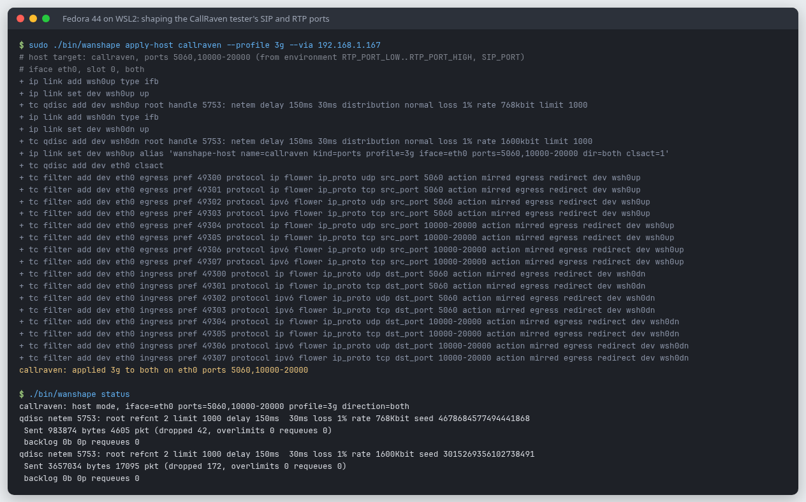
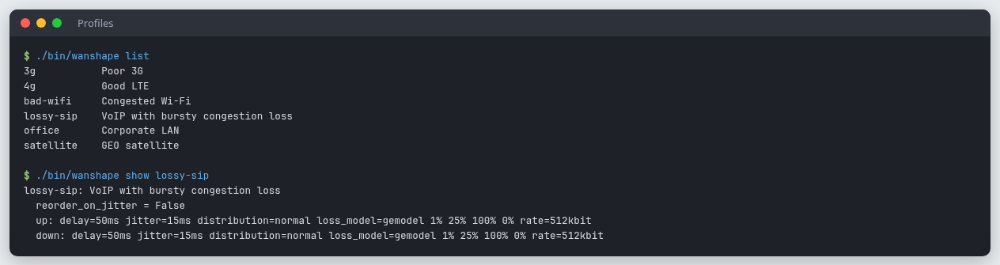
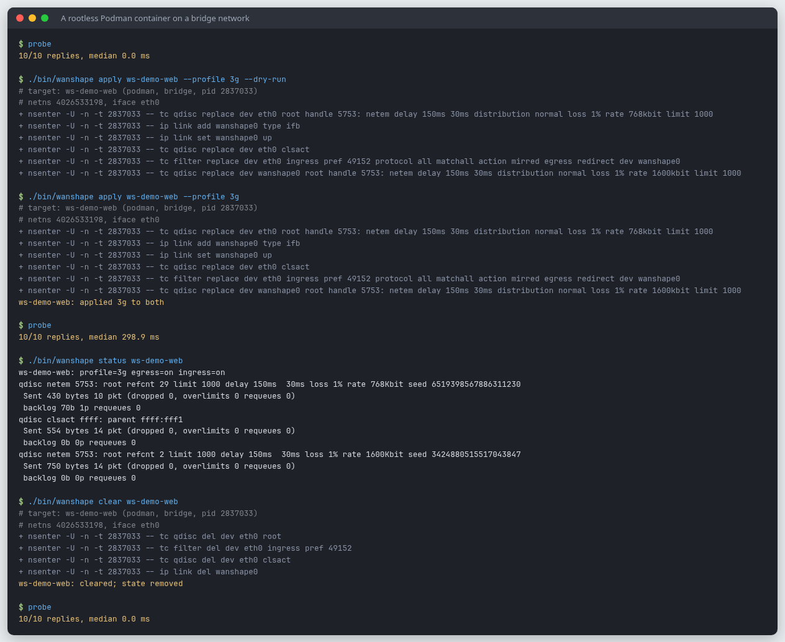
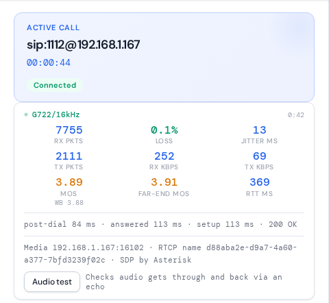
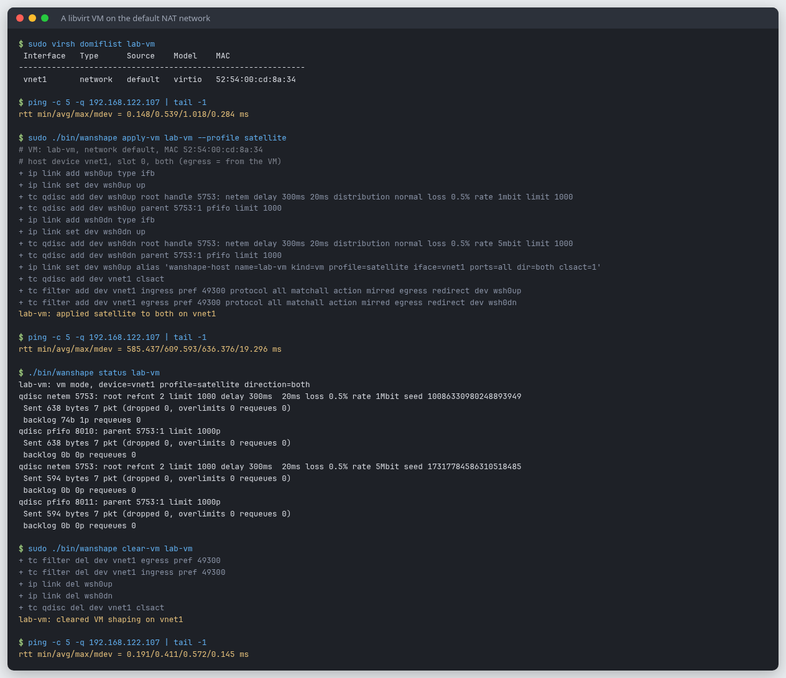

# wanshape

**A command-line tool that makes one container, one set of ports, or one virtual machine behave as if it were on a bad network: added delay, jitter, packet loss (including the bursty kind that hurts voice calls) and a bandwidth cap, while everything else on the machine carries on as normal.**

Software that talks over a network gets tested on a fast, clean one, then shipped to people on hotel Wi-Fi, 4G in a moving car and satellite links. Linux has had the tools to fake bad networks for years (`tc` and `netem`), but pointing them at exactly one container or VM is fiddly. Rootless containers have no network device on the host to attach to. Containers on host networking share the host's interface with everything else. Incoming traffic needs a second, redirected path. One mistake and you've slowed down the whole machine. wanshape does all of that in one command, shows you exactly what it will change before it does, and removes all of it again afterwards.

*A 3G profile (150 ms each way, 30 ms jitter, 1% loss, 768/1600 kbit/s) on the ports of a CallRaven softphone that uses host networking. Each change is printed as it's made. After one call, `status` shows what happened: 4,605 packets out and 17,095 in went through the delay, and 42 and 172 were dropped as loss.*

---

## At a glance

| | |
|---|---|
| **Containers** | Podman or Docker containers with their own network (bridge, pasta, slirp4netns), including rootless ones, without root and without changing the image |
| **Host-network containers and ports** | Shape just the ports a service uses, UDP and TCP, IPv4 and IPv6, while the rest of the host's traffic is untouched |
| **Virtual machines** | libvirt VMs on a NAT or bridged network, found by name |
| **Profiles** | Six built-in network conditions from office LAN to geostationary satellite, bursty VoIP loss included, plus your own in a TOML file |
| **Safe by design** | Dry runs, refusal to overwrite other tools' settings, the live kernel as the only state, and clean removal checked by tests |

One Python package with no dependencies. It runs on Linux, including Fedora under WSL2.

---

## Network conditions as profiles

A profile describes the link in each direction: delay, jitter and its distribution, packet loss (random, or the bursty Gilbert-Elliott model where losses come in clusters, as they do on a congested link), and a bandwidth cap. Delay is one-way, so the `3g` profile's 150 ms in each direction adds about 300 ms to a round trip.

The built-ins are `office`, `4g`, `3g`, `satellite`, `bad-wifi` and `lossy-sip`. Your own go in `~/.config/wanshape/profiles.toml`, or you give the settings on the command line (`--delay 80ms --jitter 20ms --loss 2%`). A profile also says whether jitter may reorder packets. On a real mobile link it does; for testing a VoIP jitter buffer you may want delay variation without reordering, and you can choose either.

---

## One container, not the whole machine

`wanshape apply <container>` goes into the container's own network namespace from outside and adds the impairment there. It uses the host's `tc`, so the container image needs no extra tools and the container needs no extra permissions. For your own rootless containers it doesn't need root either: it enters the container's user namespace as its owner.

*A real run on two throwaway containers on a Podman bridge network. `probe` sends ten UDP echoes from one container to the other. The round trip goes from 0.0 ms to 298.9 ms under `3g`, and back to 0.0 ms after `clear`.*

Both directions are shaped: outgoing traffic directly, and incoming traffic by redirecting it through a small virtual device. wanshape works out the container's interface from its routing table, because rootless Podman's default network names the interface after the host's (`wlp0s20f3`, not `eth0`). `--dry-run` prints exactly the commands it would run. `status` reads the live state from the kernel, with packet and drop counters.

---

## Host-network containers, by port

A container on host networking has no network of its own, so there's nothing to attach to per container. `wanshape apply-host` matches the service's traffic by the local ports it uses instead, on whichever host interface carries it (`--via` picks the one that routes to a given address, such as the phone system). Only matching packets are delayed. The rest of the host's traffic isn't queued any differently, because the interface's main queue is never replaced.

Give it a container name and it reads the ports from the container itself: a `wanshape.ports` label, or the usual `SIP_PORT` and `RTP_PORT_LOW`/`RTP_PORT_HIGH` style of variables. Or give the ports directly with `--ports 5060,10000-20000`, for any service at all. Two targets whose ports overlap are refused rather than left to fight.

This is the mode wanshape was built for: testing call quality with [CallRaven](../callraven/README.md), a softphone container that runs on host networking. Here it is during a call through FreePBX with the `3g` profile on its ports:

*44 seconds into a G.722 call to an extension that echoes the audio back: the round trip is 369 ms and the estimated MOS has dropped to 3.89.*

The same calls with and without shaping, on the same machine, figures from CallRaven:

| | Round trip (RTCP) | Echoed audio round trip | Jitter | MOS |
|---|---|---|---|---|
| No shaping | 1 ms | 4 ms | 6 ms | 4.37 |
| `3g` | 356 ms | 367 ms | 13 ms | 3.91 |
| `lossy-sip` | 120 ms | 123 ms | 13 ms | 4.17 |
| After `clear-host` | 4 ms | 5 ms | 7 ms | 4.37 |

---

## Virtual machines

`wanshape apply-vm <name>` shapes everything a libvirt VM sends and receives on one network interface. It asks libvirt which host device belongs to the VM, then checks that device's hardware address against the one libvirt gives that VM. A device name reused by another VM therefore can't send the impairment to the wrong place.

*A throwaway VM on libvirt's default NAT network. The `satellite` profile (300 ms each way) takes a ping from 0.5 ms to 610 ms, and `clear-vm` takes it back to 0.4 ms.*

When a VM restarts, libvirt recreates its network device, often under a new name, and the shaping goes with it. `status` marks the target as stale, and applying again moves the shaping to the new device. If the VM already has a bandwidth limit set in libvirt, wanshape says so and stops, rather than breaking it.

---

## Safe to point at a real machine

- **Dry run first.** Every mode prints the exact commands before running them, and `--dry-run` stops there.
- **It won't take over someone else's setup.** If another tool already has a queue or filter where wanshape would go, it refuses and says what it found. For containers, `--force` replaces it on purpose.
- **The kernel is the record.** wanshape tags everything it creates, so `status` and `clear` work from what is really there, not from a file that could be out of date. Host and VM targets keep their settings on the kernel devices themselves, readable without root.
- **It cleans up after itself.** A host or VM apply that fails halfway is rolled back. A container apply that fails halfway says exactly what is still active. `clear` removes only what wanshape added, and the tests check that nothing is left behind.
- **Clear exit codes for scripts:** unsupported target, missing prerequisite or root, or a conflict, each with its own code.

---

## How it runs

Clone the repository and run `./bin/wanshape`, or install it with pip. It needs Python 3.11, `iproute2` and the kernel's netem modules (present in Fedora and in Microsoft's WSL2 kernel; `wanshape doctor` checks). Containers you own need no privileges. Host-port and VM shaping change the host's own interfaces, so they run with `sudo`.

## Status

An early but working tool (v0.3), built in November 2026 and used on real calls.

- **Tests:** 68 unit tests, plus four end-to-end tests that measure real round trips with and without shaping: rootless Podman containers (bridge, pasta and user-namespace variants), host ports in a private network namespace, a KVM virtual machine, and the live CallRaven calls above. The unit, container and host-port tests pass on both Fedora and WSL2. The VM test ran on Fedora, and VM mode was also run on real libvirt VMs under WSL2.
- **Not done yet**, each tracked as an issue:
  - VMs attached directly to a network card (macvtap)
  - measuring VM-to-VM traffic
  - re-applying automatically when a VM restarts
  - testing with Docker, which is supported in the code but hasn't been tried
  - a time limit that clears the shaping by itself

Source and documentation: [github.com/chrisnock-personal/wanshape](https://github.com/chrisnock-personal/wanshape).
